# Wire Pay — 決済管理ダッシュボード

[](https://github.com/Atsushi-Odajima/Payment-management/actions/workflows/ci.yml)
[](./LICENSE)


日本語 | [English](#english)

小規模ECストア向けに、複数の決済手段（クレジット / QR / コンビニ / 銀行振込 / その他Web決済）の **接続・認証情報の保管・決済ライフサイクル（与信 → 売上確定 → 返金）** を一画面で管理するダッシュボードです。

**🔗 ライブデモ: <https://payment-management-green.vercel.app>**
デモモードで動作し、外部の決済APIは呼び出しません。接続テストは入力の妥当性のみ検証し、決済は自由に作成・確定・取消・返金できます（データは毎日リセット）。ログイン画面にデモ用パスワードを表示しています。

<p align="center">
  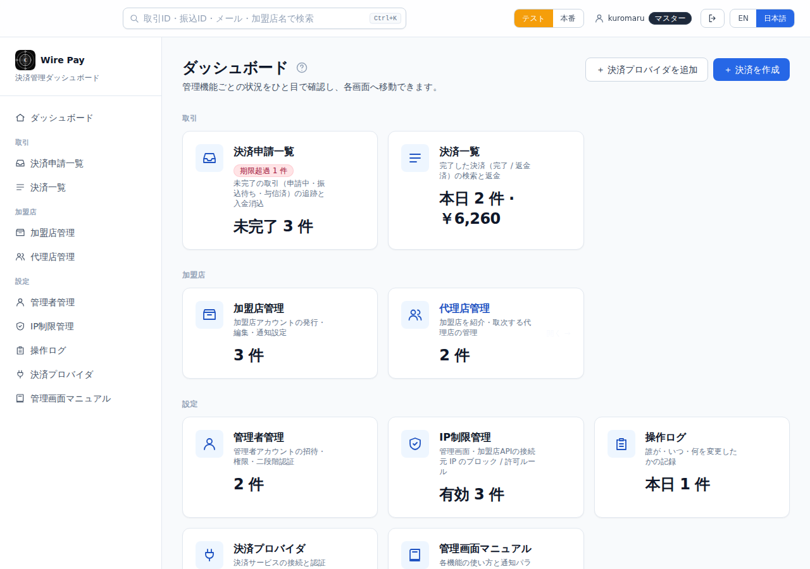
  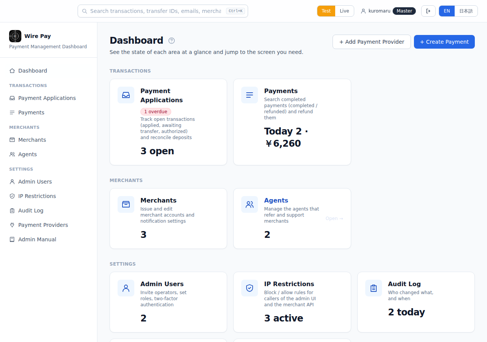
</p>
<p align="center">
  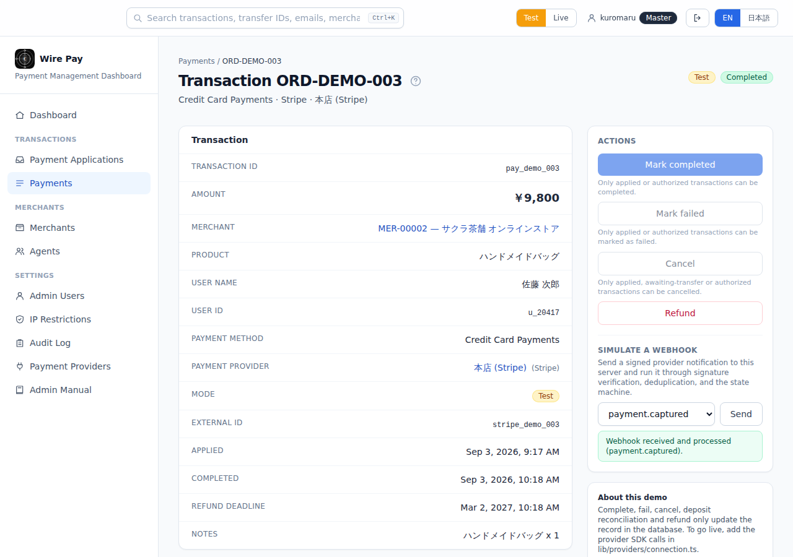
  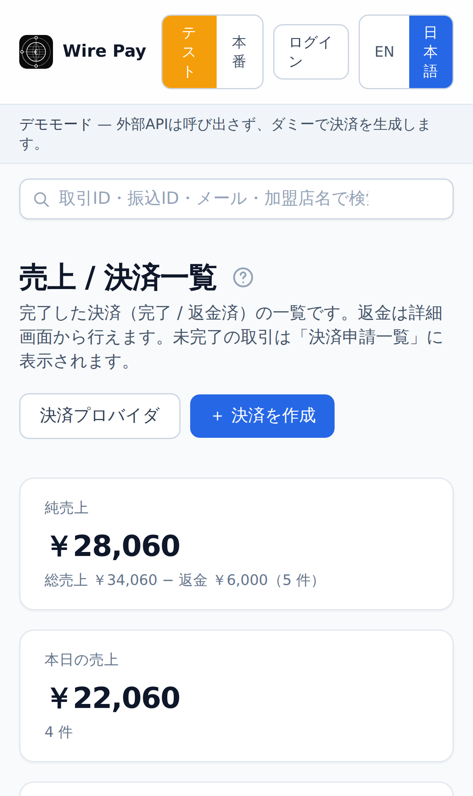
</p>
<p align="center">
  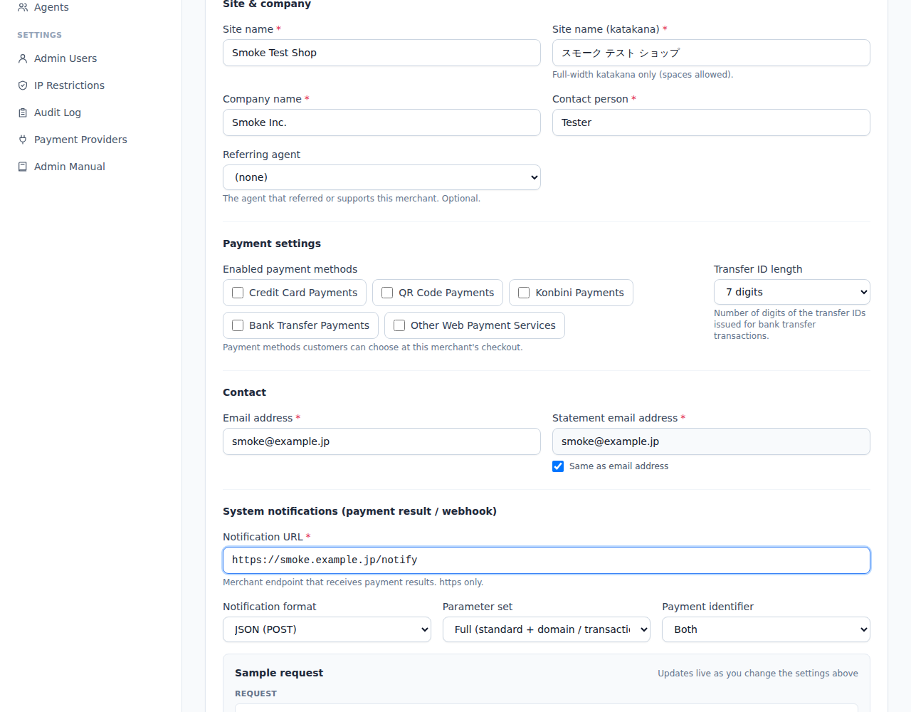
  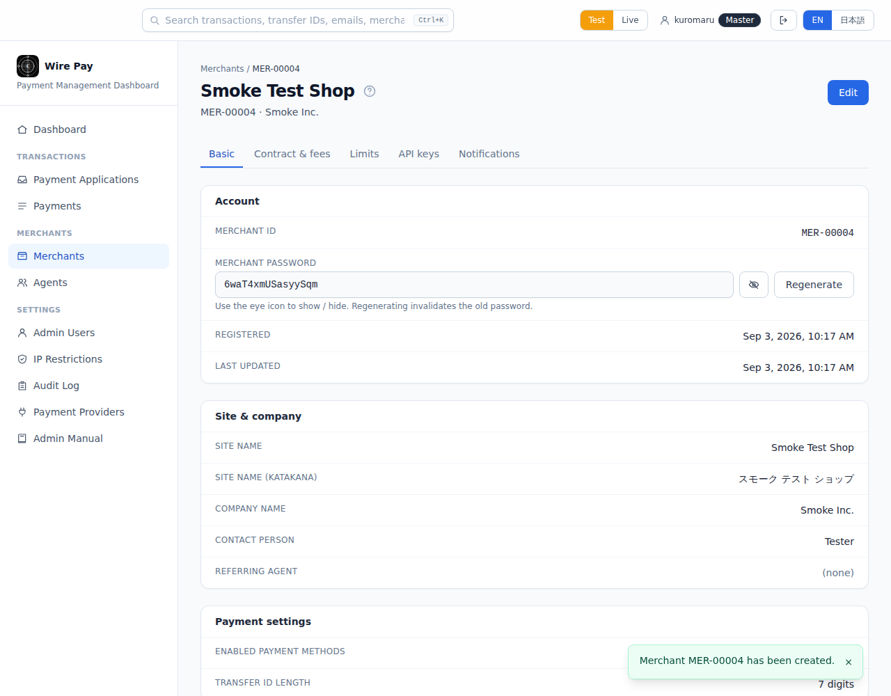
</p>
<p align="center">
  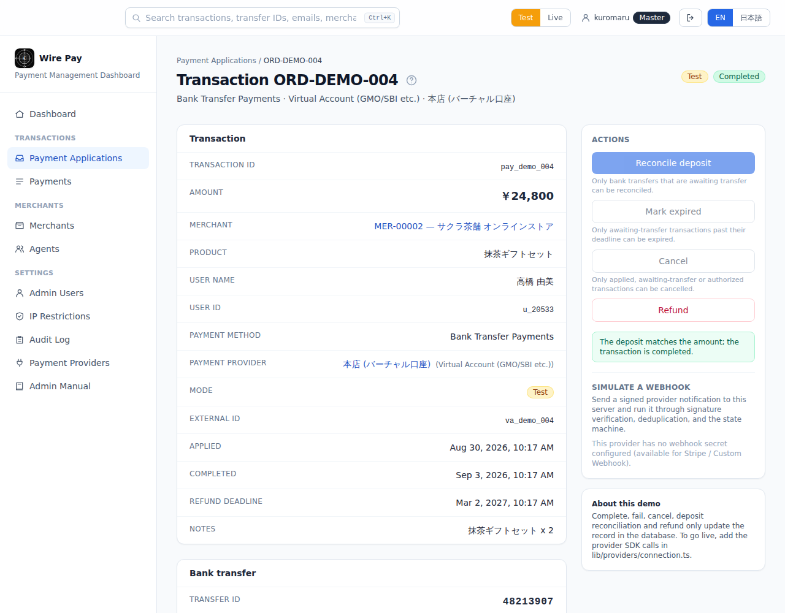
  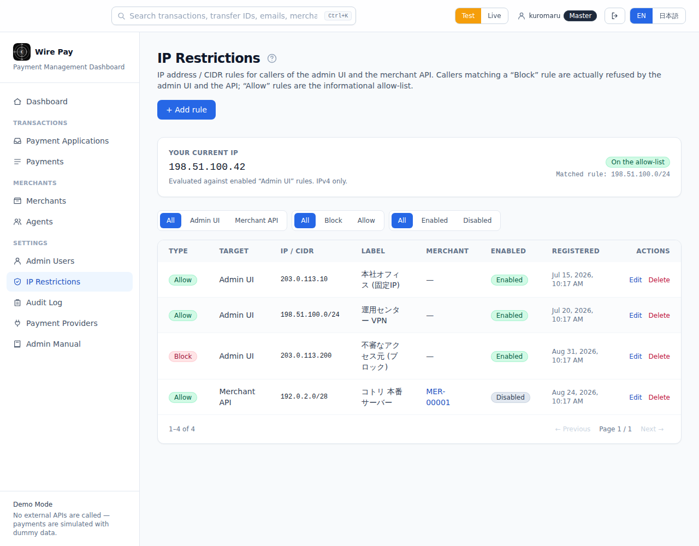
</p>
<p align="center">
  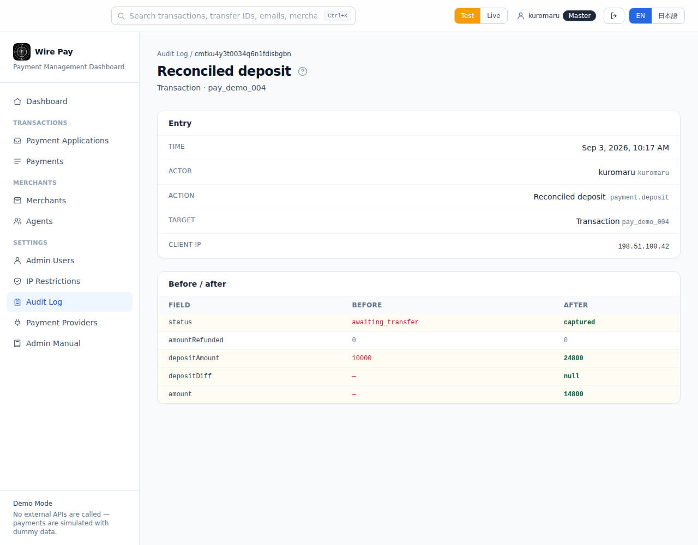
  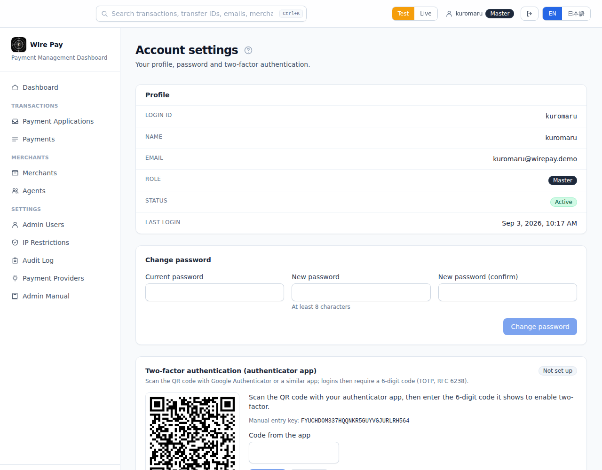
</p>
<p align="center">
  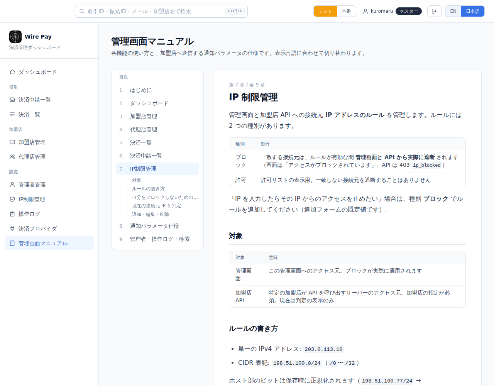
  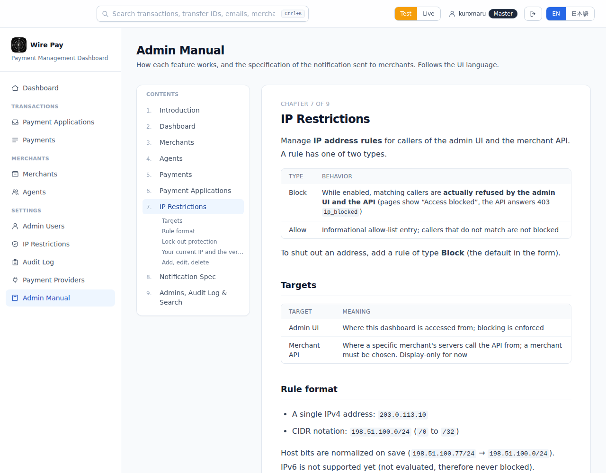
</p>

## 主な機能

- **決済プロバイダ接続フロー** — カテゴリ → サービス → 認証情報の3ステップ。対応: Stripe / Square / GMO PG / PayPay / au PAY / 楽天ペイ / d払い / ビットキャッシュ / スマートピット / Webコンビニ / ペイジー / バーチャル口座 / カスタムWebhook（[`lib/providers/registry.ts`](./lib/providers/registry.ts) にデータとして定義。フォーム・必須チェック・暗号化対象・マスク表示が全て定義から派生）
- **認証情報の暗号化保存** — シークレットはフィールド単位で AES-256-GCM 暗号化。管理画面では末尾4文字のみ表示。鍵は本番で未設定なら起動しない（fail-closed）。鍵を変更しても 500 にならず「再入力が必要」と案内
- **取引のライフサイクル** — 加盟店サイトで決済方法が選ばれた時点の取引（決済申請）を 申請中 / 振込待ち / 与信済 → 完了 → 返金済 で管理。**決済申請一覧**（未完了）と **決済一覧**（完了・返金済）は同じテーブルのフィルタ違い。**一部返金**対応、状態遷移は1つの遷移表に集約し、更新は status 条件付きの `updateMany` で**アトミック**（二重返金・二重消込が構造的に通らない）
- **冪等キー** — 決済作成 API は `Idempotency-Key` ヘッダを受け、同じキーの再送には同じ結果を返す
- **監査ログ（PaymentEvent）** — 誰が（ダッシュボード / Webhook）いつ何をしたかを追記専用で記録し、詳細画面にタイムライン表示
- **Webhook 受信** — Stripe 互換の HMAC-SHA256 署名検証（timestamp tolerance 付き）と、イベントIDによる重複排除。詳細画面から署名付き Webhook を自サーバーに送って挙動を確認できる
- **管理者アカウント + 二段階認証 + CSRF + レートリミット + セキュリティヘッダ** — 管理者は `AdminUser`（ログインID + scrypt パスワード、TOTP / RFC 6238 の二段階認証、マスター / 一般ロール、招待・仮パスワード再発行・最後のマスター保護）。更新操作はセッション必須、Origin 検証と `X-Requested-With`、IP 単位の rate limit、CSP / HSTS / frame-ancestors
- **操作ログ（監査）** — 誰が・いつ・何を・何に対して・どこから変更したかを変更前後の JSON とともに記録。操作者 / 操作種別 / 対象 / 期間で絞り込み、差分表示、CSV 出力
- **横断検索** — ヘッダーの検索ボックス（Ctrl+K）で取引ID・注文番号・振込ID・メール・加盟店・代理店・管理者をまとめて検索
- **グループ化ナビ** — 取引 / 加盟店 / 精算 / リスク / レポート / 配信 / 設定のグループを `lib/nav.ts` で一元定義し、サイドバー・トップカード・モバイルタブを生成（未実装フェーズは非表示）
- **日本語 / 英語** — ヘッダーの「EN / 日本語」トグル。cookie + localStorage に保存し、SSR から正しい言語で描画。APIのエラー文言も翻訳。通貨は JPY 固定、時刻は Asia/Tokyo 固定
- **テスト / 本番モード** — プロバイダのモードを決済に `livemode` としてスナップショット。ヘッダーの Stripe 風スイッチ（Cookie 保存）でダッシュボード・一覧・限度額の利用状況が参照するモードを切替
- **加盟店の契約・限度額・APIキー** — 加盟店詳細をタブ化（基本情報 / 契約・手数料 / 限度額 / APIキー / 通知設定）。契約プラン（スタンダード / プレミアム / カスタム）と決済手段ごとの料率を **適用開始日付きの履歴** で管理、決済手段ごとの 1 回 / 1 日 / 1 か月の **限度額**（超過する取引は失敗理由付きで記録、利用状況ゲージ）、加盟店ごとの **振込期限**（期限超過は毎時の Cron で期限切れ）と **返金可能期限**、SHA-256 ハッシュ保存の **API キー / 署名シークレット**（1 回だけ平文表示・猶予期間付きローテーション・失効・`GET /api/merchant-api/ping` で疎通確認）
- **モバイル対応** — 下部タブバー、横スクロールするテーブル、`<dialog>` ベースの確認ダイアログ、loading / error / not-found の各ページ
- **加盟店管理（PSP 視点）** — 加盟店アカウントの発行（`MER-00001` 自動採番・パスワード自動生成/暗号化保存）、サイト名ふりがな（カタカナ）/ メール / https の検証、通知設定（型 × パラメータセット × 識別子）に応じて **実際に送信されるリクエストをリアルタイムでプレビュー**、閲覧 → 編集 → 更新のモード切替、マスター権限のみパスワード表示・再発行（権限は cookie を API 側で検査）、担当代理店の紐付け
- **ダッシュボード** — サイドバーと同じグループ構成のカードに主要 KPI（本日の決済件数・金額、未完了取引と振込期限超過、有効 IP ルール、本日の操作ログ件数など）を表示
- **代理店管理** — `AGT-00001` 自動採番、手数料率（% 小数2桁）、有効/無効、詳細画面に担当加盟店の一覧
- **決済申請一覧（未完了取引の追跡・消込）** — 決済種別 / ステータス / 加盟店 / 期間で絞り込み、振込待ちは振込期限が近い順・期限超過は赤で強調。銀行振込は加盟店ごとに 7 桁 / 8 桁の **振込ID** と振込期限を発行し、**入金消込**（一致 → 完了、不足 → 振込待ちのまま不足フラグ、超過 → 完了 + 超過フラグ）を詳細画面（マスター権限）と、銀行からの入金通知を模した `POST /api/demo/deposit-notify` の両方から実行できる。完了・失敗・キャンセル・期限切れの手動遷移と、ステータス変更履歴（いつ・誰が・何から何へ）
- **IP制限管理（実際に遮断）** — 管理画面 / 加盟店API 向けの IP / CIDR ルール。**ブロック** ルールに一致する接続元は `app/layout.tsx`（画面）と `withApiHandler`（API）で実際に 403 になり、自分の IP をブロックするルールは保存できない（ロックアウト防止）。許可ルールは判定表示用。現在の接続元 IP と判定を表示
- **管理画面マニュアル** — 左に目次・右に本文の 9 章構成。`content/manual/{ja,en}/*.md` を自前の Markdown レンダラで描画し、表示言語に連動。各画面ヘッダーの「?」から該当章へ

## アーキテクチャ

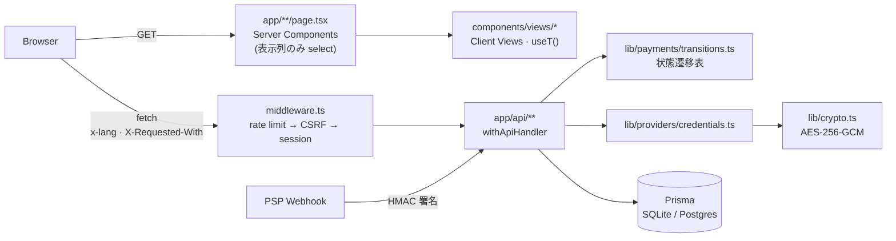

### 決済ステータス

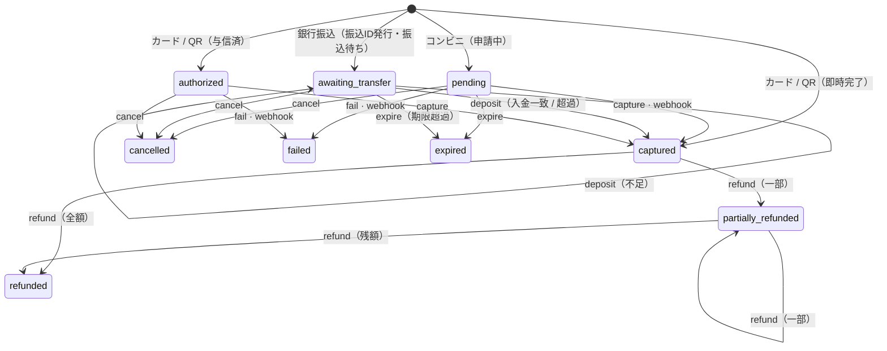

遷移表は [`lib/payments/transitions.ts`](./lib/payments/transitions.ts)、適用は [`lib/payments/actions.ts`](./lib/payments/actions.ts)。全マトリクスをテストで固定しています。

## 設計判断

**1. 認証情報を client に渡さない境界を Server Component で引く**
`app/**/page.tsx` は Prisma で表示に必要な列だけを `select` し、`components/views/*`（client）に渡す。プロバイダ編集画面は [`readCredentialsForDisplay`](./lib/providers/credentials.ts) でマスク後の値だけを渡し、復号はマスク計算のためだけに行って平文は捨てる。PATCH で secret を空欄のまま保存すると既存の暗号文を維持する — 実運用の管理画面で必要な挙動。
*トレードオフ*: 各画面が Server + View の2ファイルになる。*本番なら*: 監査ログにアクセス主体を残す（現状は `actor` のみ）。

**2. 状態遷移を1ファイルに集約し、条件付き updateMany でアトミックにする**
以前は capture / cancel / refund の各 route が `findUnique → if → update` と書いており、二重返金が通り得た。今は `TRANSITIONS` から UI の活性/非活性・API の許可判定・Webhook の適用を全て導出し、`updateMany({ where: { id, status: { in: from } } })` の件数で競合を検知する。
*トレードオフ*: 楽観ロックの version カラムは入れていない（現規模では過剰）。

**3. 暗号鍵は fail-closed**
`ENCRYPTION_KEY` は base64 32 バイトを厳密に検証し、本番で未設定・不正なら例外。開発時のみ警告付きで固定鍵にフォールバック。復号失敗は `DecryptionError` に統一し、UI は「再入力が必要」を表示する。
*本番なら*: KMS 管理 + 暗号文に鍵バージョンを付与してローテーション。

**4. i18n はライブラリを入れず型で同期を強制する**
`en.ts` を `MessageShape<typeof ja>` 型にすることでキーの欠落・過剰がビルドエラーになり、`t("nav.dashbord")` のような typo もコンパイルエラー。データ内在文言は `{ ja, en }` ペア。`{param}` 集合の一致と英語側の日本語混入はテストで検査。
*トレードオフ*: 複数形や ICU 構文は非対応（必要になった時点で導入する）。

**5. 決済履歴は帳簿として守る**
プロバイダ → 決済は `onDelete: Restrict`。履歴のあるプロバイダは削除ではなく無効化。`livemode` は決済作成時にスナップショットし、後でプロバイダを本番に切り替えても過去のテスト決済が本番売上に混入しない。「本日の売上」は Asia/Tokyo で日付境界を計算する。

**6. デモモードの境界**
実 PSP を呼ぶ箇所は [`lib/providers/connection.ts`](./lib/providers/connection.ts) の `runConnectionTest` と [`app/api/payments/route.ts`](./app/api/payments/route.ts) の作成処理、Webhook のベンダー固有ペイロード変換（[`lib/webhooks/events.ts`](./lib/webhooks/events.ts)）に閉じている。

## 技術スタック

- Next.js 14 (App Router, Route Handlers, Edge Middleware) + TypeScript (strict)
- Tailwind CSS
- Prisma 5 + SQLite（ローカル / Docker）、Postgres（Vercel + Neon）
- Zod（リクエスト検証。プロバイダの認証情報スキーマは registry から動的生成）
- Vitest（ユニット + Route Handler 統合テスト、130 ケース超）
- GitHub Actions CI（lint → typecheck → i18n 検査 → test → build → audit）、Dependabot

## ローカル開発

```bash
npm install
cp .env.example .env
# ENCRYPTION_KEY を 32 バイトの base64 に置き換える:
#   node -e "console.log(require('crypto').randomBytes(32).toString('base64'))"
# ログイン: kuromaru / atusi0130（マスター）, general / general1234（一般）— prisma/seed-accounts.ts

npx prisma migrate deploy   # スキーマ適用
npm run db:seed             # デモデータ（プロバイダ・決済・加盟店・代理店・申請・IP ルール）。テーブル単位の upsert で何度実行しても増えない
npm run db:reset            # 全削除 → seed（操作して汚れたデモ DB を初期状態に戻す）
npm run dev                 # http://localhost:3000
```

品質チェックは CI と同じ順で一括実行できます:

```bash
npm run verify   # lint → typecheck → check:i18n → test → build
npm test         # Vitest のみ（SQLite の test.db を自動作成）
```

## ディレクトリ構成

```
app/
  page.tsx                   ダッシュボード（lib/nav.ts のグループ構成でカード + KPI。未ログインは /login へ）
  login/ account/ admins/    ログイン（ID + パスワード + TOTP）/ アカウント設定 / 管理者管理（マスター）
  audit-logs/ search/        操作ログ（絞り込み・差分・CSV）/ 横断検索
  payments/                  決済一覧（純売上・本日の売上・テスト/本番切替）/ 作成 / 詳細（イベント履歴・返金・Webhookシミュレート）
  merchants/                 加盟店一覧 / 追加 / 詳細・編集（通知サンプルのプレビュー・担当代理店）
  agents/                    代理店一覧 / 追加 / 詳細・編集（担当加盟店）
  applications/              決済申請一覧（未完了の取引。種別・状態・加盟店・期間で絞り込み）/ 詳細（入金消込・完了・失敗・キャンセル・期限切れ）
  ip-restrictions/           IP制限一覧（現在IPの判定）/ 追加 / 編集
  manual/[chapter]/          管理画面マニュアル（content/manual/{ja,en}/*.md）
  providers/                 プロバイダ一覧 / 新規接続（カテゴリ→サービス→フォーム）/ 編集
  login/                     管理者ログイン
  loading.tsx error.tsx not-found.tsx
  api/
    payments/                POST（冪等キー）, [id]/[action]（capture|cancel|refund）, simulate-webhook
    providers/               CRUD + 接続テスト（credentials は返さない）
    webhooks/[providerId]/   HMAC 署名検証 + 重複排除 → 状態遷移
    merchants/               加盟店 CRUD + パスワード表示/再発行（マスター権限のみ）+ [id]/fees・limits・terms・api-keys（契約 / 限度額 / 期限 / API キー）
    merchant-api/ping/       加盟店向け API の疎通確認（Bearer API キー・加盟店ごとの IP 制限）
    cron/expire-transfers/   期限超過の振込待ちを期限切れにする毎時 Cron（CRON_SECRET）
    agents/                  代理店 CRUD
    payments/[id]/[action]   capture|cancel|refund|fail|expire|deposit（refund 以外はマスター権限）
    ip-restrictions/         ブロック / 許可ルール CRUD（自己ロックアウト防止）
    auth/                    login（ID + パスワード）/ 2fa（TOTP）/ logout（署名付き Cookie）
    account/                 自分のパスワード変更・二段階認証の登録/解除
    admins/                  管理者の招待・更新・仮パスワード・2FA 解除（マスター）
    audit-logs/              操作ログ一覧 + CSV
    search/                  横断検索
    demo/reset/ demo/deposit-notify/  CRON_SECRET で保護されたデモ初期化 / 銀行の入金通知を模した消込 API（DEPOSIT_NOTIFY_SECRET）
middleware.ts                rate limit · CSRF · DEMO_READONLY · セッション
components/
  views/                     各画面の表示（client, i18n）
  ui/                        Badge / SegmentedControl / DetailRow
  confirm-dialog.tsx         <dialog> ベースの確認ダイアログ（useConfirm）
  language-provider.tsx      言語 Context・useT・useApiJson
lib/
  payments/                  transitions.ts（状態遷移表・申請/決済のステータス集合）, actions.ts（アトミック適用 + 履歴）, transfer.ts（振込ID・入金消込）, list.ts / detail.ts（両画面共通のローダ）
  merchants/                 types / schema（Zod）/ ids（採番）/ secrets（PW）/ notification（通知サンプル）/ fees（契約プラン・料率）/ limits（限度額判定）/ api-keys（生成・ハッシュ・状態）/ detail（タブのローダ）
  mode.ts                    テスト / 本番のデータモード（Cookie `wirepay.mode`）
  agents/                    代理店の語彙・Zod・採番
  ip-restrictions/ ip.ts     ルールの Zod / enforce.ts（ブロック判定）/ IPv4・CIDR の純関数（parseCidr, ipInCidr, evaluateRules）
  manual/                    chapters.ts（章の定義）, markdown.tsx（自前レンダラ）, load.ts
  api/role-guard.ts          requireAdmin / requireMaster（セッション由来のロール検査）
  admin/                     管理者の語彙・Zod・scrypt・TOTP・セッション発行・ページガード
  audit.ts audit-list.ts     監査ログの記録（recordAudit）と一覧ローダ
  nav.ts search.ts csv.ts    ナビ定義 / 横断検索 / CSV 出力
  providers/                 registry（定義）, credentials（暗号化 I/O）, validation（Zod 生成）, connection
  webhooks/                  verify.ts（署名）, events.ts（イベント語彙）
  api/                       handler.ts（レスポンス統一・エラー変換）, envelope.ts
  i18n/                      型付き辞書 ja.ts / en.ts とコア
  auth.ts crypto.ts rate-limit.ts time.ts
prisma/
  schema.prisma migrations/  PaymentProvider · Payment · Refund · PaymentEvent · WebhookEvent · Merchant · MerchantFeeSchedule · MerchantLimit · ApiKey · Agent · IpRestriction · AdminUser · AuditLog
  seed-data.ts               決定的な seed（固定ID・テーブル単位の upsert で冪等）。Vercel は毎ビルドで db push --accept-data-loss → seed
content/manual/{ja,en}/      マニュアル本文（Markdown）
scripts/
  check-i18n.mjs build-icons.mts prepare-prisma.mjs
tests/integration/           Route Handler の統合テスト
```

## デプロイ

[`DEPLOY.md`](./DEPLOY.md) を参照。公開デモは Vercel (hnd1) + Neon、Docker（standalone 出力・非 root）で Railway / Render / Fly.io にも置けます。

## Roadmap

- [x] 状態遷移表 + アトミック更新 + 冪等キー
- [x] 一部返金（Refund）と監査ログ（PaymentEvent）
- [x] Webhook 受信（HMAC 検証・重複排除）とシミュレーター
- [x] 管理者ログイン・CSRF・レートリミット・セキュリティヘッダ
- [x] 暗号鍵の fail-closed と復号失敗時の UI
- [x] JA/EN i18n（型同期）・Asia/Tokyo 固定・cookie による SSR 言語決定
- [x] Vitest 130 ケース超 + GitHub Actions CI
- [x] 加盟店管理（発行・編集・通知仕様プレビュー・権限別パスワード表示）
- [x] 管理者アカウント（TOTP 二段階認証）・操作ログ・横断検索・グループ化ナビ
- [x] 加盟店の契約プラン / 手数料率・限度額・振込期限 / 返金可能期限・API キー・テスト / 本番スイッチ
- [ ] Postgres 専用 migration 履歴への一本化（現在 Vercel は `db push`）
- [ ] Next.js 15 へのアップグレード（`params` / `searchParams` の await 化）
- [ ] レートリミットを Upstash Redis に（現在はインスタンス内メモリ）
- [ ] 実 PSP SDK の接続（Stripe → PayPay → GMO PG の順）とベンダー別 Webhook アダプタ
- [ ] KMS 管理の鍵ローテーション（暗号文に鍵バージョン付与）
- [ ] Payout（入金）/ Dispute（チャージバック）の受信と記録
- [ ] Playwright による E2E スモーク

## How this was built

初期スキャフォールドと定型的なコードの生成には AI（Claude Code）をペアプログラマーとして使いました。設計判断 — 認証情報の境界、状態遷移の集約とアトミック更新、fail-closed な鍵管理、型で同期させる i18n、帳簿としての決済履歴 — と、レビュー、テストケースの設計、本番化に向けた優先順位付けは自分で行っています。AI が出したコードはそのままマージせず、読んで理解した上で採用・修正しています。

## セキュリティ上のメモ

- シークレットは AES-256-GCM（毎回ランダム IV・16 バイト認証タグ）で暗号化して保存。復号は接続テストと（将来の）決済処理時のみ
- 更新系 API は同一オリジンの Origin/Referer と `X-Requested-With: fetch` を要求（CSRF）。セッション Cookie は `HttpOnly; SameSite=Lax; Secure`
- レートリミットはインスタンス内メモリのため、複数インスタンスでは best-effort（Roadmap 参照）
- 公開デモは `DEMO_READONLY=1` で削除・設定変更を無効化し、毎日リセット

---

<a id="english"></a>

# Wire Pay — Payment Management Dashboard

[日本語](#wire-pay--決済管理ダッシュボード) | English

A dashboard for small e-commerce stores to **connect Japanese payment providers, store their credentials safely, and run the payment lifecycle (authorize → capture → refund)** in one place.

**🔗 Live demo: <https://payment-management-green.vercel.app>**
Runs in demo mode: no external payment APIs are called. Connection tests only validate inputs, and payments can be freely created, captured, voided and refunded (data resets daily). The login page shows the demo password.

## Features

- **PSP connection flow** — category → service → credentials in three steps. Providers: Stripe, Square, GMO PG, PayPay, au PAY, Rakuten Pay, d Payment, BitCash, Smart Pit, multi-konbini, Pay-easy, virtual accounts, custom webhook. Everything (form, required checks, which fields are encrypted, masking) derives from the data in [`lib/providers/registry.ts`](./lib/providers/registry.ts).
- **Encrypted credentials** — field-level AES-256-GCM; the UI shows only the last 4 characters. The key is fail-closed in production, and a rotated key surfaces as "please re-enter" instead of a 500.
- **Transaction lifecycle** — a transaction (payment application) is created the moment a customer picks a payment method at checkout and moves Applied / Awaiting transfer / Authorized → Completed → Refunded. **Payment Applications** (open) and **Payments** (completed / refunded) are the same table with different status filters. **Partial refunds**; a single transition table drives the UI, the API and webhooks; updates are **atomic** (`updateMany` conditioned on the current status), so a double refund or double reconciliation cannot slip through.
- **Idempotency** — `POST /api/payments` honors an `Idempotency-Key` header and replays the original result.
- **Audit trail (PaymentEvent)** — append-only record of who did what and when (dashboard vs. webhook), rendered as a timeline.
- **Webhook ingestion** — Stripe-compatible HMAC-SHA256 signatures with a timestamp tolerance, plus deduplication on event id. The payment page can send itself a signed webhook to demonstrate the path end to end.
- **Admin accounts with two-factor auth, CSRF, rate limiting, security headers** — operators are `AdminUser` rows (login ID + scrypt password, TOTP / RFC 6238 two-factor, master / general roles, invitations, temporary passwords, last-master protection). Mutations require a session; Origin check + `X-Requested-With`, per-IP limits, CSP / HSTS / `frame-ancestors 'none'`.
- **Audit log** — who changed what, when, on which record and from which IP, with redacted before / after snapshots. Filter by actor / action / target / period, diff view, CSV export.
- **Global search** — the header box (Ctrl+K) searches transaction IDs, order numbers, transfer IDs, emails, merchants, agents and admins at once.
- **Grouped navigation** — Transactions / Merchants / Settlement / Risk / Reports / Notices / Settings are defined once in `lib/nav.ts` and drive the sidebar, the dashboard cards and the mobile tabs (unimplemented phases stay hidden).
- **Japanese / English** — an EN / 日本語 toggle in the header. Stored in a cookie + localStorage so SSR already renders the right language; API error messages are localized too. Currency stays JPY; times are Asia/Tokyo.
- **Test / live mode** — each payment snapshots the provider's mode as `livemode`; a Stripe-style switch in the header (stored in a cookie) selects the mode the dashboard, the lists and the limit usage cards read.
- **Merchant contracts, limits and API keys** — the merchant detail is tabbed (Basic / Contract & fees / Limits / API keys / Notifications). Contract plans (standard / premium / custom) with per-method fee rates kept as a **dated history**, per-method **per-transaction / daily / monthly limits** (an exceeding transaction is recorded as failed with the reason; usage gauges), per-merchant **transfer deadline** (an hourly cron expires overdue transfers) and **refund window**, and SHA-256-hashed **API keys / signing secrets** (plaintext shown once, rotation with a grace period, revocation, `GET /api/merchant-api/ping` connectivity check).
- **Mobile** — bottom tab bar, horizontally scrolling tables, `<dialog>`-based confirmations, loading / error / not-found routes.
- **Merchant management (PSP side)** — issue merchant accounts (auto-numbered `MER-00001`, generated + encrypted password), katakana / email / https validation, and notification settings (format × parameter set × identifier) with a **live preview of the exact request the merchant will receive**; read → edit → update mode switch; only the master role can reveal or regenerate the password (the role is enforced server-side from a cookie); optional referring agent.
- **Dashboard** — cards grouped like the sidebar, each with its headline figure (today's payments, open transactions and overdue transfers, active IP rules, today's audit entries…).
- **Agent management** — auto-numbered `AGT-00001`, fee rate (%, two decimals), active / inactive, and the merchants each agent refers on the detail page.
- **Payment applications (open transactions)** — filter by method / status / merchant / period; awaiting transfers are listed by deadline with overdue rows in red. Bank transfers get a per-merchant 7- or 8-digit **transfer ID** and a deadline; **deposit reconciliation** (exact → completed, short → still awaiting with a short flag, excess → completed with an excess flag) runs from the detail screen (master role) and from `POST /api/demo/deposit-notify`, which mimics the bank's deposit notification. Manual complete / fail / cancel / expire, and a status history (when / who / from → to).
- **IP restrictions (enforced)** — IP / CIDR rules for the admin UI and the merchant API. Callers matching a **Block** rule are refused by `app/layout.tsx` (pages) and `withApiHandler` (API) with a 403; a rule that would block your own IP cannot be saved (lock-out protection). Allow rules are informational; the current IP and its verdict are shown.
- **In-app manual** — nine chapters, table of contents on the left and the chapter on the right, rendered from `content/manual/{ja,en}/*.md` by a small in-house Markdown renderer and linked to the UI language. Every page header has a "?" that opens its chapter.

## Architecture

See the Mermaid diagrams in the Japanese section above (they render on GitHub): request flow through Server Components, the Edge middleware and the API layer, and the payment state machine. The transition table lives in [`lib/payments/transitions.ts`](./lib/payments/transitions.ts) and is applied by [`lib/payments/actions.ts`](./lib/payments/actions.ts); the full status × action matrix is pinned by tests.

## Design decisions

1. **Credentials never cross to the client.** Server Components `select` only display columns; the provider edit page passes masked values computed by `readCredentialsForDisplay`, decrypting solely to compute the mask. Saving a secret field blank keeps the existing ciphertext. *Trade-off:* every screen is a Server page + a client View. *For production:* record the acting user in the audit log (today only `actor` = dashboard/webhook).
2. **One transition table, atomic updates.** The old per-route `find → if → update` allowed double refunds under concurrency. Now `TRANSITIONS` drives everything and `updateMany({ where: { id, status: { in: from } } })` detects conflicts by row count. *Trade-off:* no optimistic-lock version column (overkill at this size).
3. **Fail-closed encryption key.** `ENCRYPTION_KEY` must be canonical base64 of 32 bytes; production throws if it is missing or malformed, development falls back to a fixed key with a warning. Decryption failures are one `DecryptionError` type that the UI turns into a re-enter prompt. *For production:* KMS-managed keys with a key-version prefix on ciphertexts for rotation.
4. **Type-enforced i18n without a library.** `en.ts` is typed as `MessageShape<typeof ja>`, so a missing or extra key fails the build and `t("nav.dashbord")` is a compile error. Data-embedded copy is `{ ja, en }` pairs. Tests assert identical `{param}` sets and no Japanese in the English catalog. *Trade-off:* no plurals / ICU (add when needed).
5. **The ledger outlives connection settings.** Provider → payment is `onDelete: Restrict`; providers with history are disabled, not deleted. `livemode` is snapshotted at creation, so flipping a provider to live never relabels past test payments. "Today" is computed in Asia/Tokyo.
6. **A narrow demo boundary.** Real PSP calls would go into `runConnectionTest`, the create handler, and a per-vendor webhook adapter (`lib/webhooks/events.ts`) — nothing else changes.

## Tech stack

Next.js 14 (App Router, Route Handlers, Edge Middleware) · TypeScript strict · Tailwind CSS · Prisma 5 (SQLite locally / Docker, Postgres on Vercel + Neon) · Zod (credential schemas generated from the registry) · Vitest (130+ unit and route-handler integration tests) · GitHub Actions CI · Dependabot.

## Running locally

```bash
npm install
cp .env.example .env
# set ENCRYPTION_KEY to base64 of 32 random bytes:
#   node -e "console.log(require('crypto').randomBytes(32).toString('base64'))"
# log in as kuromaru / atusi0130 (master) or general / general1234 — see prisma/seed-accounts.ts

npx prisma migrate deploy
npm run db:seed
npm run dev        # http://localhost:3000

npm run verify     # lint → typecheck → check:i18n → test → build (same as CI)
```

## Deployment

See [`DEPLOY.md`](./DEPLOY.md): Vercel (Tokyo) + Neon for the public demo, or the Docker image (standalone output, non-root) on Railway / Render / Fly.io.

## Roadmap

Done: transition table + atomic updates + idempotency · partial refunds + audit log · webhook verification + simulator · login / CSRF / rate limit / headers · fail-closed key · typed JA/EN i18n · admin accounts with TOTP, audit log, global search · merchant contracts / limits / deadlines / API keys and the test / live switch · 230+ tests + CI.
Next: Postgres-only migration history (Vercel currently uses `db push`) · Next.js 15 · Upstash-backed rate limiting · real PSP SDKs (Stripe → PayPay → GMO PG) with per-vendor webhook adapters · KMS key rotation · payouts & disputes · Playwright E2E.

## How this was built

The initial scaffold and boilerplate were generated with AI (Claude Code) as a pair programmer. The design decisions — the credential boundary, the centralized state machine with atomic updates, fail-closed key handling, type-synchronized i18n, and treating payments as a ledger — as well as code review, test design and production prioritization are my own. Nothing generated was merged without being read and understood first.

## License

[MIT](./LICENSE)
