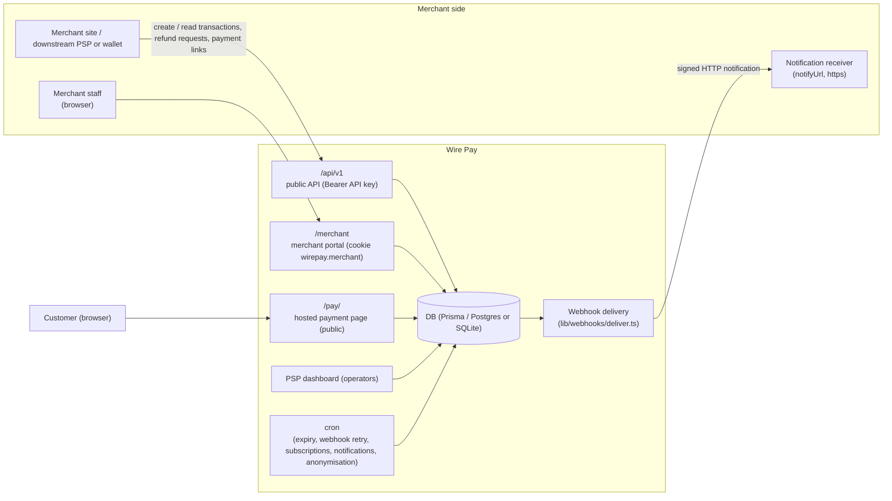
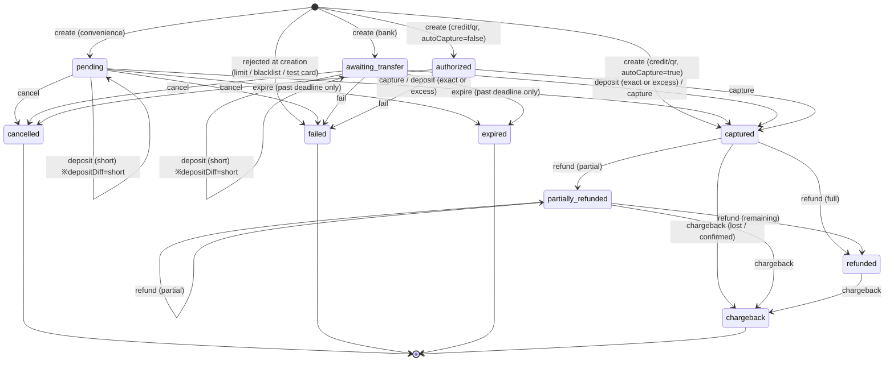
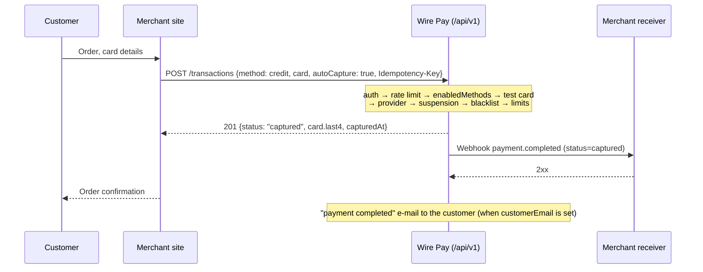
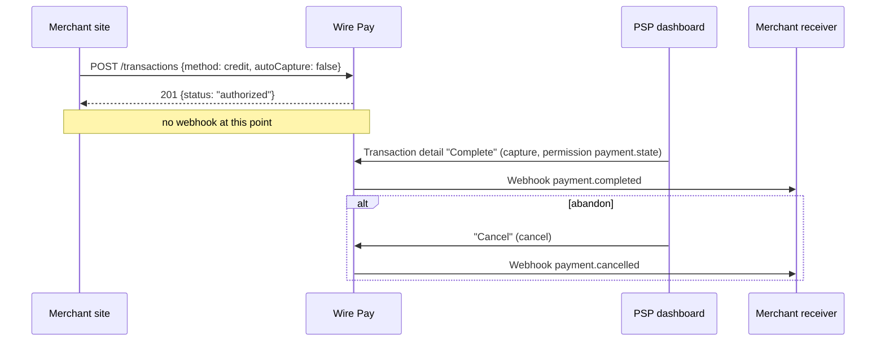
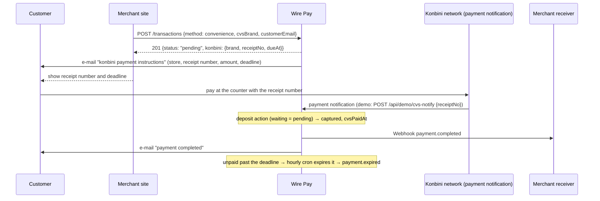
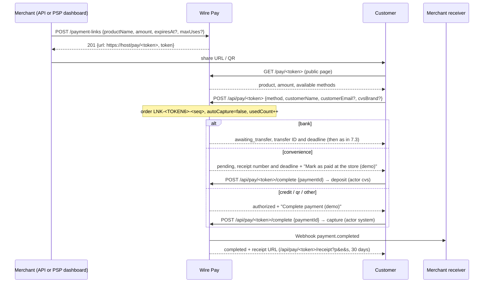
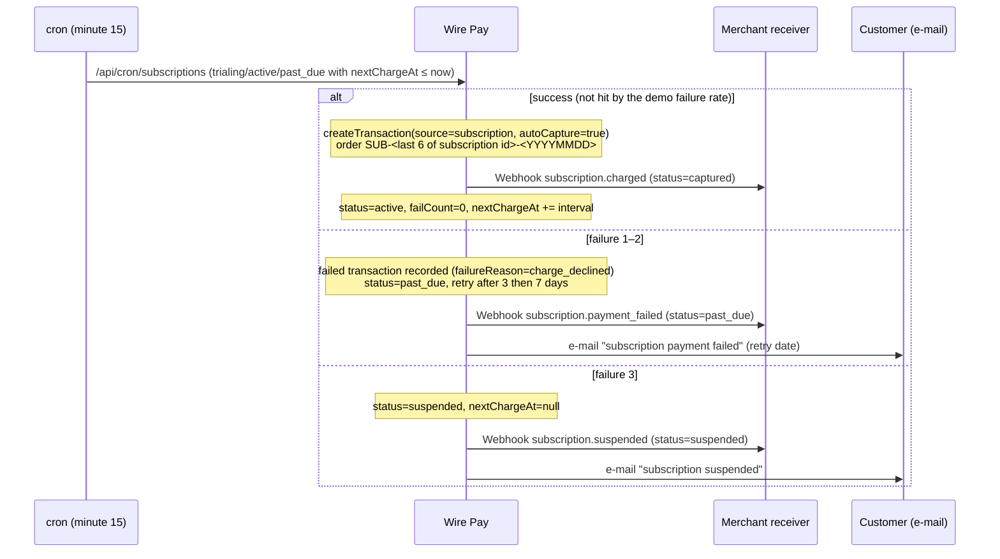
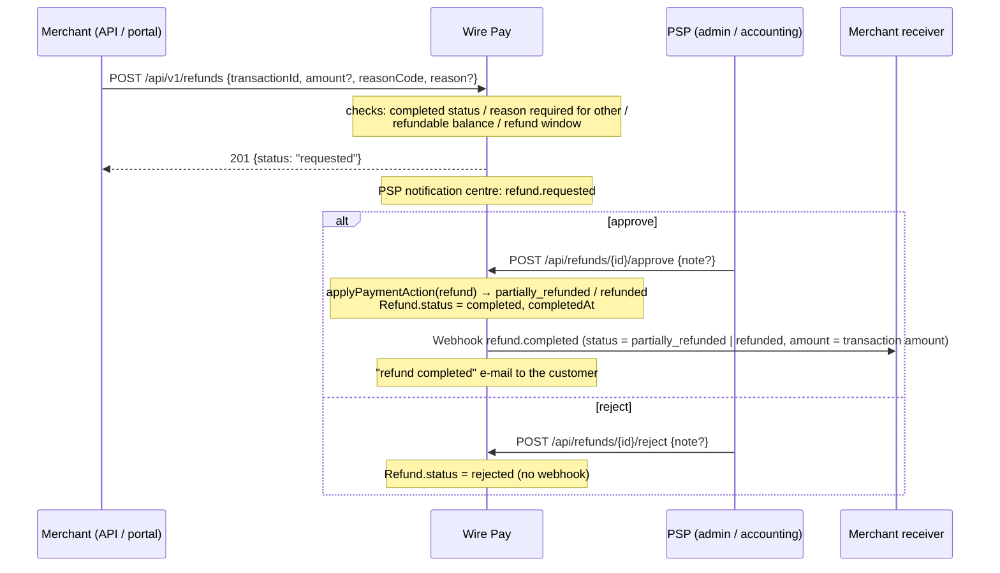
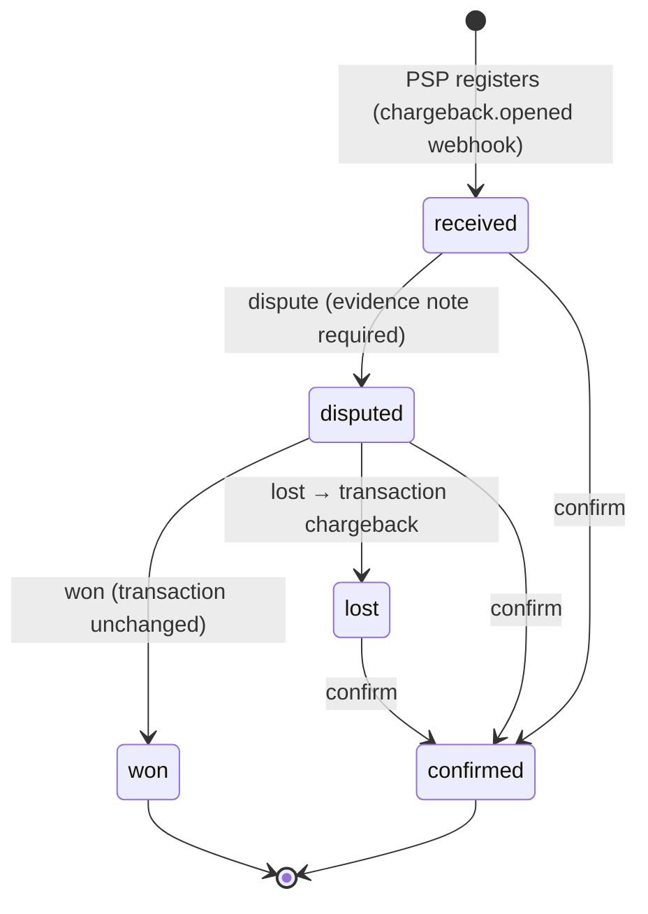
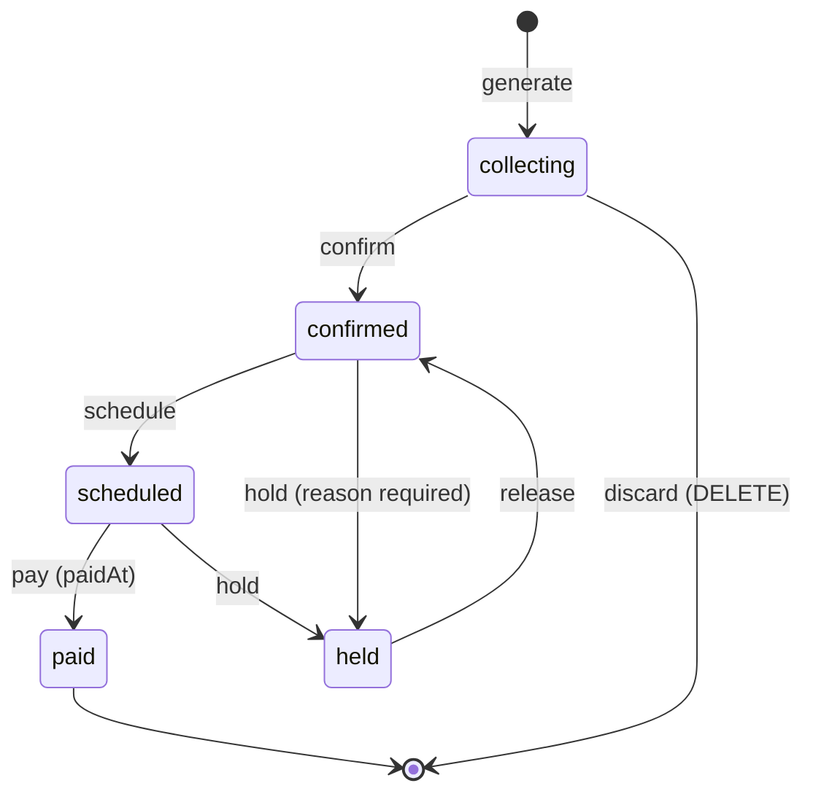

# Wire Pay Merchant & Connecting-Client Integration Specification

| Item | Value |
|---|---|
| Version | 1.0.0 |
| Target system | Wire Pay (payment management dashboard) — commit `6b72a40` (`main`) |
| Date | 2026-09-06 |
| Language | English (Japanese edition: `docs/spec/ja/A-merchant-integration-spec.md`) |
| Terminology | Follows `docs/spec/en/glossary.md` |

## Intended readers

This document is for parties that **call Wire Pay's API and dashboards to accept payments**:

- developers and operations staff of merchants (e-commerce businesses)
- **downstream PSPs and wallet operators** that accept payments through Wire Pay (they hold a Wire Pay API key and act as a client of `/api/v1`)

Connection requirements for the parties Wire Pay **entrusts processing to** (Stripe, PayPay, acquirers, konbini collection agencies, virtual-account banks, upstream PSPs / wallets) are in the companion document **Specification B (Payment Provider Connection Specification)** `docs/spec/en/B-provider-connection-spec.md`.

## How this document is written

- The body contains **only facts verifiable from the implementation** (Prisma schema, Route Handlers, the OpenAPI document, dictionaries, permission definitions, cron definitions, the admin manual).
- Unimplemented or planned functions are kept out of the body; they are listed at the end of each chapter under "Not implemented / planned" and in chapter 14.
- Statements that involve inference carry the marker "**※要確認**" (to be confirmed) and are listed with reasons in `docs/spec/ASSUMPTIONS.md`.
- Unless stated otherwise, dates are evaluated in **Japan Standard Time (Asia/Tokyo)**; API timestamps are ISO 8601 / UTC. All amounts are **whole yen** (JPY has no minor unit).

## Contents

1. [Overview and system structure](#1-overview-and-system-structure)
2. [Terminology and the transaction lifecycle](#2-terminology-and-the-transaction-lifecycle)
3. [Accounts and permissions](#3-accounts-and-permissions)
4. [Dashboard screens](#4-dashboard-screens)
5. [API specification](#5-api-specification)
6. [Webhook specification](#6-webhook-specification)
7. [Payment flows in detail](#7-payment-flows-in-detail)
8. [Refunds, voids and chargebacks](#8-refunds-voids-and-chargebacks)
9. [Settlement](#9-settlement)
10. [Security and limits](#10-security-and-limits)
11. [Notifications](#11-notifications)
12. [Testing and the sandbox](#12-testing-and-the-sandbox)
13. [Go-live checklist](#13-go-live-checklist)
14. [Not implemented / planned](#14-not-implemented--planned)
- Appendix A [Error codes](#appendix-a-error-codes)
- Appendix B [Statuses](#appendix-b-statuses)
- Appendix C [Webhook events](#appendix-c-webhook-events)
- Appendix D [Screens](#appendix-d-screens)

---

## 1. Overview and system structure

### 1.1 Wire Pay's role

Wire Pay consists of a **payment management dashboard for the PSP (the operator dashboard)**, a **public API for merchants (`/api/v1`)**, a **merchant portal (`/merchant`)** where merchants log in themselves, and a **hosted payment page (`/pay/<token>`)** for customers.

From the merchant's point of view Wire Pay does the following.

| Role | Content | Chapter |
|---|---|---|
| Accepting transactions | Credit / QR / konbini / bank-transfer transactions are created by API or payment link | 5, 7 |
| Confirming payment | Deposit reconciliation for konbini and bank transfers, capture for cards, and the result delivered by webhook | 6, 7 |
| Refunds, voids, chargebacks | The PSP reviews the merchant's refund requests and reflects them in the transaction status | 8 |
| Settlement | Completed transactions minus fees, refunds and chargebacks are managed as settlement batches; a qualified invoice PDF is produced | 9 |
| Risk management | IP restrictions, transaction limits, payment-method suspension and the blacklist control what is accepted | 10 |
| Notifications | E-mails to customers, announcements and incident information to merchants | 11 |

### 1.2 System structure



- The public API, merchant portal, payment page and PSP dashboard are one Next.js application (App Router) sharing one database and one set of business rules (`createTransaction` in `lib/payments/create.ts`, `applyPaymentAction` in `lib/payments/actions.ts`). A transaction created through any path goes through the same state machine, the same controls (limits, suspension, blacklist) and the same webhook delivery.
- The merchant portal session (cookie `wirepay.merchant`) is **completely separate** from the PSP dashboard session (chapter 3).
- External payment networks are **not called** (demo mode). Card / QR authorization and capture are processed immediately as database state transitions (Specification B, chapter 11).

### 1.3 Test and live environments

Wire Pay separates "test" and "live" **on the same endpoints and the same database**.

| Aspect | Specification |
|---|---|
| How the environment is chosen | In the API it is the **kind of API key** (`wp_test_ak_…` = test, `wp_live_ak_…` = live). The request body cannot select the environment |
| Data separation | Transactions, refunds, settlement batches, payment links, subscriptions and webhook deliveries carry `livemode` (true = live). Data created with a test key is invisible to a live key (`GET /transactions/{id}` answers 404) |
| `livemode` of a transaction | The inverse of the provider's `testMode` is snapshotted when the transaction is created. Changing the provider's mode later never re-labels past transactions |
| Dashboards | The **Test / Live** switch in the header (cookie `wirepay.mode`, default test) selects the environment shown |
| Test cards | In test mode a card number reproduces a scenario (success / authorized only / failures). A test number sent to live answers 400 `test_card_in_live` (chapter 12) |
| Real charges | The target system runs in demo mode; no charge is ever sent to an external payment network in either environment (Specification B, chapter 11) |

### 1.4 Supported payment methods

A merchant may use only the methods enabled by its contract (the merchant's "enabled methods", `enabledMethods`).

| Method (`method` in the API) | Display name | Status right after creation | What completes it |
|---|---|---|---|
| `credit` | Credit card | `captured` (`autoCapture: true`, default) or `authorized` (`autoCapture: false`) | Completes at creation. An authorized transaction is completed from the PSP dashboard ("Complete") |
| `qr` | QR code payment | Same as `credit` | Same |
| `convenience` | Konbini payment | `pending` (awaiting payment) + 13-digit receipt number + payment deadline | The store's payment notification (the `deposit` action) |
| `bank` | Bank transfer | `awaiting_transfer` + 7- or 8-digit transfer ID + transfer deadline | The bank's deposit notification or the PSP's reconciliation (the `deposit` action) |
| `other` | Other | Cannot be requested through the public API (`API_METHODS` are the four above) | — |

Per-method flows are in chapter 7, status transitions in chapter 2.

### 1.5 Connection paths covered

| Path | Authentication | Purpose | Chapter |
|---|---|---|---|
| Public API `/api/v1/*` | `Authorization: Bearer wp_<test\|live>_ak_…` | Create / read / list transactions, refund requests, payment links | 5 |
| Merchant API `/api/merchant-api/*` | Same API key | Connectivity check (`ping`), settlement batches, announcements | 5.8 |
| Webhooks (Wire Pay → merchant) | `X-Signature` (HMAC-SHA256) | Results of transactions, refunds, chargebacks, subscriptions | 6 |
| Merchant portal `/merchant/*` | Merchant ID + password (cookie `wirepay.merchant`) | Transactions, refunds, webhook log, settlements, API keys, method status, announcements, sandbox | 3, 4 |
| Hosted payment page `/pay/<token>` | None (public) | Customers pay through a payment-link URL | 7.5 |
| Receipt download `/api/pay/<token>/receipt` | Signed query (valid 30 days) | Customer downloads the receipt PDF | 7.5 |

### 1.6 Not implemented / planned (chapter 1)

- There is no live connection to external payment networks. Card / QR complete immediately; konbini and bank deposits are simulated by the demo endpoints (chapter 12) or PSP dashboard actions.

---

## 2. Terminology and the transaction lifecycle

### 2.1 Payment applications and transactions

In Wire Pay the record created when a customer picks a payment method on the merchant's site is a **transaction**, one row of the `Payment` table. Transactions before completion appear on the PSP dashboard as "**Payment applications**", completed / refunded / charged-back transactions as "**Payments**" — **the same table filtered by status**.

| List | Statuses (`lib/payments/transitions.ts`) |
|---|---|
| Payment applications (`APPLICATION_STATUSES`) | `pending`, `awaiting_transfer`, `authorized`, `failed`, `expired`, `cancelled` |
| Payments (`SALES_STATUSES`) | `captured`, `partially_refunded`, `refunded`, `chargeback` |
| Open (dashboard KPI, `OPEN_STATUSES`) | `pending`, `awaiting_transfer`, `authorized` |

The glossary (`glossary.md`) is authoritative for terminology. The most frequent terms of this chapter:

| Term | Meaning |
|---|---|
| Transaction ID (`payment_id` / `id` in the API) | Wire Pay's unique transaction identifier (cuid) |
| Order number (`orderNumber`) | The merchant's order number (1–64 characters). Uniqueness is the merchant's responsibility |
| Authorization | Reserving the funds for a card / QR payment. Status `authorized` |
| Capture | Completing an authorized transaction. Status `captured` |
| Void (`cancel`) | Abandoning a transaction before completion. Status `cancelled` (UI label "Cancelled") |
| Refund | Returning money on a completed transaction. `partially_refunded` / `refunded` |
| Transfer ID (`transferId`) | The 7- or 8-digit number a bank-transfer customer prefixes to the payer name |
| Receipt number (`cvsReceiptNo`) | The 13-digit number a konbini customer quotes at the counter |
| Deposit reconciliation (`deposit`) | Matching a bank / konbini deposit to a transaction and completing it |

### 2.2 Statuses

| Status (DB value) | Label (ja / en) | Meaning |
|---|---|---|
| `pending` | 申請中 / Applied | Just created, nothing confirmed. For konbini: "awaiting payment" (receipt number issued) |
| `awaiting_transfer` | 振込待ち / Awaiting transfer | Bank transfer; transfer ID issued, waiting for the deposit |
| `authorized` | 与信済 / Authorized | Card / QR authorization held (`autoCapture: false`, or the "authorized only" test card) |
| `captured` | 完了 / Completed | Payment settled; `capturedAt` stamped |
| `partially_refunded` | 一部返金 / Partially refunded | Refunded total below the amount |
| `refunded` | 返金済 / Refunded | Refunded total reached the amount |
| `cancelled` | キャンセル / Cancelled | Abandoned before completion (`cancelledAt`) |
| `failed` | 失敗 / Failed | Rejected at creation (limit, blacklist, test card) or failed manually / by webhook. Reason in `failureReason` |
| `expired` | 期限切れ / Expired | Transfer / payment deadline passed |
| `chargeback` | チャージバック / Chargeback | A chargeback was lost or confirmed |

Values of `failureReason` are listed in 5.3 ("Values of `failureReason`").

### 2.3 State diagram

The transitions are defined once in `TRANSITIONS` (`lib/payments/transitions.ts`); the API, dashboards, webhooks and cron all derive from it. Updates are conditional on the current status being an allowed source, so concurrent requests can never apply twice (a conflict answers 409 `invalid_transition`).



Actions, sources and targets (`TRANSITIONS`):

| Action | From | To (nominal) | Timestamp stamped | Who triggers it |
|---|---|---|---|---|
| `capture` | `pending`, `authorized`, `awaiting_transfer` | `captured` | `capturedAt` | PSP dashboard (permission `payment.state`), the hosted page's "Complete payment (demo)", provider webhook `payment.captured` |
| `cancel` | `pending`, `authorized`, `awaiting_transfer` | `cancelled` | `cancelledAt` | PSP dashboard, provider webhook `payment.cancelled` |
| `refund` | `captured`, `partially_refunded` | `refunded` (`partially_refunded` when partial) | `refundedAt` (full) | Approval of a refund request (chapter 8), provider webhook `payment.refunded` |
| `fail` | `pending`, `authorized`, `awaiting_transfer` | `failed` | — | PSP dashboard, provider webhook `payment.failed` |
| `expire` | `pending`, `awaiting_transfer` | `expired` | — | Hourly cron (past deadline only), PSP dashboard |
| `deposit` | `awaiting_transfer`, `pending` | `captured` (stays put when short) | `capturedAt` (on completion) | Bank / konbini deposit notification (demo API), PSP reconciliation (permission `payment.deposit`), matching an unmatched deposit |
| `chargeback` | `captured`, `partially_refunded`, `refunded` | `chargeback` | — | A chargeback lost or confirmed (never a direct dashboard action) |

### 2.4 Differences per payment method

#### Credit / QR (authorization and capture)

- With `autoCapture: true` (default) the transaction is `captured` at creation and `payment.completed` is delivered.
- With `autoCapture: false` it stops at `authorized`; the PSP dashboard's "Complete" moves it to `captured`. There is no merchant API to capture (chapter 14).
- An authorized transaction can be voided with "Cancel" (not a refund).

#### Bank transfer (transfer ID, deadline, short / excess deposits)

- A **transfer ID** of the merchant's configured length (7 or 8 digits, `transferIdDigits`) is issued at creation. Its first digit is never 0 and it is unique system-wide.
- **Transfer deadline** = creation time + the merchant's `transferDueDays` (default 7 days, 1–60).
- Deposits are evaluated **cumulatively** (`reconcileDeposit`): exact → `captured`; short → stays `awaiting_transfer` with `depositDiff = "short"` (the next deposit accumulates); excess → `captured` + `depositDiff = "excess"`. Short / excess cases are tracked on the PSP's "Short / excess deposits" screen: the excess is refunded through a refund request, the shortfall triggers an additional-deposit e-mail.
- Awaiting transfers past the deadline are expired by the cron at minute 0 of every hour (webhook `payment.expired`).
- A deposit that arrives without a transfer ID is recorded as an "unmatched deposit"; PSP support attaches the transfer ID and the same reconciliation runs (`payment.completed` is delivered on completion).

#### Konbini (receipt number, payment deadline)

- A **13-digit receipt number** (first digit never 0, unique) and the **store** (`cvsBrand`: `seven` / `lawson` / `familymart` / `ministop` / `other`, default `seven`) are recorded at creation.
- **Payment deadline** = creation time + the merchant's `cvsDueDays` (default 3 days, 1–30), stored in the same column as the transfer deadline (`transferDueAt`).
- No new status: `pending` means awaiting payment. The store's notification runs the same `deposit` action as a bank deposit and stamps `cvsPaidAt` on completion.
- Expiry uses the same cron as bank transfers.

#### Common

- On completion (`capture`, or an exact / excess `deposit`) the customer receives a "payment completed" e-mail; on a completed refund a "refund completed" e-mail (only when the transaction has a customer e-mail, chapter 11).
- Every status change is recorded in `PaymentEvent` (status history) with its actor (`dashboard` / `api` / `webhook` / `bank` / `cvs` / `system` / `seed`). The merchant portal's transaction detail shows this history.

### 2.5 Not implemented / planned (chapter 2)

- There is no capture or cancel through the merchant API; completing or voiding an authorized transaction is a PSP dashboard action.

---

## 3. Accounts and permissions

### 3.1 Issuing a merchant account

Merchant accounts are issued by **Wire Pay administrators (PSP operators)** on the PSP dashboard ("Merchants → + Add merchant"). Merchants cannot sign up themselves.

| Item | Specification |
|---|---|
| Merchant ID (`merchantCode`) | Auto-numbered `MER-00001`; immutable |
| Merchant password | Generated at registration and stored AES-GCM encrypted. Only the admin role can reveal / reissue it on the PSP dashboard (reissuing invalidates the old password immediately) |
| Site name / kana (full-width katakana) / company / contact / e-mail / statement e-mail | Required |
| Notification URL (`notifyUrl`) | Webhook destination; **https only** |
| Notification parameters | Format / parameter set / identifier format (chapter 6) |
| E-mail notification setting (`emailNotification`) | `per_payment` / `daily` / `none` (chapter 11) |
| Agent | Optional |
| Enabled methods (`enabledMethods`) | Any of `credit` / `qr` / `convenience` / `bank` / `other`. Methods not listed answer 400 `method_not_enabled` in the API |
| Transfer ID length (`transferIdDigits`) | 7 or 8 |

After issuing, the PSP creates API keys (`api_key`) and signing secrets (`signing_secret`) per environment (test / live) on the merchant detail's **API keys** tab. The plaintext is shown once; the database keeps only a SHA-256 hash (signing secrets additionally keep a ciphertext for webhook signing).

### 3.2 API keys and signing secrets

| Kind | Format | Use |
|---|---|---|
| API key | `wp_test_ak_<32 chars>` / `wp_live_ak_<32 chars>` | Bearer authentication for `/api/v1/*` and `/api/merchant-api/*` |
| Signing secret | `wp_test_ss_<32 chars>` / `wp_live_ss_<32 chars>` | Shared key for verifying webhook `X-Signature`. **Cannot authenticate API calls** (401 `invalid_api_key`) |

Key states (`apiKeyStatus`):

| State | Condition | Authenticates |
|---|---|---|
| `active` | Neither revoked nor expiring | Yes |
| `expiring` | Old key after a rotation, `expiresAt` in the future | Yes |
| `expired` | `expiresAt` passed | No (401) |
| `revoked` | Revoked | No (401) |

- **Rotation** issues a new key with the same mode, kind and label and gives the old key an `expiresAt` after a grace period (default `ROTATION_GRACE_DAYS` = 7 days; the PSP may choose 0–90). **Test keys can be rotated by the merchant** in the portal (grace fixed at 7 days). **Live keys** are issued, rotated and revoked only by the PSP; a merchant trying to rotate a live key gets 403 `live_key_rotation`.
- Demo cap: 20 keys per merchant (`DEMO_LIMITS.apiKeysPerMerchant`).
- `lastUsedAt` is updated on every successful authentication.

### 3.3 Merchant portal login

| Item | Specification (`lib/merchant-portal/session.ts`) |
|---|---|
| URL | `/merchant/login` |
| Credentials | Merchant ID (case-insensitive, `mer-00001` accepted) + merchant password |
| Session | Cookie `wirepay.merchant` (HMAC-signed, purpose `merchant`, **12 hours**). Key derivation is separate from the PSP dashboard cookie; neither can be used for the other |
| Lockout | **5 consecutive failures lock the account for 15 minutes** (HTTP 423 `merchant_locked`, remaining minutes returned). The correct password also answers 423 while locked |
| Rate limit | The login API is limited to 10 requests / minute per IP (shared budget with the PSP login) |
| Audit | Success `merchant.login`, lockout `merchant.lockout`, logout `merchant.logout` (actor type "merchant") |
| After a password reissue | Only the new password works; existing sessions remain valid until they expire |

After login the environment switch (Test / Live, cookie `wirepay.mode`) selects the environment shown.

### 3.4 What merchants can and cannot do

Merchants are limited to the following through the portal, the public API and the merchant API.

| Operation | Path | Notes |
|---|---|---|
| Create / read / list transactions | `/api/v1/transactions` | Own merchant, same environment only |
| **Request** refunds | `/api/v1/refunds`, portal transaction detail | Approval / rejection is the PSP's (admin / accounting). Merchants cannot force a refund past the window |
| Create payment links | `/api/v1/payment-links` | Disabling is PSP-dashboard only (chapter 14) |
| Resend webhooks | Portal | Own deliveries only |
| Rotate test keys | Portal | Live keys excluded |
| Read settlement batches / lines, export the invoice PDF | Portal, `/api/merchant-api/settlements` | Invoice for confirmed batches and later only |
| Read payment-method status and announcements | Portal, `/api/merchant-api/announcements` | |
| Read own customers | Portal | Personal data unmasked (own data) |
| Call the API from the sandbox | Portal | Test keys only |

Operations merchants **cannot** perform (PSP permissions):

| Operation | Performed by |
|---|---|
| Completing (capturing), failing, cancelling or expiring an authorized transaction | PSP (`payment.state` = admin) |
| Deposit reconciliation, unmatched deposits, short / excess follow-up | PSP (`payment.deposit` = admin / accounting and others) |
| Approving / rejecting refunds, forcing refunds past the window | PSP (admin / accounting; forcing: admin) |
| Registering, disputing and resolving chargebacks | PSP (admin / accounting) |
| Changing contract / fee rates, limits, deadlines, settlement settings, notification settings, enabled methods | PSP |
| Issuing / rotating / revoking live API keys, issuing signing secrets | PSP (admin / developer) |
| Suspending / resuming payment methods, IP restrictions, blacklist | PSP |
| Generating, confirming and paying settlement batches | PSP (admin / accounting) |
| Issuing receipts from the dashboard | PSP (admin / accounting / cs). Customers obtain their own receipt through the payment page |
| Reading internal notes (transaction notes) | PSP only (never shown in the portal) |

### 3.5 PSP roles (reference)

PSP dashboard roles are `admin` / `accounting` / `cs` / `developer` / `viewer`; the permission matrix is defined once in `PERMISSIONS` (`lib/role.ts`). The merchant-relevant subset (the full table is in the PSP manual's "Introduction"):

| Merchant-relevant operation | admin | accounting | cs | developer | viewer |
|---|---|---|---|---|---|
| Create / update merchants | ○ | | ○ | | |
| Reveal / reissue the merchant password | ○ | | | | |
| Update contract / fees, limits, deadlines, settlement settings | ○ | ○ | | | |
| Issue / rotate / revoke API keys and signing secrets | ○ | | | ○ | |
| Complete / fail / cancel / expire transactions | ○ | | | | |
| Deposit reconciliation | ○ | ○ | | | |
| Approve / reject refunds | ○ | ○ | | | |
| Generate / confirm / pay settlement batches | ○ | ○ | | | |
| Resend webhooks (PSP side) | ○ | | | ○ | |
| Suspend payment methods globally / per merchant | ○ | | ○ (per merchant only) | | |

### 3.6 Not implemented / planned (chapter 3)

- The merchant portal has no password change / reissue, no multiple staff accounts and no two-factor authentication (PSP admin accounts have TOTP).
- Merchants cannot issue, rotate or revoke live keys (ask the PSP).

---

## 4. Dashboard screens

This chapter describes the **merchant portal (`/merchant/*`)** and the **hosted payment page (`/pay/<token>`)** screen by screen. The PSP dashboard is covered only where it configures merchant behaviour (4.17). Labels are dictionary values (`lib/i18n/messages/ja.ts` / `en.ts`); the header's "EN / 日本語" switch toggles the language.

### 4.1 Common layout

| Element | Content |
|---|---|
| Header | Wire Pay logo (→ `/merchant`), "Merchant portal", **Test / Live** switch (when logged in), "API docs" link (→ `/docs/api`), language switch, logout (`POST /api/merchant-portal/logout` → `/merchant/login`). On phones the switch and the language toggle move to a second row |
| Sidebar | Site name and merchant ID, the menu below, "Which environment (test / live) to show; matches the API key's environment.", link to the PSP dashboard |
| Guard | Every page except login requires a merchant session; otherwise redirect to `/merchant/login` |

| Menu | Path | Section |
|---|---|---|
| Home | `/merchant` | 4.3 |
| Transactions | `/merchant/transactions` | 4.4 / 4.5 |
| Customers | `/merchant/customers` | 4.13 / 4.14 |
| Refund requests | `/merchant/refunds` | 4.6 |
| Webhook log | `/merchant/webhooks` | 4.7 |
| Settlements | `/merchant/settlements` | 4.8 / 4.9 |
| API keys | `/merchant/api-keys` | 4.10 |
| Payment methods | `/merchant/methods` | 4.11 |
| Announcements | `/merchant/announcements` | 4.12 |
| Sandbox | `/merchant/sandbox` | 4.15 |

Payment-method names come from `CATEGORIES` in `lib/providers/registry.ts` (Credit Card Payments / QR Code Payments / Konbini Payments / Bank Transfer Payments / Other Web Payment Services). Status labels are in Appendix B.

### 4.2 Login (`/merchant/login`)

| Item | Content |
|---|---|
| Purpose | Log in to the merchant portal with merchant ID + password |
| Inputs | Merchant ID (`MER-00001` format, case-insensitive), password |
| Action | "Log in" → `POST /api/merchant-portal/login` `{ merchantCode, password }`; success redirects to `/merchant` |
| Errors | Wrong password 401; 5 consecutive failures 423 ("Too many failed logins; the account is locked. Try again in {minutes} minutes"). Section 3.3 |
| Other | Already logged in → redirect to `/merchant`. With `DEMO_LOGIN_HINT` set, demo accounts are shown. Footer links to the API docs and the PSP dashboard |

### 4.3 Home (`/merchant`)

An overview of the merchant's account. Everything is read-only; each card links to its screen. The header environment switch applies.

| Card | Aggregation | Link |
|---|---|---|
| Completed today | Count and amount of transactions in a sales status (completed / partially refunded / refunded / chargeback) whose `capturedAt` is today (JST) | Transactions |
| Awaiting payment / authorized | Count of `pending` / `awaiting_transfer` / `authorized` | Transactions |
| Refund requests under review | Count of refund requests with status `requested` | Refund requests |
| Failed / retrying webhooks | Count of deliveries with status `failed` / `abandoned` / `retrying` | Webhook log |
| Next payout | Earliest scheduled payout date and net payout among batches in `confirmed` / `scheduled`; "None scheduled" when none | That batch / Settlements |

Below: "Recent transactions" (8 newest: order number, method, created, amount, status) and "Announcements" (currently published: title, kind, published date).

### 4.4 Transaction list (`/merchant/transactions`)

| Item | Content |
|---|---|
| Purpose | Browse the merchant's payment applications and completed payments |
| Filter | Status (All + 10 statuses); URL `?status=<value>`. Environment from the header switch |
| Order | Completed transactions first (`order: "sales"`), 20 per page |
| Columns | Order (+ transaction ID), Customer (name + customer id), Method, Amount (with `−refunded` when any), Status (with an "Overdue" badge when past the deadline), Created |
| Actions | The order number opens the detail. No CSV export, no operator actions |

### 4.5 Transaction detail (`/merchant/transactions/[id]`)

Other merchants' transactions answer 404. Internal notes (the PSP's transaction notes) are never shown.

| Section | Fields |
|---|---|
| Heading | Transaction {order number}, environment badge (Test / Live), status, overdue badge |
| Transaction | Transaction ID, amount, refunded (if any), product, customer (name, id, e-mail), method, created, completed, failure reason (raw `failureReason`, if set) |
| Bank transfer (when a transfer ID exists) | Transfer ID, deadline, deposited (total). Rose border when overdue |
| Konbini (when a receipt number exists) | Store, receipt number (4-4-5 grouping), deadline, paid at ("Unpaid" until paid) |
| History | Status history (type → resulting status, time) |
| Refunds | Refund requests (reason code, time, amount, status) |

**Request refund** (form on the right):

| Item | Content |
|---|---|
| Shown when | Status `captured` / `partially_refunded`; otherwise "Only completed transactions can be refunded." |
| Refund amount | 1 … refundable (amount − refunded − pending requests); default is the whole refundable balance |
| Reason | Customer request / Defective goods / Duplicate payment / Other (default: customer). "Other" requires details |
| Reason (details) | ≤500 characters |
| Submit | `POST /api/merchant-portal/refunds` `{ paymentId, amount, reasonCode, reason }` → 201 `{ id, status: "requested", amount }`. No confirmation dialog |
| Past the window | The submit button is disabled and "This transaction is past its refund window…" is shown. Merchants cannot force it (contact PSP support) |
| Success | "Refund requested. The decision is also delivered by webhook (refund.completed)." |
| Errors | 409 (not completed), 400 `refund_exceeds`, 409 `refund_window_expired`, etc. (5.6) |

### 4.6 Refund requests (`/merchant/refunds`)

| Item | Content |
|---|---|
| Purpose | Review the merchant's refund requests and their outcomes |
| Filters | None (environment switch only); 20 per page |
| Columns | Requested, Order (→ transaction detail), Amount, Reason (code + details; the decision note in red when rejected), Status (Requested / Approved / Rejected / Processing / Completed / Failed), Completed |
| Actions | None (requests are made from the transaction detail) |

### 4.7 Webhook log (`/merchant/webhooks`)

| Item | Content |
|---|---|
| Purpose | Inspect deliveries to the notification URL and resend manually |
| Data | Latest 100 rows of the selected environment; no filters or paging |
| Columns | Sent, Event, URL (method + URL), Status (Pending / Success / Failed / Retrying / Abandoned), Attempts, Response (HTTP status) |
| Action | "Resend" → `POST /api/merchant-portal/webhooks/{id}/resend` (no body). No confirmation dialog. **The signature (`X-Timestamp` / `X-Signature`) is recomputed.** Result: "Re-sent (response {status})." or "Re-sent but failed: {error}" |
| Audit | `webhook.resend` (actor: merchant) |

Delivery details (request headers / body, attempt history) are not in the portal; they are on the PSP dashboard's webhook log detail.

### 4.8 Settlements (`/merchant/settlements`)

| Item | Content |
|---|---|
| Purpose | Review settlement batches (sales minus fees, refunds and chargebacks) and payout dates |
| Data | Latest 100 of the selected environment |
| Columns | Period (→ detail), Gross sales, Net payout (red when negative), Status (Collecting / Confirmed / Scheduled / Paid / Held), Payout date (paid date once paid) |

### 4.9 Settlement detail (`/merchant/settlements/[id]`)

| Section | Fields |
|---|---|
| Summary | Gross sales, fee total, refund total, chargeback total, settlement fee (transfer fee), net payout, payout date, paid at |
| Lines | Occurred, kind (payment / refund / chargeback), order (→ transaction detail), method, amount (red when negative), fee |
| Invoice PDF | While collecting: "Available after the batch is confirmed." Otherwise `GET /api/merchant-portal/settlements/{id}/invoice` opens in a new tab (audit `settlement.invoice_export`) |

Formulas are in chapter 9.

### 4.10 API keys (`/merchant/api-keys`)

| Item | Content |
|---|---|
| Purpose | Review issued API keys / signing secrets and self-rotate test keys |
| Columns | Key (first 16 characters + …, label), Kind (API key / Signing secret), Environment (Test / Live), Status (Active / Expiring / Expired / Revoked), Issued, Expires, Last used |
| Action | "Rotate" on active / expiring test keys. Confirmation "Replace test key {prefix} with a new one. The old key keeps working for 7 days." → `POST /api/merchant-portal/api-keys/{keyId}/rotate` (no body) → 201 `{ key, plaintext }` |
| Result | "New key issued. It cannot be shown again after you leave this page." + plaintext + copy button. **The plaintext is shown once only** |
| Live keys | "Live keys are read-only here."; rotation answers 403 `live_key_rotation` |
| Empty | "No API keys yet. Ask Wire Pay to issue one." |

### 4.11 Payment methods (`/merchant/methods`)

A read-only screen that always shows the four rows credit / QR / konbini / bank transfer ("other" is excluded). Evaluation order:

1. Not in the contract's enabled methods → **Not in contract**
2. Suspended globally (Wire Pay stopped it for all merchants) → **Suspended (all merchants)**; suspended for this merchant → **Suspended (your account)**; with the reason and "Resumes {date-time}"
3. Otherwise → **Available**

Creating a transaction with a suspended method answers 409 `method_suspended` in the API, and the method disappears from the payment page (10.3).

### 4.12 Announcements (`/merchant/announcements`)

Cards for announcements that are published (status "published" and within the window) and target all merchants or include this merchant: kind badge (Notice / Maintenance / Incident), title, published time, body and, for incidents, the timeline (occurred → investigating → resolved). No actions.

### 4.13 Customers (`/merchant/customers`)

| Item | Content |
|---|---|
| Purpose | The merchant's customer master (one row per customer id used in transactions) with stored cards and transaction history |
| Display | Own data, therefore **personal data is not masked** (the PSP dashboard masks it) |
| Search | "Search (customer id / name / e-mail)"; Enter applies `?q=` (≤100 characters). 20 per page |
| Columns | Customer (name or customer id → detail; "Anonymised" badge), E-mail, Transactions, Cards (stored tokens), Last transaction |
| Actions | None (anonymisation is PSP admin only) |

### 4.14 Customer detail (`/merchant/customers/[id]`)

| Section | Fields |
|---|---|
| Heading | Name (or customer id), customer id. When anonymised: "This customer's personal data was anonymised on {date}…" |
| Profile | E-mail, phone, first transaction |
| Stored cards | Brand, •••• last 4, expiry, last used (or created). Card numbers are never stored |
| Transactions | Order (→ transaction detail), created, amount, status |

### 4.15 Sandbox (`/merchant/sandbox`)

A console that calls the **real public API (`/api/v1`)** from the browser with a test key. It is not a separate mock environment: requests that work here work unchanged with a live key.

| Item | Content |
|---|---|
| API key | `wp_test_ak_…` only (`wp_live_` is refused client-side: "Only test keys can be used in the sandbox."). Stored only in the browser's sessionStorage (`wirepay.sandbox.key`) |
| Endpoint | One of the five endpoints of 5.2; path parameters / query string / JSON body ("Load example" inserts the sample) |
| Send | Direct browser `fetch("/api/v1/...", { Authorization: Bearer <key> })`. Shows the response (`HTTP {status} · {ms} ms` and JSON), an equivalent curl command and the test card list |
| Caution | Transactions created here are real test data shown on both dashboards, and webhooks are really delivered. The 60 / minute rate limit applies |

### 4.16 Hosted payment page (`/pay/<token>`)

A public page for customers (no login, no dashboard chrome): the URL of a payment link (5.7 / 7.5).

| Item | Content |
|---|---|
| Display | Merchant site name, product, description, amount. Test links show "Test mode — nothing is actually charged" |
| Unavailable | If disabled / expired / exhausted, only the reason is shown and there is no form (7.5) |
| Methods | The merchant's enabled methods ∩ not suspended ∩ an active provider exists in the same environment. None → "No payment method is available right now." |
| Inputs | Method (radio), store when konbini is chosen, name (required, ≤120), e-mail (optional, ≤200). **No card details are collected** |
| Submit | "Pay {amount}" → `POST /api/pay/<token>` → 201. Bank transfer shows transfer ID, amount and deadline (no button; the deposit is reconciled by the PSP). Konbini shows store, receipt number, amount, deadline and "Mark as paid at the store (demo)". Credit / QR / other show "Complete payment (demo)" |
| Completed | "Payment completed — Reference {order number}" and "Download receipt (PDF)" (signed URL valid 30 days) |

### 4.17 PSP dashboard settings that affect merchants (reference)

Merchants cannot change these themselves; ask the PSP.

| PSP screen (merchant detail tab) | Settings | Chapter |
|---|---|---|
| Basic | Site / company / contact, agent, **enabled methods**, **transfer ID length**, contacts | 3.1 |
| Contract & fees | Contract plan (Standard / Premium / Custom) and per-method rate / fixed fee, effective date, **transfer deadline (days)**, **refund window (days)**, **konbini payment deadline (days)** | 7, 8, 9 |
| Limits | Per-method per-transaction / daily / monthly caps and usage | 10.2 |
| API keys | Issue / rotate / revoke API keys and signing secrets | 3.2 |
| Notifications | Notification URL, format, parameter set, identifier, sample | 6 |
| Settlement | Cycle, payout term, bank account, settlement fee, registration number and address for invoices | 9 |
| Payment methods | Per-merchant suspension | 10.3 |
| Webhook log | Recent deliveries to this merchant (details, resend) | 6 |

### 4.18 Not implemented / planned (chapter 4)

- The portal has no CSV export, no detailed transaction filters (method, period, order search) and no webhook delivery detail (headers / body).
- Merchants cannot change notification settings, enabled methods, deadlines or their password themselves.

---

## 5. API specification

This chapter is derived from the OpenAPI 3.0.3 document returned by `GET /api/v1/openapi.json` (generated by `lib/public-api/openapi.ts` from the Zod schemas in `lib/public-api/schemas.ts`). Endpoint additions and changes are always reflected there; where this text and the OpenAPI document differ, the OpenAPI document prevails.

### 5.1 Common rules

| Item | Specification |
|---|---|
| Base URL | `https://<host>/api/v1` (`servers[0].url`) |
| Format | JSON requests and responses (`Content-Type: application/json`); amounts are whole yen |
| Authentication | `Authorization: Bearer <API key>`. Key format `wp_(test|live)_(ak|ss)_[A-Za-z0-9]{32}`. Anything other than `ak` (a signing secret) answers 401 `invalid_api_key` |
| Environment | The key's `test` / `live` is the data environment; the endpoints are shared |
| IP restriction | When the merchant has **block** rules for target "merchant API", a matching caller receives 403 `ip_blocked`. The caller IP is the first hop of `X-Forwarded-For`, else `X-Real-IP` |
| Rate limit | **60 requests per minute per merchant × environment** (fixed UNIX-minute windows counted in the database). Over the limit: 429 `rate_limited` + `Retry-After` (seconds) + `X-RateLimit-Limit` + `X-RateLimit-Remaining: 0`. Successful responses also carry `X-RateLimit-Limit` / `X-RateLimit-Remaining`. The counter is consumed **after authentication and before business processing**, so requests that fail with 4xx count too |
| Idempotency | `POST /transactions` accepts an `Idempotency-Key` header (or `idempotencyKey` in the body, 8–128 characters). A retry with the same key returns **the same transaction** (HTTP 201, identical shape) and never creates a duplicate. Keys are unique system-wide (`Payment.idempotencyKey @unique`) |
| Language | The error `message` follows the `x-lang` header (`ja` / `en`), else `Accept-Language`, default `ja` |
| CSRF / session | `/api/v1/*` is exempt from the middleware's session and CSRF checks (Bearer only) |
| Audit | Creations and refund requests made through the API are logged with actor type **merchant** and the merchant ID. The status-history actor is `api` |

#### Response envelope

```json
{ "ok": true, "data": { ... } }
{ "ok": false, "error": { "code": "invalid_input", "message": "Invalid input", "details": { "fieldErrors": { "amount": "too_small" } } } }
```

`details` depends on the code. `invalid_input` carries `fieldErrors` (field → reason code); Zod validation errors carry Zod's `flatten()` output (`fieldErrors` / `formErrors`).

#### Retry guidance

| Response | Recommended action |
|---|---|
| 429 `rate_limited` | Retry after `Retry-After` seconds |
| 5xx / network failure | Retry with **the same `Idempotency-Key`** (prevents duplicates) |
| 4xx (other than 429) | Fix the request before retrying |

### 5.2 Endpoints

| Operation | Method / path | Success | Summary |
|---|---|---|---|
| `createTransaction` | `POST /transactions` | 201 | Create a transaction |
| `listTransactions` | `GET /transactions` | 200 | The merchant's transactions of the key's environment (newest first, cursor paging) |
| `getTransaction` | `GET /transactions/{id}` | 200 | One transaction |
| `createRefund` | `POST /refunds` | 201 | Request a refund |
| `createPaymentLink` | `POST /payment-links` | 201 | Create a payment link |
| — | `GET /openapi.json` | 200 | The OpenAPI document (no authentication) |

### 5.3 POST /transactions — create a transaction

Starts a payment. Merchant and environment come from the API key; enabled methods, suspensions, limits and the blacklist apply.

#### Request body (`createTransactionApiSchema`)

| Field | Type | Required | Constraints | Description |
|---|---|---|---|---|
| `method` | string | ○ | `credit` / `qr` / `convenience` / `bank` | Payment method |
| `orderNumber` | string | ○ | 1–64 chars | Your order number (shown on the dashboards and in webhooks) |
| `amount` | integer | ○ | 1–99,999,999 | Amount in yen |
| `productName` | string \| null | | ≤200 | Product name |
| `customerName` | string \| null | | ≤120 | Customer name |
| `customerId` | string \| null | | ≤64 | Your customer id; the key of the customer master (10.6) |
| `customerEmail` | string \| null | | email, ≤200 | Receives transfer / konbini instructions and completion mails |
| `description` | string \| null | | ≤2000 | Free text |
| `autoCapture` | boolean | | default `true` | `credit` / `qr`: `true` completes immediately, `false` leaves it authorized |
| `card` | object | | | Card details (below); meaningful only for `credit` |
| `card.number` | string | ○ (when `card` given) | 13–19 digits, Luhn-checked | Card number. **Never stored** (only brand, last 4 and the fraud fingerprint) |
| `card.expMonth` | integer | ○ | 1–12 | Expiry month |
| `card.expYear` | integer | ○ | 2024–2099 | Expiry year (4 digits) |
| `card.cvc` | string | | 3–4 digits | Security code; neither validated nor stored |
| `cvsBrand` | string | | `seven` / `lawson` / `familymart` / `ministop` / `other` | `convenience`: the store chain; default `seven` |
| `idempotencyKey` | string | | 8–128 chars | Alternative to the `Idempotency-Key` header |

Header: `Idempotency-Key` (optional, 8–128 chars). When both header and body are present, **the header wins**.

#### Processing order

1. API-key authentication → rate-limit consumption.
2. If the merchant's `enabledMethods` does not contain `method` → 400 `method_not_enabled`.
3. `method = credit` with `card`: a Luhn failure is 400 `invalid_input` (`fieldErrors["card.number"] = "invalid"`). A test card number (chapter 12) is **400 `test_card_in_live` in live**; in test it selects the scenario (failure scenarios record `failed` + `failureReason`; "authorized only" forces `autoCapture` to `false`). The brand is derived from the leading digits (4 → visa, 51–55 / 22–27 → mastercard, 35 → jcb, 34 / 37 → amex, 30 / 36 / 38 → diners, otherwise visa).
4. The provider is the **oldest** (`createdAt` ascending) row with `status = active`, `category = method` and the key's environment (`testMode = !livemode`). None → 400 `provider_not_found`.
5. `createTransaction` (shared logic):
   1. If the `Idempotency-Key` already exists, **return the existing transaction** (`replayed`).
   2. Demo cap (1,000 transactions, `DEMO_LIMITS.payments`) → 403 `demo_limit`.
   3. Payment-method suspension (global → per merchant) → 409 `method_suspended` (`details: { scope: "global" | "merchant", method }`).
   4. Blacklist (card fingerprint, source IP, e-mail): a hit records the transaction as **`failed`** (`failureReason = "blocked:<card|ip|email>"`).
   5. Limits (only when not blacklisted): per transaction → daily → monthly; exceeding records **`failed`** (`failureReason = "limit_exceeded:<per_transaction|daily|monthly>"`) and delivers the webhook `limit.exceeded`.
   6. Customer master upsert (when `customerId` is given).
   7. Row creation. `bank` gets a transfer ID + deadline, `convenience` a receipt number + deadline + store. A uniqueness collision of the transfer ID / receipt number is redrawn once.
   8. A transaction created `captured` delivers `payment.completed`; `bank` sends the "transfer instructions" e-mail, `convenience` the "konbini payment instructions" e-mail.
   9. A `failed` transaction feeds repeated-failure detection (blacklist candidates).

Limit hits, blacklist hits and test-card failures all return **HTTP 201 with `status: "failed"`** — not an error response. Check `failureReason`.

#### Response (`data`: Transaction)

| Field | Type | Description |
|---|---|---|
| `object` | `"transaction"` | Constant |
| `id` | string | Transaction ID (`payment_id` in webhooks) |
| `orderNumber` | string | Your order number |
| `status` | string | Statuses of 2.2 |
| `amount` | integer | Amount |
| `amountRefunded` | integer | Refunded total |
| `currency` | `"JPY"` | Constant |
| `method` | string | `credit` / `qr` / `convenience` / `bank` / `other` |
| `mode` | `"test"` \| `"live"` | Environment |
| `productName` | string \| null | |
| `customer` | object | `{ id, name, email }` (each string \| null) |
| `description` | string \| null | |
| `failureReason` | string \| null | Table below |
| `bankTransfer` | object \| null | Bank transfer only: `{ transferId, dueAt (ISO/UTC \| null), depositAmount (cumulative) }` |
| `konbini` | object \| null | Konbini only: `{ brand, receiptNo (13 digits, no hyphens), dueAt, paidAt }` |
| `card` | object \| null | When card details were sent: `{ last4 }` |
| `createdAt` / `capturedAt` / `cancelledAt` / `refundedAt` | string \| null | ISO 8601 / UTC |

Values of `failureReason`:

| Value | Meaning |
|---|---|
| `limit_exceeded:per_transaction` / `limit_exceeded:daily` / `limit_exceeded:monthly` | Merchant limit exceeded |
| `blocked:card` / `blocked:ip` / `blocked:email` | Blacklist hit |
| `card_declined` / `insufficient_funds` / `expired_card` / `incorrect_cvc` / `processing_error` | Test-card failure scenarios (test environment) |
| `charge_declined` | Demo subscription failure (7.6) |
| null | No recorded reason (including manual / webhook `fail`) |

#### Example

```
POST /api/v1/transactions
Authorization: Bearer wp_test_ak_…
Content-Type: application/json
Idempotency-Key: order-2026-00042

{ "method": "credit", "orderNumber": "ORD-2026-00042", "amount": 4980,
  "customerId": "u_10021", "customerEmail": "taro@example.com",
  "card": { "number": "4242424242424242", "expMonth": 12, "expYear": 2028 } }
```

```json
{ "ok": true, "data": { "object": "transaction", "id": "clx1a2b3c4d5e6f7g8h9i0j1k", "orderNumber": "ORD-2026-00042",
  "status": "captured", "amount": 4980, "amountRefunded": 0, "currency": "JPY", "method": "credit", "mode": "test",
  "productName": null, "customer": { "id": "u_10021", "name": null, "email": "taro@example.com" }, "description": null,
  "failureReason": null, "bankTransfer": null, "konbini": null, "card": { "last4": "4242" },
  "createdAt": "2026-09-01T03:00:00.000Z", "capturedAt": "2026-09-01T03:00:00.000Z", "cancelledAt": null, "refundedAt": null } }
```

Bank transfer (excerpt): `"status": "awaiting_transfer", "bankTransfer": { "transferId": "4821390", "dueAt": "2026-09-08T03:00:00.000Z", "depositAmount": 0 }`
Konbini (excerpt): `"status": "pending", "konbini": { "brand": "lawson", "receiptNo": "4102993827716", "dueAt": "2026-09-04T03:00:00.000Z", "paidAt": null }`

#### Errors

| HTTP | code | Condition |
|---|---|---|
| 400 | `invalid_input` | Zod validation failure, Luhn failure, invalid `merchantId` (internal) |
| 400 | `invalid_json` | Body is not JSON |
| 400 | `method_not_enabled` | Method not in the merchant's contract |
| 400 | `test_card_in_live` | Test card number in the live environment |
| 400 | `provider_not_found` | No active provider in the environment |
| 400 | `provider_disabled` | Selected provider disabled (normally unreachable) |
| 403 | `demo_limit` | Demo cap |
| 409 | `method_suspended` | Payment method suspended |
| 409 | `conflict` | Transfer ID / receipt number redraw also collided |

### 5.4 GET /transactions — list transactions

Returns the merchant's transactions of the key's environment, newest `createdAt` first (`id` descending on ties).

| Query | Type | Constraints | Description |
|---|---|---|---|
| `status` | string | ≤32 | Exact status filter |
| `method` | string | `credit` / `qr` / `convenience` / `bank` | Method filter |
| `from` | string | `YYYY-MM-DD` | Created on or after (JST midnight) |
| `to` | string | `YYYY-MM-DD` | Created on or before (JST, inclusive) |
| `limit` | integer | 1–100, default 20 | Page size |
| `startingAfter` | string | ≤64 | Cursor: the `id` of the previous page's last transaction |

Response: `{ "data": [Transaction, …], "hasMore": boolean }`. When `hasMore` is `true`, pass the last element's `id` as `startingAfter`.

### 5.5 GET /transactions/{id} — retrieve a transaction

Returns one transaction. Another merchant's or environment's transaction and an unknown id all answer **404 `not_found`** (existence is not disclosed).

### 5.6 POST /refunds — request a refund

**Requests** a refund of a completed transaction. The PSP approves or rejects it; `refund.completed` is delivered on completion. Business rules are in chapter 8.

| Field | Type | Required | Constraints | Description |
|---|---|---|---|---|
| `transactionId` | string | ○ | 1–64 | Transaction ID |
| `amount` | integer | | 1–99,999,999 | Amount; omitted = **the whole refundable balance** |
| `reasonCode` | string | | `customer` / `defect` / `duplicate` / `other`, default `customer` | Reason code |
| `reason` | string | | ≤500 | Free text; required for `reasonCode = other` |

Response (`data`: Refund):

| Field | Description |
|---|---|
| `object` | `"refund"` |
| `id` | Refund request ID |
| `transactionId` | Transaction ID |
| `amount` | Amount |
| `kind` | `full` (≥ transaction amount) / `partial` |
| `reasonCode`, `reason` | As requested |
| `status` | `requested` right after the request (Appendix B) |
| `createdAt`, `completedAt` | ISO 8601 / UTC |

Errors:

| HTTP | code | Condition |
|---|---|---|
| 404 | `not_found` | Other merchant / environment / unknown transaction |
| 409 | `invalid_transition` | Transaction not `captured` / `partially_refunded` |
| 400 | `invalid_input` | `other` without `reason` |
| 400 | `refund_exceeds` | `amount` > refundable balance (amount − refunded − pending requests). No `details`; the message states the balance |
| 409 | `refund_window_expired` | Past the refund window (`capturedAt` + the merchant's `refundWindowDays`). Cannot be forced through the API |

### 5.7 POST /payment-links — create a payment link

Issues a hosted payment page URL (7.5). The link's environment is the key's environment.

| Field | Type | Required | Constraints | Description |
|---|---|---|---|---|
| `productName` | string | ○ | 1–120 (trimmed) | Shown on the page |
| `amount` | integer | ○ | 1–9,999,999 | Amount in yen. **Lower cap than the transaction API** |
| `description` | string | | ≤500 | Shown on the page |
| `expiresAt` | string | | `YYYY-MM-DD` | Last valid day (JST, whole day) |
| `maxUses` | integer | | 1–100,000 | Maximum number of checkouts (transaction creations); omitted = unlimited |

Response (`data`: PaymentLink):

| Field | Description |
|---|---|
| `object` | `"payment_link"` |
| `id` | Link ID |
| `url` | `https://<host>/pay/<token>` |
| `token` | 24 characters (lower-case letters + digits) |
| `productName`, `amount`, `description` | Settings |
| `expiresAt` | **Midnight JST of the day after** the given date (ISO / UTC) or null |
| `maxUses`, `usedCount` | Cap and uses |
| `status` | `active` / `disabled` |
| `mode` | `test` / `live` |
| `createdAt` | ISO 8601 / UTC |

### 5.8 Merchant API (`/api/merchant-api/*`)

Auxiliary endpoints authenticated with the same API key. IP restrictions and key states behave as in the public API, but **the merchant × environment rate limit is not applied** (only `authenticateMerchantApiKey` runs, without `consumePublicApiRateLimit`). The middleware treats `/api/merchant-api/` as a self-authenticating path, so no per-IP rate limit, CSRF or session check applies either.

| Endpoint | Response `data` |
|---|---|
| `GET` / `POST /api/merchant-api/ping` | `{ merchantCode, siteName, mode, kind, keyPrefix, status }`; connectivity / key check |
| `GET /api/merchant-api/settlements` | `{ merchantCode, mode, settlements: [ { id, periodFrom, periodTo, status, grossAmount, feeAmount, refundAmount, chargebackAmount, settlementFee, netAmount, scheduledAt, paidAt, holdReason, createdAt } ] }` (the key's environment, latest 100) |
| `GET /api/merchant-api/settlements?id=<batchId>` | `{ batch, lines: [ { kind, method, description, amount, fee, occurredAt } ] }`; other merchants / environments answer 404 |
| `GET /api/merchant-api/announcements` | `{ merchantCode, announcements: [ { id, kind, title, body, publishFrom, publishUntil, updates } ] }`; published announcements targeting everyone or this merchant |

### 5.9 Extra information in the OpenAPI document

Besides the standard `paths` / `components`, `GET /api/v1/openapi.json` carries these extension fields.

| Field | Content |
|---|---|
| `x-error-codes` | The public API error codes of Appendix A (`code`, `status`, `description`) |
| `x-test-cards` | The test cards of chapter 12 (`number`, `outcome`, `description`) |
| `x-rate-limit` | `{ limit: 60, windowSeconds: 60, scope: "merchant × environment" }` |

The language of the descriptions can be selected with `?lang=ja` / `?lang=en`; otherwise `x-lang` / `Accept-Language` (default `ja`). The response carries `Cache-Control: public, max-age=300`. No authentication is needed.

### 5.10 Not implemented / planned (chapter 5)

- No API endpoint captures, cancels or expires a transaction.
- No API reads, lists or cancels refund requests; no API reads, lists or disables payment links; no customer, stored-card or subscription API.
- `GET /transactions` does not validate `status` server-side; an unknown value returns zero rows.
- No API retrieves or rotates webhook signing secrets (only the portal's test-key rotation).

---

## 6. Webhook specification

When a transaction, refund, chargeback or subscription changes state, Wire Pay sends an HTTP request (webhook) to the merchant's **notification URL (`notifyUrl`)**. Delivery is implemented in `lib/webhooks/deliver.ts`, payload construction in `lib/merchants/notification.ts`. Deliveries are visible in the portal's "Webhook log" (4.7) and on the PSP dashboard.

### 6.1 Events

| `event` | When | `status` value | Transaction (`payment_id`) |
|---|---|---|---|
| `payment.completed` | The transaction completed (immediate card / QR completion, the PSP's "Complete", an exact / excess deposit, hosted-page completion, matching an unmatched deposit, API re-notify) | `captured` | The transaction |
| `payment.failed` | The transaction failed (PSP "Fail", provider webhook) | `failed` | The transaction |
| `payment.expired` | Expired past the transfer / payment deadline (including the hourly cron) | `expired` | The transaction |
| `payment.cancelled` | The transaction was cancelled | `cancelled` | The transaction |
| `refund.completed` | A refund request was approved and completed (including a direct refund via a provider webhook) | `partially_refunded` / `refunded` | The original transaction |
| `chargeback.opened` | A chargeback was registered | `chargeback:<reason code>` (e.g. `chargeback:fraud`) — a fixed string with the reason, not the transaction status. `amount` is the **disputed amount** | The original transaction |
| `limit.exceeded` | A transaction was recorded as failed because of the merchant's limit | `failed:limit_exceeded:<per_transaction\|daily\|monthly>` | The failed transaction |
| `subscription.charged` | A recurring charge succeeded | `captured` | The charge's transaction |
| `subscription.payment_failed` | A recurring charge failed and awaits a retry | `past_due` | The failed transaction |
| `subscription.suspended` | The subscription was suspended after the third failure | `suspended` | The failed transaction |

- No delivery for transactions without a merchant (provider-direct transactions) or to merchants with an empty `notifyUrl` (no delivery row is created either).
- Creation-time rejections send **no `payment.failed`**: a limit hit sends only `limit.exceeded`; a blacklist hit sends nothing.
- A successful recurring charge sends only `subscription.charged`, not `payment.completed` (`createTransaction` suppresses it for `source = subscription`).

### 6.2 Notification settings (three choices per merchant)

The content is determined by the merchant's notification settings (PSP dashboard, merchant detail "Notifications" tab).

#### (1) Format (`notifyFormat`) — transport

| Value | Label | Method | Content-Type | Where the parameters go | Signed payload |
|---|---|---|---|---|---|
| `json_post` (default) | JSON (POST) | POST | `application/json` | JSON body (`amount` numeric, others strings) | The request body as sent |
| `form_post` | form-urlencoded (POST) | POST | `application/x-www-form-urlencoded` | Body | The request body as sent |
| `query_get` | Query parameters (GET) | GET | none | URL query string | The query string (without the leading `?`) |

#### (2) Parameter set (`notifyParamSet`) — cumulative

| Value | Label | Parameters |
|---|---|---|
| `minimal` | Minimal | Identifiers + `event`, `merchant_id`, `amount`, `currency`, `paid_at`, `status` |
| `standard` (default) | Standard | Minimal + `payment_method`, `user_id`, `product_id` |
| `full` | Full | Standard + `domain`, `transaction_id` (always, regardless of the identifier setting) |

#### (3) Identifier format (`notifyIdFormat`)

| Value | Label | Identifiers included |
|---|---|---|
| `payment_id` (default) | Unique payment ID only | `payment_id` |
| `transaction_id` | Transaction ID only | `transaction_id` |
| `both` | Both | `payment_id`, `transaction_id` |

### 6.3 Parameters

Parameter order is fixed: **identifiers → minimal → standard → full**. Because the order matters for form / query signature verification, receivers must sign **the body / query string exactly as received** (never re-serialise).

| Name | Type | Description |
|---|---|---|
| `payment_id` | string | Wire Pay's transaction ID (`id` in the API) |
| `transaction_id` | string | The provider-side transaction ID (`Payment.externalId`); empty when unknown. In the demo a value shaped `<first 6 chars of providerKey>_<time base36>_<random>` |
| `event` | string | Event name of 6.1. **Branch on this first** |
| `merchant_id` | string | Merchant ID (`MER-00001`) |
| `amount` | integer / string | Amount in yen; numeric in JSON, string in form / query. **The transaction amount** even in refund / subscription events (`chargeback.opened` alone carries the disputed amount) |
| `currency` | string | Always `JPY` |
| `paid_at` | string | Completion time (`capturedAt`); for incomplete transactions the last update. ISO 8601 / UTC (e.g. `2026-09-01T03:34:56.000Z`) |
| `status` | string | Table in 6.1 |
| `payment_method` | string | `credit` / `qr` / `convenience` / `bank` / `other` (may be empty) |
| `user_id` | string | The merchant's customer id (`customerId`); for payment links the e-mail or `guest_<time base36>` |
| `product_id` | string | Product name (`productName`) |
| `domain` | string | Host name of the notification URL |

### 6.4 Headers and signature

| Header | Content |
|---|---|
| `X-Timestamp` | Send time (UNIX seconds, string) |
| `X-Signature` | `v1=<signature (64 hex chars)>` |
| `Wirepay-Signature` | Compatibility: `t=<X-Timestamp>,v1=<same signature>` |
| `Content-Type` | POST only (6.2) |
| `User-Agent` | `WirePay-Notify/1.0` |

Signature:

```
signed_payload = "<X-Timestamp>" + "." + <payload>      # payload: body, or the GET query string without "?"
v1 = hex( HMAC_SHA256( key = signing key, message = signed_payload ) )
```

**Signing key** precedence:

1. The merchant's **signing secret** (`wp_<test|live>_ss_…`) of the same environment (test / live): the **most recently issued** one (`issuedAt` descending) that is `apiKeyUsable` (neither revoked nor expired)
2. When no signing secret exists, **the merchant password**

Because the key differs per environment, keep both the test and the live signing secret and verify according to the environment of the transaction (※ the payload carries no environment field; notifications for transactions created with a test key are signed with the test secret).

#### Verification steps

1. Take `X-Timestamp` and the `v1` value of `X-Signature`.
2. Recompute `v1` over the body (or the GET query string) **exactly as received** and compare in **constant time**.
3. Reject if `X-Timestamp` differs from the current time by **5 minutes or more** (replay protection; resends carry a fresh timestamp and signature).
4. On success branch on `event` and `payment_id` and answer **2xx**.

#### Sample code (Node.js)

```js
import { createHmac, timingSafeEqual } from "node:crypto";

export function verify(headers, rawPayload, secret) {
  const ts = headers["x-timestamp"];
  const v1 = String(headers["x-signature"] ?? "").replace(/^v1=/, "");
  if (!ts || !v1 || Math.abs(Date.now() / 1000 - Number(ts)) > 300) return false;
  const expected = createHmac("sha256", secret).update(`${ts}.${rawPayload}`).digest("hex");
  return expected.length === v1.length && timingSafeEqual(Buffer.from(expected), Buffer.from(v1));
}
```

Express (JSON POST; read the body as a **raw string**):

```js
app.post("/wirepay/notify", express.raw({ type: "*/*" }), (req, res) => {
  const raw = req.body.toString("utf8");
  if (!verify(req.headers, raw, process.env.WIREPAY_SIGNING_SECRET)) return res.status(401).end();
  const n = JSON.parse(raw);
  // when n.event === "payment.completed", mark order n.payment_id as paid (idempotently)
  res.status(200).end();
});
```

PHP:

```php
$ts  = $_SERVER['HTTP_X_TIMESTAMP'] ?? '';
$v1  = preg_replace('/^v1=/', '', $_SERVER['HTTP_X_SIGNATURE'] ?? '');
$raw = $_SERVER['REQUEST_METHOD'] === 'GET' ? $_SERVER['QUERY_STRING'] : file_get_contents('php://input');
$ok  = $ts !== '' && abs(time() - (int)$ts) <= 300
    && hash_equals(hash_hmac('sha256', "$ts.$raw", $secret), $v1);
```

### 6.5 Sample (JSON / standard / unique payment ID only)

```
POST https://shop.example.jp/wirepay/notify
Content-Type: application/json
X-Timestamp: 1756697696
X-Signature: v1=3f0c9c5d...
Wirepay-Signature: t=1756697696,v1=3f0c9c5d...
User-Agent: WirePay-Notify/1.0

{
  "payment_id": "clx1a2b3c4d5e6f7g8h9i0j1k",
  "event": "payment.completed",
  "merchant_id": "MER-00001",
  "amount": 4980,
  "currency": "JPY",
  "paid_at": "2026-09-01T03:34:56.000Z",
  "status": "captured",
  "payment_method": "credit",
  "user_id": "u_10021",
  "product_id": "Spring jacket"
}
```

With form-urlencoded (POST) the body is `payment_id=…&event=payment.completed&merchant_id=MER-00001&amount=4980&…`; with query GET the same string follows `?` in the URL. The PSP dashboard's notification tab renders a live sample (with a curl command) for the chosen settings.

### 6.6 Delivery, timeout and retries

| Item | Specification |
|---|---|
| Trigger | **After** the state change is committed (a failing webhook never fails the operation) |
| Timeout | **10 seconds** (`WEBHOOK_TIMEOUT_MS`). Redirects are not followed (`redirect: "manual"`; a 3xx counts as failure) |
| Success | HTTP **2xx** |
| Automatic retries | After a failure (non-2xx, timeout, network error): **1 min → 5 min → 30 min → 2 h → 24 h** (`RETRY_DELAYS_MS`). Due retries are sent by the cron `/api/cron/webhook-retry` at minute 30 of every hour (up to 100 per run) |
| Abandonment | After **5** failures (`MAX_ATTEMPTS`) the delivery becomes `abandoned` and the PSP notification centre gets a critical notice. A manual resend revives it |
| Delivery statuses | `pending` / `success` / `retrying` / `failed` / `abandoned` |
| Records | One `WebhookAttempt` per try (attempt number, response code, first 1 KB of the response body, duration, trigger = `system` / `cron` / `dashboard`) |
| Manual resend | From the portal (4.7) or the PSP dashboard. **Timestamp and signature are recomputed** and the request is sent immediately regardless of schedule |

### 6.7 Receiver requirements

| Requirement | Content |
|---|---|
| Endpoint | `https` only (validated on the PSP dashboard); normally reachable from the internet |
| Response | Return 2xx promptly (within 10 seconds) after verification; do heavy work asynchronously |
| Idempotency | The same `payment_id` + `event` **may arrive more than once** (automatic retry, manual resend, API re-notify). De-duplicate on `payment_id` + `event` |
| Ordering | Several events may arrive for one transaction (e.g. `payment.completed` → `refund.completed`) and order is not guaranteed. Decide from your own state and `event`, not from `paid_at` / `status` recency |
| Verification | When in doubt, `GET /api/v1/transactions/{id}` returns the current state |
| Key management | Keep the per-environment signing secrets safe; during a rotation accept both old and new keys |
| IP allow list | Wire Pay's source IP is not fixed (serverless). Verify by signature, not IP (**※要確認**: the production egress range depends on the hosting environment) |

### 6.8 Requesting a resend

1. The **Resend** button in the portal's "Webhook log" (own deliveries, immediate).
2. For a completed bank transfer whose notification was missed, ask PSP support for an **API re-notify** (PSP dashboard, transaction detail "API re-notify" → resends `payment.completed`; completed / partially refunded / refunded bank transfers only).
3. Abandoned deliveries (5 failures) can be resent by either method.

### 6.9 Not implemented / planned (chapter 6)

- Merchants cannot change their notification URL or format themselves (ask the PSP).
- No per-event subscription settings; every event goes to the same URL.
- The payload has no environment (test / live) field.

---

## 7. Payment flows in detail

This chapter shows, per payment method, the flow from creation to completion, webhook and display as sequence diagrams. API fields are in chapter 5, webhook fields in chapter 6, statuses in chapter 2.

### 7.1 Credit / QR (immediate completion)



- In the demo, authorization and capture happen together and the transaction is created `captured` (the history records `created` (→ authorized) and `capture` (authorized → captured)).
- `payment.completed` is delivered **almost simultaneously with the creation response**. The response `status` already confirms completion; waiting for the webhook is unnecessary.

### 7.2 Credit / QR (authorization only → PSP completes)



- There is no merchant API to capture or cancel an `authorized` transaction. Test card `4000000000003220` reproduces this state.

### 7.3 Bank transfer

```mermaid
sequenceDiagram
  participant C as Customer
  participant S as Merchant site
  participant W as Wire Pay
  participant B as Bank (deposit notification)
  participant P as PSP dashboard
  participant R as Merchant receiver

  S->>W: POST /transactions {method: bank, customerEmail}
  W-->>S: 201 {status: "awaiting_transfer", bankTransfer: {transferId, dueAt}}
  W->>C: e-mail "transfer instructions" (transfer ID, amount, deadline)
  S-->>C: show transfer ID and deadline
  C->>B: transfer (transfer ID prefixed to the payer name)
  alt deposit notification (demo: POST /api/demo/deposit-notify)
    B->>W: {transferId, amount}
  else PSP reconciles manually
    P->>W: transaction detail "Reconcile deposit" {amount}
  end
  Note over W: reconcileDeposit: total = deposited + this one<br/>exact → captured / short → awaiting_transfer (short) / excess → captured (excess)
  alt exact / excess
    W->>R: Webhook payment.completed
    W->>C: e-mail "payment completed"
  else short
    Note over W: no webhook; listed on "Short / excess deposits" as short
    P->>C: (PSP action) e-mail "additional deposit request"
  end
  Note over W: unpaid past the deadline → hourly cron expires it
  W->>R: Webhook payment.expired (on expiry)
```

- Deposits without or with a wrong transfer ID are held as "unmatched deposits"; PSP support attaches the correct transfer ID, the same reconciliation runs, and `payment.completed` is delivered on completion. No merchant action is needed.
- For an excess deposit the PSP files a refund request (reason `duplicate`); `refund.completed` follows approval.

### 7.4 Konbini



- The receipt number has 13 digits (displayed 4-4-5, plain in the API). The notification accepts hyphens.
- A short notification leaves the transaction `pending` with `depositDiff = short` (same handling as bank transfers).

### 7.5 Payment links (hosted payment page)



| Item | Specification |
|---|---|
| Available methods | The merchant's `enabledMethods` ∩ not suspended ∩ an active provider exists in the same environment |
| Order number | `LNK-<first 6 token chars (upper case)>-<uses + 1, 4 digits zero-padded>` |
| Customer id (`user_id`) | The customer's e-mail; `guest_<time base36>` when none |
| Unavailability order | `disabled` (disabled) → `expired` (`expiresAt` ≤ now; midnight JST after the given day) → `exhausted` (`usedCount` ≥ `maxUses`). Checked on page load and on POST (POST answers 409 `link_disabled` / `link_expired` / `link_exhausted`) |
| Uses | +1 per transaction creation (consumed at creation, not completion) |
| Receipt | A signed URL is minted on completion (`HMAC-SHA256(token.paymentId.exp)`, 30 days). The first download creates the receipt row (`source = customer`, number `RC-YYYYMM-00001`); later downloads are not counted as re-issues |
| Audit | Transactions created from the page use actor `system`; completion uses `system` (`cvs` for konbini) |

Disabling a payment link is PSP-dashboard only (`/payment-links/[id]`).

### 7.6 Subscriptions

Plans and subscriptions are created **only on the PSP dashboard** (`/subscriptions`). Merchants receive the results by webhook.



| Item | Specification (`lib/subscriptions/service.ts`) |
|---|---|
| Interval | `monthly` (calendar month + 1) / `yearly` (+ 1 year) / `weekly` (+ 7 days) |
| Trial | `trialDays` > 0 starts `trialing`; the trial end is the first charge date |
| Retries | `RETRY_DAYS = [3, 7]`, `MAX_CHARGE_FAILURES = 3` |
| Provider | The active credit provider of the same environment (else any active provider) |
| Demo failure rate | `RiskSetting.demoChargeFailPercent` (default 20 %). The PSP's "Charge now (success / failure)" forces the outcome |
| Charge transactions | Ordinary transactions in lists, refunds, settlement and reports; linked by `subscriptionId` |

### 7.7 Not implemented / planned (chapter 7)

- No merchant API for plans / subscriptions.
- The payment page has no real card entry, 3-D Secure or QR display ("Complete payment (demo)" completes it).
- The payment page has no button simulating a bank deposit (PSP reconciliation or the demo deposit API).

---

## 8. Refunds, voids and chargebacks

### 8.1 Refunds

A refund is a **request row in the `Refund` table** with a two-step flow "request → approve / reject". Requests come from merchants (API / portal) and PSP operators; approval / rejection is PSP-only (admin / accounting).



#### Request validation (`createRefundRequest`)

| Condition | Result |
|---|---|
| Transaction not `captured` / `partially_refunded` | 409 `invalid_transition` |
| `reasonCode = other` without `reason` | 400 `invalid_input` (`fieldErrors.reason = required`) |
| `amount` > refundable balance = amount − refunded − **pending requests (`requested` / `approved` / `processing`)** | 400 `refund_exceeds` |
| Past the refund window (`capturedAt` + the merchant's `refundWindowDays`, default 180 days, 0–365) | 409 `refund_window_expired`. Only a PSP admin may request with "forced refund" (`force: true` + reason required); never through merchant paths |
| Kind | `amount` ≥ transaction amount → `full`, else `partial` |

#### Refund request statuses

| Status | Meaning |
|---|---|
| `requested` | Just filed; awaiting review |
| `approved` | Approved (skipped in the demo — goes straight to `completed`) |
| `processing` | In progress (not used in the demo) |
| `completed` | Refund completed; the transaction is `partially_refunded` / `refunded` |
| `rejected` | Rejected; `decisionNote` holds the reviewer's note (shown in red in the portal) |
| `failed` | Failed (does not occur in the demo) |

#### What the merchant sees

| Where | Content |
|---|---|
| Transaction detail (portal) | Refund requests (reason, time, amount, status), refunded total, refundable balance |
| Refund requests (portal) | All requests and outcomes, rejection reasons |
| Webhook | `refund.completed` (approval only; rejections are not notified) |
| API | Only the `POST /api/v1/refunds` response; there is no refund read API (chapter 14) |
| Settlement | Completed refunds are deducted in the batch of the period containing **`completedAt`** (chapter 9) |

#### Multiple refunds

Partial refunds may be requested repeatedly within the balance. Once the refunded total reaches the amount the transaction is `refunded` and further requests answer 409 `invalid_transition`.

### 8.2 Voids (cancel)

Abandoning an `authorized`, `pending` or `awaiting_transfer` transaction **before completion**. Distinct from refunds; not available after completion.

| Item | Specification |
|---|---|
| Actor | PSP only (permission `payment.state` = admin). Not available through the merchant API or portal |
| Result | `cancelled`, `cancelledAt`, webhook `payment.cancelled` (`status = cancelled`) |
| Settlement | Not settled (never completed) |
| How to request | Tell PSP support the transaction ID (or order number) (**※要確認**: the request channel is outside the system) |

### 8.3 Chargebacks

Payment disputes from card issuers are registered and managed by the PSP. Merchants learn about them from the registration webhook and, when lost / confirmed, from the transaction status and the settlement deduction.



| Item | Specification (`lib/chargebacks/*`) |
|---|---|
| Eligible transactions | `captured` / `partially_refunded` / `refunded`. A second open case (`received` / `disputed`) answers 409 `chargeback_exists` |
| Registration | Disputed amount (default = transaction amount, ≤ amount), reason code (`fraud` / `not_received` / `not_as_described` / `duplicate` / `other`), dispute deadline (default **14 days**), evidence note |
| Webhook | `chargeback.opened` at registration (`status = chargeback:<reason>`, `amount` = disputed amount). Won / lost / confirmed are **not** notified |
| Transaction | Lost (`lost`) or confirmed (`confirmed`) moves the transaction to `chargeback` (transitions in 2.3) |
| Settlement | Lost / confirmed amounts are deducted in the batch of the period containing **`resolvedAt`** |
| Deadline | The PSP notification centre warns daily from 3 days before the deadline |
| Evidence | Outside the system (contact the PSP). The portal has no chargeback screen |

### 8.4 Not implemented / planned (chapter 8)

- No merchant API / portal void, refund cancellation or read, chargeback read or evidence upload.
- No webhooks for refund rejection or chargeback won / lost / confirmed.
- Refund statuses `approved` / `processing` / `failed` are unused in the demo (approval completes immediately).

---

## 9. Settlement

Settlement is managed as **settlement batches (`SettlementBatch`)** per merchant and period with their **lines (`SettlementLine`)**. The PSP (admin / accounting) generates, confirms and pays batches; merchants read them in the portal (4.8 / 4.9) and through the merchant API (5.8). Implementation: `lib/settlements/*`; period and payout dates use midnight JST as boundaries.

### 9.1 Settlement settings (per merchant)

Set on the PSP dashboard, merchant detail "Settlement" tab.

| Item (column) | Options / constraints | Meaning |
|---|---|---|
| Settlement cycle (`settlementCycle`) | `monthly` month-end (default) / `semimonthly` 15th and month-end / `weekly` | Default period of a batch |
| Payout term (`payoutTerm`) | `next_month_end` (default) / `next_month_15` / `month_after_next_15` / `next_week` | Payout date computed from the period end |
| Bank account | Bank (≤80), branch (≤80), type `ordinary` / `current`, account number (7–8 digits), holder (≤80) | Payout destination |
| Settlement fee (`settlementFee`) | 0–10,000 yen (default 0) | Transfer fee deducted once per batch |
| Registration number (`invoiceNumber`) | `T` + 13 digits | Printed on the qualified invoice as the recipient |
| Address (`address`) | ≤200 | Same |

### 9.2 Cycles and periods

| Cycle | Default period (relative to the generation date) | Example (generated 3 Sep) |
|---|---|---|
| Month-end | 1st to last day of the previous month | 1–31 Aug |
| 15th and month-end | Generated on/after the 16th: 1st–15th of this month; on/before the 15th: 16th–end of the previous month | 16–31 Aug |
| Weekly | Previous Monday–Sunday | 24–30 Aug |

- The PSP may choose any period (start ≤ end). Internally the end is stored as **midnight JST of the next day, exclusive** (`periodTo` in the API is exclusive).
- One batch per merchant, environment and identical start/end (duplicates answer 409 `settlement_exists`).

| Payout term | Scheduled payout (`scheduledAt`, from the period end) |
|---|---|
| Next month end | Last day of the following month |
| Next month 15th | 15th of the following month |
| Month after next 15th | 15th of the month after next |
| Next week | 7 days after the period end |

### 9.3 Line aggregation (`collectLines`)

| Kind | Source | Date used | Amount | Fee | Tax category |
|---|---|---|---|---|---|
| `payment` sale | Transactions with status `captured` / `partially_refunded` / `refunded` / `chargeback` | `capturedAt` within the period | Transaction amount (+) | Formula below | `standard10` |
| `refund` | Refund requests with status `completed` | `completedAt` within the period | Refund amount (−) | 0 | `exempt` |
| `chargeback` | Chargebacks with status `lost` / `confirmed` | `resolvedAt` within the period | Disputed amount (−) | 0 | `exempt` |

- Refunds and chargebacks are deducted in the **period in which they occurred**, whatever period the original sale belonged to. The net payout may be negative.
- Batches are per environment (test / live); in production test batches are never paid (demo only).

### 9.4 Fee formula

```
fee (per transaction) = floor( amount × rate% ÷ 100 ) + fixed fee (yen)      # rounded down to the yen
```

- Rate and fixed fee come from the **contract in force at the transaction's completion time** (the latest schedule in the contract history with `effective date ≤ capturedAt`), **per payment method**.
- No contract, or method `other` → 0 yen.
- Default plan rates (`PLAN_DEFAULT_RATES`):

| Plan | Credit | QR | Konbini | Bank transfer |
|---|---|---|---|---|
| Standard | 3.6 % + 0 yen | 3.0 % + 0 yen | 3.5 % + 30 yen | 2.0 % + 50 yen |
| Premium | 3.2 % + 0 yen | 2.6 % + 0 yen | 3.0 % + 30 yen | 1.5 % + 50 yen |
| Custom | Rate (0–100 %, 2 decimals) and fixed fee (0–100,000 yen) per method | | | |

### 9.5 Batch summary and net payout

```
gross sales        = Σ amounts of sale lines
fee total          = Σ fees of sale lines
refund total       = Σ |amounts of refund lines|
chargeback total   = Σ |amounts of chargeback lines|
settlement fee     = the merchant's settlementFee (once per batch)
net payout (netAmount) = gross sales − fee total − refund total − chargeback total − settlement fee
```

### 9.6 Batch statuses and actions (PSP)



| Status | Label | Meaning | Visible to the merchant |
|---|---|---|---|
| `collecting` | Collecting | Just generated; the PSP reviews the lines | List / detail (no invoice) |
| `confirmed` | Confirmed | Amounts fixed, lines immutable | Invoice PDF available; shown as "Next payout" on the home screen |
| `scheduled` | Scheduled | To be paid on the scheduled date | Same |
| `paid` | Paid | Paid (`paidAt`) | Paid date |
| `held` | Held | Payout stopped, e.g. during a dispute (`holdReason`) | Hold reason (`holdReason` in the API) |

### 9.7 Reading the statement (portal / API)

| Field | Description |
|---|---|
| Period | `periodFrom` to `periodTo − 1 day` (the screen shows the inclusive end; `periodTo` in the API is exclusive) |
| Gross sales / fee total / refund total / chargeback total / settlement fee / net payout | 9.5 |
| Scheduled payout / paid at | `scheduledAt` / `paidAt` |
| Lines | Occurred, kind, order (→ transaction detail), method, amount (negative for refunds / chargebacks), fee |

### 9.8 Qualified invoice PDF

A qualified invoice PDF from the PSP to the merchant for the **payment fees** of a settlement batch.

| Item | Content |
|---|---|
| Availability | Batches at `confirmed` / `scheduled` / `paid` / `held`. Collecting → 409 `settlement_not_confirmed` |
| Paths | Portal settlement detail (`GET /api/merchant-portal/settlements/{id}/invoice`), PSP dashboard (permission `invoice.export` = admin / accounting) |
| Invoice number | `INV-YYYYMM-<merchant number>` (the period's start month; the merchant number is the merchant ID without `MER-`) |
| Issuer | The PSP's global settings (name, registration number `T` + 13 digits, address, phone) |
| Recipient | The merchant's company name, address and registration number (settlement tab) |
| Lines | Fees per payment method (count, sales base, tax category, tax-inclusive amount) and the transfer fee |
| Consumption tax | Fees are **tax-inclusive**. Per rate: `tax = round(inclusive × rate ÷ (100 + rate))`, rounded by the global `taxRounding` (`floor` default / `round` / `ceil`). Sale-line fees are 10 %; refund / chargeback lines are exempt |
| Audit | `settlement.invoice_export` (`portal: true` when exported by the merchant) |
| PDF | pdf-lib with an embedded Noto Sans JP subset; no headless browser |

### 9.9 Agent fees (reference)

For merchants with an agent, `floor(net payout × the agent's fee rate %)` is aggregated monthly over **confirmed / scheduled / paid** batches (PSP dashboard "Agent fees"). It does not change the merchant's net payout.

### 9.10 Not implemented / planned (chapter 9)

- No **automatic generation** per cycle and no payout API (the PSP generates manually; payout is a status change).
- No automatic statement e-mail (template `statement` is a manual-use text).
- No line CSV export in the portal (PSP dashboard only).

---

## 10. Security and limits

### 10.1 IP restrictions

| Target (`target`) | Content |
|---|---|
| `merchant_api` (merchant API) | Per merchant. Callers matching a **block (`deny`)** rule receive 403 `ip_blocked` on `/api/v1/*` and `/api/merchant-api/*`. Allow (`allow`) rules are informational only and never block non-matching callers |
| `admin` (dashboard) | For the PSP dashboard; not relevant to merchants |

- Rules are a single IPv4 address (`203.0.113.10`) or CIDR (`198.51.100.0/24`, `/0`–`/32`). IPv6 is not evaluated (never blocked; the IPv4-mapped form `::ffff:a.b.c.d` is treated as IPv4).
- The caller IP is the first hop of `X-Forwarded-For`, else `X-Real-IP`.
- Rules are configured by the PSP (admin / developer). Tell the PSP in advance when your API servers' egress IPs change.

### 10.2 Transaction limits

The PSP sets **per-transaction / daily / monthly** caps (yen; blank = unlimited) per merchant × method (`credit` / `qr` / `convenience` / `bank`) in `MerchantLimit`.

| Item | Specification (`lib/merchants/limits.ts`) |
|---|---|
| When checked | At creation (API, payment links, subscriptions, PSP dashboard alike), after the blacklist check |
| Order | Per transaction (`amount` > cap) → daily (today's total + `amount` > cap) → monthly (this month's total + `amount` > cap) |
| Counted usage | Transactions of the same merchant, method and environment with status `pending` / `awaiting_transfer` / `authorized` / `captured` / `partially_refunded` / `refunded`. **Failed, cancelled and expired are excluded.** Day / month boundaries are JST |
| On exceed | The transaction is **recorded as `failed`** (HTTP 201) with `failureReason = "limit_exceeded:<per_transaction\|daily\|monthly>"`; webhook `limit.exceeded` (`status = failed:limit_exceeded:…`) and a PSP notification |
| Merchant visibility | Failure reason on the transaction detail and the webhook. Caps and usage are on the PSP dashboard's merchant "Limits" tab (not in the portal) |

### 10.3 Payment-method suspension

The PSP can temporarily stop **new transactions only** for a payment method, e.g. during a provider outage or at the merchant's request. In-flight transactions (completion, refunds, deposits) are unaffected.

| Item | Specification (`lib/payments/method-controls.ts`) |
|---|---|
| Scope | **Global** (all merchants, admin) / **per merchant** (admin / cs). Methods: credit / QR / konbini / bank transfer |
| Order | Global → per merchant → the merchant's enabled methods (`enabledMethods`) |
| API response | 409 `method_suspended`, `details: { scope: "global" \| "merchant", method }` |
| Payment page | Suspended methods disappear from the choices |
| Auto-resume | A resume time can be set; the cron `/api/cron/payment-method-controls` at minute 45 resumes it |
| Merchant visibility | Portal "Payment methods" (reason, resume time) and any published incident announcement (the PSP can draft one when suspending globally) |

### 10.4 Blacklist (repeated-failure detection)

| Item | Specification (`lib/risk/*`) |
|---|---|
| Keys | Card fingerprint (`sha256(brand\|last4\|expiry)`), source IP (IPv4), e-mail (lower-cased) |
| When checked | At creation (before limits). A hit on an **active** entry records the transaction as `failed` (HTTP 201) with `failureReason = "blocked:<card\|ip\|email>"`. **No webhook** |
| Automatic detection | M failures within N minutes for the same key (default 10 minutes / 3, adjustable by the PSP) create a **candidate**; the PSP approves it to make it active. Candidates do not block |
| Manual entries | Added by the PSP (admin / cs); active immediately |
| Merchant visibility | The failure reason (`blocked:…`) on the transaction detail. The list itself is not exposed to merchants; ask the PSP to lift false positives |

### 10.5 Personal data and retention

| Item | Specification (`lib/pii/*`, `lib/customers/service.ts`) |
|---|---|
| Stored personal data | Customer name, e-mail, source IP, card last 4 and card fingerprint on transactions; name, e-mail and phone in the customer master |
| Never stored | **Card number (PAN) and security code.** The API's `card.number` is used only for brand detection and to derive the last 4 and the fingerprint |
| PSP dashboard display | Names show the family name only (`山田 ＊＊`), e-mails the first 2 characters + `***@domain`, phones the last 4 digits, IPs hide the 4th octet. Unmasking is admin / cs only and each reveal is audited (`pii.unmask`) |
| Merchant portal display | Own data is **unmasked** |
| Audit log | Personal-data keys (`customerName` / `payerName` / `*email*` / `phone` / `ip`-like) are masked **at write time** |
| CSV | PSP global setting `csvPii` (`masked` default / `full`); even `full` reveals values only to admin / accounting |
| Retention (anonymisation) | Global `piiRetentionMonths` (default **24 months**, 1–120). A **daily cron** (`/api/cron/anonymize`, 19:00 UTC = 04:00 JST) clears personal data of customers whose last transaction is older, and of old transactions without a customer row (name, e-mail, phone, source IP and card identifiers set to null; stored card tokens deleted). Ledger data (amounts, statuses) remains |
| Manual anonymisation | PSP admin with a reason (customer detail); irreversible. A customer who transacts again is re-created with fresh data and a new retention window |
| Audit retention | Audit rows older than `auditRetentionYears` (default **7 years**, 1–30) are deleted by the same cron |
| Effect on merchants | Anonymised transactions / customers lose name, e-mail etc. in the portal too (transaction ID, amount, status remain); `customer` in `GET /transactions/{id}` becomes null |

### 10.6 Customer master and stored cards

| Item | Specification |
|---|---|
| Customer (`Customer`) | One row per merchant × `customerId` (the API's `customerId`). Created / refreshed at transaction creation (name and e-mail overwritten by the latest transaction) |
| Stored card (`PaymentToken`) | Brand, last 4, expiry and fingerprint of transactions that sent `card`; one row per customer × fingerprint, `lastUsedAt` updated |
| Use | Portal "Customers" (4.13 / 4.14), PSP global search and fraud detection |
| API | No API reads or uses customers or stored cards. **There is no re-charging with a stored card** |

### 10.7 Other transport and authentication limits

| Item | Specification |
|---|---|
| Notification URL | https only |
| API key | Bearer only; no query-string keys |
| Rate limits | Public API 60 / minute (merchant × environment). Portal mutation APIs 60 / minute per IP, login 10 / minute |
| CSRF | Portal mutation APIs require a same-origin `Origin` / `Referer` and `X-Requested-With: fetch` (browser use only) |
| Demo caps | 1,000 transactions, 200 merchants, 20 API keys per merchant, etc. (`DEMO_LIMITS`); 403 `demo_limit` when reached |
| Cookie | Merchant session `wirepay.merchant`: `Path=/; HttpOnly; SameSite=Lax; Max-Age=43200`, plus `Secure` in production (`NODE_ENV=production`) |

### 10.8 Not implemented / planned (chapter 10)

- The portal cannot view or change IP restrictions, limits or the blacklist.
- Column-level encryption of personal data is not implemented (plain columns + masking + retention).
- IPv6 IP restrictions are not evaluated.

---

## 11. Notifications

This chapter covers notifications other than webhooks: **e-mails to customers and merchants** and **announcements / incident information**. Webhooks are in chapter 6.

### 11.1 The three e-mail notification settings (merchant setting `emailNotification`)

| Value | Label | Meaning |
|---|---|---|
| `per_payment` | Per payment | Setting value for a mail per payment |
| `daily` | Daily digest | Setting value for one digest per day |
| `none` | None | No notification |

The value is stored on the merchant (`Merchant.emailNotification`) and displayed / edited on the PSP dashboard's merchant list, detail and form, but **at the target commit no code reads it to decide whether or how often to send mail** (`lib/email/*` never reads `emailNotification`, and no transaction mail is sent to merchants). It is a reserved setting for a future merchant-facing payment notification mail (14.4).

### 11.2 E-mails to customers

For transactions with a customer e-mail (`customerEmail`), mails are produced on these events. Templates are editable by the PSP (`/email-templates`, Japanese / English); the customer language is the environment variable `EMAIL_DEFAULT_LANG` (default `ja`).

| Template key | When | Main content |
|---|---|---|
| `transfer_guide` transfer instructions | Bank-transfer transaction created | Amount, transfer ID, deadline, product |
| `cvs_guide` konbini payment instructions | Konbini transaction created | Store, receipt number (4-4-5), amount, deadline |
| `payment_completed` payment completed | The transaction completed through `capture` or an exact / excess `deposit` (PSP "Complete", hosted-page completion, reconciliation / deposit notification). **Not sent for transactions that are `captured` at creation (`autoCapture: true` credit / QR)** — `createTransaction` does not call the completion hook | Order number, amount, transaction ID |
| `refund_completed` refund completed | A refund request was approved | Refund amount, order number, transaction ID |
| `deposit_short` additional deposit request | The PSP marks a short deposit as "customer notified" | Transfer ID, shortfall, amount due, deadline |
| `subscription_failed` | A recurring charge failed (retry pending) | Plan, amount, retry date |
| `subscription_suspended` | Third failure | Plan |

- **The demo does not send mail**; it records it in the send log (PSP dashboard "E-mail log") as "demo (not sent)" (`EMAIL_PROVIDER=log`, default). Connecting a real provider is a PSP-side configuration.
- Disabled templates produce no mail.
- The merchant-facing `statement` (settlement statement) is a manual-use text; nothing sends it automatically.

### 11.3 Announcements, maintenance and incidents

| Item | Specification (`lib/announcements/*`) |
|---|---|
| Kinds | `notice` / `maintenance` / `incident` |
| Published when | Status `published` and `publishFrom ≤ now < publishUntil` (no `publishUntil` = until ended) |
| Audience | All merchants (`targetAll`) or listed merchants (`targetMerchantIds`) |
| Incident timeline | `occurred` → `investigating` → `resolved` |
| Reading (screens) | Portal "Announcements" (4.12) and the home screen's announcements panel |
| Reading (API) | `GET /api/merchant-api/announcements` (5.8). No recommended polling interval is defined (**※要確認**) |
| Push | No webhook or e-mail delivery of announcements |

### 11.4 The PSP notification centre (reference)

Operator notifications (abandoned webhooks, method suspension, limit hits, refund requests, subscription failures, daily overdue digests, blacklist candidates, etc. — 15 kinds) go to the PSP dashboard's notification centre and to e-mail / Slack. Merchants do not receive them, but knowing which ones are triggered by merchant activity helps when contacting the PSP.

| PSP notification | Trigger |
|---|---|
| `webhook.abandoned` | 5 failed deliveries to the merchant's URL (likely a merchant endpoint problem) |
| `limit.exceeded` | The merchant's limit was exceeded |
| `refund.requested` | A refund request from the merchant |
| `transfer.overdue` / `cvs.overdue` | Overdue transfers / konbini payments (daily) |
| `blacklist.candidate` | Repeated-failure detection |

### 11.5 Not implemented / planned (chapter 11)

- Merchant-facing mail driven by the "e-mail notification setting" is not implemented (the value is only stored).
- No automatic statement mail and no webhook / e-mail delivery of announcements.
- A real mail provider must be added to `lib/email/send.ts`.

---

## 12. Testing and the sandbox

### 12.1 Test card numbers and scenarios

In the test environment (`wp_test_ak_` key), sending one of these numbers in `card.number` reproduces a scenario (`lib/public-api/test-cards.ts`). Any other **Luhn-valid** number succeeds; Luhn failures answer 400 `invalid_input`. In live (`wp_live_ak_`) these numbers answer 400 `test_card_in_live`.

| Number | Outcome (`outcome`) | Transaction `status` | `failureReason` | Description |
|---|---|---|---|---|
| `4242424242424242` | `success` | `captured` (`authorized` with `autoCapture: false`) | — | Success (authorized and captured). Visa |
| `5555555555554444` | `success` | Same | — | Success (Mastercard) |
| `3566002020360505` | `success` | Same | — | Success (JCB) |
| `4000000000003220` | `authorized_only` | `authorized` | — | 3-D Secure style: stops at authorized; complete from the PSP dashboard |
| `4000000000000002` | `declined` | `failed` | `card_declined` | Declined by the issuer |
| `4000000000009995` | `insufficient_funds` | `failed` | `insufficient_funds` | Insufficient funds |
| `4000000000000069` | `expired_card` | `failed` | `expired_card` | Expired card |
| `4000000000000127` | `incorrect_cvc` | `failed` | `incorrect_cvc` | Incorrect CVC |
| `4000000000000119` | `processing_error` | `failed` | `processing_error` | Processing error at the network |

- Any `expMonth` 1–12 and `expYear` 2024–2099 is accepted (no past-date check). `cvc` is neither stored nor validated.
- Failure scenarios return HTTP 201 with `status: "failed"` and appear in the portal. No `payment.failed` webhook is sent (creation-time failure). They do feed repeated-failure detection (by default 3 failures in 10 minutes from the same card / IP / e-mail create a blacklist candidate).
- `credit` / `qr` transactions without `card` succeed without card details.

### 12.2 Testing konbini and bank transfers

| Method | How to complete in test |
|---|---|
| Konbini | (a) PSP dashboard transaction detail "Reconcile deposit", (b) demo notification API `POST /api/demo/cvs-notify`, (c) the payment page's "Mark as paid at the store (demo)" |
| Bank transfer | (a) PSP dashboard "Reconcile deposit" (short / excess reproducible), (b) demo notification API `POST /api/demo/deposit-notify` |
| Expiry | Wait for the hourly cron, or the PSP dashboard's "Expire" (only after the deadline) |

### 12.3 Demo endpoints

The demo deposit APIs are protected by the **PSP-side environment variable `DEPOSIT_NOTIFY_SECRET`**: unset in production → 404, unset in development → open. Merchants that want to use them need the secret from the PSP (the receiver-interface specification is in Specification B, chapter 3).

| Endpoint | Request | Response |
|---|---|---|
| `POST /api/demo/deposit-notify` | `Authorization: Bearer <DEPOSIT_NOTIFY_SECRET>`, `{ transferId, amount, payerName?, bankReference?, receivedAt?, mode? }` | Exact / excess: 200 `{ matched: true, status: "captured", depositDiff: null \| "excess", completed: true, … }`; short: 200 `{ status: "awaiting_transfer", depositDiff: "short", completed: false }`; unknown transfer ID: **202** `{ matched: false, unmatchedDepositId }` (recorded as an unmatched deposit); not awaiting: 409 `invalid_transition` |
| `POST /api/demo/cvs-notify` | Same Bearer, `{ receiptNo (13 digits, hyphens allowed), amount? }` | 200 `{ receiptNo, paymentId, status, depositDiff, completed }`; unknown: 404 `receipt_not_found` |
| `GET` / `POST /api/demo/webhook-receiver?result=ok\|error\|timeout` | None | Simulated webhook receiver: `ok` = 200 (echoes the request), `error` = 500, `timeout` = waits 12 seconds. The seeded merchants' notification URL points here |

### 12.4 Using the sandbox console

1. Log in to the portal and find your test key (`wp_test_ak_…`) under "API keys" (ask the PSP if none exists).
2. Open "Sandbox", paste the key and pick an endpoint; "Load example" fills the body.
3. "Send" calls the **real `/api/v1`** from the browser and shows the HTTP status, duration, JSON response and an equivalent curl command.
4. The transactions you create appear in the portal's "Transactions" and on the PSP dashboard, and webhooks are really delivered.

Constraints: live keys are refused, the key lives only in the browser's sessionStorage, and the 60 / minute rate limit applies.

### 12.5 Testing webhook reception

1. Have the PSP register your https notification URL and give you the test signing secret.
2. Create a `credit` transaction with `autoCapture: true` (sandbox or API): `payment.completed` arrives immediately.
3. Request a refund with `POST /api/v1/refunds` and ask the PSP to approve it: `refund.completed` arrives.
4. Return 5xx or delay the response to observe the 1 min → 5 min → … retries and the records in the portal's "Webhook log".
5. Resend manually and confirm that `X-Timestamp` and the signature are recomputed.

### 12.6 Test data (seed)

The demo environment ships with these merchants and keys (`prisma/seed-data.ts`; reset daily at 03:00 JST).

| Item | Value |
|---|---|
| Merchants | `MER-00001` (ハンドメイド雑貨 コトリ) and 3 others |
| Test API key (MER-00001) | `wp_test_ak_KotoriDemoTestKey000000000000001` |
| Merchant login | Shown on the login page's demo accounts panel (when `DEMO_LOGIN_HINT` is set) |
| Notification URL | `/api/demo/webhook-receiver` |

### 12.7 Not implemented / planned (chapter 12)

- No scenario numbers (test-card equivalents) for QR, konbini or bank transfer.
- No manual webhook firing of arbitrary events in test (the PSP dashboard's "Simulate webhook" tests the provider → Wire Pay direction).

---

## 13. Go-live checklist

Items a merchant (or downstream PSP / wallet) confirms before going live. Section numbers in brackets point to the details.

### 13.1 Contract and account

- [ ] Received the merchant ID (`MER-xxxxx`) and password from the PSP and can log in at `/merchant/login` (3.3)
- [ ] The methods you will use are enabled in the contract ("Available" on `/merchant/methods`) (4.11)
- [ ] Agreed the transfer ID length (7 / 8) and the transfer, konbini and refund-window day counts with the PSP (2.4, 8.1)
- [ ] Agreed the limits (per transaction / daily / monthly) (10.2)
- [ ] The PSP registered the settlement settings (cycle, payout term, bank account, settlement fee, registration number and address) (9.1)
- [ ] Reviewed the contract plan and fee rates (9.4)

### 13.2 API keys

- [ ] Received and safely stored the test API key (`wp_test_ak_`) and test signing secret (`wp_test_ss_`) (3.2)
- [ ] `GET /api/merchant-api/ping` or `GET /api/v1/transactions?limit=1` authenticates with the test key (5.8, 5.4)
- [ ] Received the live API key (`wp_live_ak_`) and live signing secret (`wp_live_ss_`) (at go-live)
- [ ] Rotation procedures are part of operations (test: self-service; live: ask the PSP; 7-day grace) (3.2)
- [ ] Told the PSP your API servers' egress IPs and confirmed the merchant-API IP restriction (10.1)

### 13.3 Creating transactions

- [ ] `POST /api/v1/transactions` sends an `Idempotency-Key` and retries with the same key on 5xx / network failure (5.1)
- [ ] The code branches on the response `status` and explains `failureReason` to the user when `failed` (5.3)
- [ ] `bank`: `bankTransfer.transferId` and `dueAt` are shown to the customer with "prefix the transfer ID to the payer name" (7.3)
- [ ] `convenience`: `konbini.receiptNo` (shown 4-4-5), `brand` and `dueAt` are shown to the customer (7.4)
- [ ] `credit` / `qr`: the `autoCapture` policy is decided; with authorization only, the PSP completion procedure is agreed (7.2)
- [ ] 429 `rate_limited` is retried after `Retry-After` (5.1)
- [ ] The 9 test cards were exercised: success, authorized only, each failure (12.1)
- [ ] `customerId` is a stable customer identifier of your own (customer master key) (10.6)

### 13.4 Receiving webhooks

- [ ] An https notification URL is registered with the PSP and the format (JSON / form / query), parameter set and identifier format are chosen (6.2)
- [ ] `X-Timestamp` + `X-Signature` are verified with HMAC-SHA256 over the **raw body (or the GET query string)** in constant time (6.4)
- [ ] Notifications whose timestamp is off by 5 minutes or more are rejected (6.4)
- [ ] Both the test and the live signing secret can verify (6.4)
- [ ] Processing is **idempotent** on `payment_id` + `event` and order-independent (6.7)
- [ ] 2xx is returned within 10 seconds (heavy work asynchronous) (6.6)
- [ ] Every event (`payment.completed` / `payment.failed` / `payment.expired` / `payment.cancelled` / `refund.completed` / `chargeback.opened` / `limit.exceeded` / `subscription.*`) gets a 2xx, and unknown events are ignored safely (6.1)
- [ ] Successes are visible in the portal's "Webhook log" and the resend procedure is part of operations (4.7, 6.8)

### 13.5 Refunds, settlement and others

- [ ] A refund request (API or portal) and the `refund.completed` webhook were verified (8.1)
- [ ] The procedure for refunds past the window (ask the PSP) is in place (8.1)
- [ ] Settlement batches / lines (portal, `/api/merchant-api/settlements`) and the invoice PDF were checked (9.7, 9.8)
- [ ] A way to read announcements / incidents (portal or `GET /api/merchant-api/announcements`) is chosen (11.3)
- [ ] Customer mail texts (transfer, konbini, completion, refund) were reviewed with the PSP (11.2)
- [ ] The personal-data retention (default 24 months) and the effect of anonymisation are understood (10.5)

### 13.6 Switching to live

- [ ] Switched to the live key and no test card numbers are sent (no `test_card_in_live`) (12.1)
- [ ] Transactions, webhooks and settlements were checked with the header switch set to "Live" (1.3)
- [ ] Webhook verification works with the live signing secret (6.4)

---

## 14. Not implemented / planned

A consolidated list of the items scattered at the chapter ends. None of them exists at the target commit and none is described in the body.

### 14.1 Payment processing

| Item | Status |
|---|---|
| Live connection to external payment networks | None. Card / QR complete immediately in the DB; konbini / bank deposits are simulated by the demo APIs or PSP actions (Specification B, chapter 11) |
| Real card entry, 3-D Secure or QR display on the payment page | None ("Complete payment (demo)") |
| Re-charging a stored card | None |
| Test scenario numbers for QR, konbini, bank transfer | None |

### 14.2 Merchant API

| Item | Status |
|---|---|
| Capture / cancel / expire API | None (PSP dashboard actions) |
| Reading, listing or cancelling refund requests | None |
| Reading, listing or disabling payment links | None (disable on the PSP dashboard) |
| Customer, stored-card and subscription APIs | None |
| Retrieving / rotating signing secrets by API | None |
| Webhook event subscriptions and an environment field | None |
| Validation of `GET /transactions` `status` | None (unknown values return zero rows) |

### 14.3 Merchant portal

| Item | Status |
|---|---|
| Password change / reissue, multiple staff, two-factor | None |
| Issuing / rotating / revoking live keys | None (ask the PSP) |
| Self-service changes to notification settings, enabled methods, deadlines | None |
| CSV export, detailed transaction filters, webhook delivery detail (headers / body) | None |
| Viewing IP restrictions, limits, blacklist | None |
| Chargeback viewing and evidence upload | None |

### 14.4 Notifications and settlement

| Item | Status |
|---|---|
| Merchant mail driven by the "e-mail notification setting" | Only the value is stored |
| Real mail delivery | `EMAIL_PROVIDER=log` records only |
| Automatic settlement generation, payout API, automatic statement mail | None |
| Webhooks for refund rejection and chargeback won / lost / confirmed | None |
| Webhook / e-mail delivery of announcements | None |

### 14.5 Security

| Item | Status |
|---|---|
| Column-level encryption of personal data | None (plain columns + masking + retention) |
| IPv6 IP restrictions | Not evaluated |
| Fixed webhook egress IP | None (verify by signature) |

---

## Appendix A: Error codes

Error codes a merchant may receive. Response format: 5.1.

### A.1 Public API (`/api/v1/*`) — identical to `x-error-codes`

| code | HTTP | Meaning |
|---|---|---|
| `invalid_api_key` | 401 | Missing, malformed, revoked or expired key, or a signing secret used for authentication |
| `ip_blocked` | 403 | Matches the merchant's IP block rule |
| `invalid_input` | 400 | Validation failed; `details.fieldErrors` names the fields |
| `invalid_json` | 400 | Body is not JSON |
| `test_card_in_live` | 400 | Test card number in live |
| `method_not_enabled` | 400 | Method not in the merchant's contract |
| `provider_not_found` | 400 | No active provider in the environment |
| `method_suspended` | 409 | Payment method suspended (`details.scope`, `details.method`) |
| `not_found` | 404 | Missing, or another merchant's / environment's resource |
| `refund_exceeds` | 400 | Refund exceeds the refundable balance |
| `refund_window_expired` | 409 | Past the refund window |
| `invalid_transition` | 409 | Operation not allowed in the current status (e.g. refund of an incomplete transaction) |
| `demo_limit` | 403 | Demo data cap |
| `rate_limited` | 429 | Over 60 / minute; see `Retry-After` |
| `internal` | 500 | Unexpected server error |

The shared handler may additionally return `conflict` (409, uniqueness violation), `provider_disabled` (400), `encryption_key` (500, PSP-side key misconfiguration) and `undecryptable` (422).

### A.2 Merchant portal APIs (`/api/merchant-portal/*`)

| code | HTTP | Where |
|---|---|---|
| `invalid_credentials` | 401 | Login: wrong merchant ID or password |
| `merchant_locked` | 423 | Login: locked after 5 consecutive failures (`{minutes}`) |
| `unauthorized` | 401 | No / expired merchant session |
| `csrf_origin` / `csrf_header` | 403 | Missing same-origin / `X-Requested-With: fetch` |
| `rate_limited` | 429 | Per-IP cap (mutations 60 / min, login 10 / min) |
| `not_found` | 404 | Another merchant's transaction / delivery / key / batch |
| `invalid_transition` / `refund_exceeds` / `refund_window_expired` / `invalid_input` | 409 / 400 / 409 / 400 | Refund request (as in A.1) |
| `live_key_rotation` | 403 | Rotating a live key |
| `key_not_active` | 409 | Rotating a revoked / expired key |
| `settlement_not_confirmed` | 409 | Invoice PDF of a collecting batch |

### A.3 Hosted payment page APIs (`/api/pay/*`)

| code | HTTP | Meaning |
|---|---|---|
| `not_found` | 404 | Unknown token, or a transaction not belonging to the link |
| `link_disabled` / `link_expired` / `link_exhausted` | 409 | Disabled / expired / usage cap reached |
| `invalid_input` | 400 | Invalid input (including `fieldErrors.method = unavailable`) |
| `invalid_transition` | 409 | "Complete" on an already completed transaction |
| `receipt_link_invalid` | 403 | Receipt URL signature mismatch or expired |
| `receipt_not_completed` | 409 | Receipt for an incomplete transaction |

### A.4 Demo deposit APIs (`/api/demo/*`)

| code | HTTP | Meaning |
|---|---|---|
| `unauthorized` | 401 | `DEPOSIT_NOTIFY_SECRET` mismatch |
| `not_found` | 404 | Secret unset in production (disabled) |
| `receipt_not_found` | 404 | Unknown receipt number |
| `invalid_transition` | 409 | Deposit on a transaction not awaiting transfer / payment |
| `not_bank_transfer` | 400 | Transaction with neither transfer ID nor receipt number |

## Appendix B: Statuses

| Object | Values (label ja / en) |
|---|---|
| Transaction (`Payment.status`) | The 10 values of 2.2 |
| Refund request (`Refund.status`) | `requested` 申請中 / Requested, `approved` 承認 / Approved, `rejected` 否認 / Rejected, `processing` 処理中 / Processing, `completed` 完了 / Completed, `failed` 失敗 / Failed |
| Refund kind (`Refund.kind`) | `full`, `partial` |
| Refund reason (`reasonCode`) | `customer` customer request, `defect` defective goods, `duplicate` duplicate payment, `other` |
| Chargeback (`Chargeback.status`) | `received`, `disputed`, `won`, `lost`, `confirmed` |
| Chargeback reason | `fraud`, `not_received`, `not_as_described`, `duplicate`, `other` |
| Settlement batch (`SettlementBatch.status`) | `collecting`, `confirmed`, `scheduled`, `paid`, `held` |
| Settlement line kind (`SettlementLine.kind`) | `payment` sale, `refund`, `chargeback` |
| Webhook delivery (`WebhookDelivery.status`) | `pending`, `success`, `retrying`, `failed`, `abandoned` |
| Subscription (`Subscription.status`) | `trialing`, `active`, `past_due`, `suspended`, `cancelled` |
| Payment link (`PaymentLink.status`) | `active`, `disabled` |
| API key | `active`, `expiring`, `expired`, `revoked` |
| Short / excess deposit (`Payment.depositDiff` / `depositDiffStatus`) | `short` / `excess`; follow-up `open`, `refund_arranged`, `notified`, `resolved` |
| Announcement (`Announcement.status` / `kind`) | `draft`, `published`, `ended`; kinds `notice` / `maintenance` / `incident`; incident updates `occurred` / `investigating` / `resolved` |
| Customer | `anonymizedAt` set = anonymised |

## Appendix C: Webhook events

Section 6.1 is authoritative. Event names are `MERCHANT_WEBHOOK_EVENTS` in `lib/webhooks/events.ts` (10): `payment.completed`, `payment.failed`, `payment.expired`, `payment.cancelled`, `refund.completed`, `chargeback.opened`, `limit.exceeded`, `subscription.charged`, `subscription.payment_failed`, `subscription.suspended`.

## Appendix D: Screens

### D.1 Merchant portal and customer-facing

| Path | Screen | Section |
|---|---|---|
| `/merchant/login` | Merchant login | 4.2 |
| `/merchant` | Home | 4.3 |
| `/merchant/transactions` | Transactions | 4.4 |
| `/merchant/transactions/[id]` | Transaction detail (refund request) | 4.5 |
| `/merchant/refunds` | Refund requests | 4.6 |
| `/merchant/webhooks` | Webhook log (resend) | 4.7 |
| `/merchant/settlements` | Settlements | 4.8 |
| `/merchant/settlements/[id]` | Settlement detail (invoice PDF) | 4.9 |
| `/merchant/api-keys` | API keys (test-key rotation) | 4.10 |
| `/merchant/methods` | Payment methods | 4.11 |
| `/merchant/announcements` | Announcements | 4.12 |
| `/merchant/customers` | Customers | 4.13 |
| `/merchant/customers/[id]` | Customer detail | 4.14 |
| `/merchant/sandbox` | Sandbox | 4.15 |
| `/pay/[token]` | Hosted payment page | 4.16 |
| `/docs/api`, `/docs/api/[chapter]` | Public API docs (Getting started / Authentication & environments / Errors & rate limits / Test cards / Webhooks / Sandbox + generated reference) | — |

### D.2 PSP dashboard screens relevant to merchants (reference)

| Path | Screen |
|---|---|
| `/merchants`, `/merchants/[id]?tab=basic\|contract\|limits\|apikeys\|notify\|settlement\|webhooks\|methods` | Merchants (detail tabs) |
| `/applications`, `/payments`, `/payments/[id]` | Payment applications / Payments / Transaction detail (complete, fail, cancel, reconcile, refund request, API re-notify, receipt) |
| `/refunds`, `/refunds/[id]` | Refunds (approve / reject) |
| `/settlements`, `/settlements/[id]` | Settlements |
| `/webhook-logs`, `/webhook-logs/[id]` | Webhook log (detail, resend) |
| `/chargebacks`, `/chargebacks/new`, `/chargebacks/[id]` | Chargebacks |
| `/unmatched-deposits`, `/deposit-diffs` | Unmatched deposits / Short & excess deposits |
| `/payment-links`, `/payment-links/[id]` | Payment links (disable, QR) |
| `/subscriptions`, `/subscriptions/[id]` | Subscriptions |
| `/payment-method-controls` | Payment method suspension (global) |
| `/ip-restrictions`, `/blacklist` | IP restrictions / Blacklist |
| `/announcements` | Announcements |
| `/customers`, `/customers/[id]` | Customers (masked, anonymisation) |
| `/email-templates`, `/email-logs` | E-mail templates / E-mail log |
