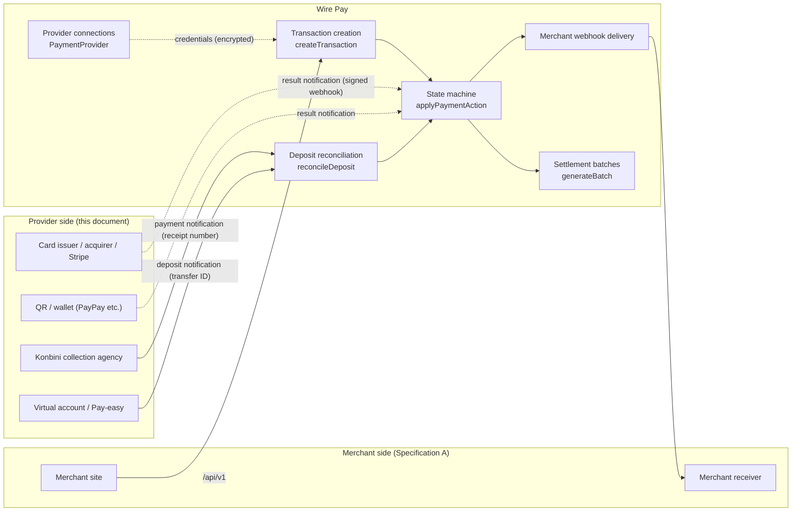
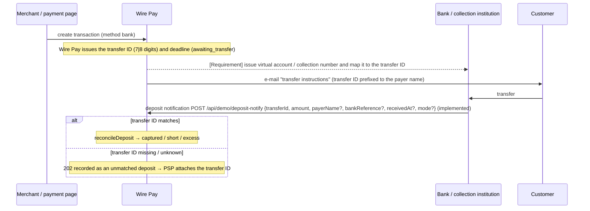

# Wire Pay Payment Provider Connection Specification

| Item | Value |
|---|---|
| Version | 1.0.0 |
| Target system | Wire Pay (payment management dashboard) — commit `6b72a40` (`main`) |
| Date | 2026-09-06 |
| Language | English (Japanese edition: `docs/spec/ja/B-provider-connection-spec.md`) |
| Terminology | Follows `docs/spec/en/glossary.md` |

## Intended readers

This document is for the parties **Wire Pay entrusts payment processing to**:

- card issuers, acquirers and card platforms such as Stripe
- QR / wallet operators such as PayPay
- konbini (convenience-store) payment collection agencies
- banks and collection institutions providing virtual accounts or Pay-easy
- upstream PSPs / wallets that Wire Pay uses as a client
- developers who **implement and operate provider connections** on the Wire Pay side

The specification for parties that **use** Wire Pay's API (merchants, downstream PSPs / wallets) is the companion document **Specification A (Merchant & Connecting-Client Integration Specification)** `docs/spec/en/A-merchant-integration-spec.md`. Where merchant-side behaviour matters here, the relevant chapter of Specification A is referenced rather than repeated.

## How this document is written

- The body contains **only facts verifiable from the implementation**. At the target commit Wire Pay runs in **demo mode and never calls an external payment network**, so no real traffic with a provider exists. This document therefore describes the current connection settings, receiving interfaces and state transitions exactly as implemented, and states the **interface requirements Wire Pay will impose on providers for a live connection** as explicitly separated "requirements" (sections headed "Requirements for a live connection").
- Unimplemented or mocked functions are listed at the end of each chapter under "Not implemented / planned" and in chapter 11, never in the body.
- Statements involving inference carry "**※要確認**" (to be confirmed) and are listed with reasons in `docs/spec/ASSUMPTIONS.md`.
- Unless stated otherwise, dates use Japan Standard Time (Asia/Tokyo); API timestamps are ISO 8601 / UTC; amounts are whole yen (JPY).

## Contents

1. [Overview](#1-overview)
2. [Connection model per payment method](#2-connection-model-per-payment-method)
3. [Receiving deposit and result notifications](#3-receiving-deposit-and-result-notifications)
4. [Identifier mapping](#4-identifier-mapping)
5. [Reconciliation and short / excess handling](#5-reconciliation-and-short--excess-handling)
6. [Authorization, capture, void, refund, chargeback](#6-authorization-capture-void-refund-chargeback)
7. [Settlement and the flow of funds](#7-settlement-and-the-flow-of-funds)
8. [Incident operations](#8-incident-operations)
9. [Security requirements](#9-security-requirements)
10. [Adding a new provider](#10-adding-a-new-provider)
11. [Not implemented / planned](#11-not-implemented--planned)
- Appendix A [Data model (ER diagram)](#appendix-a-data-model-er-diagram)
- Appendix B [Configuration items](#appendix-b-configuration-items)

---

## 1. Overview

### 1.1 Division of responsibilities



| Responsibility | Wire Pay | Provider |
|---|---|---|
| Accepting transactions, issuing identifiers | Issues the transaction ID, transfer ID (7 / 8 digits) and receipt number (13 digits) and presents them to merchants and customers | When issuing its own identifiers (virtual account numbers, collection numbers) keeps them mapped to Wire Pay's (chapter 4) |
| Executing authorization, capture, void, refund | Manages the state machine and ledger (`Payment` / `Refund` / `PaymentEvent`). **No external call at the target commit** (demo) | The real operation against the card network / wallet balance (live-connection requirement) |
| Notifying results and deposits | Receives them through the receiving interfaces (chapter 3), applies transitions, sends merchant webhooks and e-mails | Signs notifications; Wire Pay processes idempotently so retries are tolerated |
| Reconciliation, short / excess | Cumulative-amount decision (chapter 5); operator screens for unmatched and short / excess deposits | Notifies amount, time, payer name and bank reference |
| Settlement | Per-merchant batches and net payout (chapter 7), qualified invoice PDF | Funds transfer to Wire Pay. **No funds-movement connection at the target commit** |
| Chargebacks | Registration, dispute, outcome, confirmation and settlement deduction | Notification of disputes (**currently entered manually by PSP operators**) |
| Incidents | Payment-method suspension (global / per merchant), notification centre, webhook resend | Incident communication (**no system integration today**) |

### 1.2 Connection model at the target commit

| Element | Implementation |
|---|---|
| Provider definitions | `PROVIDERS` in `lib/providers/registry.ts` (15 definitions in 5 categories). Credential fields, secrecy and test-mode support are defined in code |
| Provider connection (instance) | `PaymentProvider` table: `providerKey`, `category`, `displayName`, `status` (`active` / `disabled`), `testMode`, `credentials` (JSON; secret fields as AES-256-GCM ciphertext) |
| Connection test | `runConnectionTest`: presence of required fields and URL format only. **No external API call** |
| Provider selection at creation | Public API: the **oldest** row with `status = active`, `category = method` and the key's environment (`testMode = !livemode`). PSP dashboard: chosen explicitly. Payment links: one active provider per category in the link's environment. Subscriptions: the active credit provider of the environment (else any active provider) |
| Transaction environment | `Payment.livemode = !provider.testMode`, snapshotted at creation |
| Provider-side identifier | `Payment.externalId` (in the demo generated by Wire Pay as `<first 6 chars of providerKey>_<time base36>_<random>`; unique per `(providerId, externalId)`) |
| Receiving interfaces | (a) `POST /api/webhooks/{providerId}` (signed result notifications), (b) `POST /api/demo/deposit-notify` (bank deposits), (c) `POST /api/demo/cvs-notify` (konbini payments). Chapter 3 |
| Sending interfaces | Wire Pay → merchant webhooks (Specification A, chapter 6). **No** Wire Pay → provider API calls |
| Ledger protection | A provider with transactions cannot be deleted (409 `provider_has_payments`); it is disabled instead |

### 1.3 Environments (test / live)

- A provider connection has `testMode` (true = test). Definitions with `supportsTestMode: false` (the custom webhook integration) hide the toggle in the form (**※要確認**: `supportsTestMode` only controls the UI toggle; the API accepts any `testMode`).
- Test and live are **separate `PaymentProvider` rows** of the same definition with different `testMode`.
- Transactions, refunds, settlements and webhook deliveries are all separated by `livemode` (Specification A, 1.3).

### 1.4 Not implemented / planned (chapter 1)

- No API calls from Wire Pay to providers (authorize, capture, void, refund, balance).
- No provider adapter layer (vendor notification formats → Wire Pay's internal events). The receiving interfaces use Wire Pay's own format (chapter 3).

---

## 2. Connection model per payment method

### 2.1 Provider definitions (`PROVIDERS`) and the connection form

On the PSP dashboard ("Payment providers → + Add payment provider", `/providers/new` → `/providers/new/[provider]`) the operator picks a category and a provider and fills in the fields below. Fields with `secret: true` are AES-256-GCM encrypted on save and displayed masked (`••••••••` + last 4 characters, chapter 9). `required` fields are mandatory; `type: url` fields must match `http(s)://`.

#### Credit card (`credit`)

| `providerKey` | Name | Fields (`key`: type / required / secret) |
|---|---|---|
| `stripe` | Stripe | `publishable_key`: text / required; `secret_key`: password / required / secret; `webhook_secret`: password / secret (verifies incoming webhooks); `statement_descriptor`: text (≤22 chars) |
| `square` | Square | `application_id`: text / required; `access_token`: password / required / secret; `location_id`: text / required |
| `gmo_pg` | GMO Payment Gateway | `site_id`: text / required; `site_password`: password / required / secret; `shop_id`: text / required; `shop_password`: password / required / secret; `api_endpoint`: url |

#### QR code (`qr`)

| `providerKey` | Name | Fields |
|---|---|---|
| `paypay` | PayPay | `merchant_id`: text / required; `api_key`: text / required (public identifier, stored in plaintext); `api_secret`: password / required / secret; `store_id`: text |
| `au_pay` | au PAY | `merchant_id`: text / required; `store_id`: text / required; `api_key`: text / required (plaintext); `api_secret`: password / required / secret; `callback_url`: url |
| `rakuten_pay` | Rakuten Pay (Online) | `service_id`: text / required; `auth_key`: password / required / secret; `shop_url`: url |
| `docomo_pay` | d Payment | `merchant_id`: text / required; `api_key`: password / required / secret; `callback_url`: url |

#### Konbini (`convenience`)

| `providerKey` | Name | Fields |
|---|---|---|
| `bitcash` | BitCash | `merchant_code`: text / required; `auth_key`: password / required / secret; `notify_url`: url |
| `smartpit` | Smart Pit | `client_id`: text / required; `client_secret`: password / required / secret; `expiry_days`: text (**※要確認**: display only; the payment deadline comes from the merchant's `cvsDueDays`) |
| `web_conveni` | Multi-Konbini Payment | `contract_code`: text / required; `api_token`: password / required / secret; `stores`: select (`all` / `lawson` / `familymart` / `seven`; **※要確認**: display only; the payment page always offers `CVS_BRANDS`) |

#### Bank transfer (`bank`)

| `providerKey` | Name | Fields |
|---|---|---|
| `pay_easy` | Pay-easy | `collection_agency`: text / required (collection agency number); `customer_number_prefix`: text; `confirmation_number`: password / secret |
| `virtual_account` | Virtual Account (GMO/SBI etc.) | `bank_partner`: select / required (`gmo_aozora` / `sbi` / `mizuho` / `rakuten`); `api_user`: text / required; `api_password`: password / required / secret; `branch_code`: text; `webhook_url`: url (deposit notification webhook URL; **※要確認**: display only — Wire Pay's receiving URL is fixed at `/api/demo/deposit-notify`) |

#### Other (`other`)

| `providerKey` | Name | Fields |
|---|---|---|
| `custom_webhook` | Custom Webhook | `service_name`: text / required; `endpoint`: url / required; `auth_header`: password / secret; `webhook_secret`: password / secret (verifies incoming webhooks); `notes`: textarea. `supportsTestMode: false` |

**The only field actually read at the target commit is `webhook_secret`** (`stripe`, `custom_webhook`). All other fields are stored, displayed and checked by the connection test but never used for processing (chapter 11).

### 2.2 What Wire Pay exchanges with providers per method

The sequence diagrams distinguish **implemented paths (solid)** from **requirements for a live connection (dashed, marked "Requirement")**.

#### Credit / QR

```mermaid
sequenceDiagram
  participant S as Merchant / payment page
  participant W as Wire Pay
  participant P as Card / QR provider

  S->>W: create transaction (method credit|qr, autoCapture)
  Note over W: today: authorization and capture settle in the DB immediately<br/>(captured or authorized); no call to P
  W-->>P: [Requirement] authorize / capture / void / refund API calls
  P-->>W: [Requirement] result (approval code, provider transaction ID)
  P->>W: result notification POST /api/webhooks/{providerId} (signed, implemented)
  Note over W: payment.captured → capture / payment.failed → fail /<br/>payment.cancelled → cancel / payment.refunded → refund
```

- The implemented receiver is `POST /api/webhooks/{providerId}` (3.1): it finds the transaction by `externalId` and applies the transition per `EVENT_TO_ACTION`.
- What Wire Pay sends (requirement): amount (yen), Wire Pay transaction ID (reference), the merchant's order number, card data (**Wire Pay never holds the PAN, so a live connection must rely on the provider's tokenisation / hosted fields**, chapter 9).
- What Wire Pay receives: the provider transaction ID (stored in `externalId`), the result type, optionally an amount.

#### Konbini

```mermaid
sequenceDiagram
  participant S as Merchant / payment page
  participant W as Wire Pay
  participant K as Konbini collection agency
  participant C as Customer

  S->>W: create transaction (method convenience, cvsBrand)
  Note over W: Wire Pay issues the 13-digit receipt number and the deadline (pending)
  W-->>K: [Requirement] register receipt number, amount, deadline, store (or obtain K's number)
  W->>C: e-mail "konbini payment instructions"
  C->>K: pays at the counter
  K->>W: payment notification POST /api/demo/cvs-notify {receiptNo, amount?} (implemented)
  Note over W: deposit → captured, cvsPaidAt; payment.completed to the merchant
  Note over W: past the deadline → hourly cron expires it (no cancellation sent to K)
```

#### Bank transfer (virtual account / Pay-easy)



### 2.3 Provider connection API (used by the PSP dashboard)

| Method / path | Permission | Content |
|---|---|---|
| `GET /api/providers` | view | List (never includes `credentials`) |
| `POST /api/providers` | `provider.create` (admin / developer) | `{ providerKey, displayName (≤80), testMode (default true), credentials }`. Missing required fields → 400 `missing_required`; unknown `providerKey` → 400 `unsupported_provider`; cap 50 → 403 `demo_limit`. Audit `provider.create` |
| `PATCH /api/providers/{id}` | `provider.update` | `displayName` / `status` (`active` / `disabled`) / `testMode` / `credentials` (`""` on a secret field = unchanged, on a non-secret field = delete). Audit `provider.update` (records only whether credentials changed) |
| `DELETE /api/providers/{id}` | `provider.delete` | 409 `provider_has_payments` if any transaction exists. Audit `provider.delete` |
| `POST /api/providers/test` | `provider.test` | Connection test on unsaved form values (required fields, URL format only) |
| `POST /api/providers/{id}/test` | `provider.test` | Connection test on the stored, decrypted credentials; updates `lastTestAt` / `lastTestOk`. Undecryptable (key changed) → 422 `undecryptable` |

With `DEMO_READONLY=1` (public demo) `DELETE` and `PATCH /api/providers/*` answer 403 for everyone.

### 2.4 Not implemented / planned (chapter 2)

- Nothing calls provider APIs with the stored credentials (`secret_key`, `api_secret`, …). The connection test makes no network call.
- No registration / issuance with konbini agencies or virtual-account banks, and no cancellation notice on expiry.
- Fields such as `expiry_days`, `stores`, `webhook_url`, `callback_url`, `notify_url`, `statement_descriptor` are stored and displayed only and have no effect.
