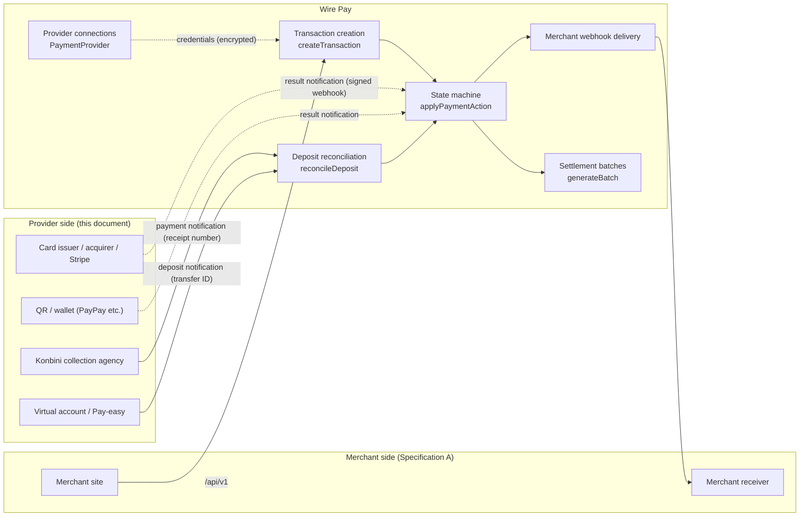
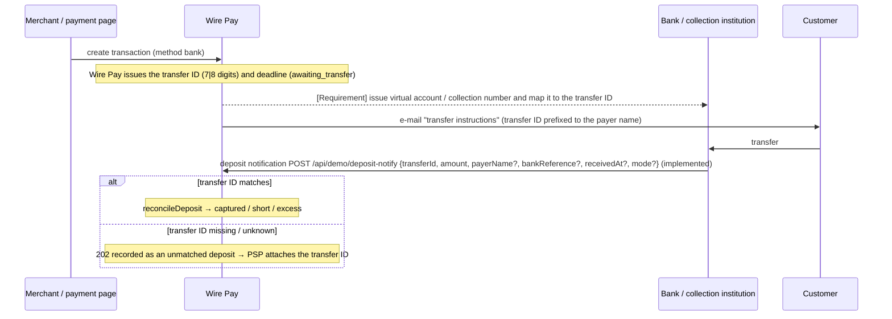
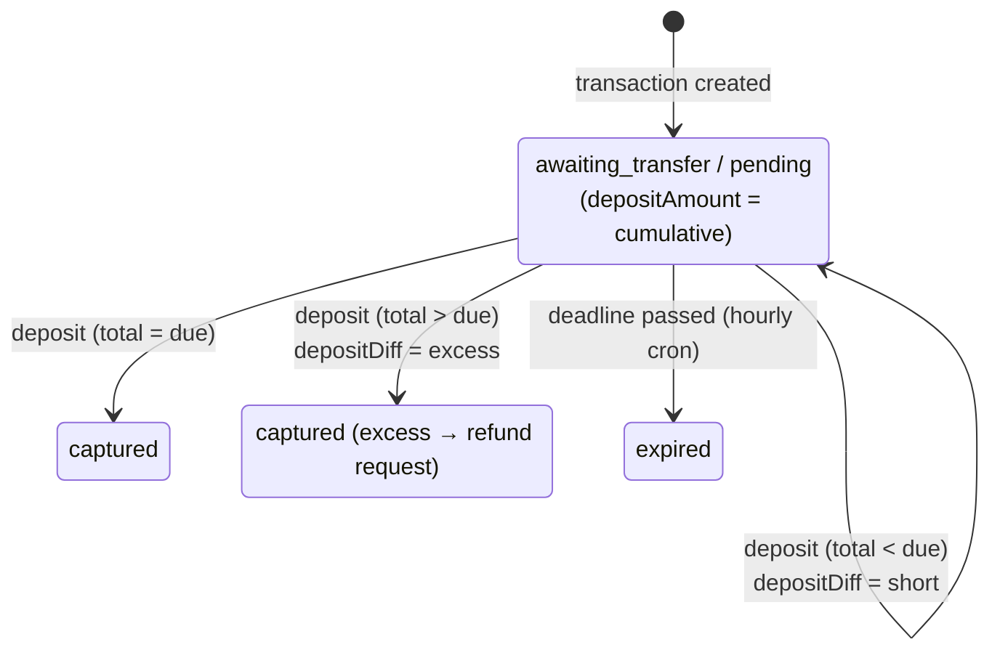
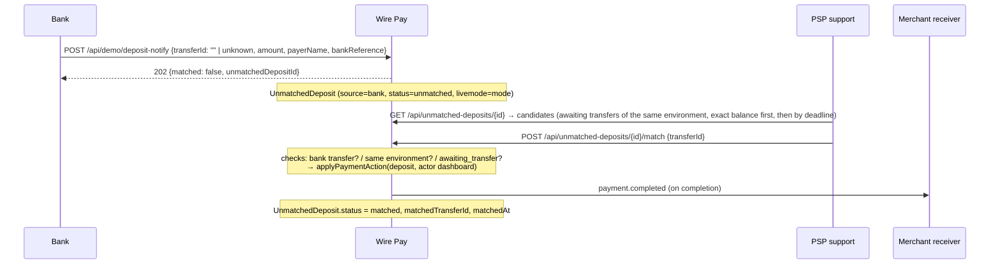
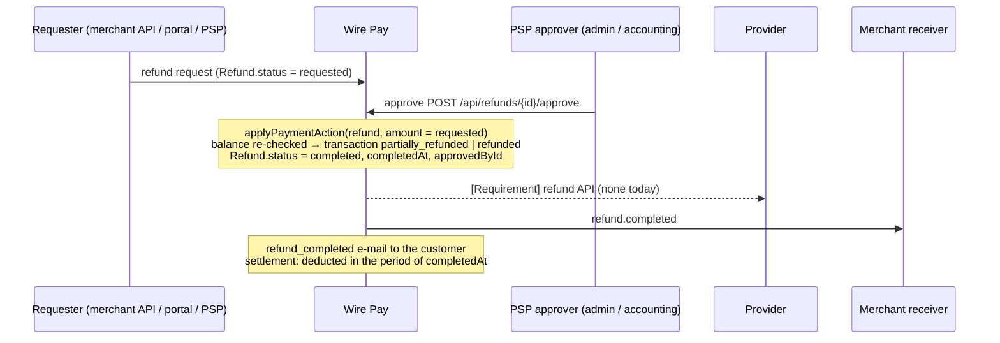
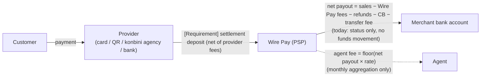
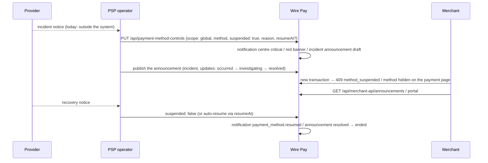
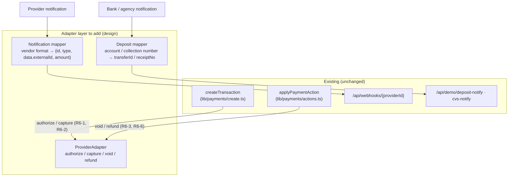
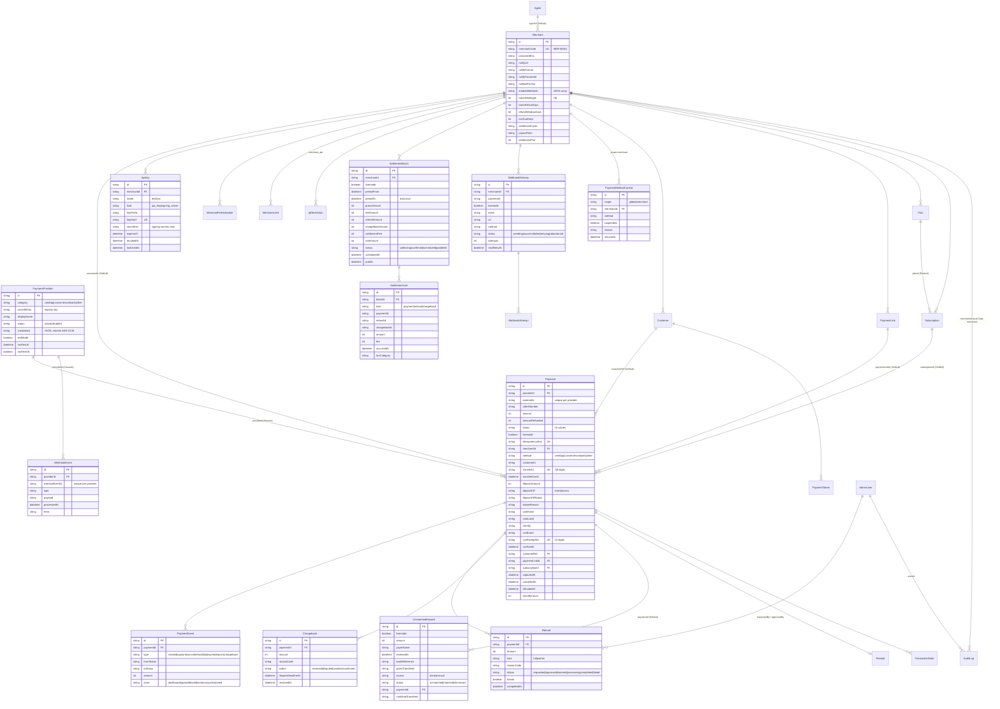

# Wire Pay Payment Provider Connection Specification

| Item | Value |
|---|---|
| Version | 1.0.0 |
| Target system | Wire Pay (payment management dashboard) — commit `6b72a40` (`main`) |
| Date | 2026-09-06 |
| Language | English (Japanese edition: `docs/spec/ja/B-provider-connection-spec.md`) |
| Terminology | Follows `docs/spec/en/glossary.md` |

## Intended readers

This document is for the parties **Wire Pay entrusts payment processing to**:

- card issuers, acquirers and card platforms such as Stripe
- QR / wallet operators such as PayPay
- konbini (convenience-store) payment collection agencies
- banks and collection institutions providing virtual accounts or Pay-easy
- upstream PSPs / wallets that Wire Pay uses as a client
- developers who **implement and operate provider connections** on the Wire Pay side

The specification for parties that **use** Wire Pay's API (merchants, downstream PSPs / wallets) is the companion document **Specification A (Merchant & Connecting-Client Integration Specification)** `docs/spec/en/A-merchant-integration-spec.md`. Where merchant-side behaviour matters here, the relevant chapter of Specification A is referenced rather than repeated.

## How this document is written

- The body contains **only facts verifiable from the implementation**. At the target commit Wire Pay runs in **demo mode and never calls an external payment network**, so no real traffic with a provider exists. This document therefore describes the current connection settings, receiving interfaces and state transitions exactly as implemented, and states the **interface requirements Wire Pay will impose on providers for a live connection** as explicitly separated "requirements" (sections headed "Requirements for a live connection").
- Unimplemented or mocked functions are listed at the end of each chapter under "Not implemented / planned" and in chapter 11, never in the body.
- Statements involving inference carry "**※要確認**" (to be confirmed) and are listed with reasons in `docs/spec/ASSUMPTIONS.md`.
- Unless stated otherwise, dates use Japan Standard Time (Asia/Tokyo); API timestamps are ISO 8601 / UTC; amounts are whole yen (JPY).

## Contents

1. [Overview](#1-overview)
2. [Connection model per payment method](#2-connection-model-per-payment-method)
3. [Receiving deposit and result notifications](#3-receiving-deposit-and-result-notifications)
4. [Identifier mapping](#4-identifier-mapping)
5. [Reconciliation and short / excess handling](#5-reconciliation-and-short--excess-handling)
6. [Authorization, capture, void, refund, chargeback](#6-authorization-capture-void-refund-chargeback)
7. [Settlement and the flow of funds](#7-settlement-and-the-flow-of-funds)
8. [Incident operations](#8-incident-operations)
9. [Security requirements](#9-security-requirements)
10. [Adding a new provider](#10-adding-a-new-provider)
11. [Not implemented / planned](#11-not-implemented--planned)
- Appendix A [Data model (ER diagram)](#appendix-a-data-model-er-diagram)
- Appendix B [Configuration items](#appendix-b-configuration-items)

---

## 1. Overview

### 1.1 Division of responsibilities



| Responsibility | Wire Pay | Provider |
|---|---|---|
| Accepting transactions, issuing identifiers | Issues the transaction ID, transfer ID (7 / 8 digits) and receipt number (13 digits) and presents them to merchants and customers | When issuing its own identifiers (virtual account numbers, collection numbers) keeps them mapped to Wire Pay's (chapter 4) |
| Executing authorization, capture, void, refund | Manages the state machine and ledger (`Payment` / `Refund` / `PaymentEvent`). **No external call at the target commit** (demo) | The real operation against the card network / wallet balance (live-connection requirement) |
| Notifying results and deposits | Receives them through the receiving interfaces (chapter 3), applies transitions, sends merchant webhooks and e-mails | Signs notifications; Wire Pay processes idempotently so retries are tolerated |
| Reconciliation, short / excess | Cumulative-amount decision (chapter 5); operator screens for unmatched and short / excess deposits | Notifies amount, time, payer name and bank reference |
| Settlement | Per-merchant batches and net payout (chapter 7), qualified invoice PDF | Funds transfer to Wire Pay. **No funds-movement connection at the target commit** |
| Chargebacks | Registration, dispute, outcome, confirmation and settlement deduction | Notification of disputes (**currently entered manually by PSP operators**) |
| Incidents | Payment-method suspension (global / per merchant), notification centre, webhook resend | Incident communication (**no system integration today**) |

### 1.2 Connection model at the target commit

| Element | Implementation |
|---|---|
| Provider definitions | `PROVIDERS` in `lib/providers/registry.ts` (15 definitions in 5 categories). Credential fields, secrecy and test-mode support are defined in code |
| Provider connection (instance) | `PaymentProvider` table: `providerKey`, `category`, `displayName`, `status` (`active` / `disabled`), `testMode`, `credentials` (JSON; secret fields as AES-256-GCM ciphertext) |
| Connection test | `runConnectionTest`: presence of required fields and URL format only. **No external API call** |
| Provider selection at creation | Public API: the **oldest** row with `status = active`, `category = method` and the key's environment (`testMode = !livemode`). PSP dashboard: chosen explicitly. Payment links: one active provider per category in the link's environment. Subscriptions: the active credit provider of the environment (else any active provider) |
| Transaction environment | `Payment.livemode = !provider.testMode`, snapshotted at creation |
| Provider-side identifier | `Payment.externalId` (in the demo generated by Wire Pay as `<first 6 chars of providerKey>_<time base36>_<random>`; unique per `(providerId, externalId)`) |
| Receiving interfaces | (a) `POST /api/webhooks/{providerId}` (signed result notifications), (b) `POST /api/demo/deposit-notify` (bank deposits), (c) `POST /api/demo/cvs-notify` (konbini payments). Chapter 3 |
| Sending interfaces | Wire Pay → merchant webhooks (Specification A, chapter 6). **No** Wire Pay → provider API calls |
| Ledger protection | A provider with transactions cannot be deleted (409 `provider_has_payments`); it is disabled instead |

### 1.3 Environments (test / live)

- A provider connection has `testMode` (true = test). Definitions with `supportsTestMode: false` (the custom webhook integration) hide the toggle in the form (**※要確認**: `supportsTestMode` only controls the UI toggle; the API accepts any `testMode`).
- Test and live are **separate `PaymentProvider` rows** of the same definition with different `testMode`.
- Transactions, refunds, settlements and webhook deliveries are all separated by `livemode` (Specification A, 1.3).

### 1.4 Not implemented / planned (chapter 1)

- No API calls from Wire Pay to providers (authorize, capture, void, refund, balance).
- No provider adapter layer (vendor notification formats → Wire Pay's internal events). The receiving interfaces use Wire Pay's own format (chapter 3).

---

## 2. Connection model per payment method

### 2.1 Provider definitions (`PROVIDERS`) and the connection form

On the PSP dashboard ("Payment providers → + Add payment provider", `/providers/new` → `/providers/new/[provider]`) the operator picks a category and a provider and fills in the fields below. Fields with `secret: true` are AES-256-GCM encrypted on save and displayed masked (`••••••••` + last 4 characters, chapter 9). `required` fields are mandatory; `type: url` fields must match `http(s)://`.

#### Credit card (`credit`)

| `providerKey` | Name | Fields (`key`: type / required / secret) |
|---|---|---|
| `stripe` | Stripe | `publishable_key`: text / required; `secret_key`: password / required / secret; `webhook_secret`: password / secret (verifies incoming webhooks); `statement_descriptor`: text (≤22 chars) |
| `square` | Square | `application_id`: text / required; `access_token`: password / required / secret; `location_id`: text / required |
| `gmo_pg` | GMO Payment Gateway | `site_id`: text / required; `site_password`: password / required / secret; `shop_id`: text / required; `shop_password`: password / required / secret; `api_endpoint`: url |

#### QR code (`qr`)

| `providerKey` | Name | Fields |
|---|---|---|
| `paypay` | PayPay | `merchant_id`: text / required; `api_key`: text / required (public identifier, stored in plaintext); `api_secret`: password / required / secret; `store_id`: text |
| `au_pay` | au PAY | `merchant_id`: text / required; `store_id`: text / required; `api_key`: text / required (plaintext); `api_secret`: password / required / secret; `callback_url`: url |
| `rakuten_pay` | Rakuten Pay (Online) | `service_id`: text / required; `auth_key`: password / required / secret; `shop_url`: url |
| `docomo_pay` | d Payment | `merchant_id`: text / required; `api_key`: password / required / secret; `callback_url`: url |

#### Konbini (`convenience`)

| `providerKey` | Name | Fields |
|---|---|---|
| `bitcash` | BitCash | `merchant_code`: text / required; `auth_key`: password / required / secret; `notify_url`: url |
| `smartpit` | Smart Pit | `client_id`: text / required; `client_secret`: password / required / secret; `expiry_days`: text (**※要確認**: display only; the payment deadline comes from the merchant's `cvsDueDays`) |
| `web_conveni` | Multi-Konbini Payment | `contract_code`: text / required; `api_token`: password / required / secret; `stores`: select (`all` / `lawson` / `familymart` / `seven`; **※要確認**: display only; the payment page always offers `CVS_BRANDS`) |

#### Bank transfer (`bank`)

| `providerKey` | Name | Fields |
|---|---|---|
| `pay_easy` | Pay-easy | `collection_agency`: text / required (collection agency number); `customer_number_prefix`: text; `confirmation_number`: password / secret |
| `virtual_account` | Virtual Account (GMO/SBI etc.) | `bank_partner`: select / required (`gmo_aozora` / `sbi` / `mizuho` / `rakuten`); `api_user`: text / required; `api_password`: password / required / secret; `branch_code`: text; `webhook_url`: url (deposit notification webhook URL; **※要確認**: display only — Wire Pay's receiving URL is fixed at `/api/demo/deposit-notify`) |

#### Other (`other`)

| `providerKey` | Name | Fields |
|---|---|---|
| `custom_webhook` | Custom Webhook | `service_name`: text / required; `endpoint`: url / required; `auth_header`: password / secret; `webhook_secret`: password / secret (verifies incoming webhooks); `notes`: textarea. `supportsTestMode: false` |

**The only field actually read at the target commit is `webhook_secret`** (`stripe`, `custom_webhook`). All other fields are stored, displayed and checked by the connection test but never used for processing (chapter 11).

### 2.2 What Wire Pay exchanges with providers per method

The sequence diagrams distinguish **implemented paths (solid)** from **requirements for a live connection (dashed, marked "Requirement")**.

#### Credit / QR

```mermaid
sequenceDiagram
  participant S as Merchant / payment page
  participant W as Wire Pay
  participant P as Card / QR provider

  S->>W: create transaction (method credit|qr, autoCapture)
  Note over W: today: authorization and capture settle in the DB immediately<br/>(captured or authorized); no call to P
  W-->>P: [Requirement] authorize / capture / void / refund API calls
  P-->>W: [Requirement] result (approval code, provider transaction ID)
  P->>W: result notification POST /api/webhooks/{providerId} (signed, implemented)
  Note over W: payment.captured → capture / payment.failed → fail /<br/>payment.cancelled → cancel / payment.refunded → refund
```

- The implemented receiver is `POST /api/webhooks/{providerId}` (3.1): it finds the transaction by `externalId` and applies the transition per `EVENT_TO_ACTION`.
- What Wire Pay sends (requirement): amount (yen), Wire Pay transaction ID (reference), the merchant's order number, card data (**Wire Pay never holds the PAN, so a live connection must rely on the provider's tokenisation / hosted fields**, chapter 9).
- What Wire Pay receives: the provider transaction ID (stored in `externalId`), the result type, optionally an amount.

#### Konbini

```mermaid
sequenceDiagram
  participant S as Merchant / payment page
  participant W as Wire Pay
  participant K as Konbini collection agency
  participant C as Customer

  S->>W: create transaction (method convenience, cvsBrand)
  Note over W: Wire Pay issues the 13-digit receipt number and the deadline (pending)
  W-->>K: [Requirement] register receipt number, amount, deadline, store (or obtain K's number)
  W->>C: e-mail "konbini payment instructions"
  C->>K: pays at the counter
  K->>W: payment notification POST /api/demo/cvs-notify {receiptNo, amount?} (implemented)
  Note over W: deposit → captured, cvsPaidAt; payment.completed to the merchant
  Note over W: past the deadline → hourly cron expires it (no cancellation sent to K)
```

#### Bank transfer (virtual account / Pay-easy)



### 2.3 Provider connection API (used by the PSP dashboard)

| Method / path | Permission | Content |
|---|---|---|
| `GET /api/providers` | view | List (never includes `credentials`) |
| `POST /api/providers` | `provider.create` (admin / developer) | `{ providerKey, displayName (≤80), testMode (default true), credentials }`. Missing required fields → 400 `missing_required`; unknown `providerKey` → 400 `unsupported_provider`; cap 50 → 403 `demo_limit`. Audit `provider.create` |
| `PATCH /api/providers/{id}` | `provider.update` | `displayName` / `status` (`active` / `disabled`) / `testMode` / `credentials` (`""` on a secret field = unchanged, on a non-secret field = delete). Audit `provider.update` (records only whether credentials changed) |
| `DELETE /api/providers/{id}` | `provider.delete` | 409 `provider_has_payments` if any transaction exists. Audit `provider.delete` |
| `POST /api/providers/test` | `provider.test` | Connection test on unsaved form values (required fields, URL format only) |
| `POST /api/providers/{id}/test` | `provider.test` | Connection test on the stored, decrypted credentials; updates `lastTestAt` / `lastTestOk`. Undecryptable (key changed) → 422 `undecryptable` |

With `DEMO_READONLY=1` (public demo) `DELETE` and `PATCH /api/providers/*` answer 403 for everyone.

### 2.4 Not implemented / planned (chapter 2)

- Nothing calls provider APIs with the stored credentials (`secret_key`, `api_secret`, …). The connection test makes no network call.
- No registration / issuance with konbini agencies or virtual-account banks, and no cancellation notice on expiry.
- Fields such as `expiry_days`, `stores`, `webhook_url`, `callback_url`, `notify_url`, `statement_descriptor` are stored and displayed only and have no effect.

---

## 3. Receiving deposit and result notifications

Notifications Wire Pay receives from providers fall into three receiving interfaces. All use Wire Pay's own format and are exempt from the middleware's session, CSRF and (dashboard-oriented) IP checks.

| Receiving interface | Purpose | Authentication | Implementation |
|---|---|---|---|
| `POST /api/webhooks/{providerId}` | **Result notifications** for card / QR / other (capture, failure, cancellation, refund) | HMAC-SHA256 signature (the connection's `webhook_secret`) | `app/api/webhooks/[providerId]/route.ts`, `lib/webhooks/verify.ts` |
| `POST /api/demo/deposit-notify` | **Bank-transfer deposit notifications** | Bearer `DEPOSIT_NOTIFY_SECRET` | `app/api/demo/deposit-notify/route.ts` |
| `POST /api/demo/cvs-notify` | **Konbini payment notifications** | Bearer `DEPOSIT_NOTIFY_SECRET` (shared with the bank one) | `app/api/demo/cvs-notify/route.ts` |

Although the `/api/demo/*` names come from the demo, this document treats them as the **specification of the receiving interfaces**. For a live connection an adapter must satisfy the same contract (request / response / idempotency) — see 3.5. The demo receiver for merchant webhooks, `GET/POST /api/demo/webhook-receiver`, simulates the Wire Pay → merchant direction and is irrelevant to providers (Specification A, 12.3).

### 3.1 Result notifications: `POST /api/webhooks/{providerId}`

#### Request

| Item | Specification |
|---|---|
| Path | `{providerId}` = `PaymentProvider.id` (Wire Pay's connection ID, communicated to the provider as its notification URL) |
| Headers | `Wirepay-Signature: t=<UNIX seconds>,v1=<hex HMAC-SHA256>`; `Content-Type: application/json` |
| Signature | `v1 = hex( HMAC_SHA256( key = webhook_secret, message = "<t>.<raw body>" ) )`. **Stripe-compatible format.** Rejected when `t` differs from now by more than **±300 seconds** |
| Body | `{ "id": string(1–128), "type": "payment.captured" \| "payment.failed" \| "payment.cancelled" \| "payment.refunded", "data": { "externalId": string, "amount"?: integer > 0 } }` |
| `id` | The provider's event ID; de-duplicated on `(providerId, id)` |
| `data.externalId` | The provider transaction ID (`Payment.externalId`, unique per `(providerId, externalId)`) |
| `data.amount` | The refund amount for `payment.refunded` (omitted = the whole remaining balance); ignored for other types |

#### Processing

1. Load the provider by `providerId`; missing → 404 `provider_not_found`.
2. Decrypt the credentials and read `webhook_secret`; unset → 400 `webhook_not_configured`.
3. Verify the signature; failures → 400 `signature_malformed` / `signature_expired` / `signature_mismatch`.
4. Parse JSON (400 `invalid_json`) and validate the schema (400 `invalid_input`).
5. De-duplicate: an existing `(providerId, externalEventId)` answers **200 `{ received: true, duplicate: true }`** without re-applying. Concurrent arrivals are resolved by the unique constraint.
6. Store the raw body in `WebhookEvent`.
7. Find the transaction by `externalId`; missing → record `error = payment_not_found` and answer 404 `not_found`.
8. Apply the action mapped by `EVENT_TO_ACTION` (`applyPaymentAction`, actor `webhook`, audit actor type `webhook`). An impossible transition (e.g. `payment.captured` on a completed transaction) answers 409 `invalid_transition` and stores the message in `WebhookEvent.error`.

| `type` | Action | Allowed source statuses | Merchant webhook |
|---|---|---|---|
| `payment.captured` | `capture` | `pending` / `authorized` / `awaiting_transfer` | `payment.completed` |
| `payment.failed` | `fail` | `pending` / `authorized` / `awaiting_transfer` | `payment.failed` |
| `payment.cancelled` | `cancel` | `pending` / `authorized` / `awaiting_transfer` | `payment.cancelled` |
| `payment.refunded` | `refund` | `captured` / `partially_refunded` | `refund.completed` (a `Refund` row is created directly as `completed`, reason `other`) |

#### Response

| HTTP | Body | Meaning |
|---|---|---|
| 200 | `{ ok: true, data: { received: true, duplicate: false, payment: { id, status, amountRefunded, depositAmount, depositDiff } } }` | Applied |
| 200 | `{ received: true, duplicate: true }` | Event ID already processed |
| 400 | `signature_*` / `webhook_not_configured` / `invalid_json` / `invalid_input` / `refund_exceeds` | Retrying will not help |
| 404 | `provider_not_found` / `not_found` | Connection ID or transaction not found |
| 409 | `invalid_transition` | Not applicable in the current status |

#### Wire Pay's behaviour towards provider retries

- A retry with the same `id` always answers 200 (duplicate). **Providers should retry only on non-2xx.** 4xx responses will not succeed until the content changes.
- The timestamp tolerance is 5 minutes; recompute `t` and the signature on retry.

#### Test facility

The PSP dashboard's "Simulate webhook" on a transaction detail (permission `payment.simulate_webhook` = admin / developer) builds an event of the above shape for the transaction's `externalId`, signs it with the provider's `webhook_secret` and **POSTs it to Wire Pay's own `/api/webhooks/{providerId}`** (`POST /api/payments/{id}/simulate-webhook` `{ type, amount? }`), exercising signature verification, de-duplication and the state machine on the production path.

### 3.2 Bank-transfer deposit notifications: `POST /api/demo/deposit-notify`

#### Request

| Item | Type | Required | Description |
|---|---|---|---|
| `Authorization` | header | when configured | `Bearer <DEPOSIT_NOTIFY_SECRET>` (constant-time compare). When the variable is unset: 404 (disabled) in production, open in development |
| `transferId` | string (≤20) | | The transfer ID the customer prefixed to the payer name. When it does not match `^\d{7,8}$` or no transaction exists, the deposit is recorded as **unmatched** |
| `amount` | integer (1–99,999,999) | ○ | Amount received (yen) |
| `payerName` | string (≤120) | | Payer name (kept on the unmatched deposit; `(unknown)` when omitted) |
| `bankReference` | string (≤80) | | The bank's statement reference |
| `receivedAt` | string (ISO date-time, ≤40) | | Deposit time; defaults to now |
| `mode` | `test` \| `live` | | Environment of the virtual account (only for the unmatched deposit's `livemode`); default `test` |

#### Processing and response

| Situation | HTTP | `data` |
|---|---|---|
| Transfer ID matched, reconciliation applied | 200 | `{ matched: true, transferId, paymentId, amount (due), received (this deposit), depositAmount (cumulative), depositDiff: null \| "short" \| "excess", status, completed: boolean }` |
| Transfer ID missing / malformed / unknown | **202** | `{ matched: false, transferId: string \| null, unmatchedDepositId, received }` (an `UnmatchedDeposit` with `source = bank`, `status = unmatched` is created; audit `deposit.register`) |
| Transaction not awaiting transfer (completed, expired, cancelled…) | 409 | `invalid_transition` (`depositOnlyAwaiting`) |
| Transaction with neither transfer ID nor receipt number | 400 | `not_bank_transfer` |
| Invalid `amount` | 400 | `invalid_input` |
| Provider connection disabled | 400 | `provider_disabled` |

- Reconciliation is `applyPaymentAction(deposit, actor: "bank")`; audit actor type `bank`; decision rules in chapter 5.
- On completion the merchant receives `payment.completed` and the customer a "payment completed" e-mail.
- **Note**: matching uses `transferId` only; `mode` is not part of the match (the transaction's own `livemode` applies). `mode` only affects the environment of an unmatched deposit.

### 3.3 Konbini payment notifications: `POST /api/demo/cvs-notify`

| Item | Type | Required | Description |
|---|---|---|---|
| `Authorization` | header | when configured | As in 3.2 |
| `receiptNo` | string (≤20) | ○ | The 13-digit receipt number; hyphens are stripped before matching (`4102-9938-27716` accepted). Malformed / unknown → 404 `receipt_not_found` |
| `amount` | integer | | Amount paid at the counter; omitted = **the transaction amount** (treated as exact) |

| Situation | HTTP | `data` |
|---|---|---|
| Applied | 200 | `{ receiptNo (hyphens removed), paymentId, amount (due), received, depositDiff, status, completed }` |
| Unknown | 404 | `receipt_not_found` |
| Not awaiting payment | 409 | `invalid_transition` |

- Reconciliation is `applyPaymentAction(deposit, actor: "cvs")` with `waiting = pending`. On completion `cvsPaidAt` is stamped, the merchant receives `payment.completed` and the customer the completion e-mail.
- The payment page's "Mark as paid at the store (demo)" calls the same `deposit` with actor `cvs` (Specification A, 7.5).

### 3.4 Common receiving rules

| Item | Specification |
|---|---|
| Response envelope | `{ ok: true, data }` / `{ ok: false, error: { code, message } }` (`x-lang` selects the language) |
| Idempotency | Result notifications are de-duplicated by event ID. Deposit notifications **carry no event ID; the same notification sent twice is counted twice** (chapter 5). The sender must suppress retries or manage duplicates (e.g. by `bankReference`) |
| Rate limit | None (the middleware passes `/api/webhooks/` and `/api/demo/*` as self-authenticating paths) |
| IP restriction | The dashboard block list does not apply (`ipRestricted: false`) |
| Audit | `AuditLog.actorType` = `webhook` / `bank` / `cvs`, with the caller IP |
| Status history | `PaymentEvent.actor` = `webhook` / `bank` / `cvs` |

### 3.5 Requirements for a live connection (interfaces required of providers)

To connect the receiving interfaces of the target commit to real notifications, the provider (or an adapter) must satisfy:

| Requirement | Content |
|---|---|
| R3-1 Result signature | HMAC-SHA256 in the `t=<UNIX seconds>,v1=<hex>` format, with a shared secret that fits Wire Pay's `webhook_secret` field; clock skew within 5 minutes |
| R3-2 Event ID | A unique, immutable provider-side event ID (≤128 chars), identical on retries |
| R3-3 Transaction mapping | The notification carries the `externalId` Wire Pay issued (a live design must store the provider's transaction ID instead, chapter 4) |
| R3-4 Event types | Mappable onto `payment.captured` / `payment.failed` / `payment.cancelled` / `payment.refunded` (vendor names translated by an adapter) |
| R3-5 Bank deposit notification | Carries the transfer ID (7 / 8 digits), amount, deposit time, payer name and bank reference; deposits whose transfer ID cannot be read are still notified (held as unmatched) |
| R3-6 Konbini payment notification | Carries the 13-digit receipt number and the amount paid |
| R3-7 Retry policy | Retry only on non-2xx. **Never send a deposit notification twice** (Wire Pay has no event-ID de-duplication for deposits) |
| R3-8 Authentication | Deposit notifications use a Bearer token (`DEPOSIT_NOTIFY_SECRET`); per-provider tokens require an adapter (one shared secret today) |
| R3-9 Environment separation | Test notifications must reach only test transactions (`livemode = false`). Result notifications are separated by `providerId` (per connection); deposit notifications match by transfer ID / receipt number, which are unique across environments and could match across them (4.3) |

### 3.6 Not implemented / planned (chapter 3)

- No adapters translating vendor formats (Stripe `payment_intent.succeeded`, PayPay `PAYMENT_COMPLETED`, …).
- No event ID / de-duplication for deposit notifications, no per-provider Bearer tokens, no source-IP restriction.
- Only four result types are accepted; transitions to authorized-only, partial captures and chargeback notifications are not.

---

## 4. Identifier mapping

### 4.1 Wire Pay identifiers

| Identifier | Column | Format | Uniqueness | Issued | Used for |
|---|---|---|---|---|---|
| Transaction ID | `Payment.id` | cuid (about 25 alphanumerics) | System-wide | At creation (Prisma) | `id` in the merchant API, `payment_id` in webhooks, dashboards |
| Provider transaction ID | `Payment.externalId` | Any string; in the demo `<first 6 chars of providerKey (alphanumeric, lower case)>_<creation time base36>_<8 random chars>` | Per `(providerId, externalId)` | Generated by Wire Pay at creation (demo) | `data.externalId` of result notifications, `transaction_id` of merchant webhooks |
| Transfer ID | `Payment.transferId` | 7 or 8 digits (merchant setting `transferIdDigits`), first digit non-zero (`^[1-9]\d{6,7}$`) | **System-wide** (`@unique`, across environments) | Random at bank-transfer creation, redrawn once on collision | Deposit-notification match key, customer instructions |
| Receipt number | `Payment.cvsReceiptNo` | 13 digits, first digit non-zero (`^[1-9]\d{12}$`); displayed 4-4-5 | **System-wide** (`@unique`) | Random at konbini creation, redrawn once | Payment-notification match key, customer instructions |
| Order number | `Payment.orderNumber` | Merchant-supplied (≤64). Payment links `LNK-<TOKEN6>-<4-digit seq>`, subscriptions `SUB-<last 6 of subscription id>-<YYYYMMDD>` (`-F` suffix for failed records) | Not unique | Merchant / Wire Pay | Display, settlement line description |
| Idempotency key | `Payment.idempotencyKey` | 8–128 chars | System-wide | Merchant | Duplicate prevention |
| Event ID (inbound) | `WebhookEvent.externalEventId` | Provider-side ID (≤128) | Per `(providerId, externalEventId)` | Provider | De-duplication of result notifications |
| Connection ID | `PaymentProvider.id` | cuid | System-wide | At connection creation | Path of the result-notification URL |
| Merchant ID | `Merchant.merchantCode` | `MER-` + 5-digit sequence | System-wide | At merchant creation | `merchant_id` in merchant webhooks, part of the invoice number |
| Receipt / invoice number | `Receipt.receiptNo` / (at PDF generation) | `RC-YYYYMM-00001` (monthly sequence) / `INV-YYYYMM-<merchant number>` | Receipts system-wide | At issue | Documents |

### 4.2 Mapping to provider identifiers

| Provider identifier | Wire Pay counterpart | Today | Requirement for a live connection |
|---|---|---|---|
| Card / QR transaction ID (Stripe PaymentIntent ID, PayPay merchantPaymentId, …) | `Payment.externalId` | Wire Pay generates a pseudo ID and expects result notifications to return it in `data.externalId` | R4-1: **overwrite** `externalId` with the provider's transaction ID obtained from the authorize / capture response and match notifications on it; or pass Wire Pay's generated `externalId` to the provider as its reference (`merchantPaymentId` etc.) and have notifications echo it |
| Virtual account number / collection customer & confirmation numbers | None (matching by transfer ID) | The customer prefixes the transfer ID to the payer name | R4-2: when accounts / numbers are issued per order, keep an account-number → transfer ID (or transaction ID) map in the adapter and translate deposit notifications into `transferId`; respect the merchant's length setting (7 / 8) |
| Konbini receipt / slip number | `Payment.cvsReceiptNo` | Wire Pay generates the 13 digits | R4-3: when the agency issues the number, normalise it to 13 digits (first non-zero) into `cvsReceiptNo`, or translate through a map |
| Notification event ID | `WebhookEvent.externalEventId` | Stored as-is | R4-4: must be unique and immutable |
| Chargeback / dispute case ID | None | Entered manually by the PSP (`Chargeback` has no external ID column) | R4-5: future column (**※要確認**: not implemented) |

### 4.3 Uniqueness and collisions

- Transfer IDs and receipt numbers are **random**; the DB unique constraint detects a collision and one redraw is attempted (two consecutive collisions answer 409 `conflict`). The 7-digit space holds 9 × 10^6 values, the 13-digit space 9 × 10^12.
- Transfer IDs and receipt numbers are unique across environments (test / live). A test deposit notification could in theory match a live transfer ID (3.5, R3-9); `mode` is not used for matching.
- `externalId` is unique per connection (`providerId`). Separate test and live connections of the same definition form separate namespaces.

### 4.4 Not implemented / planned (chapter 4)

- No path stores the provider transaction ID into `externalId` (no authorize / capture response ingestion).
- No columns for virtual account numbers or chargeback case IDs.

---

## 5. Reconciliation and short / excess handling

### 5.1 Decision logic (`reconcileDeposit`)

Deposit reconciliation is the pure function `reconcileDeposit(amount, alreadyDeposited, deposit, waiting)` in `lib/payments/transfer.ts`, shared by bank transfers (`waiting = awaiting_transfer`) and konbini (`waiting = pending`).

```
total = alreadyDeposited + deposit           # cumulative deposits
if total <  amount → status = waiting,  diff = "short"     # short: stays put; the next deposit accumulates
if total == amount → status = captured, diff = null        # exact: completed
if total >  amount → status = captured, diff = "excess"    # excess: completed + excess flag
```

| Outcome | `Payment` update | Merchant webhook | Customer e-mail | PSP follow-up |
|---|---|---|---|---|
| Short | `depositAmount = total`, `depositDiff = "short"`, `depositDiffStatus = "open"`; status unchanged | None | None (the `deposit_short` mail is sent when the PSP marks "customer notified") | "Short / excess deposits" screen → notify the customer → re-evaluated by the next deposit |
| Exact | `status = captured`, `capturedAt`, `depositAmount = total`, `depositDiff = null`, `depositDiffStatus = null` (konbini also `cvsPaidAt`) | `payment.completed` | `payment_completed` | None |
| Excess | `status = captured`, `capturedAt`, `depositAmount = total`, `depositDiff = "excess"`, `depositDiffStatus = "open"` | `payment.completed` | `payment_completed` | "Short / excess deposits" → file a refund request for the excess (reason `duplicate`, amount = excess) → `refund.completed` on approval |

- Preconditions: the transaction is `awaiting_transfer` (with a transfer ID) or `pending` (with a receipt number). A deposit on a `pending` transaction without a receipt number answers 409.
- The deposit must be a positive integer; otherwise 400 `invalid_input`.
- Decision and update run in one transaction with a status-conditioned update, so two simultaneous notifications leave one with 409 `invalid_transition` (deposits after completion are refused, 5.4).



### 5.2 Follow-up status of short / excess deposits (`depositDiffStatus`)

| Value | Label | Transition |
|---|---|---|
| `open` | Open | Set automatically at reconciliation |
| `refund_arranged` | Refund arranged | Excess × open → PSP "Refund the difference" (`createRefundRequest`, reason `duplicate`, `reason = "excess deposit (<transfer ID>)"`) |
| `notified` | Customer notified | Short × open → PSP "Mark as notified" (mail `deposit_short`: transfer ID, shortfall, amount due, deadline) |
| `resolved` | Resolved | Any state → PSP "Resolve" |

API: `GET /api/deposit-diffs`, `POST /api/deposit-diffs/{paymentId}/refund|notify|resolve` (permission `deposit_diff.update` = admin / accounting / cs; audit `payment.deposit_diff_update`).

### 5.3 Unmatched deposits (deposits without a usable transfer ID)



| Operation | API | Permission | Errors |
|---|---|---|---|
| Register (manual) | `POST /api/unmatched-deposits` `{ amount, payerName, receivedAt?, bankReference?, givenTransferId?, note? }` | `unmatched_deposit.register` (admin / accounting / cs) | Invalid `receivedAt` 400 |
| Candidates | `GET /api/unmatched-deposits/{id}` → `{ deposit, candidates[] }` (up to 20, with `exact` (balance match) and `overdue` flags) | view | |
| Match | `POST /api/unmatched-deposits/{id}/match` `{ transferId }` → `{ deposit, payment, renotified }` | `unmatched_deposit.match` (admin / accounting) | Unknown / not a bank transfer 404 `transfer_not_found`; environment mismatch 409 `mode_mismatch`; not awaiting 409 `invalid_transition`; already handled 409 `deposit_not_open` |
| Dismiss | `POST /api/unmatched-deposits/{id}/dismiss` `{ reason }` | `unmatched_deposit.dismiss` | Already handled 409 `deposit_not_open` |
| API re-notify | `POST /api/payments/{id}/renotify` (completed bank transfers only) | `payment.renotify` (admin / cs / developer) | Not a bank transfer 409 `not_bank_transfer`; not completed 409 `invalid_transition`; no merchant 409 `no_merchant` |

### 5.4 Deadlines

| Item | Specification |
|---|---|
| Deadline | Bank: creation + `Merchant.transferDueDays` (default 7, 1–60). Konbini: creation + `Merchant.cvsDueDays` (default 3, 1–30). Both in `Payment.transferDueAt` |
| Automatic expiry | The hourly cron `GET/POST /api/cron/expire-transfers` (minute 0, `CRON_SECRET`) applies `expire` (actor `system`, audit `cron`) to up to 200 transactions per run with `transferDueAt < now` and status `awaiting_transfer` (or `pending` + receipt number). Merchant webhook `payment.expired` |
| Manual expiry | PSP dashboard "Expire"; before the deadline 409 `not_overdue` |
| Deposits after expiry | Once `expired`, a deposit notification answers 409 `invalid_transition` even with a matching transfer ID, and **the deposit is not recorded as unmatched either**. The PSP must return the money separately (**※要確認**: the post-expiry refund procedure is outside the system) |
| Deposits near the deadline | The cron re-checks `transferDueAt` in real time, so up to an hour after the deadline a deposit may still reconcile; concurrent races are resolved by the status-conditioned update |
| Daily digest | The notifications cron (minute 50) raises "overdue bank transfers: N" and "overdue konbini payments: N" once a day to the PSP notification centre (`transfer.overdue` / `cvs.overdue`) |

### 5.5 Requirements for a live connection

| Requirement | Content |
|---|---|
| R5-1 | One notification per deposit; never resend the same deposit (cumulative evaluation would double-count) |
| R5-2 | Include the deposit time (`receivedAt`) and bank reference (`bankReference`) so unmatched deposits can be matched and audited |
| R5-3 | Provide a way to return money for post-expiry or unknown deposits on the provider / adapter side (Wire Pay moves no funds) |
| R5-4 | Decide with merchants whether partial deposits (several transfers) are acceptable; Wire Pay accepts them automatically through cumulative evaluation |

### 5.6 Not implemented / planned (chapter 5)

- No holding of deposits after expiry or cancellation (refused with 409).
- No de-duplication of deposit notifications (3.4).

---

## 6. Authorization, capture, void, refund, chargeback

For each operation this chapter pairs **Wire Pay's status handling (implemented)** with **the operation required with the provider (requirement for a live connection)**. The transition table is identical to Specification A, 2.3 (`lib/payments/transitions.ts`) and is not repeated.

### 6.1 Operations and Wire Pay's handling

| Operation | Wire Pay trigger (implemented) | Effect (`applyPaymentAction`) | Merchant webhook | Provider operation (requirement) |
|---|---|---|---|---|
| Authorize | Creation with `autoCapture: false` (credit / qr), payment-link checkout, test card `4000000000003220` | `authorized` (history `created` → authorized) | None | R6-1: call the authorize API and store the provider transaction ID in `externalId` |
| Capture | Creation with `autoCapture: true`, PSP "Complete", payment page "Complete payment", result notification `payment.captured` | `captured`, `capturedAt` | `payment.completed` | R6-2: capture API (on an authorization); a single authorize + capture call for immediate sales |
| Void (cancel) | PSP "Cancel", result notification `payment.cancelled` | `cancelled`, `cancelledAt` | `payment.cancelled` | R6-3: authorization reversal API; invalidate bank / konbini numbers |
| Fail | PSP "Fail", result notification `payment.failed`, creation-time rejection (limit, blacklist, test card) | `failed`, `failureReason` | `payment.failed` (creation-time rejections send only `limit.exceeded`) | R6-4: ingest declines and errors (`failureReason` reason codes) |
| Expire | Hourly cron, PSP "Expire" | `expired` | `payment.expired` | R6-5: number invalidation notice (optional) |
| Deposit | Deposit notification (bank / konbini), PSP "Reconcile deposit", matching an unmatched deposit | Chapter 5 | `payment.completed` (on completion) | Chapters 3 and 5 |
| Refund | Approval of a refund request (PSP), result notification `payment.refunded` | `partially_refunded` / `refunded`, `amountRefunded += amount`, `refundedAt` (full), `Refund.status = completed` | `refund.completed` | R6-6: refund API (partial / full). **Today the refund completes at approval** (`approved` / `processing` are skipped) |
| Chargeback | PSP registers → disputes → lost / confirmed | `chargeback` on lost / confirmed (from `captured` / `partially_refunded` / `refunded`) | `chargeback.opened` at registration only | R6-7: ingest dispute notifications; evidence submission API (optional) |

### 6.2 Internal refund flow



- The result notification `payment.refunded` (3.1) bypasses the request flow and creates a `Refund` row directly as `completed` (`reasonCode = other`, no `requestedById`). It serves as the ingestion point for refunds executed on the provider side.
- The refundable balance is "amount − refunded − pending requests"; approval re-checks it.

### 6.3 Internal chargeback flow

| Step | Wire Pay operation (PSP, permissions `chargeback.create` / `chargeback.update` = admin / accounting) | Effect |
|---|---|---|
| Register | `POST /api/chargebacks` `{ paymentId, amount? (default = transaction amount), reasonCode, disputeDeadline? (default 14 days), evidenceNote? }` | `Chargeback(received)`, merchant webhook `chargeback.opened` |
| Dispute | `POST /api/chargebacks/{id}/dispute` `{ evidenceNote }` (required) | `disputed` |
| Outcome | `POST /api/chargebacks/{id}/resolve` `{ outcome: won \| lost, note? }` | `won` (transaction unchanged) / `lost` (transaction → `chargeback`, `resolvedAt`) |
| Confirm | `POST /api/chargebacks/{id}/confirm` (from `received` / `disputed` / `lost`) | `confirmed`, transaction → `chargeback`, `resolvedAt` (now if unset) |
| Settlement deduction | `lost` / `confirmed` with `resolvedAt` in the period become `chargeback` lines | Chapter 7 |
| Deadline | The notifications cron (minute 50) warns the PSP daily from 3 days before the deadline (`chargeback.deadline`) | |

Disputes from the provider (card issuer / acquirer) are **entered manually by PSP operators today**. The `chargeback` status cannot be set directly on the dashboard; it results only from a lost or confirmed chargeback.

### 6.4 How status consistency is kept

| Mechanism | Content |
|---|---|
| Status-conditioned update | `updateMany({ where: { id, status: { in: from } } })`: a transaction whose status is not an allowed source updates 0 rows → 409. Concurrent notifications and operations never apply twice |
| History | Every transition appended to `PaymentEvent(type, fromStatus, toStatus, amount, actor)` |
| Audit | `AuditLog` `payment.<action>` with before / after snapshots (actor types `admin` / `webhook` / `bank` / `cvs` / `system` / `merchant`) |
| Disabled provider | Operations on a transaction whose connection is `disabled` answer 400 `provider_disabled` (the ledger stays; transitions resume when the connection is re-activated) |
| Side effects isolated | Webhooks and e-mails are sent **after commit** and never fail the transition |

### 6.5 Requirements for a live connection (summary)

| Requirement | Content |
|---|---|
| R6-1 … R6-7 | Rows of 6.1 |
| R6-8 | Call the provider API **before** the state transition and apply `applyPaymentAction` on success (the current `applyPaymentAction` has no external call; a calling layer must sit in front of the action, chapter 10) |
| R6-9 | Operations that the provider settles asynchronously (capture after 3-D Secure, refunds confirmed later) are ingested through result notifications (3.1) |
| R6-10 | To actually use `approved` → `processing` → `completed` / `failed`, split `approveRefund` so that `applyPaymentAction(refund)` runs after the provider's response rather than at approval |

### 6.6 Not implemented / planned (chapter 6)

- Provider API calls for authorize, capture, void, refund and ingestion of their responses.
- Automatic chargeback registration from provider notifications and an evidence submission API.
- Real use of refund statuses `approved` / `processing` / `failed`.

---

## 7. Settlement and the flow of funds

### 7.1 Where the funds flow



| Leg | Implementation at the target commit | Requirement |
|---|---|---|
| Customer → provider | External. Wire Pay learns of it through result / deposit notifications (chapter 3) | — |
| Provider → Wire Pay | **None.** No ingestion or matching of provider settlement deposits or provider fees | R7-1: ingest the provider's settlement statement (transactions, amounts, fees, deposit date) and match it against Wire Pay transactions |
| Wire Pay → merchant | **Status management** of settlement batches (generate, confirm, schedule, paid). No transfer is executed | R7-2: a payout API (Zengin / bank API) that moves `scheduled` batches to `paid` |
| Wire Pay → agent | Monthly aggregation and CSV only | — |

### 7.2 Settlement batch calculation

Formulas, cycles, payout terms, line aggregation and status transitions are **identical to Specification A, chapter 9** (same `lib/settlements/service.ts`). Only points relevant to provider connections are added here.

| Aspect | Content |
|---|---|
| Nature of the fee | The fee deducted in settlement is the **Wire Pay (PSP) → merchant** contract rate (`MerchantFeeSchedule`, per-method `ratePercent` + `fixedFee`). Fees the provider charges Wire Pay (interchange, acquiring fees) are **not modelled** |
| Completion-date basis | Sale lines use `capturedAt`, refund lines `completedAt`, chargeback lines `resolvedAt` within the period, independent of the provider's deposit or closing dates |
| Environment | Separate batches per `livemode`; test batches are never paid (demo) |
| Qualified invoice | An invoice for the **Wire Pay → merchant payment fees** (tax-inclusive, per rate, rounding). Invoices between Wire Pay and providers are out of scope |
| Line sources | `SettlementLine.paymentId / refundId / chargebackId` are string references (no FK); the ledger survives source deletions |

### 7.3 Matching provider settlements (requirements)

The target commit has no tables or screens for provider settlement statements. A live connection needs adapters and tables meeting:

| Requirement | Content |
|---|---|
| R7-3 | Ingest the provider's statement (amount, fee, expected deposit date per transaction / `externalId`) |
| R7-4 | Match against Wire Pay's completed transactions (`captured` and later) and report differences |
| R7-5 | Decide whether the provider's deposit confirmation triggers `scheduled` → `paid` on merchant batches or whether they run independently (**※要確認**: business decision) |

### 7.4 Not implemented / planned (chapter 7)

- Provider fee and provider statement models, funds movement (payout) API connection, automatic generation per cycle (Specification A, 9.10).

---

## 8. Incident operations

### 8.1 Payment-method suspension

For a provider-side incident (card network outage, collection agency downtime, …) the PSP can stop **new checkouts only** for a method. In-flight transactions (completion, refunds, deposits) are unaffected.

| Item | Specification (`lib/payments/method-controls.ts`, `PaymentMethodControl`) |
|---|---|
| Scope | Global (`scope = global`, admin) / per merchant (`scope = merchant`, admin / cs) |
| Methods | `credit` / `qr` / `convenience` / `bank` ("other" is not controllable) |
| Required | A reason (`reason`) |
| Auto-resume | With a future `resumeAt`, the cron `GET/POST /api/cron/payment-method-controls` (minute 45) resumes it (audit `payment_method.resume`, notification `payment_method.resumed`) |
| Effect | The shared creation path answers 409 `method_suspended` (API, PSP dashboard, payment links, subscriptions alike); the method disappears from the payment page and the creation form |
| Visibility | PSP dashboard: a red banner on every page while a global suspension is active. Merchant portal: "Payment methods" with reason and resume time |
| Notifications | A notification centre entry on suspension (global = critical, per merchant = warning). A global suspension offers to draft an `incident` announcement |
| API | `GET /api/payment-method-controls[?merchantId=]`, `PUT /api/payment-method-controls` `{ scope, merchantId?, method, suspended, reason, resumeAt? }` |
| Audit | `payment_method.suspend` / `payment_method.resume` |



### 8.2 Resending notifications

| Direction | Mechanism |
|---|---|
| Wire Pay → merchant webhooks | Automatic retries 1 min → 5 min → 30 min → 2 h → 24 h (cron `/api/cron/webhook-retry` at minute 30), abandoned after 5 → notification centre critical (`webhook.abandoned`). Manual resend by the PSP (permission `webhook.resend` = admin / developer) and by the merchant. Details in Specification A, 6.6 |
| Provider → Wire Pay result notifications | Wire Pay cannot request a resend; it relies on the provider's retries (3.1; duplicates are removed by event ID) |
| Provider → Wire Pay deposit notifications | Same. A missed deposit can be typed in by the PSP as an unmatched deposit and matched (5.3) |
| Re-notifying a bank transfer to the merchant | `POST /api/payments/{id}/renotify` (resends `payment.completed`; completed bank transfers only) |

### 8.3 Notification centre integration

PSP notifications (`lib/notifications/*`) relevant to provider operations. Severities are defaults; e-mail / Slack delivery follows each admin's preferences.

| Kind | Severity | Trigger | Roles |
|---|---|---|---|
| `payment_method.suspended` | critical (global) / warning (per merchant) | Method suspended | everyone / admin, cs |
| `payment_method.resumed` | info | Auto-resume | everyone |
| `webhook.abandoned` | critical | Merchant webhook failed 5 times | admin, developer |
| `batch.failed` | critical | A cron job threw (`runCron` wraps expiry, webhook retry, subscriptions, method resume, notifications, anonymisation) | admin, developer |
| `transfer.overdue` / `cvs.overdue` | warning | Overdue transfers / konbini payments (once a day) | admin, accounting, cs |
| `limit.exceeded` | warning | Merchant limit exceeded | admin, accounting, cs |
| `blacklist.candidate` | warning | Repeated-failure detection | admin, cs |
| `chargeback.deadline` | critical | Dispute deadline within 3 days | admin, accounting |
| `subscription.payment_failed` | warning / critical | Subscription charge failed / suspended | admin, accounting, cs |
| `settlement.generated` / `settlement.held` | info / warning | Batch generated / held | admin, accounting |
| `refund.requested` | info | Refund request | admin, accounting |

The same kind and target is raised at most once per 24 hours. Delivery goes to `GlobalSetting.slackWebhookUrl` (Slack Incoming Webhook, 8-second timeout, one retry, `SlackLog`) and by e-mail through the `notification` template.

### 8.4 Cron jobs and outages

| Cron (`vercel.json`, UTC) | Work | Effect when stalled |
|---|---|---|
| `/api/cron/expire-transfers` hourly at :00 | Expire overdue transfers / konbini slips | Expiry is delayed (deposits still reconcile) |
| `/api/cron/webhook-retry` hourly at :30 | Send due merchant webhook retries | Retries are delayed |
| `/api/cron/subscriptions` hourly at :15 | Charge subscriptions | Charges are delayed |
| `/api/cron/payment-method-controls` hourly at :45 | Resume suspensions past `resumeAt` | Auto-resume is delayed |
| `/api/cron/notifications` hourly at :50 | Daily digests and pending e-mail / Slack fan-out | Notifications are delayed |
| `/api/cron/anonymize` 19:00 | Personal-data retention | Anonymisation is delayed |
| `/api/demo/reset` 18:00 | Demo data reset (public demo only; never register on real data) | — |

All require `Authorization: Bearer <CRON_SECRET>` and answer 404 when it is unset. Exceptions raise `batch.failed` and the route answers 500 (recorded as a failed invocation by Vercel).

### 8.5 Recovery procedure (PSP operations)

1. Recognise the provider incident → **suspend the method globally** (reason, resume time) → publish an incident announcement (`occurred`).
2. Review result / deposit notifications that failed during the incident (400 / 409 / 5xx) in `WebhookEvent.error` and the audit log; ask the provider to resend.
3. On recovery → lift the suspension (or auto-resume) → add `investigating` / `resolved` updates → end the announcement.
4. Resend abandoned merchant webhooks from the webhook log; match missed deposits from unmatched deposits.
5. If the expiry cron was stalled, the first run after recovery processes up to 200 per run (the rest on later runs).

### 8.6 Requirements for a live connection

| Requirement | Content |
|---|---|
| R8-1 | A systematic way to receive provider outage / recovery (status API / notification). Today the PSP suspends manually |
| R8-2 | Alignment of the provider's retry policy with Wire Pay's event-ID de-duplication (3.5) |
| R8-3 | A policy for transactions left `authorized` during an outage (auto-void / expiry) (**※要確認**: `authorized` has no deadline) |

### 8.7 Not implemented / planned (chapter 8)

- Automatic detection / suspension on provider outages, automatic voiding of `authorized` transactions, automatic retry of failed cron runs.

---

## 9. Security requirements

### 9.1 Signatures

| Direction | Scheme | Implementation |
|---|---|---|
| Provider → Wire Pay (result notifications) | `Wirepay-Signature: t=<UNIX seconds>,v1=<hex HMAC-SHA256(secret, "<t>.<raw body>")>`. Tolerance ±300 s. Constant-time compare. The secret is the connection's `webhook_secret` (stored AES-GCM encrypted, decrypted on use) | `lib/webhooks/verify.ts`, `app/api/webhooks/[providerId]/route.ts` |
| Provider → Wire Pay (deposit notifications) | Bearer token `DEPOSIT_NOTIFY_SECRET` (environment variable, constant-time compare). No signature | `app/api/demo/deposit-notify/route.ts`, `cvs-notify/route.ts` |
| Wire Pay → merchant (webhooks) | `X-Signature: v1=<hex HMAC-SHA256(secret, "<X-Timestamp>.<payload>")>` + `X-Timestamp`, plus the compatible `Wirepay-Signature: t=..,v1=..`. Secret: the merchant's signing secret per environment (else the merchant password) | Specification A, 6.4 |
| Cron / demo reset | Bearer `CRON_SECRET` (constant-time compare) | `app/api/cron/*` |

Requirements for a live connection: R9-1 add **a signature or per-provider token** to deposit notifications (one shared Bearer today). R9-2 a secret rotation procedure (`webhook_secret` can be updated through the connection form on the PSP dashboard; there is no overlap period with the old secret).

### 9.2 IP restrictions

| Target | Implementation |
|---|---|
| Provider → Wire Pay notifications | **No IP restriction** (`/api/webhooks/*` and `/api/demo/*` are `ipRestricted: false` and pass the middleware). Authentication by signature / token only |
| PSP dashboard | Callers matching `IpRestriction(target = admin, mode = deny)` are blocked from pages and APIs (403 `ip_blocked`); self-lockout prevention (400 `ip_self_block`); IPv4 only |
| Merchant API | `IpRestriction(target = merchant_api, merchantId)` deny rules (Specification A, 10.1) |

Requirement for a live connection: R9-3 when a provider's egress range is fixed, implement a per-route allow list in the adapter layer or a WAF (Wire Pay itself has no inbound allow list).

### 9.3 Key management

| Key | Use | Specification (`lib/crypto.ts` etc.) |
|---|---|---|
| `ENCRYPTION_KEY` | **AES-256-GCM** encryption of provider secret fields, merchant passwords, signing-secret ciphertexts and admin TOTP secrets | base64 32 bytes (43 chars + `=`). 12-byte random IV per encryption, 16-byte auth tag; ciphertext `iv:tag:data` (base64 each). **Fail-closed**: in production a missing / malformed key throws at start-up / use (API 500 `encryption_key`). Development only: a fixed dev key with a warning |
| `SESSION_SECRET` | HMAC for the admin session cookie, the merchant session cookie (separate derivation with the `wirepay-merchant-session:` prefix) and receipt download URLs (`wirepay-receipt:` prefix) | Falls back to `ENCRYPTION_KEY` |
| `CRON_SECRET` | Bearer for cron / demo reset | Unset → cron routes answer 404 (expiry, retries, charges, notifications, anonymisation stop) |
| `DEPOSIT_NOTIFY_SECRET` | Bearer for deposit notifications | Unset → 404 in production, open in development |
| Provider `webhook_secret` and other secret fields | Result-notification verification etc. | Stored per connection in `PaymentProvider.credentials` (JSON) as ciphertext; displayed as `••••••••` + last 4; blank on edit = unchanged |
| Merchant API keys | Merchant API authentication | SHA-256 hash only; plaintext shown once at issue / rotation |
| Merchant signing secrets | Merchant webhook signing | Hash plus an AES-GCM ciphertext (`ApiKey.secretEnc`) decrypted at send time |

Changing `ENCRYPTION_KEY` makes existing ciphertexts undecryptable: the API answers 422 `undecryptable` and the UI shows "undecryptable" (the demo database is re-seeded instead). Key rotation (key versions in ciphertexts) is not implemented.

### 9.4 Not holding personal data

| Item | Specification |
|---|---|
| Card number (PAN) and security code | **Never stored.** The public API's `card.number` is used only for Luhn validation, brand detection and deriving the last 4 and the fingerprint (`sha256(brand\|last4\|expiry)`); `cvc` is not even validated. The PSP dashboard's creation form takes brand, last 4 and expiry only |
| Stored cards (`PaymentToken`) | Brand, last 4, expiry, fingerprint. No column for a provider token |
| Customer personal data | Name, e-mail, phone and source IP in plain columns, masked on PSP screens, masked at write time in the audit log, anonymised after the retention period (default 24 months) (Specification A, 10.5) |
| Data passed to providers (requirement) | R9-4: a live connection handling PANs must rely on the provider's tokenisation / hosted fields / 3-D Secure redirects so that Wire Pay's servers never receive the PAN (keeping Wire Pay out of PCI DSS scope) |

### 9.5 Transport, authorization and audit

| Item | Specification |
|---|---|
| Authorization of receiving endpoints | Result notifications: per-connection `providerId` + signature. Deposit notifications: shared token. Dashboard CSRF / session checks do not apply |
| Authorization of management actions | `lib/role.ts` permission matrix. Creating / updating / deleting / testing provider connections: `admin` / `developer`; global method suspension: `admin`; deposit reconciliation: `admin` / `accounting`; matching unmatched deposits: `admin` / `accounting` |
| Audit log | Every change in `AuditLog` (actor types `admin` / `merchant` / `system` / `webhook` / `bank` / `cvs` / `cron` / `seed`; snapshots redact secret keys as `[redacted]` and mask personal-data keys) |
| Rate limits | None on provider inbound. PSP dashboard mutation APIs 60 / minute per IP |
| Security headers | Set in Next.js `next.config.js` (**※要確認**: the concrete header values are out of scope here) |

### 9.6 Not implemented / planned (chapter 9)

- Signatures / per-provider tokens for deposit notifications, inbound IP allow lists, key rotation (KMS), a provider token column.

---

## 10. Adding a new provider

This chapter is for developers adding or implementing provider connections on the Wire Pay side. Following the structure of the target commit it separates (A) **what can be done with connection settings alone** (the current mechanism) from (B) **the implementation steps for a live connection with real traffic** (a design to meet the requirements). The repository's working rules (`CLAUDE.md`) apply.

### 10.1 (A) Adding connection settings (possible with the current mechanism)

1. **Add the provider definition** — append a `ProviderDefinition` to `PROVIDERS` in `lib/providers/registry.ts`.
   - `key` (unique, lower case + `_`), `name` / `description` (`{ ja, en }` both mandatory), `category` (`credit` / `qr` / `convenience` / `bank` / `other`), `logoColor`, `docsUrl` (optional), `supportsTestMode`.
   - `fields`: inputs. `type` (`text` / `password` / `secret` / `url` / `email` / `select` / `textarea`), `required`, `secret: true` (encrypted storage, masked display), `placeholder` (technical strings only), `helpText` (`{ ja, en }`), `options` for `select`.
   - Name the secret used to verify result notifications **`webhook_secret`** (`app/api/webhooks/[providerId]/route.ts` reads that key).
2. **Dictionaries** — all copy lives in the definition as `LocalizedText`. Extra UI strings go into both `lib/i18n/messages/ja.ts` and `en.ts` (one side alone is a type error).
3. **Connection test** — `runConnectionTest` checks required fields and URL format only. Provider-specific checks go into `lib/providers/connection.ts` (for network calls see 10.2).
4. **Seed (optional)** — to ship a demo connection, add a fixed-ID `upsert({ update: {} })` to `prisma/seed-data.ts`.
5. **Verify** — `npm run verify` (lint → typecheck → check:i18n → check:permissions → test → build). Extend `lib/providers/*.test.ts` where definitions are tested.
6. **Operate** — the provider appears under its category in "Payment providers → Add" on the PSP dashboard. Register separate test and live connections.

Within this scope the new provider takes part in **provider selection at creation, environment separation and result-notification reception (when `webhook_secret` exists)**, but no external traffic occurs.

### 10.2 (B) Implementing a live connection with real traffic (design guidance)

The target commit has no adapter layer; the following is **design guidance for an addition** (not implemented).



| Step | Content | Existing modules involved |
|---|---|---|
| B-1 Adapter interface | Implement a `ProviderAdapter` with `authorize(input) → { externalId }`, `capture(externalId, amount)`, `void(externalId)`, `refund(externalId, amount) → { refundId }` in `lib/providers/adapters/<key>.ts`. Obtain credentials via `readCredentialsForUse(providerKey, credentials)` (never import `lib/crypto` directly) | `lib/providers/credentials.ts` |
| B-2 Hook into creation | Call authorize / capture **before** the row is written in `createTransaction`; on success store the `externalId`, on failure record `failed` + `failureReason` (the same path as the test cards' `forcedFailure`). `Payment.externalId` is unique per `(providerId, externalId)` | `lib/payments/create.ts` (replacing `generateDemoExternalId`) |
| B-3 Hook into actions | Call the adapter right before `applyPaymentAction` (PSP capture / cancel, refund approval `approveRefund`). Split refunds into `approved` → provider response → `completed` / `failed` (R6-10) | `lib/payments/actions.ts`, `lib/refunds/service.ts`, `app/api/payments/[id]/[action]/route.ts` |
| B-4 Result-notification mapper | A route for the vendor's webhook (e.g. `/api/webhooks/stripe/{providerId}`) verifies the vendor signature → converts to `{ id, type, data: { externalId, amount } }` → reuses the existing processing (de-duplication, `EVENT_TO_ACTION`). Extend `lib/webhooks/events.ts` and `EVENT_TO_ACTION` for missing types (authorized only, partial capture, chargeback) | `lib/webhooks/verify.ts`, `lib/webhooks/events.ts` |
| B-5 Deposit mapper | Convert bank / agency notifications to `{ transferId, amount, payerName, bankReference, receivedAt, mode }` / `{ receiptNo, amount }` and call `applyPaymentAction(deposit)` or `registerUnmatchedDeposit`. **Add** event-ID de-duplication (none today) | `lib/payments/actions.ts`, `lib/deposits/service.ts` |
| B-6 Credential fields | Add the needed fields to `registry.ts` (`secret: true` for secrets). Existing connections can be extended with `PATCH /api/providers/{id}` | `lib/providers/registry.ts` |
| B-7 Tests | Route Handler integration tests (`tests/integration/*.test.ts`, SQLite `prisma/test.db`) with a stubbed `fetch` covering adapter → transition → merchant webhook (`WEBHOOK_DELIVERY=queue` to inspect the queue). Add screen checks to the Playwright smoke (`tests/smoke-ops.mjs`) | `tests/` |
| B-8 Audit and notifications | Record adapter failures with `recordAudit` and the notification centre (`emitNotification`; new kinds go into `NOTIFICATION_KINDS` and the dictionary `notificationEnums.*`) | `lib/audit.ts`, `lib/notifications/*` |
| B-9 Documentation | Update the admin manual `content/manual/{ja,en}/*.md`, `CLAUDE.md` and the relevant chapters of these specifications | — |

### 10.3 Checklist when adding a provider

- [ ] The definition is in `PROVIDERS` with matching `{ ja, en }` copy (`npm run check:i18n` passes)
- [ ] Secret fields have `secret: true` and display masked
- [ ] The result-notification secret is named `webhook_secret` (when using the existing route)
- [ ] Test and live connections are registered separately with the right `testMode`
- [ ] Transaction creation picks a provider of the matching `category` (public API: the oldest active one)
- [ ] Signature verification, de-duplication and transitions of result notifications are covered by tests (`simulate-webhook` for manual checks)
- [ ] Deposit notifications (bank / konbini) translate to transfer IDs / receipt numbers and the reconciliation, short / excess and unmatched cases are verified
- [ ] Method suspension (global / per merchant) makes new checkouts answer 409
- [ ] Deleting a connection with transactions answers 409 `provider_has_payments` and disabling works instead
- [ ] `npm run verify` and the Playwright smoke pass; the manual and CLAUDE.md are updated

### 10.4 Not implemented / planned (chapter 10)

- The adapter layer, mappers and refund split of 10.2 are all unimplemented.

---

## 11. Not implemented / planned

The target commit of Wire Pay runs in **demo mode**; there is no "real sending" of payment processing. This chapter lists honestly what is unimplemented or still mocked with respect to provider connections.

### 11.1 Real sending not implemented

| Item | Status |
|---|---|
| Provider API calls for authorize, capture, void, refund | None; everything is an immediate DB state transition |
| Ingesting the provider transaction ID | None; `Payment.externalId` is pseudo-generated by Wire Pay |
| Issuing virtual accounts / collection numbers, registering konbini receipt numbers with the agency | None; transfer IDs and receipt numbers are Wire Pay random numbers |
| Invalidation notices to providers on expiry / cancellation | None |
| Ingesting provider settlement statements and matching them; funds movement (merchant payouts, agent payments) | None; settlement is status management only |
| Automatic chargeback ingestion and evidence submission | None; PSP operators enter chargebacks manually |
| Real e-mail delivery | `EMAIL_PROVIDER=log` (record only) / `console` |
| External connectivity in the connection test | None; required fields and URL format only |

### 11.2 Still mocked

| Item | Status |
|---|---|
| Result-notification format | Wire Pay's own (`{ id, type, data: { externalId, amount } }`, Stripe-compatible signature); no vendor-format mappers |
| Deposit notifications | `/api/demo/deposit-notify`, `/api/demo/cvs-notify` (shared Bearer, no de-duplication, environment not used for matching) |
| Demo receiver for merchant webhooks | `/api/demo/webhook-receiver?result=ok\|error\|timeout` |
| PSP dashboard "Complete / Fail" | Manual demo actions for transitions a provider notification would perform in production |
| Payment page "Complete payment (demo)" / "Mark as paid at the store (demo)" | Substitutes for real card entry and counter payment |
| Subscription charge outcomes | Random failures at `RiskSetting.demoChargeFailPercent` (default 20 %) |
| Test card numbers | Scenario selection in test; in live the normal flow (immediate completion) because there is no network |
| Most connection fields | Stored and displayed only (`expiry_days`, `stores`, `webhook_url`, `callback_url`, `notify_url`, `statement_descriptor`, `api_endpoint`, `api_key`, …) |

### 11.3 Gaps in the data model

| Item | Status |
|---|---|
| Provider fees, provider statements, provider tokens (stored cards), external chargeback case IDs, virtual account numbers | No columns / tables |
| Event IDs for deposit notifications | No column (`WebhookEvent` is for result notifications only) |
| Expiry of `authorized` | None (authorized transactions never expire) |
| Postgres migration history | Vercel uses `prisma db push` (the SQLite schema with the provider rewritten); the Docker path uses `migrate deploy` |

### 11.4 Operational constraints

| Item | Status |
|---|---|
| Rate limits | None on provider inbound; dashboard per-IP limits are in-process memory (best-effort across instances) |
| Key rotation | Changing `ENCRYPTION_KEY` makes existing ciphertexts undecryptable (no KMS / key versions) |
| IPv6 | Not evaluated by IP restrictions |
| Demo caps | 50 providers, 1,000 transactions, etc. (`DEMO_LIMITS`) |

---

## Appendix A: Data model (ER diagram)

Main models for payments, provider connections and settlement (`prisma/schema.prisma`). Enumerations are string columns validated by the application.



Other models (`AdminUser`, `AuditLog`, `IpRestriction`, `Blacklist`, `RiskSetting`, `Notification*`, `SlackLog`, `EmailTemplate`, `EmailLog`, `Announcement*`, `GlobalSetting`, `ApiRateLimit`, `Receipt`, `Customer`, `PaymentToken`, `AnonymizeBatch`, `Plan`, `Subscription`, `PaymentLink`, `TransactionNote`, `Agent`) are in `prisma/schema.prisma`.

## Appendix B: Configuration items

### B.1 Environment variables (`DEPLOY.md`)

| Variable | Required | Use (as relevant to provider connections) |
|---|---|---|
| `DATABASE_URL` | ✅ | SQLite (`file:`) or Postgres |
| `ENCRYPTION_KEY` | ✅ | AES-256-GCM key (base64, 32 bytes). Encrypts provider credentials, merchant passwords, signing secrets, TOTP. Fail-closed in production |
| `SESSION_SECRET` | optional | HMAC key for sessions and receipt URLs (falls back to `ENCRYPTION_KEY`) |
| `CRON_SECRET` | production ✅ | Bearer for `/api/cron/*` and `/api/demo/reset`; unset → cron routes answer 404 |
| `DEPOSIT_NOTIFY_SECRET` | optional | Bearer for `/api/demo/deposit-notify` and `/api/demo/cvs-notify`; unset → 404 in production / open in development |
| `APP_URL` | recommended in production | Resolves relative `notifyUrl`s, payment-link URLs and the OpenAPI `servers` (fallback `VERCEL_PROJECT_PRODUCTION_URL` → `VERCEL_URL` → `http://localhost:3000`) |
| `WEBHOOK_DELIVERY` | optional | `queue` queues merchant webhooks for the cron instead of sending immediately |
| `EMAIL_PROVIDER` / `EMAIL_DEFAULT_LANG` | optional | Mail provider (`log` / `console`) and customer mail language |
| `DEMO_READONLY` | optional | `1` makes DELETE and provider PATCH answer 403 |
| `DEMO_LOGIN_HINT` / `DEMO_GENERAL_PASSWORD` | optional | Demo account display |

### B.2 Provider connection (`PaymentProvider`)

| Item | Values |
|---|---|
| `providerKey` | The 15 definitions of 2.1 |
| `category` | Set from the definition |
| `displayName` | 1–80 characters |
| `status` | `active` / `disabled` |
| `testMode` | true / false |
| `credentials` | Per definition field (secrets as ciphertext) |

### B.3 Global settings (`GlobalSetting`, PSP dashboard "Global settings", admin)

| Item | Default | Use |
|---|---|---|
| `viewerCsvExport` | false | Whether the viewer role may export CSV |
| `slackWebhookUrl` | — | Slack destination of the notification centre |
| `issuerName` / `issuerRegistrationNo` (`T` + 13 digits) / `issuerAddress` / `issuerTel` | — | Qualified-invoice issuer |
| `taxRounding` | `floor` | Consumption-tax rounding (`floor` / `round` / `ceil`) |
| `piiRetentionMonths` | 24 | Personal-data retention |
| `auditRetentionYears` | 7 | Audit-log retention |
| `csvPii` | `masked` | Personal data in CSV (`masked` / `full`) |

### B.4 Risk settings (`RiskSetting`, id `global`)

| Item | Default | Use |
|---|---|---|
| `windowMinutes` | 10 | Window of repeated-failure detection (1–1440) |
| `maxFailures` | 3 | Failures that create a candidate (2–100) |
| `demoChargeFailPercent` | 20 | Demo subscription failure rate (0–100) |

### B.5 Per-merchant settings (`Merchant`, as relevant to provider connections)

| Item | Default / constraints | Use |
|---|---|---|
| `enabledMethods` | `[]` | Enabled payment methods |
| `transferIdDigits` | 7 (7 / 8) | Transfer ID length |
| `transferDueDays` | 7 (1–60) | Transfer deadline |
| `cvsDueDays` | 3 (1–30) | Konbini payment deadline |
| `refundWindowDays` | 180 (0–365) | Refund window |
| `notifyUrl` / `notifyFormat` / `notifyParamSet` / `notifyIdFormat` | https / `json_post` / `standard` / `payment_id` | Merchant webhooks |
| `settlementCycle` / `payoutTerm` / bank account / `settlementFee` / `invoiceNumber` / `address` | `monthly` / `next_month_end` / — / 0 / — / — | Settlement |
| `MerchantFeeSchedule` (`plan`, `rates`, `effectiveFrom`) | — | Fees (history) |
| `MerchantLimit` (`perTransaction`, `daily`, `monthly`) | null = unlimited | Limits |
| `IpRestriction(target = merchant_api)` | — | Merchant-API IP restriction |
| `PaymentMethodControl(scope = merchant)` | — | Per-merchant method suspension |

### B.6 Cron (`vercel.json`)

See the table in 8.4.
