# Wire Pay 加盟店・接続クライアント向け 統合仕様書

| 項目 | 内容 |
|---|---|
| 版数 | 1.1.0 |
| 対象システム | Wire Pay（決済管理ダッシュボード）— コミット `cf1c153`（`main`） |
| 作成日 / 更新日 | 2026-09-06（1.0.0）/ 2026-09-07（1.1.0。変更点は巻末の改訂履歴と `docs/spec/CHANGELOG.md`） |
| 言語 | 日本語（英語版: `docs/spec/en/A-merchant-integration-spec.md`） |
| 用語 | `docs/spec/ja/glossary.md` の対訳に従う |

## 本書の対象読者

本書は **Wire Pay の API・管理画面を呼び出して決済を利用する側** のための仕様書です。

- 加盟店（EC サイト運営者）の開発者・運用担当者
- Wire Pay を経由して決済を受け付ける **下位の PSP・ウォレット事業者**（Wire Pay の API キーを持ち、`/api/v1` を呼ぶクライアントとして振る舞う事業者）

Wire Pay が決済処理を **委託する先**（Stripe、PayPay、アクワイアラ、コンビニ収納代行、バーチャル口座提供銀行、上位 PSP・ウォレット）向けの接続要件は、姉妹文書 **仕様書B（決済プロバイダ接続仕様書）** `docs/spec/ja/B-provider-connection-spec.md` に記載しています。

## 本書の記述方針

- 本文は **実装から確認できる事実のみ** を記載しています（Prisma スキーマ、Route Handler、OpenAPI 定義、辞書、権限定義、cron 定義、管理画面マニュアル）。
- 未実装・予定の機能は各章末の「未実装・今後の予定」および第 14 章にまとめ、本文には混ぜていません。
- 推測を含む箇所は「**※要確認**」を付け、`docs/spec/ASSUMPTIONS.md` に理由付きで列挙しています。
- 日時は特記なき限り **日本時間（Asia/Tokyo）** で判定し、API の日時文字列は ISO 8601 / UTC です。金額はすべて **円の整数**（JPY、小数なし）です。

## 目次

1. [概要とシステム構成](#1-概要とシステム構成)
2. [用語と取引のライフサイクル](#2-用語と取引のライフサイクル)
3. [アカウントと権限](#3-アカウントと権限)
4. [管理画面の操作説明](#4-管理画面の操作説明)
5. [API 仕様](#5-api-仕様)
6. [Webhook 仕様](#6-webhook-仕様)
7. [決済フローの詳細](#7-決済フローの詳細)
8. [返金・取消・チャージバック](#8-返金取消チャージバック)
9. [精算](#9-精算)
10. [セキュリティと制限](#10-セキュリティと制限)
11. [通知](#11-通知)
12. [テストとサンドボックス](#12-テストとサンドボックス)
13. [接続チェックリスト](#13-接続チェックリスト)
14. [未実装・今後の予定](#14-未実装今後の予定)
- 付録 A [エラーコード一覧](#付録-a-エラーコード一覧)
- 付録 B [ステータス一覧](#付録-b-ステータス一覧)
- 付録 C [Webhook イベント一覧](#付録-c-webhook-イベント一覧)
- 付録 D [画面一覧](#付録-d-画面一覧)
- 付録 E [権限マトリクス（完全版）](#付録-e-権限マトリクス完全版)
- 付録 F [よくある問い合わせ → 参照章](#付録-f-よくある問い合わせ--参照章)
- [改訂履歴](#改訂履歴)

---

## 1. 概要とシステム構成

### 1.1 Wire Pay の役割

Wire Pay は、小規模 EC 向けの **決済管理ダッシュボード（PSP 側の管理画面）** と、加盟店向けの **公開 API（`/api/v1`）**、加盟店自身がログインする **加盟店管理画面（`/merchant`）**、購入者向けの **ホスト型決済ページ（`/pay/<token>`）** から構成されます。

加盟店から見た Wire Pay の役割は次のとおりです。

| 役割 | 内容 | 本書の章 |
|---|---|---|
| 取引の受付 | クレジット / QR / コンビニ / 銀行振込の取引を API または決済リンクで作成する | 5, 7 |
| 支払いの確認 | コンビニ・銀行振込の入金消込、クレジットの売上確定を行い、結果を Webhook で通知する | 6, 7 |
| 返金・取消・チャージバック | 加盟店の返金申請を PSP が審査し、取引ステータスに反映する | 8 |
| 精算 | 完了取引から手数料・返金・チャージバックを差し引いた差引支払額を精算バッチとして管理し、適格請求書 PDF を出力する | 9 |
| リスク管理 | IP 制限・限度額・決済手段の一時停止・ブラックリストにより取引の受付を制御する | 10 |
| 通知 | 購入者へのメール、加盟店へのお知らせ・障害情報 | 11 |

### 1.2 システム構成

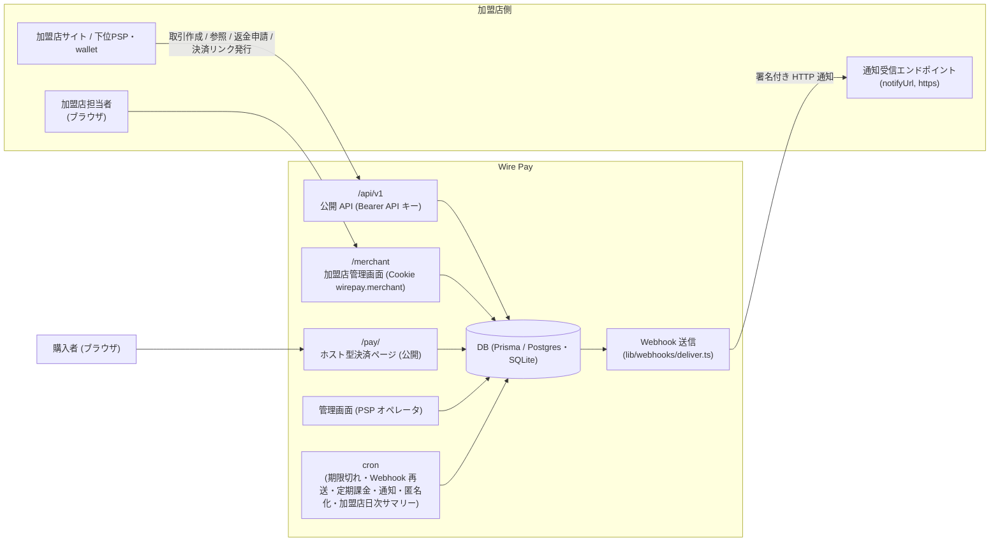

- 公開 API・加盟店管理画面・決済ページ・PSP 管理画面は同一の Next.js アプリケーション（App Router）で提供され、同じデータベースと同じ業務ロジック（`lib/payments/create.ts` の `createTransaction`、`lib/payments/actions.ts` の `applyPaymentAction`）を使います。どの経路から作成された取引も、同じ状態遷移・同じ制限（限度額・停止・ブラックリスト）・同じ Webhook 送信を通ります。
- 加盟店管理画面のセッション（Cookie `wirepay.merchant`）は PSP 管理画面のセッションとは **完全に別** です（第 3 章）。
- 外部の決済ネットワークは **呼び出しません**（デモモード）。クレジット / QR の与信・売上はデータベース上の状態遷移として即時に処理されます（仕様書B 第 11 章）。

### 1.3 テスト環境と本番環境

Wire Pay は「テスト（test）」と「本番（live）」の 2 つの環境を **同じエンドポイント・同じデータベース** 上で分離しています。

| 観点 | 仕様 |
|---|---|
| 環境の決まり方 | API では **API キーの種類**（`wp_test_ak_…` = test、`wp_live_ak_…` = live）で決まります。リクエストボディで環境を指定することはできません |
| データの分離 | 取引・返金・精算バッチ・決済リンク・定期課金・Webhook 送信ログはそれぞれ `livemode`（true = live）を持ち、テストキーで作成したデータは本番キーから見えません（`GET /transactions/{id}` は 404） |
| 取引の `livemode` | 取引作成時に使用したプロバイダの `testMode` の反転値をスナップショットします。後でプロバイダのモードを変えても過去の取引は再分類されません |
| 管理画面・加盟店管理画面 | ヘッダーの **テスト / 本番** スイッチ（Cookie `wirepay.mode`、既定 test）で表示する環境を切り替えます |
| テストカード | テスト環境ではカード番号でシナリオ（成功 / 与信止まり / 各種失敗）を再現できます。本番環境でテスト番号を送ると 400 `test_card_in_live` です（第 12 章） |
| 実請求 | 本書の対象システムはデモモードで動作し、いずれの環境でも外部の決済ネットワークへ請求は発生しません（仕様書B 第 11 章） |

### 1.4 対応決済手段

加盟店が利用できる決済手段は、契約で有効化されたもの（加盟店の「利用可能な決済手段」`enabledMethods`）に限られます。

| 決済手段（API の `method`） | 表示名 | 取引作成直後のステータス | 完了の契機 |
|---|---|---|---|
| `credit` | クレジットカード | `captured`（`autoCapture: true`、既定）または `authorized`（`autoCapture: false`） | 作成時に即時完了。与信済の場合は PSP 管理画面の「完了にする」 |
| `qr` | QR コード決済 | `credit` と同じ | 同上 |
| `convenience` | コンビニ決済 | `awaiting_payment`（支払待ち）+ 13 桁の受付番号 + 支払期限 | 店頭支払いの入金通知（`deposit` アクション） |
| `bank` | 銀行振込 | `awaiting_transfer`（振込待ち）+ 7 / 8 桁の振込ID + 振込期限 | 銀行の入金通知または PSP の入金消込（`deposit` アクション） |
| `other` | その他 | 公開 API では指定できません（`API_METHODS` は上記 4 種） | — |

決済手段ごとの詳細なフローは第 7 章、ステータスの遷移は第 2 章を参照してください。

### 1.5 本書で扱う接続経路

| 経路 | 認証 | 用途 | 章 |
|---|---|---|---|
| 公開 API `/api/v1/*` | `Authorization: Bearer wp_<test\|live>_ak_…` | 取引の作成・参照・一覧、返金申請、決済リンク発行 | 5 |
| 加盟店 API `/api/merchant-api/*` | 同じ API キー | 疎通確認（`ping`）、精算バッチの参照、お知らせの取得 | 5.8 |
| Webhook（Wire Pay → 加盟店） | `X-Signature`（HMAC-SHA256） | 取引・返金・チャージバック・定期課金の結果通知 | 6 |
| 加盟店管理画面 `/merchant/*` | 加盟店ID + パスワード（Cookie `wirepay.merchant`） | 取引・返金・Webhook 送信ログ・精算・API キー・決済手段の状態・お知らせ・サンドボックス | 3, 4 |
| ホスト型決済ページ `/pay/<token>` | 認証なし（公開） | 決済リンクで発行した URL で購入者が支払う | 7.5 |
| 領収書ダウンロード `/api/pay/<token>/receipt` | 署名付きクエリ（30 日有効） | 購入者による領収書 PDF の取得 | 7.5 |

### 1.6 未実装・今後の予定（第 1 章）

- 外部決済ネットワークへの実接続はありません。クレジット / QR は即時に完了し、コンビニ・銀行振込の入金通知はデモ用エンドポイント（第 12 章）またはPSP 管理画面の操作で模擬します。

---

## 2. 用語と取引のライフサイクル

### 2.1 決済申請と取引

Wire Pay では、加盟店サイトで購入者が決済手段を選択した時点で生成される 1 行のレコードを **取引（Transaction）** と呼び、これが `Payment` テーブルの 1 行です。完了前の取引は PSP 管理画面の「**決済申請一覧**」に、完了・返金・チャージバックの取引は「**決済一覧**」に表示されますが、両者は **同じテーブルをステータスで分けた表示** です。

| 一覧 | 含まれるステータス（`lib/payments/transitions.ts`） |
|---|---|
| 決済申請一覧（`APPLICATION_STATUSES`） | `pending`, `awaiting_transfer`, `awaiting_payment`, `authorized`, `failed`, `expired`, `cancelled` |
| 決済一覧（`SALES_STATUSES`） | `captured`, `partially_refunded`, `refunded`, `chargeback` |
| 未完了（ダッシュボード KPI、`OPEN_STATUSES`） | `pending`, `awaiting_transfer`, `awaiting_payment`, `authorized` |
| 入金待ち（期限 `transferDueAt` を持つ、`WAITING_STATUSES`） | `awaiting_transfer`, `awaiting_payment` |

主要な用語は用語集（`glossary.md`）を正とします。本章で頻出するものだけ抜粋します。

| 用語 | 意味 |
|---|---|
| 取引ID（`payment_id` / API の `id`） | Wire Pay が発行する一意の取引識別子（cuid） |
| 注文番号（`orderNumber`） | 加盟店側の注文番号（1〜64 文字）。一意性は加盟店側の責任です |
| 与信（Authorization） | クレジット / QR の支払い枠の確保。ステータス `authorized` |
| 売上確定（Capture） | 与信済取引の完了。ステータス `captured` |
| 取消（Void / `cancel`） | 完了前の取引の取りやめ。ステータス `cancelled`（UI 表示は「キャンセル」） |
| 返金（Refund） | 完了した取引の代金を戻す操作。`partially_refunded` / `refunded` |
| 振込ID（`transferId`） | 銀行振込で購入者が振込名義の前に付ける 7 または 8 桁の数字 |
| 受付番号（`cvsReceiptNo`） | コンビニ決済で購入者が店頭で提示する 13 桁の数字 |
| 入金消込（`deposit`） | 銀行振込・コンビニの入金を取引に突き合わせて完了にする操作 |

### 2.2 ステータス一覧

| ステータス（DB 値） | 表示（ja / en） | 意味 |
|---|---|---|
| `pending` | 申請中 / Pending | 作成直後で何も確定していない（1.1.0 で英語表示を "Applied" から "Pending" に変更） |
| `awaiting_transfer` | 振込待ち / Awaiting transfer | 銀行振込。振込IDを発行し入金を待っている |
| `awaiting_payment` | 支払待ち / Awaiting payment | コンビニ決済。受付番号を発行し店頭支払いを待っている（**1.1.0 で追加**。以前は `pending` を流用） |
| `authorized` | 与信済 / Authorized | クレジット / QR の与信が取れている（`autoCapture: false`、またはテストカード「与信止まり」） |
| `captured` | 完了 / Completed | 決済成立。`capturedAt` が刻まれる |
| `partially_refunded` | 一部返金 / Partially refunded | 返金済額が取引額未満 |
| `refunded` | 返金済 / Refunded | 返金済額が取引額に達した |
| `cancelled` | キャンセル / Cancelled | 完了前に取りやめた（`cancelledAt`） |
| `failed` | 失敗 / Failed | 作成時の拒否（限度額・ブラックリスト・テストカード）または手動 / Webhook による失敗。`failureReason` に理由 |
| `expired` | 期限切れ / Expired | 振込期限・支払期限を過ぎた。期限後に届いた入金は未消込入金として保留され、PSP が `late_deposit` で完了にできる（7.3 節） |
| `chargeback` | チャージバック / Chargeback | チャージバックが敗訴・確定した |

`failureReason` の値は第 5.3.4 節（`failureReason` の値）にまとめています。

### 2.3 状態遷移図

状態遷移は `lib/payments/transitions.ts` の `TRANSITIONS` が唯一の定義で、API・管理画面・Webhook・cron はすべてここから導出されます。更新は「現在のステータスが遷移元に含まれる場合のみ」成功する条件付き更新で行われ、同時実行で二重に適用されることはありません（衝突は 409 `invalid_transition`）。

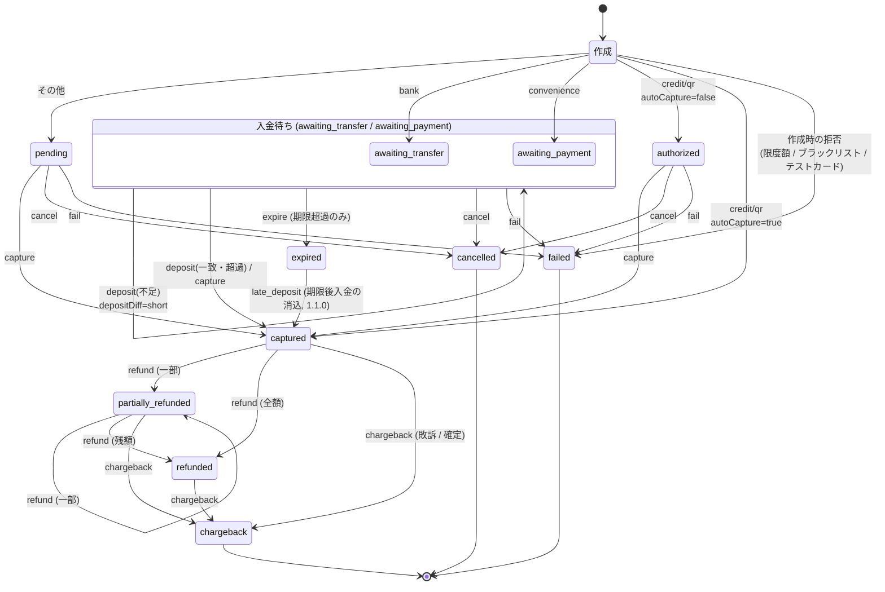

アクションと遷移元・遷移先の対応（`TRANSITIONS`）:

| アクション | 遷移元 | 遷移先（名目） | 刻まれる日時 | 誰が実行するか |
|---|---|---|---|---|
| `capture` | `pending`, `authorized`, `awaiting_transfer`, `awaiting_payment` | `captured` | `capturedAt` | PSP 管理画面（権限 `payment.state`）、決済ページの「支払いを確定」（デモ）、プロバイダ Webhook `payment.captured` |
| `cancel` | `pending`, `authorized`, `awaiting_transfer`, `awaiting_payment` | `cancelled` | `cancelledAt` | PSP 管理画面、プロバイダ Webhook `payment.cancelled` |
| `refund` | `captured`, `partially_refunded` | `refunded`（一部なら `partially_refunded`） | `refundedAt`（全額時） | 返金申請の承認（第 8 章）、プロバイダ Webhook `payment.refunded` |
| `fail` | `pending`, `authorized`, `awaiting_transfer`, `awaiting_payment` | `failed` | — | PSP 管理画面、プロバイダ Webhook `payment.failed` |
| `expire` | `awaiting_transfer`, `awaiting_payment` | `expired` | — | 期限切れ cron（期限超過のみ。実行頻度は仕様書B 8.4 節）、PSP 管理画面 |
| `deposit` | `awaiting_transfer`, `awaiting_payment` | `captured`（不足時は遷移元のまま） | `capturedAt`（完了時） | 銀行 / コンビニの入金通知（デモ API）、PSP 管理画面の入金消込（権限 `payment.deposit`）、未消込入金の消込 |
| `late_deposit` | `expired` | `captured`（金額の過不足があっても完了し `depositDiff` に記録） | `capturedAt` | 未消込入金画面の「期限後入金として消込」（権限 `unmatched_deposit.match`、理由必須。**1.1.0 で追加**。API・Webhook からは実行されない） |
| `chargeback` | `captured`, `partially_refunded`, `refunded` | `chargeback` | — | チャージバックの敗訴・確定（管理画面の直接操作ではない） |

### 2.4 決済手段ごとの違い

#### クレジット / QR（与信と売上）

- `autoCapture: true`（既定）では作成と同時に `captured` になり、`payment.completed` の Webhook が送られます。
- `autoCapture: false` では `authorized` で止まり、PSP 管理画面の「完了にする」で `captured` になります。加盟店 API から売上確定を行う手段はありません（第 14 章）。
- 与信済の取引は「キャンセル」で取り消せます（返金ではありません）。

#### 銀行振込（振込ID・振込期限・過不足入金）

- 作成時に加盟店設定の桁数（7 または 8 桁、`transferIdDigits`）で **振込ID** を発行します。先頭は 0 以外、システム全体で一意です。
- **振込期限** = 作成日時 + 加盟店設定の `transferDueDays`（既定 7 日、1〜60）。
- 入金は **累計** で判定します（`reconcileDeposit`）。一致 → `captured`、不足 → `awaiting_transfer` のまま `depositDiff = "short"`（次の入金で累計）、超過 → `captured` + `depositDiff = "excess"`。過不足は PSP 側の「過不足入金」画面で追跡され、超過分は差額返金申請、不足分は追加入金案内メールで対応されます。
- 期限を過ぎた振込待ちは cron `/api/cron/expire-transfers` が `expired` にします（`payment.expired` の Webhook。デモの `vercel.json` では 1 日 1 回、本番運用では毎時を推奨。仕様書B 8.4 節）。
- 振込IDが付いていない入金は「未消込入金」として記録され、PSP のサポートが振込IDを付与して消込します（完了時に `payment.completed` が送られます）。
- **期限切れ後・キャンセル後に届いた入金、環境（test / live）が一致しない入金** は消込されず、未消込入金として保留されます（1.1.0）。期限後入金は PSP が理由を付けて「期限後入金として消込」すると取引が `captured` になり、通常どおり `payment.completed` と決済完了メールが送られます。キャンセル済の取引への入金は組戻し（返金手配）として却下されます（7.3 節）。
- 同じ入金通知の再送（同じ `eventId`、または内容が同じ通知）は二重に計上されません（1.1.0）。

#### コンビニ決済（受付番号・支払期限）

- 作成時に **13 桁の受付番号**（先頭 0 以外、一意）と **支払店舗**（`cvsBrand`: `seven` / `lawson` / `familymart` / `ministop` / `other`、未指定は `seven`）を記録します。
- **支払期限** = 作成日時 + 加盟店設定の `cvsDueDays`（既定 3 日、1〜30）。振込期限と同じ列（`transferDueAt`）を使います。
- 作成時のステータスは **`awaiting_payment`（支払待ち）** です（1.1.0 で追加。以前は `pending` を流用していました）。店頭支払いの通知は銀行振込と同じ `deposit` アクションで処理され、完了時に `cvsPaidAt` が刻まれます。
- 期限切れ・期限後入金・環境不一致・再送の扱いは銀行振込と同じです。

#### 共通

- 完了時（`capture`、または一致・超過の `deposit`）に購入者へ「決済完了」メール、返金完了時に「返金完了」メールが送られます（宛先メールがある取引のみ、第 11 章）。
- すべての状態変更は `PaymentEvent`（ステータス変更履歴）に実行者（`dashboard` / `api` / `webhook` / `bank` / `cvs` / `system` / `seed`）付きで記録されます。加盟店管理画面の取引詳細でこの履歴を参照できます。

### 2.5 未実装・今後の予定（第 2 章）

- 加盟店 API からの売上確定（capture）・取消（cancel）はありません。与信済取引の完了・取消は PSP 管理画面の操作です。

---

## 3. アカウントと権限

### 3.1 加盟店アカウントの発行

加盟店アカウントは **Wire Pay の管理者（PSP オペレータ）** が PSP 管理画面の「加盟店管理 → ＋ 加盟店追加」で発行します。加盟店が自らサインアップする機能はありません。

| 項目 | 仕様 |
|---|---|
| 加盟店ID（`merchantCode`） | `MER-00001` 形式で自動採番。変更不可 |
| 加盟店パスワード | 登録時に自動生成され AES-GCM で暗号化保存。PSP 管理画面では admin 権限のみ表示・再発行可（再発行で旧パスワードは即時無効） |
| サイト名 / ふりがな（全角カタカナ）/ 会社名 / 担当者名 / メールアドレス / 明細送付先メール | 必須項目 |
| システム通知先 URL（`notifyUrl`） | Webhook の送信先。**https のみ** |
| 通知パラメータ設定 | 通知の型 / 送信パラメータセット / 決済識別子の形式（第 6 章） |
| メール通知設定（`emailNotification`） | `per_payment`（決済ごと）/ `daily`（1 日まとめて）/ `none`（無し）（第 11 章） |
| 担当代理店 | 任意 |
| 利用可能な決済手段（`enabledMethods`） | `credit` / `qr` / `convenience` / `bank` / `other` の組み合わせ。ここに無い手段は API で 400 `method_not_enabled` |
| 振込IDの桁数（`transferIdDigits`） | 7 または 8 |

登録と同時に **テスト環境の署名シークレット（`wp_test_ss_…`）が自動発行** され、登録完了画面で平文が 1 回だけ表示されます（1.1.0）。API キー（`api_key`）と本番環境の署名シークレット（`signing_secret`）は、PSP が加盟店詳細の **API キー** タブで環境（test / live）ごとに発行します。平文は発行時に 1 回だけ表示され、DB には SHA-256 ハッシュのみ保存されます（署名シークレットは Webhook 署名のため暗号文も保持）。使用可能な署名シークレットが無い環境への Webhook は送信されません（6.4 節）。

### 3.2 API キーと署名シークレット

| 種別 | 形式 | 用途 |
|---|---|---|
| API キー | `wp_test_ak_<32 文字>` / `wp_live_ak_<32 文字>` | `/api/v1/*`・`/api/merchant-api/*` の Bearer 認証 |
| 署名シークレット | `wp_test_ss_<32 文字>` / `wp_live_ss_<32 文字>` | Webhook の `X-Signature` 検証用の共有鍵。**API 認証には使えません**（401 `invalid_api_key`） |

キーの状態（`apiKeyStatus`）:

| 状態 | 条件 | 認証 |
|---|---|---|
| `active` | 失効も期限も無い | 可 |
| `expiring` | ローテーション後の旧キーで、`expiresAt` が未来 | 可 |
| `expired` | `expiresAt` を過ぎた | 不可（401） |
| `revoked` | 失効された | 不可（401） |

- **ローテーション**: 同じモード・種別・ラベルで新しいキーを発行し、旧キーには猶予期間（既定 `ROTATION_GRACE_DAYS` = 7 日、PSP 側では 0〜90 日を指定可）の `expiresAt` が設定されます。**テストキーは加盟店管理画面から自分でローテーション** できます（猶予は 7 日固定）。**本番キー** の発行・ローテーション・失効は PSP のみが行い、加盟店が本番キーをローテーションしようとすると 403 `live_key_rotation` です。
- 加盟店 1 社あたりのキー数はデモ上限 20（`DEMO_LIMITS.apiKeysPerMerchant`）です。
- 認証に成功するたびに `lastUsedAt` が更新されます。

### 3.3 加盟店管理画面のログイン

| 項目 | 仕様（`lib/merchant-portal/session.ts`） |
|---|---|
| URL | `/merchant/login` |
| 資格情報 | 加盟店ID（大文字小文字は区別しない。`mer-00001` でも可）+ 加盟店パスワード |
| セッション | Cookie `wirepay.merchant`（HMAC 署名、purpose `merchant`、**12 時間**）。PSP 管理画面の Cookie とは鍵派生を分離しており、相互に流用できません |
| ロックアウト | **5 回連続失敗で 15 分ロック**（HTTP 423 `merchant_locked`、残り分数を返す）。ロック中は正しいパスワードでも 423 |
| レート制限 | ログイン API は IP ごとに 10 回 / 分（PSP のログインと同じ枯渇枠） |
| 監査 | 成功 `merchant.login`、ロック `merchant.lockout`、ログアウト `merchant.logout` を操作ログに記録（操作者種別「加盟店」） |
| パスワード再発行後 | 新しいパスワードのみ有効。既存セッションは期限まで有効 |

ログイン後は環境スイッチ（テスト / 本番、Cookie `wirepay.mode`）で表示する環境を切り替えられます。

### 3.4 加盟店にできる操作とできない操作

加盟店管理画面・公開 API・加盟店 API で加盟店ができる操作は次に限られます。

| 操作 | 経路 | 備考 |
|---|---|---|
| 取引の作成・参照・一覧 | `/api/v1/transactions` | 自加盟店・同一環境のみ |
| 返金の **申請** | `/api/v1/refunds`、加盟店管理画面の取引詳細 | 承認 / 否認は PSP（admin / accounting）。加盟店による強制返金（期限超過）は不可 |
| 決済リンクの発行 | `/api/v1/payment-links` | 無効化は PSP 管理画面のみ（第 14 章） |
| Webhook の再送 | 加盟店管理画面 | 自社宛の送信のみ |
| テストキーのローテーション | 加盟店管理画面 | 本番キーは不可 |
| 精算バッチ・明細の参照、請求書 PDF の出力 | 加盟店管理画面、`/api/merchant-api/settlements` | 請求書は確定以降のバッチのみ（請求書番号は確定時に採番） |
| 領収書の発行（自社の完了 / 一部返金の取引） | 加盟店管理画面の取引詳細 | 宛名・但し書きを指定して PDF を取得（4.5 節、1.1.0） |
| 決済手段の状態・お知らせの参照 | 加盟店管理画面、`/api/merchant-api/announcements` | |
| 自社顧客の参照 | 加盟店管理画面 | 個人情報はマスクなし（自社データ） |
| サンドボックスからの API 呼び出し | 加盟店管理画面 | テストキーのみ |

加盟店が **できない** 操作（PSP 側の権限）:

| 操作 | 実行者 |
|---|---|
| 与信済取引の完了（売上確定）・失敗・キャンセル・期限切れ | PSP（`payment.state` = admin） |
| 入金消込、未消込入金の処理、過不足入金の対応 | PSP（`payment.deposit` = admin / accounting ほか） |
| 返金の承認 / 否認、期限超過返金の強制 | PSP（admin / accounting、強制は admin） |
| チャージバックの登録・異議申立て・結果登録 | PSP（admin / accounting） |
| 契約・手数料率・限度額・期限・精算設定・通知設定・利用可能な決済手段の変更 | PSP |
| 本番 API キーの発行・ローテーション・失効、署名シークレットの発行 | PSP（admin / developer） |
| 決済手段の停止 / 再開、IP 制限、ブラックリスト | PSP |
| 精算バッチの生成・確定・振込 | PSP（admin / accounting） |
| 領収書の発行（PSP 管理画面から） | PSP（admin / accounting / cs）。加盟店は加盟店管理画面の取引詳細から、購入者は決済ページ経由で取得可 |
| 未消込入金の消込・期限後入金の消込・組戻し | PSP（admin / accounting） |
| 内部メモ（取引メモ）の閲覧 | PSP のみ（加盟店管理画面には表示されません） |

### 3.5 PSP 側ロールの概要（参考）

PSP 管理画面のロールは `admin` / `accounting` / `cs` / `developer` / `viewer` の 5 種で、権限マトリクスは `lib/role.ts` の `PERMISSIONS` が唯一の定義です。加盟店に直接関係する範囲は次のとおりです（完全な表は PSP 管理画面マニュアル「はじめに」）。

| 加盟店に関係する操作 | admin | accounting | cs | developer | viewer |
|---|---|---|---|---|---|
| 加盟店の作成・更新 | ○ | | ○ | | |
| 加盟店パスワードの表示・再発行 | ○ | | | | |
| 契約・手数料 / 限度額 / 期限 / 精算設定の更新 | ○ | ○ | | | |
| API キー・署名シークレットの発行 / ローテーション / 失効 | ○ | | | ○ | |
| 取引の完了 / 失敗 / キャンセル / 期限切れ | ○ | | | | |
| 入金消込 | ○ | ○ | | | |
| 未消込入金の消込（期限後入金を含む） | ○ | ○ | | | |
| 返金の承認 / 否認 | ○ | ○ | | | |
| 精算バッチの生成 / 確定 / 振込 | ○ | ○ | | | |
| Webhook の再送（PSP 側） | ○ | | | ○ | |
| 決済手段の全体停止 / 加盟店別停止 | ○ | | ○（加盟店別のみ） | | |
| IP 制限のルールと許可リストモードの変更 | ○ | | | ○ | |

完全な権限マトリクスは付録 E を参照してください。

### 3.6 未実装・今後の予定（第 3 章）

- 加盟店によるパスワード変更・再発行、複数担当者アカウント、二段階認証は加盟店管理画面にはありません（PSP 管理者アカウントには TOTP があります）。
- 加盟店による本番キーの発行・ローテーション・失効はありません（PSP に依頼）。

---

## 4. 管理画面の操作説明

本章は **加盟店管理画面（`/merchant/*`）** と、購入者が利用する **ホスト型決済ページ（`/pay/<token>`）** を画面ごとに説明します。PSP 管理画面は加盟店に関係する範囲（加盟店設定として PSP が行うもの）のみ 4.17 節で触れます。ラベルは辞書（`lib/i18n/messages/ja.ts` / `en.ts`）の値で、英語表示はヘッダーの「EN / 日本語」で切り替えます。

### 4.1 共通レイアウト

| 要素 | 内容 |
|---|---|
| ヘッダー | Wire Pay ロゴ（→ `/merchant`）、「加盟店管理画面」、**テスト / 本番** スイッチ（ログイン時のみ）、「API ドキュメント」リンク（→ `/docs/api`）、言語切替、ログアウト（`POST /api/merchant-portal/logout` → `/merchant/login`）。スマートフォン幅ではスイッチと言語切替が 2 段目に移動 |
| 本番モードの表示 | 本番モード中はヘッダー左端の赤線と画面上部の赤いストライプ「本番モード — 実際のデータを表示しています」を出し、各画面のタイトル横に現在のモードのバッジを表示します。テスト → 本番に切り替えるとトーストで注意を表示（1.1.0） |
| サイドバー | サイト名・加盟店ID、メニュー（下表）、「表示するデータの環境（テスト / 本番）。API キーの環境に対応します。」。PSP 管理画面へのリンクはデモ環境（`DEMO_LOGIN_HINT` 設定時）のみ表示（1.1.0） |
| ガード | ログインページ以外はすべて加盟店セッション必須。未ログインは `/merchant/login` へリダイレクト |

| メニュー | パス | 節 |
|---|---|---|
| ホーム | `/merchant` | 4.3 |
| 取引 | `/merchant/transactions` | 4.4 / 4.5 |
| 顧客 | `/merchant/customers` | 4.13 / 4.14 |
| 返金申請 | `/merchant/refunds` | 4.6 |
| Webhook 送信ログ | `/merchant/webhooks` | 4.7 |
| 精算 | `/merchant/settlements` | 4.8 / 4.9 |
| API キー | `/merchant/api-keys` | 4.10 |
| 決済手段の状態 | `/merchant/methods` | 4.11 |
| お知らせ | `/merchant/announcements` | 4.12 |
| サンドボックス | `/merchant/sandbox` | 4.15 |

決済手段の表示名は `lib/providers/registry.ts` の `CATEGORIES` から取ります（クレジットカード決済 / QRコード決済 / コンビニ決済 / 銀行振込決済 / その他Webサービス決済）。ステータスの表示名は付録 B を参照してください。

### 4.2 ログイン（`/merchant/login`）

| 項目 | 内容 |
|---|---|
| 目的 | 加盟店ID + パスワードで加盟店管理画面にログインする |
| 入力 | 加盟店ID（`MER-00001` 形式、大文字小文字は区別しない）、パスワード |
| 操作 | 「ログイン」→ `POST /api/merchant-portal/login` `{ merchantCode, password }`。成功で `/merchant` へ |
| エラー | パスワード不一致 401、5 回連続失敗で 423（「ログイン失敗が続いたためアカウントをロックしました。{minutes} 分後に再度お試しください」）。第 3.3 節 |
| その他 | 既にログイン済みなら `/merchant` へリダイレクト。デモ環境（`DEMO_LOGIN_HINT` 設定時）はデモ用アカウントと PSP 管理画面へのリンクを表示（本番では出ない）。フッターに API ドキュメントへのリンク。入力欄は `name="merchant-code"`（`autocomplete="off"`）/ `name="merchant-password"` で、ブラウザが PSP 管理者の ID を自動入力しないようにしている（1.1.0） |

### 4.3 ホーム（`/merchant`）

自社の状況の概要です。すべて閲覧専用で、各カードは該当画面へのリンクです。表示はヘッダーの環境スイッチに従います。

| カード | 集計内容 | リンク先 |
|---|---|---|
| 本日の完了取引 | 完了系ステータス（完了 / 一部返金 / 返金済 / チャージバック）で `capturedAt` が本日（JST）の件数と金額 | 取引 |
| 支払待ち・与信済 | `pending` / `awaiting_transfer` / `awaiting_payment` / `authorized` の件数 | 取引 |
| 審査中の返金申請 | ステータス `requested` の返金申請件数 | 返金申請 |
| 失敗 / 再送待ちの Webhook | ステータス `failed` / `abandoned` / `retrying` の送信件数 | Webhook 送信ログ |
| 次回の振込予定 | ステータス `confirmed` / `scheduled` の精算バッチのうち最も早い振込予定日と差引支払額。無ければ「予定なし」 | 該当バッチ / 精算 |

下部に「最近の取引」（新しい順 8 件: 注文番号・決済種別・申請日時・金額・ステータス）と「お知らせ」（公開中のもの: タイトル・種別・公開日）、現在の **メール通知設定**（決済ごと / 1 日まとめて / 無し。変更は PSP に依頼、11.1 節）を表示します（1.1.0）。

### 4.4 取引一覧（`/merchant/transactions`）

| 項目 | 内容 |
|---|---|
| 目的 | 自社の決済申請と完了した決済を一覧で確認する |
| 絞り込み | ステータス（すべて + 11 ステータス）。URL は `?status=<値>`。環境はヘッダーのスイッチ |
| 並び | 完了取引を優先した表示順（`order: "sales"`）、20 件ごとのページング |
| 列 | 注文番号（+ 取引ID）、ユーザー（ユーザー名 + ユーザーID）、決済種別、金額（返金済みがあれば `−返金額` を併記）、ステータス（期限超過は「期限超過」バッジ）、申請日時 |
| 操作 | 行の注文番号から詳細へ。CSV 出力・操作ボタンはありません |

### 4.5 取引詳細（`/merchant/transactions/[id]`）

自社以外の取引は 404 です。内部メモ（PSP の取引メモ）は表示されません。

| セクション | 表示項目 |
|---|---|
| 見出し | 取引 {注文番号}、環境バッジ（テスト / 本番）、ステータス、期限超過バッジ |
| 取引情報 | 取引ID、金額、返金済み額（あれば）、商品名、ユーザー（名・ID・メール）、決済種別、申請日時、完了日時、失敗理由（あれば、`failureReason` の生値） |
| 銀行振込（振込IDがある場合） | 振込ID、期限、入金額（累計）。期限超過は枠が赤 |
| コンビニ決済（受付番号がある場合） | 支払店舗、受付番号（4-4-5 区切り）、期限、支払日時（未払いなら「未払い」） |
| 履歴 | ステータス変更履歴（種別 → 遷移後ステータス、日時） |
| 返金 | 返金申請の一覧（理由コード、日時、金額、ステータス） |
| 領収書（完了 / 一部返金の取引） | 宛名（≤120）と但し書き（≤120、空なら前回値 → 商品名 → 「商品代金」）を入力して「発行」→ `POST /api/merchant-portal/receipts/{paymentId}` `{ recipientName?, description? }`、PDF は `GET` 同パス。番号は `RC-YYYYMM-00001`（PSP 管理画面の発行と同じ採番）、再発行は番号据え置きで回数 +1。`source = merchant`、監査 `receipt.issue`（1.1.0） |

**返金を申請**（右側のフォーム）:

| 項目 | 内容 |
|---|---|
| 表示条件 | ステータスが `captured` / `partially_refunded`。それ以外は「完了した取引のみ返金を申請できます。」 |
| 返金額 | 1 〜 返金可能額（取引額 − 返金済み − 審査待ちの申請額）。既定は返金可能額の全額 |
| 理由 | 顧客都合 / 商品不良 / 重複決済 / その他（既定: 顧客都合）。「その他」は詳細が必須 |
| 理由（詳細） | ≤500 文字 |
| 送信 | `POST /api/merchant-portal/refunds` `{ paymentId, amount, reasonCode, reason }` → 201 `{ id, status: "requested", amount }`。確認ダイアログはありません |
| 期限超過 | 返金可能期限を過ぎていると送信ボタンが無効になり、「この取引は返金可能期限を過ぎています。…」を表示。加盟店から強制はできません（PSP のサポートへ） |
| 成功時 | 「返金申請を受け付けました。審査結果は Webhook（refund.completed）でも通知されます。」 |
| エラー | 409（未完了）、400 `refund_exceeds`、409 `refund_window_expired` など（第 5.6 節） |

### 4.6 返金申請（`/merchant/refunds`）

| 項目 | 内容 |
|---|---|
| 目的 | 自社の返金申請と審査結果を確認する |
| 絞り込み | なし（環境スイッチのみ）。20 件ごとのページング |
| 列 | 申請日時、注文番号（→ 取引詳細）、返金額、理由（理由コード + 詳細。否認時は審査メモを赤字で表示）、ステータス（申請中 / 承認 / 否認 / 処理中 / 完了 / 失敗）、完了日時 |
| 操作 | なし（申請は取引詳細から） |

### 4.7 Webhook 送信ログ（`/merchant/webhooks`）

| 項目 | 内容 |
|---|---|
| 目的 | 通知先 URL への送信記録の確認と手動再送 |
| 表示 | 環境スイッチに従い最新 100 件。絞り込み・ページングなし |
| 列 | 送信日時、イベント、送信先（メソッド + URL）、ステータス（送信待ち / 成功 / 失敗 / リトライ待ち / 断念）、試行回数、応答（HTTP ステータス） |
| 操作 | 「再送」→ `POST /api/merchant-portal/webhooks/{id}/resend`（ボディなし）。確認ダイアログなし。**署名（`X-Timestamp` / `X-Signature`）は再計算** されます。結果は「再送しました（応答 {status}）。」または「再送しましたが失敗しました: {error}」 |
| 監査 | 操作ログ `webhook.resend`（操作者: 加盟店） |

送信ログの詳細（リクエストヘッダー・ボディ・試行履歴）は加盟店管理画面には無く、PSP 管理画面の Webhook 送信ログ詳細で確認します。

### 4.8 精算（`/merchant/settlements`）

| 項目 | 内容 |
|---|---|
| 目的 | 精算バッチ（売上・手数料・返金・チャージバックの差引）と振込予定を確認する |
| 表示 | 環境スイッチに従い最新 100 件 |
| 列 | 対象期間（→ 詳細）、請求書番号（確定以降）、売上総額、差引支払額（負なら赤）、ステータス（集計中 / 確定 / 振込予定 / 振込済 / 保留）、振込予定日（振込済なら振込完了日） |

### 4.9 精算詳細（`/merchant/settlements/[id]`）

| セクション | 表示項目 |
|---|---|
| 内訳 | 請求書番号（`INV-YYYYMM-<加盟店番号>-<連番 2 桁>`、確定時に採番。集計中は未採番）、売上総額、手数料合計、返金合計、チャージバック合計、精算手数料（振込手数料）、差引支払額、振込予定日、振込完了日 |
| 明細 | 発生日時、種別（売上 / 返金 / チャージバック）、注文番号（→ 取引詳細）、決済手段、金額（負なら赤）、手数料 |
| 請求書 PDF（インボイス） | 集計中は「集計中のバッチは確定後に出力できます。」。確定以降は `GET /api/merchant-portal/settlements/{id}/invoice` を新しいタブで開く（監査 `settlement.invoice_export`） |

計算式は第 9 章を参照してください。

### 4.10 API キー（`/merchant/api-keys`）

| 項目 | 内容 |
|---|---|
| 目的 | 発行済みの API キー・署名シークレットの確認と、テストキーの自己ローテーション |
| 列 | キー（先頭 16 文字 + …、ラベル）、種別（API キー / 署名シークレット）、環境（テスト / 本番）、ステータス（有効 / 失効予定 / 期限切れ / 失効）、発行日、有効期限、最終使用 |
| 操作 | テストキーで有効 / 失効予定のものに「ローテーション」。確認ダイアログ「テストキー {prefix} を新しいキーに置き換えます。旧キーは 7 日間は引き続き使えます。」→ `POST /api/merchant-portal/api-keys/{keyId}/rotate`（ボディなし）→ 201 `{ key, plaintext }` |
| 結果表示 | 「新しいキーを発行しました。この画面を閉じると再表示できません。」+ 平文 + コピーボタン。**平文は 1 回しか表示されません** |
| 本番キー | 「本番キーは表示のみです。」。ローテーションは 403 `live_key_rotation` |
| 空 | 「API キーはありません。Wire Pay に発行を依頼してください。」 |

### 4.11 決済手段の状態（`/merchant/methods`）

クレジット / QR / コンビニ / 銀行振込の 4 行を常に表示する閲覧専用画面です（「その他」は対象外）。判定の優先順:

1. 契約の「利用可能な決済手段」に無い → **契約対象外**
2. 全体停止中（Wire Pay が全加盟店向けに停止）→ **全体停止中**、加盟店別停止 → **停止中（貴社のみ）**。理由と「再開予定 {日時}」を併記
3. それ以外 → **利用可能**

停止中の手段で取引を作成すると API は 409 `method_suspended`、決済ページでは選択肢から消えます（第 10.3 節）。

### 4.12 お知らせ（`/merchant/announcements`）

公開中（ステータス「公開」かつ公開期間内）で、全加盟店向けまたは自社を対象に含むお知らせをカードで表示します。種別バッジ（お知らせ / メンテナンス / 障害）、タイトル、公開日時、本文、障害の場合は更新履歴（発生 → 対応中 → 復旧）。操作はありません。

### 4.13 顧客（`/merchant/customers`）

| 項目 | 内容 |
|---|---|
| 目的 | 自社の顧客マスタ（取引のユーザーIDごとに 1 件）と保存カード・取引履歴の確認 |
| 表示 | 自社データのため **個人情報はマスクなし**（PSP 管理画面ではマスク表示） |
| 検索 | 「検索（ユーザーID / 氏名 / メール）」。Enter で `?q=` に反映（≤100 文字）。20 件ごとのページング |
| 列 | 顧客（氏名またはユーザーID → 詳細。匿名化済みバッジ）、メール、取引数、カード（保存トークン数）、最終取引 |
| 操作 | なし（匿名化は PSP の admin のみ） |

### 4.14 顧客詳細（`/merchant/customers/[id]`）

| セクション | 表示項目 |
|---|---|
| 見出し | 氏名（無ければユーザーID）、ユーザーID。匿名化済みなら「この顧客の個人情報は {日時} に匿名化されました…」 |
| プロフィール | メール、電話番号、初回取引 |
| 保存されたカード | ブランド、•••• 下 4 桁、有効期限、最終使用（または登録）日時。カード番号は保存されていません |
| 取引履歴 | 注文番号（→ 取引詳細）、申請日時、金額、ステータス |

### 4.15 サンドボックス（`/merchant/sandbox`）

ブラウザから **実際の公開 API（`/api/v1`）** をテストキーで呼び出すコンソールです。専用のモック環境ではなく本番と同じコードパスなので、ここで通ったリクエストは本番キーでもそのまま使えます。

| 項目 | 内容 |
|---|---|
| API キー | `wp_test_ak_…` のみ（`wp_live_` はクライアント側で拒否「サンドボックスではテストキーのみ使えます。」）。ブラウザの sessionStorage（キー `wirepay.sandbox.key`）にのみ保存 |
| エンドポイント | 第 5.2 節の 5 エンドポイントを選択。パスパラメータ / クエリ文字列 / リクエストボディ（JSON、「サンプルを読み込む」で例を挿入） |
| 送信 | ブラウザから直接 `fetch("/api/v1/...", { Authorization: Bearer <key> })`。レスポンス（`HTTP {status} · {ms} ms` と JSON）、同等の curl コマンド、テストカード一覧を表示 |
| 注意 | 作成した取引はテスト環境の実データとして両管理画面に表示され、Webhook も実際に送信されます。レート制限（60 回 / 分）も適用されます |

### 4.16 ホスト型決済ページ（`/pay/<token>`）

購入者向けの公開ページ（ログイン不要、管理画面のナビなし）。決済リンク（第 5.7 節 / 第 7.5 節）の URL です。

| 項目 | 内容 |
|---|---|
| 表示 | 加盟店のサイト名、商品名、説明、金額。テスト環境のリンクには「テストモード（実際の請求は発生しません）」 |
| 利用不可 | 無効化 / 期限切れ / 上限到達のいずれかなら理由文のみ表示し、フォームは出ません（第 7.5 節） |
| 支払方法 | 加盟店の利用可能な決済手段 ∩ 停止中でない ∩ 同一環境に有効なプロバイダがある手段。1 つも無ければ「現在ご利用いただけるお支払い方法がありません。」 |
| 入力 | 支払方法（ラジオ）、コンビニ選択時は店舗、お名前（必須、≤120）、メールアドレス（任意、≤200）。**カード番号などの入力はありません** |
| 送信 | 「{金額} を支払う」→ `POST /api/pay/<token>` → 201。銀行振込は振込ID・金額・期限を表示（ボタンなし。入金は PSP 側の消込）。コンビニは店舗・受付番号・金額・期限と「店頭で支払い済みにする（デモ）」。クレジット / QR / その他は「お支払いを確定する（デモ）」 |
| 完了 | 「お支払いが完了しました 受付番号 {注文番号}」と「領収書（PDF）をダウンロード」（30 日有効の署名付き URL） |

### 4.17 PSP 管理画面のうち加盟店に関係する設定（参考）

加盟店自身は操作できませんが、加盟店の挙動を決める設定です。変更は PSP に依頼してください。

| PSP 画面（加盟店詳細のタブ） | 設定内容 | 本書の章 |
|---|---|---|
| 基本情報 | サイト / 会社 / 担当者、担当代理店、**利用可能な決済手段**、**振込IDの桁数**、連絡先 | 3.1 |
| 契約・手数料 | 契約プラン（スタンダード / プレミアム / カスタム）と決済手段別の手数料率・固定手数料、適用開始日、**振込期限（日）**、**返金可能期限（日）**、**コンビニ支払期限（日）** | 7, 8, 9 |
| 限度額 | 決済手段ごとの 1 回 / 1 日 / 1 か月の上限と利用状況 | 10.2 |
| APIキー | API キー・署名シークレットの発行 / ローテーション / 失効 | 3.2 |
| 通知設定 | システム通知先 URL、通知の型、パラメータセット、識別子、通知サンプル | 6 |
| 精算設定 | 締めサイクル、支払サイト、振込先口座、精算手数料、適格請求書用の登録番号・住所 | 9 |
| 決済手段 | 加盟店別の一時停止 | 10.3 |
| Webhook送信ログ | 加盟店宛の直近の通知と結果（詳細・再送） | 6 |
| IP 制限（`/ip-restrictions`） | 加盟店 API の許可 / ブロックルールと **許可リストモード**（対象「加盟店API」） | 10.1 |
| 入金通知ログ（`/deposit-notifications`）/ 未消込入金（`/unmatched-deposits`） | 銀行・コンビニからの入金通知の記録と、保留された入金の消込 / 期限後入金の消込 / 組戻し | 7.3 |

### 4.18 未実装・今後の予定（第 4 章）

- 加盟店管理画面からの CSV 出力、取引の詳細絞り込み（決済種別・期間・注文番号検索）、Webhook 送信ログの詳細表示（ヘッダー・ボディ）はありません。
- 加盟店による通知設定・利用可能な決済手段・振込期限などの自己変更、パスワード変更はありません。

---

## 5. API 仕様

本章は `GET /api/v1/openapi.json` が返す OpenAPI 3.0.3 定義（`lib/public-api/openapi.ts` が Zod スキーマ `lib/public-api/schemas.ts` から生成）を正として起こしています。エンドポイントの追加・変更は OpenAPI 定義に必ず反映されるため、差異がある場合は OpenAPI 定義を優先してください。

### 5.1 共通事項

| 項目 | 仕様 |
|---|---|
| ベース URL | `https://<host>/api/v1`（`servers[0].url`） |
| 形式 | リクエスト・レスポンスともに JSON（`Content-Type: application/json`）。金額は円の整数 |
| 認証 | `Authorization: Bearer <API キー>`。キーの形式は `wp_(test\|live)_(ak\|ss)_[A-Za-z0-9]{32}`。`ak` 以外（署名シークレット）は 401 `invalid_api_key` |
| 環境の切替 | キーの `test` / `live` がそのままデータの環境。エンドポイントは共通 |
| IP 制限 | 加盟店に対象「加盟店API」の **ブロック** ルールが設定されている場合、一致する接続元は 403 `ip_blocked`。PSP が **許可リストモード**（加盟店API）を ON にしている場合は、許可ルールを 1 件以上持つ加盟店について、いずれにも一致しない接続元も 403 `ip_blocked`（`details.reason = "not_in_allowlist"`。許可ルールの無い加盟店は影響なし。1.1.0、10.1 節）。接続元は `X-Forwarded-For` の先頭、無ければ `X-Real-IP` |
| レート制限 | 加盟店 × 環境ごとに **60 リクエスト / 分**（UNIX 分単位の固定ウィンドウ、DB 集計。`/api/merchant-api/*` の呼び出しも同じ枠を消費、1.1.0）。超過は 429 `rate_limited` + `Retry-After`（秒）+ `X-RateLimit-Limit` + `X-RateLimit-Remaining: 0`。成功レスポンスにも `X-RateLimit-Limit` / `X-RateLimit-Remaining` が付きます。**認証成功後・ビジネス処理前** に消費されるため、4xx で失敗したリクエストもカウントされます |
| 冪等性 | `POST /transactions` は `Idempotency-Key` ヘッダー（またはボディの `idempotencyKey`、8〜128 文字）を受け付けます。同じキーの再送は **同じ取引** を返し（HTTP 201、レスポンスは同一形状）、二重作成しません。キーはシステム全体で一意（`Payment.idempotencyKey @unique`）です |
| 言語 | エラーメッセージ `message` は `x-lang` ヘッダー（`ja` / `en`）、無ければ `Accept-Language`、既定 `ja` |
| CSRF / セッション | `/api/v1/*` は middleware のセッション・CSRF 検査の対象外（Bearer 認証のみ） |
| 監査 | API から行った作成・返金申請は操作ログに操作者種別 **加盟店** と加盟店IDで記録されます。取引履歴の実行者は `api` |

#### レスポンスの封筒

```json
{ "ok": true, "data": { ... } }
{ "ok": false, "error": { "code": "invalid_input", "message": "入力内容に誤りがあります", "details": { "fieldErrors": { "amount": "too_small" } } } }
```

`details` はコードによって付きます。`invalid_input` では `fieldErrors`（項目名 → 理由コード）が入ります。Zod の検証エラーは `details` に Zod の `flatten()` 結果（`fieldErrors` / `formErrors`）が入ります。

#### リトライ指針

| 応答 | 推奨対応 |
|---|---|
| 429 `rate_limited` | `Retry-After` 秒後に再送 |
| 5xx / 通信断 | **同じ `Idempotency-Key`** で再送（二重作成を防止） |
| 4xx（429 以外） | リクエストを修正してから再送 |

### 5.2 エンドポイント一覧

| 操作 | メソッド / パス | 成功 | 概要 |
|---|---|---|---|
| `createTransaction` | `POST /transactions` | 201 | 取引を作成 |
| `listTransactions` | `GET /transactions` | 200 | 自加盟店・同一環境の取引一覧（新しい順、カーソルページング） |
| `getTransaction` | `GET /transactions/{id}` | 200 | 取引 1 件 |
| `createRefund` | `POST /refunds` | 201 | 返金を申請 |
| `createPaymentLink` | `POST /payment-links` | 201 | 決済リンクを作成 |
| — | `GET /openapi.json` | 200 | OpenAPI 定義（認証不要） |

### 5.3 POST /transactions — 取引を作成

決済を開始します。加盟店と環境は API キーから決まり、加盟店に有効化された決済手段・停止中の手段・限度額・ブラックリストが適用されます。

#### リクエストボディ（`createTransactionApiSchema`）

| 項目 | 型 | 必須 | 制約 | 説明 |
|---|---|---|---|---|
| `method` | string | ○ | `credit` / `qr` / `convenience` / `bank` | 決済手段 |
| `orderNumber` | string | ○ | 1〜64 文字 | 加盟店の注文番号。管理画面と Webhook に表示 |
| `amount` | integer | ○ | 1〜99,999,999 | 金額（円） |
| `productName` | string \| null | | ≤200 | 商品名 |
| `customerName` | string \| null | | ≤120 | 購入者名 |
| `customerId` | string \| null | | ≤64 | 加盟店側の顧客ID。顧客マスタのキー（第 10.6 節） |
| `customerEmail` | string \| null | | email、≤200 | 購入者メール。振込案内 / コンビニ案内 / 完了メールの宛先 |
| `description` | string \| null | | ≤2000 | 自由記述 |
| `autoCapture` | boolean | | 既定 `true` | `credit` / `qr`: `true` で即時完了、`false` で与信済のまま |
| `card` | object | | | カード情報（下表）。`credit` のときのみ意味を持つ |
| `card.number` | string | ○（`card` 指定時） | 13〜19 桁の数字、Luhn 検証 | カード番号。**保存されません**（ブランド・下 4 桁・不正検知用ハッシュのみ保存） |
| `card.expMonth` | integer | ○ | 1〜12 | 有効期限（月） |
| `card.expYear` | integer | ○ | 2024〜2099 | 有効期限（年、4 桁） |
| `card.cvc` | string | | 3〜4 桁 | セキュリティコード。検証にも保存にも使いません |
| `cvsBrand` | string | | `seven` / `lawson` / `familymart` / `ministop` / `other` | `convenience`: 支払店舗。未指定は `seven` |
| `idempotencyKey` | string | | 8〜128 文字 | `Idempotency-Key` ヘッダーの代替 |

ヘッダー: `Idempotency-Key`（任意、8〜128 文字）。ヘッダーとボディの両方がある場合は **ヘッダー** が優先されます。

#### 処理順序

1. API キー認証 → レート制限消費。
2. 加盟店の `enabledMethods` に `method` が含まれなければ 400 `method_not_enabled`。
3. `method = credit` かつ `card` あり: Luhn 不正は 400 `invalid_input`（`fieldErrors["card.number"] = "invalid"`）。テストカード番号（第 12 章）は **本番環境では 400 `test_card_in_live`**、テスト環境ではシナリオを選択（失敗シナリオは `failed` + `failureReason`、与信止まりは `autoCapture` を `false` に強制）。カードブランドは番号の先頭から判定（4 → visa、51〜55 / 22〜27 → mastercard、35 → jcb、34 / 37 → amex、30 / 36 / 38 → diners、その他 → visa）。
4. 同一環境（`testMode = !livemode`）で `status = active` かつ `category = method` のプロバイダを **作成日時の古い順に 1 件** 選択。無ければ 400 `provider_not_found`。
5. `createTransaction`（共通処理）:
   1. `Idempotency-Key` が既存なら **既存取引を返して終了**（`replayed`）。
   2. デモ上限（取引総数 1,000 件、`DEMO_LIMITS.payments`）に達していれば 403 `demo_limit`。
   3. 決済手段の停止判定（全体 → 加盟店別）。停止中なら 409 `method_suspended`（`details: { scope: "global" | "merchant", method }`）。
   4. ブラックリスト判定（カードハッシュ・接続元 IP・メールアドレス）。一致すると取引は **`failed` として記録**（`failureReason = "blocked:<card|ip|email>"`）。
   5. 限度額判定（ブラックリスト非該当時のみ）。1 回 / 1 日 / 1 か月の順に判定し、超過すると **`failed` として記録**（`failureReason = "limit_exceeded:<per_transaction|daily|monthly>"`）。加盟店へ Webhook `limit.exceeded` を送信。
   6. 顧客マスタの作成 / 更新（`customerId` があるとき）。
   7. 取引行の作成。`bank` は振込ID + 振込期限、`convenience` は受付番号 + 支払期限 + 支払店舗を発行。振込ID / 受付番号の一意制約違反は 1 回だけ再抽選。
   8. `captured` で作成された場合は Webhook `payment.completed` と購入者への「決済完了」メール（1.1.0。定期課金の課金を除く）、`bank` は「振込案内」メール、`convenience` は「コンビニ支払案内」メール。加盟店のメール通知設定が「決済ごと」なら加盟店担当者にも通知（11.1 節）。
   9. `failed` の場合は連続失敗検知（ブラックリスト候補の登録）。

限度額・ブラックリスト・テストカード失敗はいずれも **HTTP 201 で `status: "failed"` の取引** として返ります（エラーレスポンスではありません）。`failureReason` を確認してください。

#### レスポンス（`data`: Transaction オブジェクト）

| 項目 | 型 | 説明 |
|---|---|---|
| `object` | `"transaction"` | 固定 |
| `id` | string | 取引ID（Webhook の `payment_id`） |
| `orderNumber` | string | 加盟店の注文番号 |
| `status` | string | 第 2.2 節のステータス |
| `amount` | integer | 金額 |
| `amountRefunded` | integer | 返金済累計 |
| `currency` | `"JPY"` | 固定 |
| `method` | string | `credit` / `qr` / `convenience` / `bank` / `other` |
| `mode` | `"test"` \| `"live"` | 環境 |
| `productName` | string \| null | |
| `customer` | object | `{ id, name, email }`（各 string \| null） |
| `description` | string \| null | |
| `failureReason` | string \| null | 下表 |
| `bankTransfer` | object \| null | 銀行振込のみ: `{ transferId, dueAt (ISO/UTC \| null), depositAmount (累計入金額) }` |
| `konbini` | object \| null | コンビニのみ: `{ brand, receiptNo (13 桁・ハイフン無し), dueAt, paidAt }` |
| `card` | object \| null | カード情報を送った場合: `{ last4 }` |
| `createdAt` / `capturedAt` / `cancelledAt` / `refundedAt` | string \| null | ISO 8601 / UTC |

`failureReason` の値:

| 値 | 意味 |
|---|---|
| `limit_exceeded:per_transaction` / `limit_exceeded:daily` / `limit_exceeded:monthly` | 加盟店の限度額超過 |
| `blocked:card` / `blocked:ip` / `blocked:email` | ブラックリストに一致 |
| `card_declined` / `insufficient_funds` / `expired_card` / `incorrect_cvc` / `processing_error` | テストカードの失敗シナリオ（テスト環境） |
| `charge_declined` | 定期課金のデモ失敗（第 7.6 節） |
| null | 失敗理由なし（手動 / Webhook による `fail` を含む） |

#### 例

```
POST /api/v1/transactions
Authorization: Bearer wp_test_ak_…
Content-Type: application/json
Idempotency-Key: order-2026-00042

{ "method": "credit", "orderNumber": "ORD-2026-00042", "amount": 4980,
  "customerId": "u_10021", "customerEmail": "taro@example.com",
  "card": { "number": "4242424242424242", "expMonth": 12, "expYear": 2028 } }
```

```json
{ "ok": true, "data": { "object": "transaction", "id": "clx1a2b3c4d5e6f7g8h9i0j1k", "orderNumber": "ORD-2026-00042",
  "status": "captured", "amount": 4980, "amountRefunded": 0, "currency": "JPY", "method": "credit", "mode": "test",
  "productName": null, "customer": { "id": "u_10021", "name": null, "email": "taro@example.com" }, "description": null,
  "failureReason": null, "bankTransfer": null, "konbini": null, "card": { "last4": "4242" },
  "createdAt": "2026-09-01T03:00:00.000Z", "capturedAt": "2026-09-01T03:00:00.000Z", "cancelledAt": null, "refundedAt": null } }
```

銀行振込の例（抜粋）: `"status": "awaiting_transfer", "bankTransfer": { "transferId": "4821390", "dueAt": "2026-09-08T03:00:00.000Z", "depositAmount": 0 }`
コンビニの例（抜粋）: `"status": "awaiting_payment", "konbini": { "brand": "lawson", "receiptNo": "4102993827716", "dueAt": "2026-09-04T03:00:00.000Z", "paidAt": null }`

#### エラー

| HTTP | code | 条件 |
|---|---|---|
| 400 | `invalid_input` | Zod 検証失敗、Luhn 不正、`merchantId` 不正（内部） |
| 400 | `invalid_json` | ボディが JSON でない |
| 400 | `method_not_enabled` | 加盟店契約に無い決済手段 |
| 400 | `test_card_in_live` | 本番環境にテストカード番号 |
| 400 | `provider_not_found` | 同一環境に有効なプロバイダが無い |
| 400 | `provider_disabled` | 選択されたプロバイダが無効（通常は発生しない） |
| 403 | `demo_limit` | デモ上限 |
| 409 | `method_suspended` | 決済手段の一時停止 |
| 409 | `conflict` | 振込ID / 受付番号の再抽選にも失敗 |

### 5.4 GET /transactions — 取引を一覧

自加盟店・同一環境の取引を `createdAt` の新しい順（同時刻は `id` 降順）で返します。

| クエリ | 型 | 制約 | 説明 |
|---|---|---|---|
| `status` | string | ≤32 | ステータスで絞り込み（完全一致。`awaiting_payment` を含む 2.2 節の 11 値） |
| `method` | string | `credit` / `qr` / `convenience` / `bank` | 決済手段で絞り込み |
| `from` | string | `YYYY-MM-DD` | 作成日がこの日以降（JST 0:00 起点） |
| `to` | string | `YYYY-MM-DD` | 作成日がこの日以前（JST、当日を含む） |
| `limit` | integer | 1〜100、既定 20 | ページサイズ |
| `startingAfter` | string | ≤64 | 前ページ最後の取引 `id`（カーソル） |

レスポンス: `{ "data": [Transaction, …], "hasMore": boolean }`。`hasMore` が `true` のときは最後の要素の `id` を `startingAfter` に渡して次ページを取得します。

### 5.5 GET /transactions/{id} — 取引を取得

取引 1 件を返します。他の加盟店・他の環境の取引、存在しない ID は **404 `not_found`** です（存在の有無は区別しません）。

### 5.6 POST /refunds — 返金を申請

完了した取引の返金を **申請** します。申請は PSP の審査（承認 / 否認）を経て完了し、完了時に `refund.completed` の Webhook が届きます。返金の業務ルールは第 8 章を参照してください。

| 項目 | 型 | 必須 | 制約 | 説明 |
|---|---|---|---|---|
| `transactionId` | string | ○ | 1〜64 | 取引ID |
| `amount` | integer | | 1〜99,999,999 | 返金額。省略時は **返金可能残額の全額** |
| `reasonCode` | string | | `customer` / `defect` / `duplicate` / `other`、既定 `customer` | 理由コード |
| `reason` | string | | ≤500 | 自由記述。`reasonCode = other` のときは必須 |

レスポンス（`data`: Refund オブジェクト）:

| 項目 | 説明 |
|---|---|
| `object` | `"refund"` |
| `id` | 返金申請ID |
| `transactionId` | 取引ID |
| `amount` | 返金額 |
| `kind` | `full`（取引額以上）/ `partial` |
| `reasonCode`, `reason` | 申請内容 |
| `status` | 申請直後は `requested`（付録 B） |
| `createdAt`, `completedAt` | ISO 8601 / UTC |

エラー:

| HTTP | code | 条件 |
|---|---|---|
| 404 | `not_found` | 他社・他環境・存在しない取引 |
| 409 | `invalid_transition` | 取引が `captured` / `partially_refunded` 以外 |
| 400 | `invalid_input` | `other` で `reason` 無し |
| 400 | `refund_exceeds` | `amount` > 返金可能残額（取引額 − 返金済 − 審査待ちの申請額）。`details` は無く、メッセージに残額 |
| 409 | `refund_window_expired` | 返金可能期限（完了日時 + 加盟店の `refundWindowDays`）を超過。API からは強制できません |

### 5.7 POST /payment-links — 決済リンクを作成

ホスト型決済ページの URL を発行します（第 7.5 節）。リンクの環境は API キーの環境です。

| 項目 | 型 | 必須 | 制約 | 説明 |
|---|---|---|---|---|
| `productName` | string | ○ | 1〜120（trim） | 決済ページに表示 |
| `amount` | integer | ○ | 1〜9,999,999 | 金額（円）。**取引作成 API より上限が小さい** |
| `description` | string | | ≤500 | 決済ページに表示 |
| `expiresAt` | string | | `YYYY-MM-DD` | 最終有効日（JST、当日いっぱい） |
| `maxUses` | integer | | 1〜100,000 | 最大利用回数（取引作成回数）。省略で無制限 |

レスポンス（`data`: PaymentLink オブジェクト）:

| 項目 | 説明 |
|---|---|
| `object` | `"payment_link"` |
| `id` | リンクID |
| `url` | `https://<host>/pay/<token>` |
| `token` | 24 文字（英小文字 + 数字） |
| `productName`, `amount`, `description` | 設定内容 |
| `expiresAt` | 指定日の **翌日 0:00 JST**（ISO / UTC）または null |
| `maxUses`, `usedCount` | 上限と利用回数 |
| `status` | `active` / `disabled` |
| `mode` | `test` / `live` |
| `createdAt` | ISO 8601 / UTC |

### 5.8 加盟店 API（`/api/merchant-api/*`）

公開 API と同じ API キーで認証する補助エンドポイントです。IP 制限（許可リストモードを含む）・キー状態の扱いは公開 API と同じで、**レート制限も公開 API と同じバケット**（加盟店 × 環境 × 分、`/api/v1` と合算で 60 回 / 分。超過は 429 `rate_limited` + `Retry-After`、応答に `X-RateLimit-Limit` / `X-RateLimit-Remaining`）を消費します（1.1.0。以前は無制限）。middleware は `/api/merchant-api/` を独自認証パスとして扱い、IP 単位のレート制限・CSRF・セッション検査を行いません。

| エンドポイント | 応答 `data` |
|---|---|
| `GET` / `POST /api/merchant-api/ping` | `{ merchantCode, siteName, mode, kind, keyPrefix, status }`。疎通確認・キーの検証 |
| `GET /api/merchant-api/settlements` | `{ merchantCode, mode, settlements: [ { id, periodFrom, periodTo, status, invoiceNo, grossAmount, feeAmount, refundAmount, chargebackAmount, settlementFee, netAmount, scheduledAt, paidAt, holdReason, createdAt } ] }`（キーの環境、最新 100 件。`invoiceNo` は確定以降に採番、集計中は null。1.1.0） |
| `GET /api/merchant-api/settlements?id=<batchId>` | `{ batch, lines: [ { kind, method, description, amount, fee, occurredAt } ] }`。他社・他環境は 404 |
| `GET /api/merchant-api/announcements` | `{ merchantCode, announcements: [ { id, kind, title, body, publishFrom, publishUntil, updates } ] }`。公開中で、全加盟店向けまたは自社を対象に含むもの |

### 5.9 OpenAPI 定義の付加情報

`GET /api/v1/openapi.json` には標準の `paths` / `components` に加えて次の拡張フィールドがあります。

| フィールド | 内容 |
|---|---|
| `x-error-codes` | 付録 A の公開 API エラーコード一覧（`code`, `status`, `description`） |
| `x-test-cards` | 第 12 章のテストカード一覧（`number`, `outcome`, `description`） |
| `x-rate-limit` | `{ limit: 60, windowSeconds: 60, scope: "merchant × environment" }` |

説明文の言語はクエリ `?lang=ja` / `?lang=en` で指定でき、無ければ `x-lang` / `Accept-Language`（既定 `ja`）です。応答には `Cache-Control: public, max-age=300` が付きます。認証は不要です。

### 5.10 未実装・今後の予定（第 5 章）

- 取引の売上確定（capture）・取消（cancel）・期限切れを API から行うエンドポイントはありません。
- 返金申請の参照・一覧・取消、決済リンクの参照・一覧・無効化、顧客・保存カード・定期課金の API はありません。
- `GET /transactions` の `status` はサーバー側で値の検証を行わず、不正な値は 0 件を返します。
- Webhook 署名シークレットの API による取得・ローテーションはありません（加盟店管理画面のテストキーのローテーションのみ）。

---

## 6. Webhook 仕様

取引・返金・チャージバック・定期課金の状態が変わると、Wire Pay は加盟店の **システム通知先 URL（`notifyUrl`）** に HTTP リクエスト（Webhook）を送信します。実装は `lib/webhooks/deliver.ts`（送信・再送）と `lib/merchants/notification.ts`（ペイロード生成）です。送信の記録は加盟店管理画面「Webhook 送信ログ」（4.7 節）と PSP 管理画面で確認できます。

### 6.1 イベント一覧

| `event` | 送信タイミング | `status` の値 | 紐づく取引（`payment_id`） |
|---|---|---|---|
| `payment.completed` | 取引が完了になったとき（クレジット / QR の即時完了、PSP の「完了にする」、入金消込の一致 / 超過、決済ページの完了、未消込入金の消込、期限後入金の消込 `late_deposit`、API 再通知） | `captured` | 当該取引 |
| `payment.failed` | 取引が失敗になったとき（PSP の「失敗にする」、プロバイダ Webhook） | `failed` | 当該取引 |
| `payment.expired` | 振込期限 / 支払期限の超過で期限切れになったとき（毎時の cron を含む） | `expired` | 当該取引 |
| `payment.cancelled` | 取引がキャンセルされたとき | `cancelled` | 当該取引 |
| `refund.completed` | 返金申請が承認され完了したとき（プロバイダ Webhook による直接返金を含む） | `partially_refunded` / `refunded` | 元の取引 |
| `chargeback.opened` | チャージバックが登録されたとき | `chargeback:<理由コード>`（例 `chargeback:fraud`）※取引のステータスではなく理由付きの固定文字列。`amount` は **異議金額** | 元の取引 |
| `limit.exceeded` | 加盟店の限度額超過で取引が失敗として記録されたとき | `failed:limit_exceeded:<per_transaction\|daily\|monthly>` | 失敗として記録された取引 |
| `subscription.charged` | 定期課金の課金が成功したとき | `captured` | 課金で作成された取引 |
| `subscription.payment_failed` | 定期課金の課金が失敗し再試行待ちになったとき | `past_due` | 失敗として記録された取引 |
| `subscription.suspended` | 定期課金が 3 回目の失敗で停止したとき | `suspended` | 失敗として記録された取引 |

- 加盟店が紐づかない取引（プロバイダ直の取引）には送信しません。`notifyUrl` が空の加盟店にも送信しません（送信ログも作られません）。
- 作成時の限度額超過・ブラックリスト一致は **`payment.failed` ではなく** 限度額のみ `limit.exceeded` が送られ、ブラックリスト一致は Webhook を送りません。
- 定期課金の課金成功時は `payment.completed` は送らず `subscription.charged` のみです（`createTransaction` は `source = subscription` のとき `payment.completed` を抑止）。

### 6.2 通知パラメータ設定（加盟店ごとの 3 つの選択肢）

送信内容は加盟店の通知設定（PSP 管理画面の加盟店詳細「通知設定」タブ）で決まります。

#### (1) 通知の型（`notifyFormat`）— 送信方法

| 設定値 | 表示 | メソッド | Content-Type | パラメータの位置 | 署名対象 |
|---|---|---|---|---|---|
| `json_post`（既定） | JSON (POST) | POST | `application/json` | JSON ボディ（`amount` は数値、他は文字列） | リクエストボディそのもの |
| `form_post` | form-urlencoded (POST) | POST | `application/x-www-form-urlencoded` | ボディ | リクエストボディそのもの |
| `query_get` | クエリパラメータ (GET) | GET | なし | URL のクエリ文字列 | クエリ文字列（先頭の `?` を除く） |

#### (2) 送信パラメータセット（`notifyParamSet`）— 累積

| 設定値 | 表示 | 含まれるパラメータ |
|---|---|---|
| `minimal` | 最小 | 識別子 + `event`, `merchant_id`, `amount`, `currency`, `paid_at`, `status` |
| `standard`（既定） | 標準 | 最小 + `payment_method`, `user_id`, `product_id` |
| `full` | フル | 標準 + `domain`, `transaction_id`（識別子の設定に関わらず含む） |

#### (3) 決済識別子の形式（`notifyIdFormat`）

| 設定値 | 表示 | 含まれる識別子 |
|---|---|---|
| `payment_id`（既定） | 一意の決済IDのみ | `payment_id` |
| `transaction_id` | トランザクションIDのみ | `transaction_id` |
| `both` | 両方 | `payment_id`, `transaction_id` |

### 6.3 パラメータ一覧

パラメータの順序は **識別子 → 最小 → 標準 → フル** で固定です。form / query の署名検証では順序が重要になるため、受信側は **受け取ったボディ / クエリ文字列をそのまま** 署名対象にしてください（パースして再構成しない）。

| 名前 | 型 | 説明 |
|---|---|---|
| `payment_id` | string | Wire Pay の取引ID（API の `id`） |
| `transaction_id` | string | プロバイダ側のトランザクションID（`Payment.externalId`）。未取得なら空文字。デモでは `<providerKey 先頭 6 文字>_<時刻 36 進>_<乱数>` 形式の値 |
| `event` | string | 6.1 節のイベント名。**受信側はまずこの値で分岐** してください |
| `merchant_id` | string | 加盟店ID（`MER-00001`） |
| `amount` | integer / string | 金額（円）。JSON では数値、form / query では文字列。返金・定期課金の通知でも **取引の金額**（`chargeback.opened` のみ異議金額） |
| `currency` | string | 常に `JPY` |
| `paid_at` | string | 完了日時（`capturedAt`）。未完了の取引は最終更新日時。ISO 8601 / UTC（例 `2026-09-01T03:34:56.000Z`） |
| `status` | string | 6.1 節の表 |
| `payment_method` | string | `credit` / `qr` / `convenience` / `bank` / `other`（空文字の場合あり） |
| `user_id` | string | 加盟店側のユーザーID（`customerId`）。決済リンクではメールアドレスまたは `guest_<時刻 36 進>` |
| `product_id` | string | 商品名（`productName`） |
| `domain` | string | 通知先 URL のホスト名 |

### 6.4 ヘッダーと署名

| ヘッダー | 内容 |
|---|---|
| `X-Timestamp` | 送信時刻（UNIX 秒、文字列） |
| `X-Signature` | `v1=<署名（16 進 64 文字）>` |
| `Wirepay-Signature` | 互換用。`t=<X-Timestamp>,v1=<同じ署名>` |
| `Content-Type` | POST のみ（6.2 節） |
| `User-Agent` | `WirePay-Notify/1.0` |

署名の計算:

```
signed_payload = "<X-Timestamp>" + "." + <署名対象>      # 署名対象: ボディ、または GET のクエリ文字列（? を除く）
v1 = hex( HMAC_SHA256( key = 署名鍵, message = signed_payload ) )
```

**署名鍵** は加盟店の **署名シークレット**（`wp_<test\|live>_ss_…`）です。通知と同じ環境（test / live）で、失効・期限切れでない **最新の発行分**（`issuedAt` 降順の先頭で `apiKeyUsable` なもの）を使います。

- **使用可能な署名シークレットが無い環境への通知は送信されません**（fail closed、1.1.0。以前は加盟店パスワードで署名していました）。送信ログに `failed` / `error: signing_secret_missing` で記録され、PSP の通知センターに警告（`webhook.signing_secret_missing`、加盟店 × 環境ごとに 24 時間に 1 通）が出ます。署名シークレットを発行した後に手動再送すると署名して送られます。
- テスト環境の署名シークレットは加盟店登録時に自動発行されます（3.1 節）。本番環境の署名シークレットは本番開通時に PSP が発行します。

環境ごとに鍵が異なるため、受信側は test / live 両方の署名シークレットを保持し、`payment_id` またはリクエスト元の環境に応じて検証してください（※ペイロードに環境を示すパラメータは含まれません。テストキーで作成した取引の通知はテストの署名シークレットで署名されます）。

#### 受信側の検証手順

1. ヘッダーから `X-Timestamp` と `X-Signature` の `v1` を取り出す。
2. 受け取ったボディ（GET はクエリ文字列）を **そのまま** 使って `v1` を再計算し、**定数時間比較** で一致を確認する。
3. `X-Timestamp` が現在時刻から **5 分以上** ずれている場合は拒否する（リプレイ対策。再送時は署名とタイムスタンプが再計算されます）。
4. 検証に成功したら `event` と `payment_id` で処理を分岐し、**2xx** を返す。

#### サンプルコード（Node.js）

```js
import { createHmac, timingSafeEqual } from "node:crypto";

export function verify(headers, rawPayload, secret) {
  const ts = headers["x-timestamp"];
  const v1 = String(headers["x-signature"] ?? "").replace(/^v1=/, "");
  if (!ts || !v1 || Math.abs(Date.now() / 1000 - Number(ts)) > 300) return false;
  const expected = createHmac("sha256", secret).update(`${ts}.${rawPayload}`).digest("hex");
  return expected.length === v1.length && timingSafeEqual(Buffer.from(expected), Buffer.from(v1));
}
```

Express の例（JSON POST。ボディは **生の文字列** で受ける）:

```js
app.post("/wirepay/notify", express.raw({ type: "*/*" }), (req, res) => {
  const raw = req.body.toString("utf8");
  if (!verify(req.headers, raw, process.env.WIREPAY_SIGNING_SECRET)) return res.status(401).end();
  const n = JSON.parse(raw);
  // n.event === "payment.completed" なら n.payment_id の注文を「入金済み」に（冪等に）更新
  res.status(200).end();
});
```

PHP の例:

```php
$ts  = $_SERVER['HTTP_X_TIMESTAMP'] ?? '';
$v1  = preg_replace('/^v1=/', '', $_SERVER['HTTP_X_SIGNATURE'] ?? '');
$raw = $_SERVER['REQUEST_METHOD'] === 'GET' ? $_SERVER['QUERY_STRING'] : file_get_contents('php://input');
$ok  = $ts !== '' && abs(time() - (int)$ts) <= 300
    && hash_equals(hash_hmac('sha256', "$ts.$raw", $secret), $v1);
```

### 6.5 サンプル（JSON / 標準 / 一意の決済IDのみ）

```
POST https://shop.example.jp/wirepay/notify
Content-Type: application/json
X-Timestamp: 1756697696
X-Signature: v1=3f0c9c5d...
Wirepay-Signature: t=1756697696,v1=3f0c9c5d...
User-Agent: WirePay-Notify/1.0

{
  "payment_id": "clx1a2b3c4d5e6f7g8h9i0j1k",
  "event": "payment.completed",
  "merchant_id": "MER-00001",
  "amount": 4980,
  "currency": "JPY",
  "paid_at": "2026-09-01T03:34:56.000Z",
  "status": "captured",
  "payment_method": "credit",
  "user_id": "u_10021",
  "product_id": "春物ジャケット"
}
```

form-urlencoded（POST）の場合はボディが `payment_id=…&event=payment.completed&merchant_id=MER-00001&amount=4980&…`、クエリ GET の場合は同じ文字列が URL の `?` 以降に付きます。PSP 管理画面の通知設定タブでは、設定に応じた実際のサンプル（curl コマンド付き）をリアルタイムに確認できます。

### 6.6 送信・タイムアウト・リトライ

| 項目 | 仕様 |
|---|---|
| 送信の契機 | 状態変更をコミットした **後**（Webhook の失敗は元の操作を失敗させません） |
| タイムアウト | **10 秒**（`WEBHOOK_TIMEOUT_MS`）。リダイレクトは追いません（`redirect: "manual"` — 3xx は失敗扱い） |
| 成功判定 | HTTP **2xx** |
| 自動再送 | 失敗（2xx 以外・タイムアウト・通信エラー）後、**1 分 → 5 分 → 30 分 → 2 時間 → 24 時間**（`RETRY_DELAYS_MS`）の間隔で再送。期限が来た再送は cron `/api/cron/webhook-retry` が送信します（1 回あたり最大 100 件。デモの `vercel.json` では 1 日 1 回 01:30 UTC のため再送は日次、本番運用では毎時を推奨。仕様書B 8.4 節） |
| 署名鍵なし | 使用可能な署名シークレットが無い環境への通知は送信せず `failed`（`error: signing_secret_missing`）で記録（6.4 節、1.1.0） |
| 断念 | **5 回**（`MAX_ATTEMPTS`）失敗すると `abandoned`。PSP の通知センターに critical 通知。手動再送で復活可 |
| 送信ログのステータス | `pending`（送信待ち）/ `success` / `retrying` / `failed` / `abandoned` |
| 記録 | 送信ごとに `WebhookAttempt`（試行番号、応答コード、応答ボディ先頭 1 KB、所要時間、きっかけ = `system` / `cron` / `dashboard`） |
| 手動再送 | 加盟店管理画面（4.7 節）または PSP 管理画面。**再送時は `X-Timestamp` と署名を再計算** し、スケジュールに関係なく即時送信 |

### 6.7 受信側の実装要件

| 要件 | 内容 |
|---|---|
| エンドポイント | `https` のみ（PSP 管理画面の入力検証）。通常はインターネットから到達可能な URL |
| 応答 | 検証後は速やかに 2xx を返す（10 秒以内）。重い処理は非同期に |
| 冪等性 | 同じ `payment_id` + `event` の通知は **複数回届く可能性** があります（自動再送・手動再送・API 再通知）。`payment_id` + `event` で重複排除してください |
| 順序 | 1 つの取引に対して複数のイベント（例 `payment.completed` → `refund.completed`）が届きますが、順序は保証されません。`paid_at` / `status` の新旧ではなく、自システムの状態と `event` で判断してください |
| 状態の確認 | 疑わしい場合は `GET /api/v1/transactions/{id}` で取引の現在の状態を取得できます |
| 署名鍵の管理 | 環境（test / live）ごとの署名シークレットを安全に保管。ローテーション時は猶予期間中に新旧両方を受け付ける。署名シークレットを失効させたまま新しいものを発行しないと、その環境の通知は送信されない（6.4 節） |
| IP 許可リスト | Wire Pay の送信元 IP は固定されていません（サーバーレス環境）。IP ではなく署名で検証してください（**※要確認**: 本番の送信元 IP レンジは運用環境に依存） |

### 6.8 再送の依頼方法

1. 加盟店管理画面「Webhook 送信ログ」の **再送** ボタン（自社宛のみ、即時）。
2. 銀行振込の完了取引で通知を取りこぼした場合は、PSP のサポートに **API 再通知** を依頼（PSP 管理画面の取引詳細「API 再通知」→ `payment.completed` を再送。銀行振込の完了 / 一部返金済 / 返金済の取引のみ）。
3. 断念（5 回失敗）した通知も上記どちらでも再送できます。

### 6.9 未実装・今後の予定（第 6 章）

- Webhook の送信先 URL・形式を加盟店自身が変更する機能はありません（PSP に依頼）。
- イベント種別ごとの購読設定（特定イベントだけ受け取る）はありません。すべてのイベントが同じ URL に送られます。
- ペイロードに環境（test / live）を示すフィールドはありません。

---

## 7. 決済フローの詳細

本章では決済手段ごとに、取引の作成から完了、Webhook、加盟店側の表示までの流れをシーケンス図で示します。API の項目は第 5 章、Webhook の項目は第 6 章、ステータスは第 2 章を参照してください。

### 7.1 クレジット / QR（即時完了）

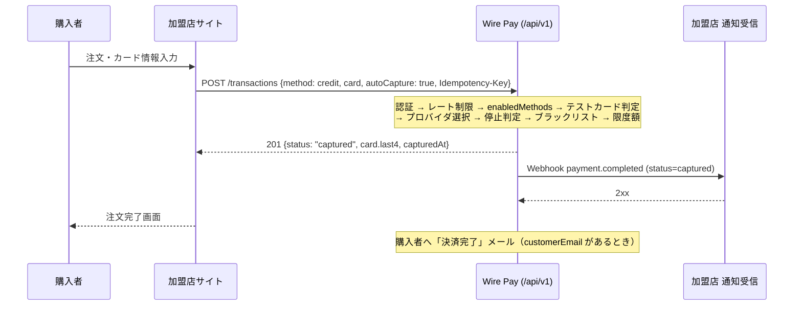

- 与信と売上確定はデモでは同時に行われ、取引は `captured` で作成されます（履歴には `created`（→ authorized）と `capture`（authorized → captured）の 2 イベントが記録されます）。
- `payment.completed` は **取引作成のレスポンスとほぼ同時** に送られます。レスポンスの `status` で完了を確認できるため、Webhook を待つ必要はありません。

### 7.2 クレジット / QR（与信のみ → PSP が完了）

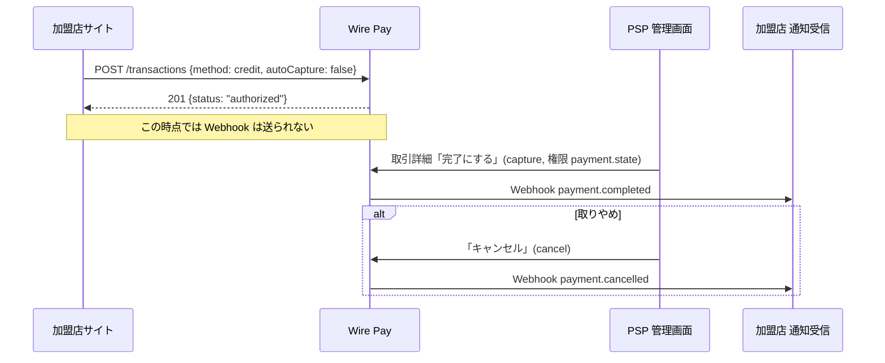

- `authorized` の取引を加盟店 API から完了・取消する手段はありません。テストカード `4000000000003220` はこの状態を再現します。

### 7.3 銀行振込

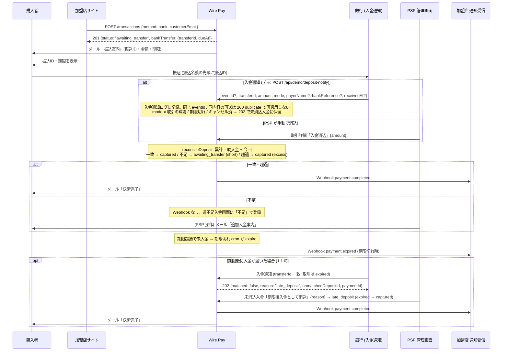

- 振込IDが無い / 誤った入金は Wire Pay 側で「未消込入金」として保留され、PSP のサポートが正しい振込IDを付与すると同じ消込が走り、完了時に `payment.completed` が送られます。加盟店側の作業はありません。
- 超過入金の差額は PSP が返金申請（理由 `duplicate`）を作成し、承認後に `refund.completed` が送られます。
- **期限後入金**（取引が `expired` の後に届いた入金）と **環境不一致**（テストの通知で本番の振込IDが一致した場合など）の入金も未消込入金として保留されます（1.1.0）。期限後入金は PSP が理由を付けて消込すると `late_deposit` 遷移で `captured` になり、金額が一致しなくても完了して過不足は `depositDiff` に記録されます。キャンセル済の取引への入金は消込できず、組戻し（返金手配）として却下されます。
- 銀行から同じ通知が再送されても（同じ `eventId`、または送信元・振込ID・金額・入金日時（分）・銀行参照番号が同じ）入金は二重計上されません（1.1.0）。すべての通知は PSP 管理画面「入金通知ログ」に残ります。

### 7.4 コンビニ決済

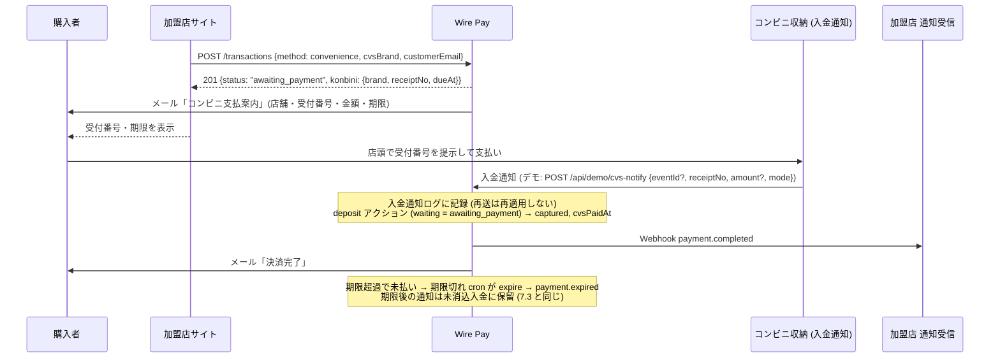

- 受付番号は 13 桁（表示は 4-4-5 区切り、API は区切りなし）。入金通知ではハイフン付きでも受け付けます。
- 金額が不足した通知は `awaiting_payment` のまま `depositDiff = short` になります（銀行振込と同じ扱い）。

### 7.5 決済リンク（ホスト型決済ページ）

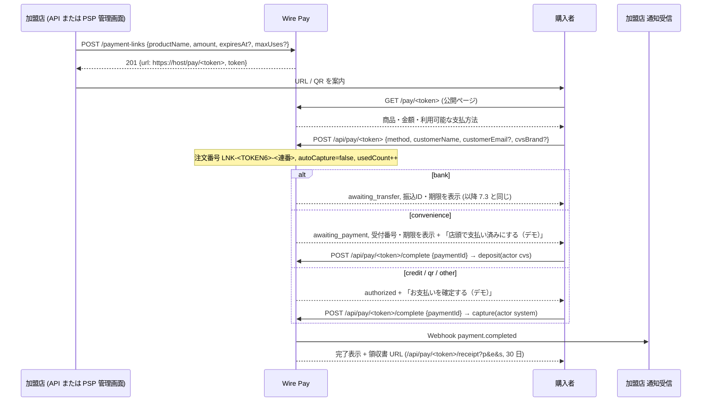

| 項目 | 仕様 |
|---|---|
| 利用可能な支払方法 | 加盟店の `enabledMethods` ∩ 停止中でない手段 ∩ 同一環境に有効なプロバイダがある手段 |
| 注文番号 | `LNK-<トークン先頭 6 文字（大文字）>-<利用回数 + 1 を 4 桁ゼロ埋め>` |
| ユーザーID（`user_id`） | 購入者のメールアドレス。未入力なら `guest_<時刻 36 進>` |
| 利用不可の判定順 | `disabled`（無効化済み）→ `expired`（`expiresAt` ≤ 現在。指定日の翌日 0:00 JST）→ `exhausted`（`usedCount` ≥ `maxUses`）。ページ表示時と POST 時の両方で判定（POST は 409 `link_disabled` / `link_expired` / `link_exhausted`） |
| 利用回数 | 取引作成ごとに +1（完了ではなく作成で消費） |
| 領収書 | 完了時に署名付き URL を発行（`HMAC-SHA256(token.paymentId.exp)`、30 日）。初回ダウンロードで領収書行（`source = customer`、番号 `RC-YYYYMM-00001`）が作られ、再ダウンロードは再発行に数えません |
| 監査 | 決済ページからの取引作成は actor `system`、完了は `system`（コンビニは `cvs`） |

決済リンクの無効化は PSP 管理画面（`/payment-links/[id]`）のみです。

### 7.6 定期課金

定期課金（プラン・契約）の作成は **PSP 管理画面のみ** です（`/subscriptions`）。加盟店は結果を Webhook で受け取ります。

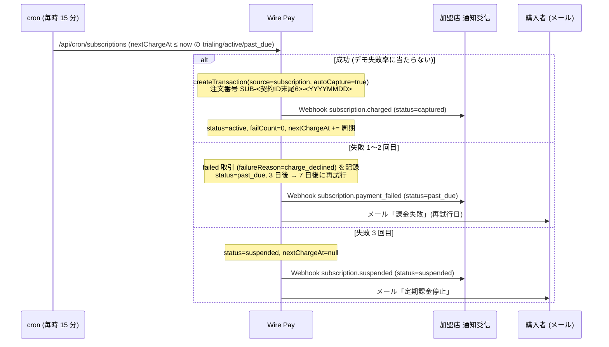

| 項目 | 仕様（`lib/subscriptions/service.ts`） |
|---|---|
| 課金周期 | `monthly`（暦月 + 1）/ `yearly`（+ 1 年）/ `weekly`（+ 7 日） |
| 無料期間 | `trialDays` > 0 なら `trialing` で開始し、終了日が初回課金日 |
| 再試行 | `RETRY_DAYS = [3, 7]`、`MAX_CHARGE_FAILURES = 3` |
| プロバイダ | 同一環境の有効なクレジットプロバイダ（無ければ任意の有効プロバイダ） |
| デモの失敗率 | `RiskSetting.demoChargeFailPercent`（既定 20%）。PSP の「今すぐ課金（成功 / 失敗）」は結果を指定 |
| 課金で作成された取引 | 通常の取引として一覧・返金・精算・レポートに現れる。`subscriptionId` で契約に紐づく |

### 7.7 未実装・今後の予定（第 7 章）

- 加盟店 API からの定期課金（プラン・契約）の作成・参照はありません。
- 決済ページの実カード入力・3D セキュア・QR コード表示はありません（「お支払いを確定する（デモ）」で完了）。
- 銀行振込の決済ページには入金を模擬するボタンがありません（PSP 側の消込またはデモ入金通知 API）。

---

## 8. 返金・取消・チャージバック

### 8.1 返金（Refund）

返金は **`Refund` テーブルの申請行** として管理され、「申請 → 承認 / 否認」の 2 段階です。申請は加盟店（API / 加盟店管理画面）と PSP オペレータが行い、承認 / 否認は PSP（admin / accounting）のみです。

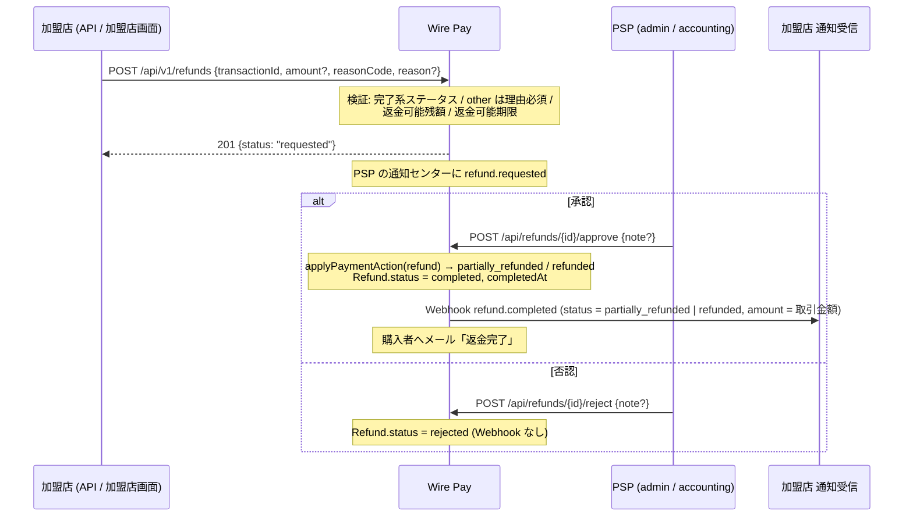

#### 申請の検証ルール（`createRefundRequest`）

| 条件 | 結果 |
|---|---|
| 取引が `captured` / `partially_refunded` 以外 | 409 `invalid_transition` |
| `reasonCode = other` で `reason` 無し | 400 `invalid_input`（`fieldErrors.reason = required`） |
| `amount` > 返金可能残額 = 取引額 − 返金済額 − **審査待ち（`requested` / `approved` / `processing`）の申請額合計** | 400 `refund_exceeds` |
| 返金可能期限（`capturedAt` + 加盟店の `refundWindowDays`、既定 180 日、0〜365）を超過 | 409 `refund_window_expired`。PSP の admin のみ「強制返金」（`force: true` + 理由必須）で申請可。加盟店経路では常に不可 |
| 種別 | `amount` ≥ 取引額なら `full`、それ以外 `partial` |

#### 返金申請のステータス

| ステータス | 意味 |
|---|---|
| `requested` | 申請直後。審査待ち |
| `approved` | 承認済み（デモでは経由せず即 `completed`） |
| `processing` | 処理中（デモでは経由しない） |
| `completed` | 返金完了。取引が `partially_refunded` / `refunded` に更新済み |
| `rejected` | 否認。`decisionNote` に審査メモ（加盟店管理画面に赤字表示） |
| `failed` | 失敗（デモでは発生しない） |

#### 加盟店から見える情報

| 場所 | 内容 |
|---|---|
| 取引詳細（加盟店管理画面） | 返金申請の一覧（理由・日時・金額・ステータス）、返金済み額、返金可能額 |
| 返金申請一覧（加盟店管理画面） | 全申請と審査結果、否認理由 |
| Webhook | `refund.completed`（承認時のみ。否認は通知されません） |
| API | `POST /api/v1/refunds` の応答のみ。返金の参照 API はありません（第 14 章） |
| 精算 | 完了した返金は **完了日（`completedAt`）の属する期間** の精算バッチで控除（第 9 章） |

#### 複数回の返金

一部返金は残額の範囲で複数回申請できます。返金済額が取引額に達した時点で `refunded` になり、以降の申請は 409 `invalid_transition` です。

### 8.2 取消（キャンセル / Void）

与信済（`authorized`）・申請中（`pending`）・振込待ち（`awaiting_transfer`）の取引を **完了前に取りやめる** 操作です。返金とは別の操作で、完了後の取引には使えません。

| 項目 | 仕様 |
|---|---|
| 実行者 | PSP のみ（権限 `payment.state` = admin）。加盟店 API・加盟店管理画面からは実行できません |
| 結果 | `cancelled`、`cancelledAt`、Webhook `payment.cancelled`（`status = cancelled`） |
| 精算 | 完了していないため精算対象外 |
| 依頼方法 | PSP のサポートへ取引ID（または注文番号）を伝える（**※要確認**: 依頼手段はシステム外の運用） |

### 8.3 チャージバック

カード会社からの支払異議は PSP が登録・管理します。加盟店は登録時の Webhook と、敗訴 / 確定時の取引ステータス・精算控除で結果を知ります。

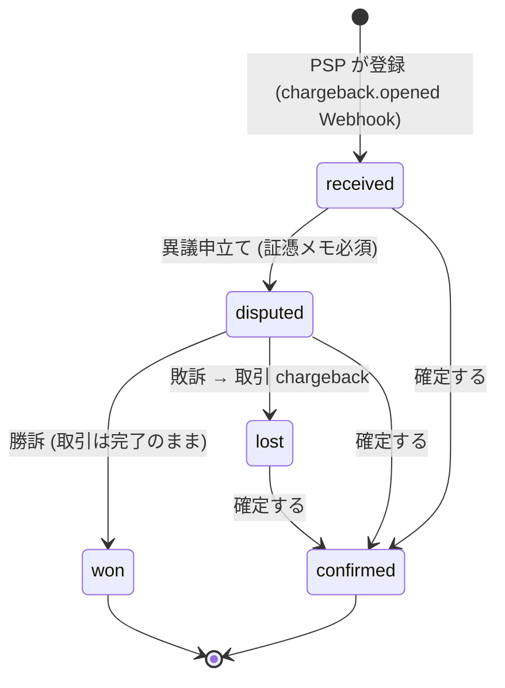

| 項目 | 仕様（`lib/chargebacks/*`） |
|---|---|
| 対象取引 | `captured` / `partially_refunded` / `refunded`。対応中（`received` / `disputed`）の重複登録は 409 `chargeback_exists` |
| 登録内容 | 異議金額（既定 = 取引額、取引額以下）、理由コード（`fraud` 不正利用 / `not_received` 商品未着 / `not_as_described` 商品相違 / `duplicate` 重複請求 / `other`）、異議申立期限（既定 **14 日後**）、証憑メモ |
| Webhook | 登録時に `chargeback.opened`（`status = chargeback:<理由コード>`、`amount` = 異議金額）。以降の勝訴・敗訴・確定は **Webhook されません** |
| 取引への反映 | 敗訴（`lost`）または確定（`confirmed`）で取引が `chargeback` ステータスになります（元のステータスからの遷移は第 2.3 節） |
| 精算 | 敗訴 / 確定した異議金額は **確定日（`resolvedAt`）の属する期間** の精算バッチで控除 |
| 期限管理 | PSP の通知センターに期限 3 日前から日次で通知 |
| 加盟店の証憑提出 | システム外（PSP へ連絡）。加盟店管理画面にチャージバックの画面はありません |

### 8.4 未実装・今後の予定（第 8 章）

- 加盟店 API・加盟店管理画面からの取消（cancel）、返金申請の取消・参照、チャージバックの参照・証憑提出はありません。
- 返金・チャージバックの `won` / `lost` / `confirmed` / 否認の Webhook はありません。
- 返金の `approved` / `processing` / `failed` はデモでは使われません（承認と同時に `completed`）。

---

## 9. 精算

精算は加盟店ごと・期間ごとの **精算バッチ（`SettlementBatch`）** と、その **明細行（`SettlementLine`）** で管理されます。バッチの生成・確定・振込は PSP（admin / accounting）が行い、加盟店は加盟店管理画面（4.8 / 4.9 節）と加盟店 API（5.8 節）で参照します。実装は `lib/settlements/*`、期間・振込予定日の計算は日本時間の 0:00 を境界とします。

### 9.1 精算設定（加盟店ごと）

PSP 管理画面の加盟店詳細「精算設定」タブで設定します。

| 項目（列） | 選択肢 / 制約 | 意味 |
|---|---|---|
| 締めサイクル（`settlementCycle`） | `monthly` 月末締め（既定）/ `semimonthly` 15日・月末締め / `weekly` 週次締め | バッチの既定の対象期間 |
| 支払サイト（`payoutTerm`） | `next_month_end` 翌月末（既定）/ `next_month_15` 翌月15日 / `month_after_next_15` 翌々月15日 / `next_week` 翌週 | 対象期間の終了日から振込予定日を計算 |
| 振込先口座 | 銀行名（≤80）、支店名（≤80）、口座種別 `ordinary` 普通 / `current` 当座、口座番号（7〜8 桁）、口座名義（≤80） | 振込先 |
| 精算手数料（`settlementFee`） | 0〜10,000 円（既定 0） | バッチ 1 件ごとに差し引く振込手数料 |
| 登録番号（`invoiceNumber`） | `T` + 13 桁 | 適格請求書の宛先として印字 |
| 住所（`address`） | ≤200 | 同上 |

### 9.2 締めサイクルと対象期間

| 締めサイクル | 既定の対象期間（生成日基準） | 例（9 月 3 日に生成） |
|---|---|---|
| 月末締め | 前月 1 日〜前月末日 | 8/1〜8/31 |
| 15日・月末締め | 生成日が 16 日以降: 当月 1〜15 日 / 15 日以前: 前月 16 日〜前月末日 | 8/16〜8/31 |
| 週次締め | 前週の月曜〜日曜 | 8/24〜8/30 |

- 期間は PSP が任意に指定できます（開始日 ≤ 終了日）。内部では終了日の **翌日 0:00 JST を排他的終端** として保持します（API の `periodTo` は排他的終端）。
- 同じ加盟店・環境で同じ開始日・終了日のバッチは 1 つだけです（重複は 409 `settlement_exists`）。

| 支払サイト | 振込予定日（`scheduledAt`、対象期間の終了日基準） |
|---|---|
| 翌月末 | 終了日の翌月の末日 |
| 翌月15日 | 終了日の翌月 15 日 |
| 翌々月15日 | 終了日の翌々月 15 日 |
| 翌週 | 終了日の 7 日後 |

### 9.3 明細の集計ルール（`collectLines`）

| 種別（`kind`） | 対象 | 判定に使う日時 | 金額 | 手数料 | 税区分 |
|---|---|---|---|---|---|
| `payment` 売上 | ステータスが `captured` / `partially_refunded` / `refunded` / `chargeback` の取引 | 完了日時 `capturedAt` が期間内 | 取引金額（+） | 下記の式 | `standard10` |
| `refund` 返金 | ステータス `completed` の返金申請 | 完了日時 `completedAt` が期間内 | 返金額（−） | 0 | `exempt` |
| `chargeback` チャージバック | ステータス `lost` / `confirmed` のチャージバック | 確定日時 `resolvedAt` が期間内 | 異議金額（−） | 0 | `exempt` |

- 返金・チャージバックは **発生した期間のバッチ** で控除されます（元の売上がどの期間でも構いません）。差引支払額がマイナスになることもあります。
- 環境（test / live）ごとに別のバッチです。本番運用ではテスト環境のバッチは支払対象外です（デモ用）。

### 9.4 手数料の計算式

```
手数料（取引ごと） = floor( 取引金額 × 料率% ÷ 100 ) + 固定手数料（円）      # 円未満切り捨て
```

- 料率と固定手数料は、**取引の完了日時に適用中だった契約**（契約・手数料タブの履歴で `適用開始日 ≤ 完了日時` の最新）の **決済手段別** の値です。
- 契約が無い場合、または決済手段が `other` の場合は 0 円です。
- 契約プランの既定料率（`PLAN_DEFAULT_RATES`）:

| プラン | クレジット | QR | コンビニ | 銀行振込 |
|---|---|---|---|---|
| スタンダード | 3.6% + 0 円 | 3.0% + 0 円 | 3.5% + 30 円 | 2.0% + 50 円 |
| プレミアム | 3.2% + 0 円 | 2.6% + 0 円 | 3.0% + 30 円 | 1.5% + 50 円 |
| カスタム | 決済手段ごとに料率（0〜100%、小数 2 桁）と固定手数料（0〜100,000 円）を個別設定 | | | |

### 9.5 バッチの内訳と差引支払額

```
売上総額            = Σ 売上行の金額
手数料合計          = Σ 売上行の手数料
返金合計            = Σ |返金行の金額|
チャージバック合計  = Σ |チャージバック行の金額|
精算手数料          = 加盟店設定の settlementFee（バッチ 1 件につき 1 回）
差引支払額 (netAmount) = 売上総額 − 手数料合計 − 返金合計 − チャージバック合計 − 精算手数料
```

### 9.6 バッチのステータスと操作（PSP）

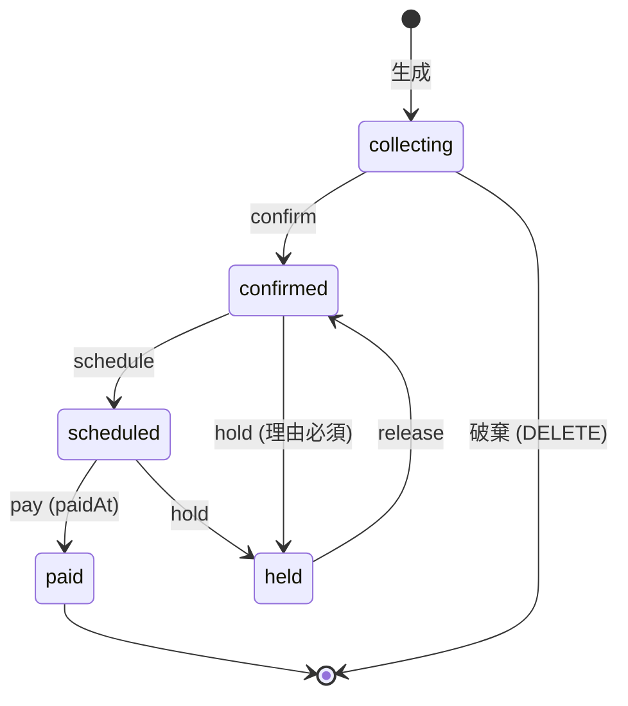

| ステータス | 表示 | 意味 | 加盟店から見えるもの |
|---|---|---|---|
| `collecting` | 集計中 | 生成直後。PSP が明細を確認する段階 | 一覧・詳細（請求書は不可） |
| `confirmed` | 確定 | 金額確定、明細変更不可。**確定時に請求書番号を採番**（1.1.0） | 請求書番号、請求書 PDF 可。ホームの「次回の振込予定」に表示 |
| `scheduled` | 振込予定 | 振込予定日に支払予定 | 同上 |
| `paid` | 振込済 | 支払完了（`paidAt`） | 振込完了日 |
| `held` | 保留 | チャージバック係争中などで支払を止めている（`holdReason`） | 保留理由（API の `holdReason`） |

### 9.7 精算明細の見方（加盟店管理画面 / API）

| 項目 | 説明 |
|---|---|
| 対象期間 | `periodFrom`〜`periodTo − 1 日`（画面は終了日を含む表記、API の `periodTo` は排他的） |
| 売上総額 / 手数料合計 / 返金合計 / チャージバック合計 / 精算手数料 / 差引支払額 | 9.5 節 |
| 振込予定日 / 振込完了日 | `scheduledAt` / `paidAt` |
| 請求書番号 | `invoiceNo`（確定以降。集計中は null）。横断検索の対象 |
| 明細行 | 発生日時、種別、注文番号（→ 取引詳細）、決済手段、金額（返金・チャージバックは負）、手数料 |

### 9.8 適格請求書（インボイス）PDF

精算バッチの **決済手数料** について、PSP から加盟店への適格請求書 PDF を出力します。

| 項目 | 内容 |
|---|---|
| 出力条件 | 確定以降（`confirmed` / `scheduled` / `paid` / `held`）のバッチ。集計中は 409 `settlement_not_confirmed` |
| 出力経路 | 加盟店管理画面の精算詳細（`GET /api/merchant-portal/settlements/{id}/invoice`）、PSP 管理画面（権限 `invoice.export` = admin / accounting） |
| 請求書番号 | `INV-YYYYMM-<加盟店番号>-<連番 2 桁>`（対象期間の開始月、加盟店番号は `MER-` を除いた数字、連番は同月・同加盟店のバッチの確定順）。**確定時に採番して `SettlementBatch.invoiceNo`（一意）に保存** し、PDF は保存値を印字する。未採番のバッチは 409 `invoice_no_missing`（1.1.0。旧形式 `INV-YYYYMM-<加盟店番号>` は 15 日・月末締め / 週次締めで同月に複数バッチが立つと重複した） |
| 発行者 | PSP の全体設定（発行者名・登録番号 `T` + 13 桁・住所・電話） |
| 宛先 | 加盟店の会社名・住所・登録番号（精算設定タブ） |
| 明細 | 決済手段ごとの手数料（件数・対象売上・税区分・税込金額）と振込手数料 |
| 消費税 | 手数料は **内税**。税率ごとに `税額 = round(税込 × 税率 ÷ (100 + 税率))`、端数処理は全体設定 `taxRounding`（`floor` 切り捨て（既定）/ `round` 四捨五入 / `ceil` 切り上げ）。売上行の手数料は 10%、返金・チャージバック行は対象外 |
| 監査 | `settlement.invoice_export`（加盟店経由は `portal: true`） |
| PDF | pdf-lib + Noto Sans JP サブセット。ヘッドレスブラウザ不要 |

### 9.9 代理店手数料（参考）

担当代理店が設定された加盟店の **確定 / 振込予定 / 振込済** バッチを対象に、`floor(差引支払額 × 代理店の手数料率%)` を月次で集計します（PSP 管理画面「代理店手数料」）。加盟店の差引支払額には影響しません。

### 9.10 未実装・今後の予定（第 9 章）

- 締めサイクルごとの **自動生成** と振込 API の接続はありません（PSP が手動で生成し、振込は状態変更のみ）。
- 精算明細メール（テンプレート `statement`）を自動送信する処理はありません（手動運用向けの文面のみ）。
- 加盟店管理画面からの明細 CSV 出力はありません（PSP 管理画面のみ）。

---

## 10. セキュリティと制限

### 10.1 IP 制限

| 対象（`target`） | 内容 |
|---|---|
| `merchant_api`（加盟店API） | 加盟店ごとに設定。**ブロック（`deny`）** ルールに一致する接続元からの `/api/v1/*`・`/api/merchant-api/*` 呼び出しは 403 `ip_blocked`。許可（`allow`）ルールは、PSP が **許可リストモード** を ON にしている場合に強制されます（下記）。OFF のときは判定表示のみ |
| `admin`（管理画面） | PSP 管理画面向け。加盟店には関係しません（同じ許可リストモードを持つ） |

**許可リストモード**（`GlobalSetting.ipAllowlistMerchantApi`、既定 OFF、1.1.0）:

- ON のとき、有効な許可ルールを 1 件以上持つ加盟店では、いずれの許可ルールにも一致しない接続元が 403 `ip_blocked`（`details.reason = "not_in_allowlist"`）になります。許可ルールの無い加盟店は影響を受けません。ブロックルールは常に優先します。
- 対象の有効な許可ルールが 1 件も無いと ON にできません（400 `allowlist_no_rules`）。管理画面側（`admin`）はさらに、切替を行うオペレータ自身の IP が許可ルールに含まれていないと ON にできず（400 `ip_self_block`）、ON の間は自分の IP が外れる許可ルールの変更・削除も拒否されます。
- 加盟店側の対処: 許可リストモードが ON の環境では、API サーバーの送信元 IP をすべて PSP に登録してもらってから接続してください。

- ルールは IPv4 単体（`203.0.113.10`）または CIDR（`198.51.100.0/24`、`/0`〜`/32`）。IPv6 は判定対象外（遮断されません。IPv4 射影形式 `::ffff:a.b.c.d` は IPv4 として判定）。
- 接続元 IP は `X-Forwarded-For` の先頭、無ければ `X-Real-IP` から取ります。
- 設定は PSP（admin / developer）が行います。加盟店サーバーの送信元 IP が変わる場合は事前に PSP へ連絡してください。

### 10.2 限度額

加盟店 × 決済手段（`credit` / `qr` / `convenience` / `bank`）ごとに **1 回あたり / 1 日あたり / 1 か月あたり** の上限金額（円、空欄 = 無制限）を PSP が設定します（`MerchantLimit`）。

| 項目 | 仕様（`lib/merchants/limits.ts`） |
|---|---|
| 判定タイミング | 取引作成時（API・決済リンク・定期課金・PSP 管理画面すべて）。ブラックリスト判定の後 |
| 判定順 | 1 回あたり（`amount` > 上限）→ 1 日（本日分の累計 + `amount` > 上限）→ 1 か月（当月分の累計 + `amount` > 上限） |
| 集計対象 | 同じ加盟店・決済手段・環境で、ステータスが `pending` / `awaiting_transfer` / `authorized` / `captured` / `partially_refunded` / `refunded` の取引の金額。**失敗・キャンセル・期限切れは含めない**。日・月の境界は JST |
| 超過時 | 取引は **`failed` として記録**（HTTP 201）、`failureReason = "limit_exceeded:<per_transaction\|daily\|monthly>"`。Webhook `limit.exceeded`（`status = failed:limit_exceeded:…`）を送信。PSP の通知センターにも通知 |
| 加盟店側の確認 | 取引詳細の失敗理由、Webhook。上限値と利用状況は PSP 管理画面の加盟店詳細「限度額」タブ（加盟店管理画面には表示されません） |

### 10.3 決済手段の一時停止

PSP は決済事業者側の障害や加盟店からの依頼で、特定の決済手段の **新規取引だけ** を一時的に止めることができます。進行中の取引（完了・返金・入金消込）には影響しません。

| 項目 | 仕様（`lib/payments/method-controls.ts`） |
|---|---|
| 範囲 | **全体停止**（全加盟店、admin）/ **加盟店別停止**（admin / cs）。対象はクレジット / QR / コンビニ / 銀行振込の 4 種 |
| 判定順 | 全体停止 → 加盟店別停止 → 加盟店の利用可能な決済手段（`enabledMethods`） |
| API の応答 | 409 `method_suspended`、`details: { scope: "global" \| "merchant", method }` |
| 決済ページ | 停止中の手段は選択肢から消える |
| 自動再開 | 停止時に再開予定日時を設定できる。毎時 45 分の cron `/api/cron/payment-method-controls` が再開 |
| 加盟店側の確認 | 加盟店管理画面「決済手段の状態」（理由・再開予定）、公開中の障害お知らせ（PSP が全体停止時に下書きを作成できる） |

### 10.4 ブラックリスト（連続失敗検知）

| 項目 | 仕様（`lib/risk/*`） |
|---|---|
| 照合キー | カード識別ハッシュ（`sha256(brand\|last4\|expiry)`）、接続元 IP（IPv4）、メールアドレス（小文字化） |
| 判定タイミング | 取引作成時（限度額より先）。**有効（`active`）** な項目に一致すると取引は `failed`（HTTP 201）、`failureReason = "blocked:<card\|ip\|email>"`。**Webhook は送信されません** |
| 自動検知 | 同じキーで直近 N 分に M 回失敗（既定 10 分 / 3 回、PSP が変更可）すると **候補**（`candidate`）として登録され、PSP が承認すると有効になります。候補の段階ではブロックされません |
| 手動追加 | PSP（admin / cs）が値を入力するとすぐに有効 |
| 加盟店側の確認 | 取引詳細の失敗理由（`blocked:…`）。ブラックリスト自体は加盟店に公開されません。誤検知の解除は PSP へ依頼 |

### 10.5 個人情報の取り扱いと保持期間

| 項目 | 仕様（`lib/pii/*`、`lib/customers/service.ts`） |
|---|---|
| 保存する個人情報 | 取引の購入者名・メール・接続元 IP・カード下 4 桁・カード識別ハッシュ、顧客マスタの氏名・メール・電話 |
| 保存しない情報 | **カード番号（PAN）・セキュリティコード**。API の `card.number` はブランド判定と下 4 桁・ハッシュの算出にのみ使われます |
| PSP 管理画面の表示 | 氏名は姓のみ（`山田 ＊＊`）、メールは先頭 2 文字 + `***@ドメイン`、電話は下 4 桁、IP は第 4 オクテットをマスク。マスク解除は admin / cs のみで、1 回ごとに操作ログ `pii.unmask` に記録 |
| 加盟店管理画面の表示 | 自社データは **マスクなし** |
| 操作ログ | 個人情報キー（`customerName` / `payerName` / `*email*` / `phone` / `ip` 系）は **保存時点で** マスク |
| CSV | PSP の全体設定 `csvPii`（`masked` 既定 / `full`）。`full` でも admin / accounting のみ実値 |
| 保持期間（匿名化） | 全体設定 `piiRetentionMonths`（既定 **24 か月**、1〜120）。最終取引がこれより古い顧客と、顧客に紐づかない古い取引の個人情報を **日次 cron**（`/api/cron/anonymize`、19:00 UTC = 04:00 JST）が消去（氏名・メール・電話・接続元 IP・カード識別情報を null、保存カードトークンを削除）。金額・ステータスなど帳簿情報は残ります |
| 手動匿名化 | PSP の admin が理由を付けて実行（顧客詳細）。元に戻せません。匿名化済みの顧客が再び取引すると新しいデータで復活し、保持期間が再開します |
| 操作ログの保持 | `auditRetentionYears`（既定 **7 年**、1〜30）を過ぎた操作ログを同じ cron が削除 |
| 加盟店への影響 | 匿名化された取引・顧客は加盟店管理画面でも氏名・メール等が空になります（取引ID・金額・ステータスは残る）。API `GET /transactions/{id}` の `customer` も null になります |

### 10.6 顧客マスタと保存カード

| 項目 | 仕様 |
|---|---|
| 顧客（`Customer`） | 加盟店 × `customerId`（API の `customerId`）で 1 件。取引作成時に自動作成・更新（氏名・メールは最新の取引で上書き） |
| 保存カード（`PaymentToken`） | `card` を送った取引のブランド・下 4 桁・有効期限・カード識別ハッシュ。顧客 × ハッシュで 1 件、`lastUsedAt` を更新 |
| 用途 | 加盟店管理画面「顧客」での参照（4.13 / 4.14 節）、PSP の横断検索・不正検知 |
| API | 顧客・保存カードを参照・利用する API はありません。**保存カードで再課金する機能はありません** |

### 10.7 通信・認証に関するその他の制限

| 項目 | 仕様 |
|---|---|
| 通知先 URL | https のみ |
| API キー | Bearer のみ。クエリ文字列でのキー送信は不可 |
| レート制限 | 公開 API と加盟店 API の合算で 60 回 / 分（加盟店 × 環境）。加盟店管理画面の更新系 API は IP ごとに 60 回 / 分、ログインは 10 回 / 分 |
| CSRF | 加盟店管理画面の更新系 API は同一オリジンの `Origin` / `Referer` と `X-Requested-With: fetch` を要求（ブラウザからのみ呼ぶ想定） |
| デモ上限 | 取引 1,000 件、加盟店 200 件、API キー 20 件 / 加盟店 など（`DEMO_LIMITS`）。到達時は 403 `demo_limit` |
| Cookie | 加盟店セッション `wirepay.merchant`: `Path=/; HttpOnly; SameSite=Lax; Max-Age=43200`、本番（`NODE_ENV=production`）では `Secure` 付き |

### 10.8 未実装・今後の予定（第 10 章）

- 加盟店管理画面からの IP 制限・限度額・ブラックリストの参照・変更はありません。
- 個人情報の列暗号化（現状は平文列 + マスク表示 + 保持期間）は未実装です。
- IPv6 の IP 制限は判定対象外です。

---

## 11. 通知

本章は Webhook 以外の通知、すなわち **購入者・加盟店へのメール** と **お知らせ・障害情報** を扱います。Webhook は第 6 章を参照してください。

### 11.1 メール通知設定の 3 種（加盟店設定 `emailNotification`）

加盟店宛の決済通知メールは、加盟店設定 `emailNotification` に従って **担当者メール（`Merchant.email`）** へ送られます（1.1.0 で実装。明細送付先メール `statementEmail` は精算関連にのみ使います）。

| 設定値 | 表示 | 送信内容（テンプレート） |
|---|---|---|
| `per_payment` | 決済ごと | 取引が完了（`captured`）になるたびに `merchant_payment_notice`（注文番号・金額・決済種別・完了日時・取引ID）。即時完了・PSP の完了操作・入金消込・期限後入金の消込・定期課金の課金すべてが対象 |
| `daily` | 1 日まとめて通知 | 毎日 09:00 JST の cron `/api/cron/merchant-daily-summary` が **前日 0:00〜24:00（JST）** の完了件数・金額・決済種別別内訳・失敗件数・期限切れ件数を `merchant_daily_summary` で 1 通（加盟店 × 環境ごと）。該当取引が 0 件の日は送らず、同じ日の分は再実行しても重複しない |
| `none` | メール通知無し | 送らない |

現在の設定は加盟店管理画面のホームに表示されます（変更は PSP に依頼）。デモ環境では 11.2 節と同じく送信ログへの記録のみです。

### 11.2 購入者へのメール

購入者メール（取引の `customerEmail`）がある取引について、次のイベントでメールが作成されます。テンプレートは PSP が編集でき（`/email-templates`、日本語 / 英語）、購入者向けの言語は環境変数 `EMAIL_DEFAULT_LANG`（既定 `ja`）です。

| テンプレートキー | 送信タイミング | 主な内容 |
|---|---|---|
| `transfer_guide` 振込案内 | 銀行振込の取引作成時 | 振込金額、振込ID、振込期限、商品 |
| `cvs_guide` コンビニ支払案内 | コンビニ決済の取引作成時 | 支払店舗、受付番号（4-4-5 区切り）、金額、期限 |
| `payment_completed` 決済完了 | 取引が完了したとき: `capture`、一致 / 超過の `deposit`、期限後入金の `late_deposit`（PSP の「完了にする」、決済ページの確定、入金消込・入金通知、未消込入金の消込）。**作成と同時に `captured` になる取引（`autoCapture: true` のクレジット / QR）でも送られます**（1.1.0。定期課金の課金は `subscription_*` テンプレートに任せるため除外） | 注文番号、金額、取引ID |
| `refund_completed` 返金完了 | 返金申請が承認されたとき | 返金額、注文番号、取引ID |
| `deposit_short` 追加入金案内 | 過不足入金で PSP が「追加入金を案内済にする」を実行したとき | 振込ID、不足額、請求金額、期限 |
| `subscription_failed` 定期課金の失敗 | 課金失敗（再試行待ち） | プラン名、金額、再試行日 |
| `subscription_suspended` 定期課金の停止 | 3 回目の失敗 | プラン名 |

- **デモ環境ではメールを実際には送信せず**、送信ログ（PSP 管理画面「メール送信ログ」）に「デモ（未送信）」として記録します（`EMAIL_PROVIDER=log` 既定）。実サービスへの接続は PSP 側の設定です。
- 無効化されたテンプレートではメールを作成しません。
- 加盟店宛のメールは 11.1 節の 2 種（`merchant_payment_notice` / `merchant_daily_summary`）が自動送信されます。`statement`（明細送付）は手動運用向けの文面のみで、自動送信はありません。

### 11.3 お知らせ・メンテナンス・障害情報

| 項目 | 仕様（`lib/announcements/*`） |
|---|---|
| 種別 | `notice` お知らせ / `maintenance` メンテナンス / `incident` 障害 |
| 公開条件 | ステータス `published` かつ `publishFrom ≤ 現在 < publishUntil`（`publishUntil` 無しは終了操作まで） |
| 対象 | 全加盟店（`targetAll`）または指定加盟店（`targetMerchantIds`） |
| 障害の更新履歴 | `occurred` 発生 → `investigating` 対応中 → `resolved` 復旧 |
| 受け取り方（画面） | 加盟店管理画面「お知らせ」（4.12 節）、ホームの「お知らせ」欄 |
| 受け取り方（API） | `GET /api/merchant-api/announcements`（5.8 節）。ポーリング間隔の推奨値はありません（**※要確認**） |
| プッシュ通知 | お知らせの Webhook・メール配信はありません |

### 11.4 PSP 側の通知センター（参考）

PSP オペレータ向けの通知（Webhook 断念、決済手段停止、限度額超過、返金申請、定期課金失敗、期限超過の日次まとめ、ブラックリスト候補 など 17 種）は PSP 管理画面の通知センターとメール / Slack に配信されます。加盟店には配信されませんが、加盟店の取引に起因する次の通知が PSP に届くことを知っておくと問い合わせが円滑です。

| PSP への通知 | 契機 |
|---|---|
| `webhook.abandoned` | 加盟店の通知先へ 5 回失敗（加盟店側のエンドポイント障害の可能性） |
| `limit.exceeded` | 加盟店の限度額超過 |
| `refund.requested` | 加盟店からの返金申請 |
| `transfer.overdue` / `cvs.overdue` | 期限超過の振込 / コンビニ支払（日次） |
| `deposit.late` | 期限切れ・キャンセル後に届いた入金の未処理件数（日次、1.1.0） |
| `webhook.signing_secret_missing` | 署名シークレットが無く送信できなかった加盟店 Webhook（加盟店 × 環境ごとに 24 時間に 1 通、1.1.0） |
| `blacklist.candidate` | 連続失敗の検知 |

### 11.5 未実装・今後の予定（第 11 章）

- 加盟店宛メールの文面を加盟店自身が変更する機能はありません（テンプレートは PSP が編集）。
- 精算明細メールの自動送信、お知らせの Webhook / メール配信はありません。
- 実メール配信サービスへの接続は `lib/email/send.ts` へのプロバイダ追加が必要です。

---

## 12. テストとサンドボックス

### 12.1 テストカード番号と各シナリオ

テスト環境（`wp_test_ak_` キー）で `card.number` に下表の番号を送ると、シナリオ別の結果を再現できます（`lib/public-api/test-cards.ts`）。表にない **Luhn 有効** な番号は成功として扱われ、Luhn 不正は 400 `invalid_input` です。本番環境（`wp_live_ak_`）でこれらの番号を送ると 400 `test_card_in_live` です。

| 番号 | 結果（`outcome`） | 取引の `status` | `failureReason` | 説明 |
|---|---|---|---|---|
| `4242424242424242` | `success` | `captured`（`autoCapture: false` なら `authorized`） | — | 成功（与信 → 売上確定）。Visa |
| `5555555555554444` | `success` | 同上 | — | 成功（Mastercard） |
| `3566002020360505` | `success` | 同上 | — | 成功（JCB） |
| `4000000000003220` | `authorized_only` | `authorized` | — | 3D セキュア相当: 与信済で止まる。PSP 管理画面から完了 |
| `4000000000000002` | `declined` | `failed` | `card_declined` | カード会社による拒否 |
| `4000000000009995` | `insufficient_funds` | `failed` | `insufficient_funds` | 残高不足 |
| `4000000000000069` | `expired_card` | `failed` | `expired_card` | 有効期限切れ |
| `4000000000000127` | `incorrect_cvc` | `failed` | `incorrect_cvc` | セキュリティコード不一致 |
| `4000000000000119` | `processing_error` | `failed` | `processing_error` | 決済ネットワークの処理エラー |

- 有効期限は `expMonth` 1〜12、`expYear` 2024〜2099 の範囲であれば任意です（過去日付の検証はありません）。`cvc` は保存も検証もされません。
- 失敗シナリオの取引は HTTP 201 で `status: "failed"` として返り、加盟店管理画面にも表示されます。Webhook `payment.failed` は **送られません**（作成時の失敗のため）。連続失敗検知の対象にはなります（同じカード・IP・メールで既定 10 分に 3 回失敗するとブラックリスト候補）。
- `card` を省略した `credit` / `qr` の取引はカード情報なしで成功します。

### 12.2 コンビニ・銀行振込のテスト

| 決済手段 | 完了させる方法（テスト環境） |
|---|---|
| コンビニ | (a) PSP 管理画面の取引詳細「入金消込」、(b) デモ入金通知 API `POST /api/demo/cvs-notify`、(c) 決済リンクページの「店頭で支払い済みにする（デモ）」 |
| 銀行振込 | (a) PSP 管理画面の取引詳細「入金消込」（不足 / 超過も再現可）、(b) デモ入金通知 API `POST /api/demo/deposit-notify` |
| 期限切れ | 期限切れ cron（`/api/cron/expire-transfers`）を待つ、または PSP 管理画面の「期限切れにする」（期限超過後のみ） |
| 期限後入金・環境不一致 | 期限切れの振込IDや、`mode` と環境が違う振込IDでデモ入金通知 API を呼ぶと 202 で未消込入金に保留される。PSP 管理画面「未消込入金」で「期限後入金として消込」（理由必須）または却下 |
| 入金通知の再送 | 同じ `eventId` で 2 回送ると 2 回目は 200 `{ duplicate: true }` で再適用されない |

### 12.3 デモ用エンドポイント

デモ入金通知 API は **PSP 側の環境変数 `DEPOSIT_NOTIFY_SECRET`** で保護されます。本番環境で未設定なら 404、開発環境で未設定なら認証なしで呼べます。加盟店が利用する場合は PSP からシークレットの提供を受けてください（受信インターフェースとしての仕様は仕様書B 第 3 章）。

| エンドポイント | リクエスト | 応答 |
|---|---|---|
| `POST /api/demo/deposit-notify` | `Authorization: Bearer <DEPOSIT_NOTIFY_SECRET>`、`{ eventId?, transferId, amount, mode, payerName?, bankReference?, receivedAt? }`。**`mode`（`test` / `live`）は必須**（未指定は 400 `invalid_input`、`fieldErrors.mode = "required"`）、`eventId` は ≤128 文字の任意の重複排除キー（1.1.0） | 一致 / 超過: 200 `{ matched: true, notificationId, notificationNo, duplicate: false, status: "captured", depositDiff: null \| "excess", completed: true, … }`、不足: 200 `{ status: "awaiting_transfer", depositDiff: "short", completed: false }`、振込ID不明 / 環境不一致 / 期限切れ / キャンセル済: **202** `{ matched: false, reason: "not_found" \| "mode_mismatch" \| "late_deposit" \| "cancelled_deposit", unmatchedDepositId, paymentId }`（未消込入金として保留）、再送（同じ `eventId`、または内容が同じ通知）: 200 `{ duplicate: true, notificationId, paymentId }` で再適用しない、完了済みなど: 409 `invalid_transition` |
| `POST /api/demo/cvs-notify` | 同じ Bearer、`{ eventId?, receiptNo（13 桁、ハイフン可）, amount?, receivedAt?, mode }`（`mode` 必須） | 200 `{ receiptNo, paymentId, status, depositDiff, completed, notificationId, … }`、環境不一致 / 期限切れ / キャンセル済: 202（上と同じ）、不明: 404 `receipt_not_found`、再送: 200 `{ duplicate: true }` |
| `GET` / `POST /api/demo/webhook-receiver?result=ok\|error\|timeout` | 認証なし | Webhook 受信の模擬。`ok` = 200（受信内容をエコー）、`error` = 500、`timeout` = 12 秒待機。seed の加盟店の通知先に設定されています |

入金通知はすべて（適用 / 重複 / 未消込 / 拒否）PSP 管理画面「入金通知ログ」（`/deposit-notifications`、通知番号 `DN-00001`）に記録され、取引詳細の「関連する入金通知・未消込入金」からも参照できます（1.1.0）。詳細な契約は仕様書B 第 3 章を参照してください。

### 12.4 サンドボックスコンソールの使い方

1. 加盟店管理画面にログインし、「API キー」でテストキー（`wp_test_ak_…`）を確認します（無ければ PSP に発行を依頼）。
2. 「サンドボックス」でキーを貼り付け、エンドポイントを選びます。リクエストボディは「サンプルを読み込む」で例を挿入できます。
3. 「送信」でブラウザから **実際の `/api/v1`** を呼び出し、HTTP ステータス・所要時間・レスポンス JSON・同等の curl コマンドを確認します。
4. 作成した取引は加盟店管理画面「取引」と PSP 管理画面に表示され、Webhook も実際に通知先へ送信されます。

制約: 本番キーは拒否、キーはブラウザの sessionStorage にのみ保存、レート制限（60 回 / 分）が適用されます。

### 12.5 Webhook 受信のテスト

1. 通知先 URL（https）を PSP に登録してもらい、署名シークレット（test）を受け取ります。
2. サンドボックスまたは API で `credit` の取引を `autoCapture: true` で作成すると即時に `payment.completed` が届きます。
3. `POST /api/v1/refunds` で返金を申請し、PSP に承認を依頼すると `refund.completed` が届きます。
4. 受信側で 5xx を返す・応答を遅らせると、1 分 → 5 分 → … の再送と加盟店管理画面「Webhook 送信ログ」の記録を確認できます。
5. 手動再送で `X-Timestamp` と署名が再計算されることを確認します。

### 12.6 テストデータ（seed）

デモ環境には次の加盟店・キーが初期投入されています（`prisma/seed-data.ts`、毎日 03:00 JST にリセット）。

| 項目 | 値 |
|---|---|
| 加盟店 | `MER-00001`（ハンドメイド雑貨 コトリ）ほか 3 社 |
| テスト API キー（MER-00001） | `wp_test_ak_KotoriDemoTestKey000000000000001` |
| 加盟店ログイン | ログイン画面のデモ用アカウント欄（`DEMO_LOGIN_HINT` 設定時） |
| 通知先 | `/api/demo/webhook-receiver` |

### 12.7 未実装・今後の予定（第 12 章）

- QR・コンビニ・銀行振込のシナリオ番号（テストカードに相当するもの）はありません。
- テスト環境でのみ有効な Webhook の手動発火（任意イベントの送信）はありません（PSP 管理画面の「Webhook をシミュレート」はプロバイダ → Wire Pay 方向の受信テストです）。

---

## 13. 接続チェックリスト

本番開通までに加盟店（または下位 PSP・ウォレット）が確認する項目です。各項目の詳細は括弧内の章を参照してください。

### 13.1 契約・アカウント

- [ ] 加盟店ID（`MER-xxxxx`）と加盟店パスワードを PSP から受領し、`/merchant/login` にログインできる（3.3）
- [ ] 利用する決済手段が契約の「利用可能な決済手段」に含まれている（`/merchant/methods` で「利用可能」）（4.11）
- [ ] 振込IDの桁数（7 / 8）、振込期限・コンビニ支払期限・返金可能期限の日数を PSP と合意した（2.4, 8.1）
- [ ] 限度額（1 回 / 1 日 / 1 か月）の設定値を PSP と合意した（10.2）
- [ ] 精算設定（締めサイクル、支払サイト、振込先口座、精算手数料、登録番号・住所）を PSP に登録してもらった（9.1）
- [ ] 契約プラン・手数料率を確認した（9.4）

### 13.2 API キー

- [ ] テスト API キー（`wp_test_ak_`）とテスト署名シークレット（`wp_test_ss_`）を受領し、安全に保管した（3.2）
- [ ] `GET /api/merchant-api/ping` または `GET /api/v1/transactions?limit=1` でテストキーの認証が通る（5.8, 5.4）
- [ ] 本番 API キー（`wp_live_ak_`）と本番署名シークレット（`wp_live_ss_`）を受領した（本番開通時）
- [ ] キーのローテーション手順（テストは自己、本番は PSP 依頼、猶予 7 日）を運用手順に組み込んだ（3.2）
- [ ] API サーバーの送信元 IP を PSP に伝え、IP 制限（加盟店API）の設定を確認した（10.1）

### 13.3 取引作成

- [ ] `POST /api/v1/transactions` に `Idempotency-Key` を付け、5xx / 通信断時に同じキーで再送する実装がある（5.1）
- [ ] レスポンスの `status` で分岐し、`failed` のときは `failureReason` をユーザーに適切に案内する（5.3）
- [ ] `bank`: `bankTransfer.transferId` と `dueAt` を購入者に表示し、「振込名義の先頭に振込ID」を案内する（7.3）
- [ ] `convenience`: `konbini.receiptNo`（4-4-5 区切りで表示）、`brand`、`dueAt` を購入者に表示し、`status` は `awaiting_payment`（支払待ち）として扱う（7.4）
- [ ] `credit` / `qr`: `autoCapture` の方針（即時完了か与信のみか）を決め、与信のみの場合は PSP の完了操作の運用を決めた（7.2）
- [ ] 429 `rate_limited` を `Retry-After` に従って再送する（5.1）
- [ ] テストカード 9 番号で成功・与信止まり・各失敗シナリオの挙動を確認した（12.1）
- [ ] `customerId` を安定した自社の顧客IDにしている（顧客マスタのキー）（10.6）

### 13.4 Webhook 受信

- [ ] https の通知先 URL を PSP に登録し、通知の型（JSON / form / query）、パラメータセット、識別子形式を選択した（6.2）
- [ ] `X-Timestamp` + `X-Signature` を **生のボディ（GET はクエリ文字列）** で HMAC-SHA256 検証し、定数時間比較している（6.4）
- [ ] タイムスタンプが 5 分以上ずれた通知を拒否する（6.4）
- [ ] test / live 両方の署名シークレットで検証できる（6.4）
- [ ] 各環境に有効な署名シークレットが発行されていることを加盟店管理画面「API キー」で確認した（無い環境の Webhook は送信されない）（6.4）
- [ ] `payment_id` + `event` で **冪等** に処理し、順序に依存しない（6.7）
- [ ] 10 秒以内に 2xx を返す（重い処理は非同期）（6.6）
- [ ] 全イベント（`payment.completed` / `payment.failed` / `payment.expired` / `payment.cancelled` / `refund.completed` / `chargeback.opened` / `limit.exceeded` / `subscription.*`）を受けても 2xx を返し、未知のイベントも安全に無視する（6.1）
- [ ] 加盟店管理画面「Webhook 送信ログ」で成功を確認し、失敗時の再送手順を運用に組み込んだ（4.7, 6.8）

### 13.5 返金・精算・その他

- [ ] 返金申請（API または加盟店管理画面）と `refund.completed` の受信を確認した（8.1）
- [ ] 返金可能期限超過時の対応（PSP へ依頼）を運用に組み込んだ（8.1）
- [ ] 精算バッチ・明細の確認方法（加盟店管理画面、`/api/merchant-api/settlements`）と請求書 PDF の取得を確認した（9.7, 9.8）
- [ ] お知らせ・障害情報の確認手段（加盟店管理画面 / `GET /api/merchant-api/announcements`）を決めた（11.3）
- [ ] 購入者メール（振込案内・コンビニ案内・完了・返金）の文面を PSP と確認した（11.2）
- [ ] 加盟店宛メール通知設定（決済ごと / 1 日まとめて / 無し）と宛先（担当者メール）を PSP と合意した（11.1）
- [ ] 個人情報の保持期間（既定 24 か月）と匿名化の影響を理解した（10.5）

### 13.6 本番切替

- [ ] 本番キーに切り替え、テストカード番号を送っていない（`test_card_in_live` にならない）（12.1）
- [ ] ヘッダーの環境スイッチを「本番」にして取引・Webhook・精算を確認した（1.3）
- [ ] 本番の署名シークレットで Webhook 検証が通る（6.4）
- [ ] 許可リストモードが ON の場合、本番 API サーバーの送信元 IP がすべて許可ルールに登録されている（10.1）

---

## 14. 未実装・今後の予定

本文の各章末に分散して記載した項目の総覧です。いずれも **対象コミット時点で実装されていない** 機能で、本文には含めていません。

### 14.1 決済処理

| 項目 | 現状 |
|---|---|
| 外部決済ネットワークへの実接続 | なし。クレジット / QR は DB 上で即時完了、コンビニ・銀行振込の入金はデモ API / PSP 操作で模擬（仕様書B 第 11 章） |
| 決済ページの実カード入力・3D セキュア・QR コード表示 | なし（「お支払いを確定する（デモ）」） |
| 保存カードによる再課金 | なし |
| QR・コンビニ・銀行振込のテストシナリオ番号 | なし |

### 14.2 加盟店 API

| 項目 | 現状 |
|---|---|
| 売上確定 / 取消 / 期限切れ API | なし（PSP 管理画面の操作） |
| 返金申請の参照・一覧・取消 API | なし |
| 決済リンクの参照・一覧・無効化 API | なし（無効化は PSP 管理画面） |
| 顧客・保存カード・定期課金の API | なし |
| 署名シークレットの API による取得 / ローテーション | なし |
| Webhook のイベント購読設定・環境フィールド | なし |
| `GET /transactions` の `status` 値検証 | なし（不正値は 0 件） |

### 14.3 加盟店管理画面

| 項目 | 現状 |
|---|---|
| パスワード変更・再発行、複数担当者、二段階認証 | なし |
| 本番キーの発行・ローテーション・失効 | なし（PSP 依頼） |
| 通知設定・利用可能な決済手段・期限日数の自己変更 | なし |
| CSV 出力、取引の詳細絞り込み、Webhook 送信ログの詳細（ヘッダー・ボディ） | なし |
| IP 制限・限度額・ブラックリストの参照 | なし |
| チャージバックの参照・証憑提出 | なし |

### 14.4 通知・精算

| 項目 | 現状 |
|---|---|
| 実メール配信サービスへの接続 | `EMAIL_PROVIDER=log` で記録のみ |
| 精算バッチの自動生成、振込 API 接続、精算明細メールの自動送信 | なし |
| 返金の否認・チャージバックの勝訴 / 敗訴 / 確定の Webhook | なし |
| お知らせの Webhook / メール配信 | なし |

### 14.5 セキュリティ

| 項目 | 現状 |
|---|---|
| 個人情報の列暗号化 | なし（平文列 + マスク表示 + 保持期間） |
| IPv6 の IP 制限 | 判定対象外 |
| 固定の Webhook 送信元 IP | なし（署名で検証） |

1.1.0 で実装済みになり本表から外した項目: 加盟店宛メール通知設定に基づくメール（11.1）、加盟店管理画面からの領収書発行（4.5）、加盟店 API のレート制限（5.8）、入金通知の重複排除と期限後入金の保留（7.3）、Webhook 署名鍵の fail closed（6.4）、IP 許可リストの強制（10.1）。

---

## 付録 A: エラーコード一覧

加盟店が受け取り得るエラーコードです。レスポンス形式は第 5.1 節。

### A.1 公開 API（`/api/v1/*`）— `x-error-codes` と同じ

| code | HTTP | 意味 |
|---|---|---|
| `invalid_api_key` | 401 | API キーが無い・形式不正・失効・期限切れ、または署名シークレットで認証しようとした |
| `ip_blocked` | 403 | 加盟店の IP 制限に一致（ブロックルール、または許可リストモード ON で許可ルール不一致。`details.reason` = `deny` / `not_in_allowlist`） |
| `invalid_input` | 400 | 検証エラー。`details.fieldErrors` に項目ごとの理由 |
| `invalid_json` | 400 | ボディが JSON でない |
| `test_card_in_live` | 400 | 本番環境にテストカード番号 |
| `method_not_enabled` | 400 | 加盟店契約に無い決済手段 |
| `provider_not_found` | 400 | 同一環境に有効なプロバイダが無い |
| `method_suspended` | 409 | 決済手段が一時停止中（`details.scope`, `details.method`） |
| `not_found` | 404 | 存在しない、または他の加盟店 / 環境のリソース |
| `refund_exceeds` | 400 | 返金額が返金可能残額を超過 |
| `refund_window_expired` | 409 | 返金可能期限を超過 |
| `invalid_transition` | 409 | 現在のステータスでは許可されない操作（例: 未完了取引の返金申請） |
| `demo_limit` | 403 | デモのデータ上限 |
| `rate_limited` | 429 | 60 回 / 分を超過。`Retry-After` |
| `internal` | 500 | 予期しないサーバーエラー |

上記に加え、共通ハンドラ由来の `conflict`（409、一意制約違反）、`provider_disabled`（400）、`encryption_key`（500、PSP 側の鍵設定不備）、`undecryptable`（422）が返る可能性があります。

### A.2 加盟店管理画面 API（`/api/merchant-portal/*`）

| code | HTTP | 発生箇所 |
|---|---|---|
| `invalid_credentials` | 401 | ログイン: 加盟店IDまたはパスワード不一致 |
| `merchant_locked` | 423 | ログイン: 5 回連続失敗によるロック（`{minutes}`） |
| `unauthorized` | 401 | 加盟店セッション無し / 期限切れ |
| `csrf_origin` / `csrf_header` | 403 | 同一オリジン / `X-Requested-With: fetch` の欠落 |
| `rate_limited` | 429 | IP ごとの上限（更新系 60 回 / 分、ログイン 10 回 / 分） |
| `not_found` | 404 | 自社以外の取引 / 送信 / キー / バッチ |
| `invalid_transition` / `refund_exceeds` / `refund_window_expired` / `invalid_input` | 409 / 400 / 409 / 400 | 返金申請（A.1 と同じ意味） |
| `live_key_rotation` | 403 | 本番キーのローテーション |
| `key_not_active` | 409 | 失効・期限切れキーのローテーション |
| `settlement_not_confirmed` | 409 | 集計中バッチの請求書 PDF |
| `invoice_no_missing` | 409 | 請求書番号が未採番のバッチ（1.1.0 より前に確定したバッチは `npm run db:backfill` で採番） |
| `receipt_not_completed` | 409 | 完了 / 一部返金以外の取引の領収書（加盟店管理画面からの発行） |

### A.3 ホスト型決済ページ API（`/api/pay/*`）

| code | HTTP | 意味 |
|---|---|---|
| `not_found` | 404 | 不明なトークン、リンクに属さない取引 |
| `link_disabled` / `link_expired` / `link_exhausted` | 409 | 無効化 / 期限切れ / 上限到達 |
| `invalid_input` | 400 | 入力不備（`fieldErrors.method = unavailable` を含む） |
| `invalid_transition` | 409 | 既に完了した取引の「確定」 |
| `receipt_link_invalid` | 403 | 領収書 URL の署名不一致・期限切れ |
| `receipt_not_completed` | 409 | 未完了取引の領収書 |

### A.4 デモ入金通知 API（`/api/demo/*`）

| code | HTTP | 意味 |
|---|---|---|
| `unauthorized` | 401 | `DEPOSIT_NOTIFY_SECRET` 不一致 |
| `not_found` | 404 | 本番でシークレット未設定（無効化） |
| `invalid_input` | 400 | `mode` 未指定（`fieldErrors.mode = "required"`）、`amount` 不正、`receivedAt` 不正 など |
| `receipt_not_found` | 404 | 受付番号が不明（コンビニ） |
| `invalid_transition` | 409 | 完了済みなど、振込待ち / 支払待ち以外の取引への入金。期限切れ・キャンセル済への入金は 409 ではなく 202 で未消込入金に保留（1.1.0） |
| `not_bank_transfer` | 400 | 振込IDも受付番号も無い取引 |

## 付録 B: ステータス一覧

| 対象 | 値（表示 ja / en） |
|---|---|
| 取引（`Payment.status`） | 第 2.2 節の 11 値（`awaiting_payment` を含む） |
| 返金申請（`Refund.status`） | `requested` 申請中 / Requested、`approved` 承認 / Approved、`rejected` 否認 / Rejected、`processing` 処理中 / Processing、`completed` 完了 / Completed、`failed` 失敗 / Failed |
| 返金種別（`Refund.kind`） | `full` 全額、`partial` 一部 |
| 返金理由（`reasonCode`） | `customer` 顧客都合、`defect` 商品不良、`duplicate` 重複決済、`other` その他 |
| チャージバック（`Chargeback.status`） | `received` 受付、`disputed` 異議申立中、`won` 勝訴、`lost` 敗訴、`confirmed` 確定 |
| チャージバック理由 | `fraud` 不正利用、`not_received` 商品未着、`not_as_described` 商品相違、`duplicate` 重複請求、`other` その他 |
| 精算バッチ（`SettlementBatch.status`） | `collecting` 集計中、`confirmed` 確定、`scheduled` 振込予定、`paid` 振込済、`held` 保留 |
| 精算明細種別（`SettlementLine.kind`） | `payment` 売上、`refund` 返金、`chargeback` チャージバック |
| Webhook 送信（`WebhookDelivery.status`） | `pending` 送信待ち、`success` 成功、`retrying` リトライ待ち、`failed` 失敗、`abandoned` 断念 |
| 定期課金（`Subscription.status`） | `trialing` 無料期間、`active` 有効、`past_due` 未払い、`suspended` 停止、`cancelled` 解約 |
| 決済リンク（`PaymentLink.status`） | `active` 有効、`disabled` 無効 |
| API キー | `active` 有効、`expiring` 失効予定、`expired` 期限切れ、`revoked` 失効 |
| 過不足入金（`Payment.depositDiff` / `depositDiffStatus`） | `short` 不足 / `excess` 超過。対応状況 `open` 未対応、`refund_arranged` 差額返金手配中、`notified` 追加入金案内済、`resolved` 完了 |
| お知らせ（`Announcement.status` / `kind`） | `draft` 下書き、`published` 公開、`ended` 終了。種別 `notice` / `maintenance` / `incident`。障害の更新 `occurred` / `investigating` / `resolved` |
| 顧客 | `anonymizedAt` あり = 匿名化済み |
| 入金通知（`DepositNotification.result`） | `applied` 適用、`duplicate` 重複、`unmatched` 未消込、`rejected` 拒否。理由 `resultReason`: `mode_mismatch` / `late_deposit` / `cancelled_deposit` / `not_found` / `no_id` / `invalid_status` / `apply_failed` |
| 未消込入金（`UnmatchedDeposit.status` / `reason` / `dismissKind`） | `unmatched` 未消込、`matched` 消込済、`dismissed` 却下。理由 `late_deposit` 期限後入金 / `cancelled_deposit` キャンセル後入金 / `mode_mismatch` 環境不一致。却下区分 `returned` 組戻し手配 / `other` |
| 領収書の発行元（`Receipt.source`） | `dashboard` PSP 管理画面、`customer` 決済ページ、`merchant` 加盟店管理画面 |

## 付録 C: Webhook イベント一覧

第 6.1 節の表を正とします。イベント名は `lib/webhooks/events.ts` の `MERCHANT_WEBHOOK_EVENTS`（10 種）: `payment.completed`, `payment.failed`, `payment.expired`, `payment.cancelled`, `refund.completed`, `chargeback.opened`, `limit.exceeded`, `subscription.charged`, `subscription.payment_failed`, `subscription.suspended`。

## 付録 D: 画面一覧

### D.1 加盟店管理画面・購入者向け

| パス | 画面 | 節 |
|---|---|---|
| `/merchant/login` | 加盟店ログイン | 4.2 |
| `/merchant` | ホーム | 4.3 |
| `/merchant/transactions` | 取引一覧 | 4.4 |
| `/merchant/transactions/[id]` | 取引詳細（返金申請） | 4.5 |
| `/merchant/refunds` | 返金申請 | 4.6 |
| `/merchant/webhooks` | Webhook 送信ログ（再送） | 4.7 |
| `/merchant/settlements` | 精算 | 4.8 |
| `/merchant/settlements/[id]` | 精算詳細（請求書 PDF） | 4.9 |
| `/merchant/api-keys` | API キー（テストキーのローテーション） | 4.10 |
| `/merchant/methods` | 決済手段の状態 | 4.11 |
| `/merchant/announcements` | お知らせ | 4.12 |
| `/merchant/customers` | 顧客 | 4.13 |
| `/merchant/customers/[id]` | 顧客詳細 | 4.14 |
| `/merchant/sandbox` | サンドボックス | 4.15 |
| `/pay/[token]` | ホスト型決済ページ | 4.16 |
| `/docs/api`, `/docs/api/[chapter]` | 公開 API ドキュメント（はじめに / 認証と環境 / エラーとレート制限 / テストカード番号 / Webhook / サンドボックス + 自動生成リファレンス） | — |

### D.2 PSP 管理画面のうち加盟店に関係する画面（参考）

| パス | 画面 |
|---|---|
| `/merchants`, `/merchants/[id]?tab=basic\|contract\|limits\|apikeys\|notify\|settlement\|webhooks\|methods` | 加盟店管理（詳細タブ） |
| `/applications`, `/payments`, `/payments/[id]` | 決済申請一覧 / 決済一覧 / 取引詳細（完了・失敗・キャンセル・入金消込・返金申請・API 再通知・領収書） |
| `/refunds`, `/refunds/[id]` | 返金管理（承認 / 否認） |
| `/settlements`, `/settlements/[id]` | 精算管理 |
| `/webhook-logs`, `/webhook-logs/[id]` | Webhook 送信ログ（詳細・再送） |
| `/chargebacks`, `/chargebacks/new`, `/chargebacks/[id]` | チャージバック |
| `/unmatched-deposits`, `/deposit-diffs`, `/deposit-notifications` | 未消込入金（消込・期限後入金の消込・組戻し）/ 過不足入金 / 入金通知ログ |
| `/payment-links`, `/payment-links/[id]` | 決済リンク（無効化・QR） |
| `/subscriptions`, `/subscriptions/[id]` | 定期課金 |
| `/payment-method-controls` | 決済手段の停止（全体） |
| `/ip-restrictions`, `/blacklist` | IP 制限（ルール・許可リストモード）/ ブラックリスト |
| `/announcements` | お知らせ配信 |
| `/customers`, `/customers/[id]` | 顧客（マスク表示・匿名化） |
| `/email-templates`, `/email-logs` | メールテンプレート / 送信ログ |

## 付録 E: 権限マトリクス（完全版）

PSP 管理画面のロール（`admin` / `accounting` / `cs` / `developer` / `viewer`）ごとの権限です。**唯一のソースは `lib/role.ts` の `PERMISSIONS`** で、下表は `npx tsx scripts/gen-permissions.ts` が生成します（手で編集しない）。加盟店に直接関係する行は第 3.5 節に抜粋しています。未ログインは閲覧のみ、`DEMO_READONLY=1` では削除とプロバイダの更新が全員 403 です。

<!-- permissions:start -->
| 機能 | 操作 | admin | accounting | cs | developer | viewer |
|---|---|---|---|---|---|---|
| 加盟店 | 閲覧 | ○ | ○ | ○ | ○ | ○ |
| 加盟店 | 作成 | ○ |  | ○ |  |  |
| 加盟店 | 更新 | ○ |  | ○ |  |  |
| 加盟店 | パスワード表示 | ○ |  |  |  |  |
| 加盟店 | パスワード再発行 | ○ |  |  |  |  |
| 契約・手数料 / 限度額 / 期限 / 精算設定 | 閲覧 | ○ | ○ | ○ | ○ | ○ |
| 契約・手数料 / 限度額 / 期限 / 精算設定 | 更新 | ○ | ○ |  |  |  |
| API キー・署名シークレット | 閲覧 | ○ | ○ | ○ | ○ | ○ |
| API キー・署名シークレット | 発行 | ○ |  |  | ○ |  |
| API キー・署名シークレット | ローテーション | ○ |  |  | ○ |  |
| API キー・署名シークレット | 失効 | ○ |  |  | ○ |  |
| 代理店 | 閲覧 | ○ | ○ | ○ | ○ | ○ |
| 代理店 | 作成 | ○ |  | ○ |  |  |
| 代理店 | 更新 | ○ |  | ○ |  |  |
| 取引 | 閲覧 | ○ | ○ | ○ | ○ | ○ |
| 取引 | 作成 | ○ |  | ○ |  |  |
| 取引 | 完了 / 失敗 / キャンセル / 期限切れ | ○ |  |  |  |  |
| 取引 | 入金消込 | ○ | ○ |  |  |  |
| 取引 | API 再通知 | ○ |  | ○ | ○ |  |
| 取引 | Webhook シミュレート | ○ |  |  | ○ |  |
| 取引メモ | 閲覧 | ○ | ○ | ○ | ○ | ○ |
| 取引メモ | 作成 | ○ | ○ | ○ | ○ |  |
| 取引メモ | 自分の投稿を編集 | ○ | ○ | ○ | ○ |  |
| 取引メモ | 削除 | ○ |  |  |  |  |
| 取引メモ | ピン留め | ○ |  | ○ |  |  |
| 未消込入金 | 閲覧 | ○ | ○ | ○ | ○ | ○ |
| 未消込入金 | 登録 | ○ | ○ | ○ |  |  |
| 未消込入金 | 消込 | ○ | ○ |  |  |  |
| 未消込入金 | 却下 | ○ | ○ | ○ |  |  |
| 入金通知ログ | 閲覧 | ○ | ○ | ○ | ○ | ○ |
| 過不足入金 | 閲覧 | ○ | ○ | ○ | ○ | ○ |
| 過不足入金 | 更新 | ○ | ○ | ○ |  |  |
| 返金 | 閲覧 | ○ | ○ | ○ | ○ | ○ |
| 返金 | 申請 | ○ |  | ○ |  |  |
| 返金 | 期限超過の強制 | ○ |  |  |  |  |
| 返金 | 承認 / 否認 | ○ | ○ |  |  |  |
| 領収書 | 閲覧 | ○ | ○ | ○ | ○ | ○ |
| 領収書 | 発行 | ○ | ○ | ○ |  |  |
| 精算バッチ | 閲覧 | ○ | ○ | ○ | ○ | ○ |
| 精算バッチ | 生成 | ○ | ○ |  |  |  |
| 精算バッチ | 確定 / 振込予定 / 振込済 / 保留 / 解除 | ○ | ○ |  |  |  |
| 精算バッチ | 削除 | ○ | ○ |  |  |  |
| 請求書（インボイス） | 出力 | ○ | ○ |  |  |  |
| 代理店手数料 | 閲覧 | ○ | ○ | ○ | ○ | ○ |
| 集計レポート | 閲覧 | ○ | ○ | ○ | ○ | ○ |
| Webhook 送信ログ | 閲覧 | ○ | ○ | ○ | ○ | ○ |
| Webhook 送信ログ | 再送 | ○ |  |  | ○ |  |
| チャージバック | 閲覧 | ○ | ○ | ○ | ○ | ○ |
| チャージバック | 作成 | ○ | ○ |  |  |  |
| チャージバック | 更新 | ○ | ○ |  |  |  |
| ブラックリスト | 閲覧 | ○ | ○ | ○ | ○ | ○ |
| ブラックリスト | 作成 | ○ |  | ○ |  |  |
| ブラックリスト | 更新 | ○ |  | ○ |  |  |
| 検知ルール | 閲覧 | ○ | ○ | ○ | ○ | ○ |
| 検知ルール | 更新 | ○ |  | ○ |  |  |
| メールテンプレート | 閲覧 | ○ | ○ | ○ | ○ | ○ |
| メールテンプレート | 更新 | ○ |  |  | ○ |  |
| メール送信ログ | 閲覧 | ○ | ○ | ○ | ○ | ○ |
| お知らせ | 閲覧 | ○ | ○ | ○ | ○ | ○ |
| お知らせ | 作成 | ○ |  | ○ |  |  |
| お知らせ | 更新 | ○ |  | ○ |  |  |
| お知らせ | 公開 / 終了 / 更新追加 | ○ |  | ○ |  |  |
| 課金プラン | 閲覧 | ○ | ○ | ○ | ○ | ○ |
| 課金プラン | 作成 | ○ |  | ○ |  |  |
| 課金プラン | 更新 | ○ |  | ○ |  |  |
| 定期課金 | 閲覧 | ○ | ○ | ○ | ○ | ○ |
| 定期課金 | 作成 | ○ |  | ○ |  |  |
| 定期課金 | 課金 / 一時停止 / 再開 / 解約 | ○ |  | ○ |  |  |
| デモの課金失敗率 | 閲覧 | ○ | ○ | ○ | ○ | ○ |
| デモの課金失敗率 | 更新 | ○ |  |  | ○ |  |
| 決済リンク | 閲覧 | ○ | ○ | ○ | ○ | ○ |
| 決済リンク | 作成 | ○ |  | ○ |  |  |
| 決済リンク | 無効化 | ○ |  | ○ |  |  |
| IP 制限 | 閲覧 | ○ | ○ | ○ | ○ | ○ |
| IP 制限 | 作成 | ○ |  |  | ○ |  |
| IP 制限 | 更新 | ○ |  |  | ○ |  |
| IP 制限 | 削除 | ○ |  |  | ○ |  |
| 決済プロバイダ | 閲覧 | ○ | ○ | ○ | ○ | ○ |
| 決済プロバイダ | 作成 | ○ |  |  | ○ |  |
| 決済プロバイダ | 更新 | ○ |  |  | ○ |  |
| 決済プロバイダ | 削除 | ○ |  |  | ○ |  |
| 決済プロバイダ | 接続テスト | ○ |  |  | ○ |  |
| 決済手段の停止 | 閲覧 | ○ | ○ | ○ | ○ | ○ |
| 決済手段の停止 | 全体停止 | ○ |  |  |  |  |
| 決済手段の停止 | 加盟店別停止 | ○ |  | ○ |  |  |
| 管理者アカウント | 閲覧 | ○ |  |  |  |  |
| 管理者アカウント | 作成 | ○ |  |  |  |  |
| 管理者アカウント | 更新 | ○ |  |  |  |  |
| 管理者アカウント | 仮パスワード / 2FA 解除 | ○ |  |  |  |  |
| 自分のアカウント | 更新 | ○ | ○ | ○ | ○ | ○ |
| 操作ログ | 閲覧 | ○ | ○ | ○ | ○ | ○ |
| 横断検索（管理者） | 閲覧 | ○ |  |  |  |  |
| 全体設定 | 閲覧 | ○ |  |  |  |  |
| 全体設定 | 更新 | ○ |  |  |  |  |
| 顧客 | 閲覧 | ○ | ○ | ○ | ○ | ○ |
| 顧客 | 匿名化 | ○ |  |  |  |  |
| CSV 出力 | 出力 | ○ | ○ | ○ | ○ |  |
| 個人情報 | マスク解除 | ○ |  | ○ |  |  |
| API ドキュメント | 閲覧 | ○ | ○ | ○ | ○ | ○ |
<!-- permissions:end -->

## 付録 F: よくある問い合わせ → 参照章

| 問い合わせ | まず確認すること | 参照章 |
|---|---|---|
| 入金が反映されない（銀行振込 / コンビニ） | 取引のステータスと期限（`expired` なら期限後入金として未消込入金に保留されている）。振込IDが正しく付いているか。入金通知の `mode` が取引の環境と一致しているか。PSP 管理画面「入金通知ログ」「未消込入金」に該当の通知があるか | 2.4, 7.3, 7.4, 12.3, 仕様書B 3.2〜3.5 / 5.3 |
| Webhook が届かない | 加盟店管理画面「Webhook 送信ログ」のステータスと応答（`failed` / `abandoned`、`error: signing_secret_missing` なら署名シークレット未発行）。通知先 URL が https で 10 秒以内に 2xx を返すか。署名検証に使う環境（test / live）が合っているか。再送は送信ログの「再送」 | 4.7, 6.4, 6.6, 6.7, 6.8 |
| 返金できない | 取引が `captured` / `partially_refunded` か（`authorized` はキャンセル、`chargeback` は返金不可）。返金可能残額（取引額 − 返金済 − 審査待ち）と返金可能期限（`refundWindowDays`）。期限超過は PSP の admin による強制返金のみ | 5.6, 8.1, 8.2 |
| 精算額が合わない | 明細の集計ルール（売上 = `capturedAt`、返金 = `completedAt`、チャージバック = `resolvedAt` が期間内）、完了日時に適用中の契約料率、精算手数料、環境（test / live）ごとに別バッチ。請求書の税額は内税・税率別・端数処理 | 9.2〜9.5, 9.8 |
| 本番キーで 400 になる | `test_card_in_live`（本番環境にテストカード番号）、`method_not_enabled`（契約に無い決済手段）、`provider_not_found`（本番環境に有効なプロバイダが無い）、`invalid_input`（`details.fieldErrors`）。403 `ip_blocked` は IP 制限（ブロック / 許可リストモード） | 5.3, 10.1, 12.1, 付録 A |
| 取引が `failed` で作成される | `failureReason`（限度額 `limit_exceeded:*`、ブラックリスト `blocked:*`、テストカードの失敗シナリオ）。HTTP は 201 | 5.3, 10.2, 10.4, 12.1 |
| メールが届かない | デモ環境ではメールは実送信されず送信ログのみ。購入者メールは取引の `customerEmail` が必要。加盟店宛は `emailNotification` の設定と担当者メール | 11.1, 11.2 |

## 改訂履歴

| 版 | 日付 | 対象コミット | 変更点 |
|---|---|---|---|
| 1.0.0 | 2026-09-06 | `6b72a40` | 初版 |
| 1.1.0 | 2026-09-07 | `cf1c153` | 修正フェーズ1〜5 の実装変更を反映。**破壊的変更**: 取引ステータス `awaiting_payment`（支払待ち）の追加（2.2, 2.3, 7.4）、入金通知の `mode` 必須化と環境照合・期限後 / キャンセル後入金の 202 保留（7.3, 12.3, 付録 A.4）、請求書番号の形式 `INV-YYYYMM-<加盟店番号>-<連番 2 桁>`（9.8）。**追加**: 入金通知の冪等化（`eventId`）と入金通知ログ、`late_deposit` 遷移、加盟店登録時のテスト署名シークレット自動発行（3.1）、Webhook 署名鍵の fail closed（6.4）、加盟店宛メール通知設定の実装（11.1）、即時完了取引の決済完了メール（11.2）、加盟店 API のレート制限（5.8）、加盟店管理画面からの領収書発行（4.5）、IP 許可リストモード（10.1）、本番モードの可視化（4.1）、PSP リンクのデモ限定と加盟店ログインの autocomplete（4.2）、英語表示 `pending` = "Pending"、付録 E（権限マトリクス）・付録 F（よくある問い合わせ）。詳細は `docs/spec/CHANGELOG.md` |
