# Wire Pay 決済プロバイダ接続仕様書

| 項目 | 内容 |
|---|---|
| 版数 | 1.0.0 |
| 対象システム | Wire Pay（決済管理ダッシュボード）— コミット `6b72a40`（`main`） |
| 作成日 | 2026-09-06 |
| 言語 | 日本語（英語版: `docs/spec/en/B-provider-connection-spec.md`） |
| 用語 | `docs/spec/ja/glossary.md` の対訳に従う |

## 本書の対象読者

本書は **Wire Pay が決済処理を委託する先** のための接続仕様書です。

- カード会社・アクワイアラ、Stripe などのカード決済プラットフォーム
- PayPay などの QR / ウォレット事業者
- コンビニ収納代行事業者
- バーチャル口座・ペイジーを提供する銀行・収納機関
- Wire Pay の上位に位置する PSP・ウォレット（Wire Pay がそのクライアントとして決済を委託する事業者）
- Wire Pay 側でプロバイダ接続を **実装・運用する開発者**

Wire Pay の API を呼び出して決済を **利用する側**（加盟店、Wire Pay を経由する下位 PSP・ウォレット）向けの仕様は、姉妹文書 **仕様書A（加盟店・接続クライアント向け 統合仕様書）** `docs/spec/ja/A-merchant-integration-spec.md` に記載しています。本書で「加盟店側の挙動」に触れる箇所は仕様書A の該当章を参照で示し、重複して記述しません。

## 本書の記述方針

- 本文は **実装から確認できる事実のみ** を記載しています。対象コミットの Wire Pay は **外部決済ネットワークを呼び出さないデモモード** で動作しており、プロバイダとの実通信は行われません。そのため本書は「現状の接続設定・受信インターフェース・状態遷移」を実装どおりに記述し、本番接続に向けて **プロバイダに求めるインターフェース要件** を「要件」として明示的に区別して書きます（要件の節は「本番接続に向けた要件」と見出しに付けます）。
- 未実装・モックのままの機能は各章末の「未実装・今後の予定」と第 11 章に列挙し、本文には混ぜていません。
- 推測を含む箇所は「**※要確認**」を付け、`docs/spec/ASSUMPTIONS.md` に理由付きで列挙しています。
- 日時は特記なき限り日本時間（Asia/Tokyo）で判定し、API の日時文字列は ISO 8601 / UTC、金額は円の整数（JPY）です。

## 目次

1. [概要](#1-概要)
2. [決済手段ごとの接続方式](#2-決済手段ごとの接続方式)
3. [入金通知・結果通知の受信仕様](#3-入金通知結果通知の受信仕様)
4. [識別子の対応](#4-識別子の対応)
5. [消込と過不足処理](#5-消込と過不足処理)
6. [与信・売上・取消・返金・チャージバック](#6-与信売上取消返金チャージバック)
7. [精算と資金の流れ](#7-精算と資金の流れ)
8. [障害時の運用](#8-障害時の運用)
9. [セキュリティ要件](#9-セキュリティ要件)
10. [新規プロバイダを追加する手順](#10-新規プロバイダを追加する手順)
11. [未実装・今後の予定](#11-未実装今後の予定)
- 付録 A [データモデル（ER 図）](#付録-a-データモデルer-図)
- 付録 B [設定項目一覧](#付録-b-設定項目一覧)

---

## 1. 概要

### 1.1 Wire Pay とプロバイダの責任分界

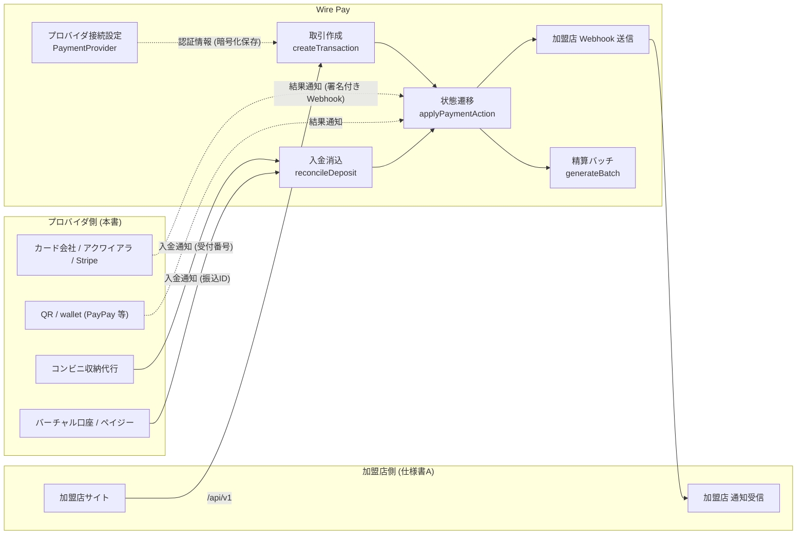

| 責任 | Wire Pay | プロバイダ |
|---|---|---|
| 取引の受付・識別子の発行 | 取引ID、振込ID（7 / 8 桁）、受付番号（13 桁）を発行し、加盟店・購入者に案内する | バーチャル口座・収納番号など **プロバイダ側の識別子** を発行する場合は、Wire Pay の識別子との対応を保つ（第 4 章） |
| 与信・売上・取消・返金の実行 | 状態遷移と帳簿（`Payment` / `Refund` / `PaymentEvent`）を管理する。**対象コミットでは外部呼び出しなし**（デモ） | カードネットワーク・ウォレット残高に対する実処理（本番接続の要件） |
| 結果・入金の通知 | 受信インターフェース（第 3 章）で受け取り、状態遷移・加盟店 Webhook・メールを行う | 署名付きで通知する。再送に耐えられるよう Wire Pay 側は冪等に処理する |
| 消込・過不足 | 累計入金額で判定（第 5 章）。未消込入金・過不足入金の運用画面を提供 | 入金額・入金日時・振込人名義・銀行側参照番号を通知する |
| 精算 | 加盟店ごとの精算バッチと差引支払額の計算（第 7 章）、適格請求書 PDF | Wire Pay への入金（資金移動）。**対象コミットには資金移動の接続なし** |
| チャージバック | 登録・異議・結果・確定の管理と精算控除 | 支払異議の通知（**現状は PSP オペレータの手入力**） |
| 障害時 | 決済手段の一時停止（全体 / 加盟店別）、通知センター、Webhook 再送 | 障害の連絡（**現状はシステム連携なし**） |

### 1.2 接続の全体像（対象コミットの実装）

| 要素 | 実装 |
|---|---|
| プロバイダ定義 | `lib/providers/registry.ts` の `PROVIDERS`（15 種、5 カテゴリ）。認証情報のフィールド定義・秘匿区分・テストモード対応可否をコードで定義 |
| プロバイダ接続（インスタンス） | `PaymentProvider` テーブル。`providerKey`、`category`、`displayName`、`status`（`active` / `disabled`）、`testMode`、`credentials`（JSON。秘匿フィールドは AES-256-GCM 暗号文） |
| 接続テスト | `runConnectionTest`: 必須項目の有無と URL 形式の検証のみ。**外部 API は呼びません** |
| 取引作成時のプロバイダ選択 | 公開 API: 同一環境（`testMode = !livemode`）で `status = active` かつ `category = method` のうち **作成日時が最も古い 1 件**。PSP 管理画面: 明示的に選択。決済リンク: 同一環境の有効なプロバイダを `category` ごとに 1 件。定期課金: 同一環境の有効なクレジットプロバイダ（無ければ任意の有効プロバイダ） |
| 取引の環境 | `Payment.livemode = !provider.testMode` を作成時にスナップショット |
| プロバイダ側識別子 | `Payment.externalId`（デモでは Wire Pay が `<providerKey 先頭 6 文字>_<時刻 36 進>_<乱数>` 形式で自動生成。`(providerId, externalId)` で一意） |
| 受信インターフェース | (a) `POST /api/webhooks/{providerId}`（署名付きの結果通知）、(b) `POST /api/demo/deposit-notify`（銀行の入金通知）、(c) `POST /api/demo/cvs-notify`（コンビニの入金通知）。第 3 章 |
| 送信インターフェース | Wire Pay → 加盟店の Webhook（仕様書A 第 6 章）。Wire Pay → プロバイダの API 呼び出しは **無し** |
| 帳簿保護 | 取引を持つプロバイダは削除不可（409 `provider_has_payments`）。無効化（`disabled`）で運用 |

### 1.3 環境（テスト / 本番）

- プロバイダ接続は `testMode`（true = テスト）を持ちます。`supportsTestMode: false` の定義（カスタム Webhook 連携）はフォームでトグルを出しません（**※要確認**: `supportsTestMode` は UI 上のトグル表示制御であり、API は任意の `testMode` を受け付けます）。
- テスト用と本番用は **別々の `PaymentProvider` 行** として登録します（同じプロバイダ定義で `testMode` を変える）。
- 取引・返金・精算・Webhook 送信はすべて `livemode` で分離されます（仕様書A 1.3 節）。

### 1.4 未実装・今後の予定（第 1 章）

- Wire Pay からプロバイダへの API 呼び出し（与信・売上・取消・返金・残高照会）はありません。
- プロバイダごとのアダプタ層（ベンダーの通知形式 → Wire Pay の内部イベントへの変換）はありません。受信インターフェースは Wire Pay 独自形式です（第 3 章）。

---

## 2. 決済手段ごとの接続方式

### 2.1 プロバイダ定義（`PROVIDERS`）と接続設定画面

PSP 管理画面「決済プロバイダ → ＋ 決済プロバイダを追加」（`/providers/new` → `/providers/new/[provider]`）でカテゴリ → プロバイダを選び、下表のフィールドを入力します。秘匿（`secret: true`）のフィールドは保存時に AES-256-GCM で暗号化され、画面には `••••••••` + 末尾 4 文字のマスクで表示されます（第 9 章）。`required` は必須、`type: url` は `http(s)://` 形式を検証します。

#### クレジットカード（`credit`）

| `providerKey` | 表示名 | フィールド（`key`: 型 / 必須 / 秘匿） |
|---|---|---|
| `stripe` | Stripe | `publishable_key`: text / 必須、`secret_key`: password / 必須 / 秘匿、`webhook_secret`: password / 秘匿（受信 Webhook の署名検証に使用）、`statement_descriptor`: text（22 文字以内の明細表記） |
| `square` | Square | `application_id`: text / 必須、`access_token`: password / 必須 / 秘匿、`location_id`: text / 必須 |
| `gmo_pg` | GMOペイメントゲートウェイ | `site_id`: text / 必須、`site_password`: password / 必須 / 秘匿、`shop_id`: text / 必須、`shop_password`: password / 必須 / 秘匿、`api_endpoint`: url |

#### QR コード決済（`qr`）

| `providerKey` | 表示名 | フィールド |
|---|---|---|
| `paypay` | PayPay | `merchant_id`: text / 必須、`api_key`: text / 必須（公開識別子として平文保存）、`api_secret`: password / 必須 / 秘匿、`store_id`: text |
| `au_pay` | au PAY | `merchant_id`: text / 必須、`store_id`: text / 必須、`api_key`: text / 必須（平文）、`api_secret`: password / 必須 / 秘匿、`callback_url`: url |
| `rakuten_pay` | 楽天ペイ (オンライン) | `service_id`: text / 必須、`auth_key`: password / 必須 / 秘匿、`shop_url`: url |
| `docomo_pay` | d払い | `merchant_id`: text / 必須、`api_key`: password / 必須 / 秘匿、`callback_url`: url |

#### コンビニ決済（`convenience`）

| `providerKey` | 表示名 | フィールド |
|---|---|---|
| `bitcash` | ビットキャッシュ | `merchant_code`: text / 必須、`auth_key`: password / 必須 / 秘匿、`notify_url`: url |
| `smartpit` | スマートピット | `client_id`: text / 必須、`client_secret`: password / 必須 / 秘匿、`expiry_days`: text（**※要確認**: 表示専用。取引の支払期限は加盟店設定 `cvsDueDays` で決まり、この値は参照されません） |
| `web_conveni` | Webコンビニ決済 | `contract_code`: text / 必須、`api_token`: password / 必須 / 秘匿、`stores`: select（`all` / `lawson` / `familymart` / `seven`。**※要確認**: 表示専用。決済ページの店舗選択肢は `CVS_BRANDS` 固定） |

#### 銀行振込（`bank`）

| `providerKey` | 表示名 | フィールド |
|---|---|---|
| `pay_easy` | ペイジー (Pay-easy) | `collection_agency`: text / 必須（収納機関番号）、`customer_number_prefix`: text、`confirmation_number`: password / 秘匿 |
| `virtual_account` | バーチャル口座 (GMO/SBI等) | `bank_partner`: select / 必須（`gmo_aozora` / `sbi` / `mizuho` / `rakuten`）、`api_user`: text / 必須、`api_password`: password / 必須 / 秘匿、`branch_code`: text、`webhook_url`: url（入金通知 Webhook URL。**※要確認**: 表示専用。Wire Pay の入金受信 URL は `/api/demo/deposit-notify` 固定） |

#### その他（`other`）

| `providerKey` | 表示名 | フィールド |
|---|---|---|
| `custom_webhook` | カスタムWebhook連携 | `service_name`: text / 必須、`endpoint`: url / 必須、`auth_header`: password / 秘匿、`webhook_secret`: password / 秘匿（受信 Webhook の署名検証に使用）、`notes`: textarea。`supportsTestMode: false` |

**対象コミットで実際に参照されるフィールドは `webhook_secret`（`stripe`、`custom_webhook`）のみ** です。他のフィールドは保存・表示・接続テスト（必須チェック）に使われ、決済処理には使われません（第 11 章）。

### 2.2 決済手段ごとに Wire Pay がプロバイダと交換するもの

以下のシーケンス図は、**実装されている経路（実線）** と **本番接続に向けた要件（破線、「要件」と注記）** を区別して示します。

#### クレジット / QR

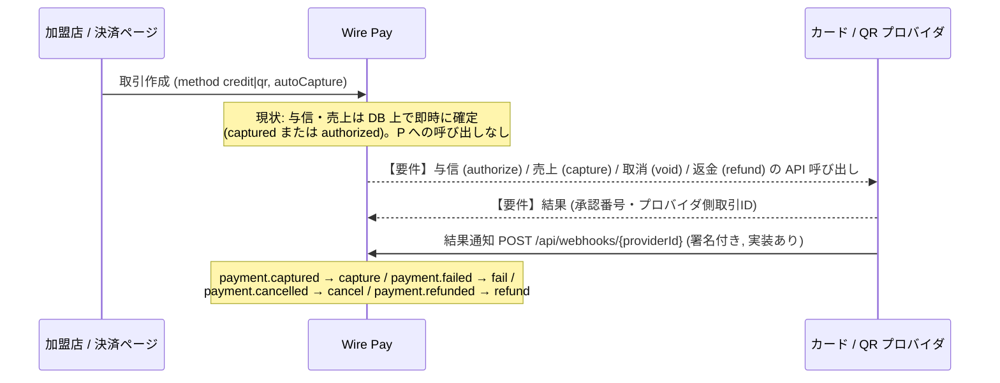

- 実装されている受信は `POST /api/webhooks/{providerId}`（3.1 節）で、`externalId` で取引を特定し、`EVENT_TO_ACTION` に従って状態遷移を適用します。
- Wire Pay が送るもの（要件）: 金額（円）、Wire Pay 取引ID（参照用）、加盟店の注文番号、カード情報（**Wire Pay は PAN を保持しないため、本番接続ではプロバイダのトークン化 / ホスト型フィールドを前提とする**。第 9 章）。
- Wire Pay が受け取るもの: プロバイダ側取引ID（`externalId` に保存）、結果種別、金額（任意）。

#### コンビニ決済

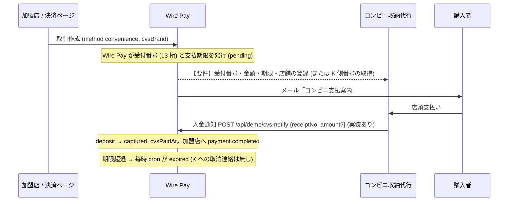

#### 銀行振込（バーチャル口座 / ペイジー）

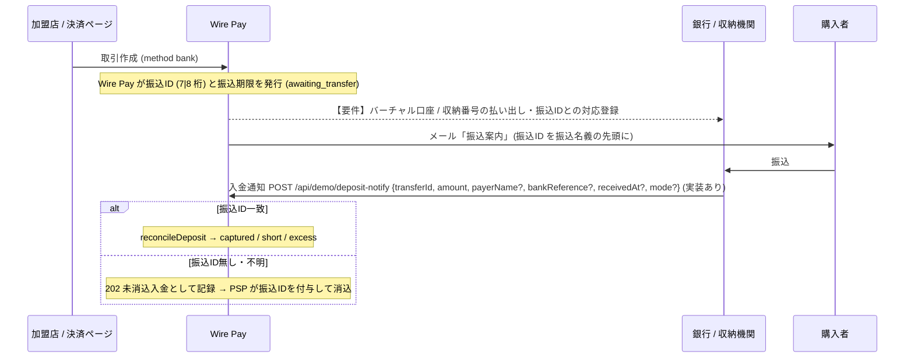

### 2.3 プロバイダ接続の API（PSP 管理画面が使用）

| メソッド / パス | 権限 | 内容 |
|---|---|---|
| `GET /api/providers` | 閲覧 | 一覧（`credentials` は含まない） |
| `POST /api/providers` | `provider.create`（admin / developer） | `{ providerKey, displayName（≤80）, testMode（既定 true）, credentials }`。必須項目不足は 400 `missing_required`、未知の `providerKey` は 400 `unsupported_provider`、上限 50 件で 403 `demo_limit`。監査 `provider.create` |
| `PATCH /api/providers/{id}` | `provider.update` | `displayName` / `status`（`active` / `disabled`）/ `testMode` / `credentials`（秘匿フィールドの `""` は「変更なし」、非秘匿の `""` は削除）。監査 `provider.update`（認証情報の変更有無のみ記録） |
| `DELETE /api/providers/{id}` | `provider.delete` | 取引が 1 件でもあれば 409 `provider_has_payments`。監査 `provider.delete` |
| `POST /api/providers/test` | `provider.test` | 未保存のフォーム値で接続テスト（必須・URL 形式の検証のみ） |
| `POST /api/providers/{id}/test` | `provider.test` | 保存済みの復号した認証情報で接続テスト。`lastTestAt` / `lastTestOk` を更新。復号不能（鍵変更）は 422 `undecryptable` |

`DEMO_READONLY=1` の公開デモでは `DELETE` と `PATCH /api/providers/*` が全員 403 です。

### 2.4 未実装・今後の予定（第 2 章）

- 認証情報（`secret_key`、`api_secret` など）を使ってプロバイダ API を呼ぶ処理はありません。接続テストは外部通信を行いません。
- コンビニ収納代行・バーチャル口座への番号登録 / 払い出し、期限切れ時の取消連絡はありません。
- `expiry_days`、`stores`、`webhook_url`、`callback_url`、`notify_url`、`statement_descriptor` などのフィールドは保存・表示のみで、挙動に影響しません。

---

## 3. 入金通知・結果通知の受信仕様

Wire Pay がプロバイダから受け取る通知は 3 つの受信インターフェースに整理されます。いずれも Wire Pay 独自形式で、middleware のセッション・CSRF・IP 制限（管理画面向け）の対象外です。

| 受信インターフェース | 用途 | 認証 | 実装 |
|---|---|---|---|
| `POST /api/webhooks/{providerId}` | カード / QR / その他の **結果通知**（売上確定・失敗・取消・返金） | HMAC-SHA256 署名（プロバイダ接続の `webhook_secret`） | `app/api/webhooks/[providerId]/route.ts`、`lib/webhooks/verify.ts` |
| `POST /api/demo/deposit-notify` | 銀行振込の **入金通知** | Bearer `DEPOSIT_NOTIFY_SECRET` | `app/api/demo/deposit-notify/route.ts` |
| `POST /api/demo/cvs-notify` | コンビニ決済の **入金通知** | Bearer `DEPOSIT_NOTIFY_SECRET`（銀行と共用） | `app/api/demo/cvs-notify/route.ts` |

`/api/demo/*` の名称はデモ由来ですが、本書では **受信インターフェースの仕様** として扱います。本番接続では同じ契約（リクエスト / レスポンス / 冪等性）を満たすアダプタを用意することが要件です（3.5 節）。加盟店 Webhook を受け取るデモ用 `GET/POST /api/demo/webhook-receiver` は Wire Pay → 加盟店方向の模擬受信であり、プロバイダには関係しません（仕様書A 12.3 節）。

### 3.1 結果通知: `POST /api/webhooks/{providerId}`

#### リクエスト

| 項目 | 仕様 |
|---|---|
| パス | `{providerId}` = `PaymentProvider.id`（Wire Pay 側の接続 ID。プロバイダごとに Wire Pay が通知先 URL として案内） |
| ヘッダー | `Wirepay-Signature: t=<UNIX 秒>,v1=<hex HMAC-SHA256>`。`Content-Type: application/json` |
| 署名 | `v1 = hex( HMAC_SHA256( key = webhook_secret, message = "<t>.<生のボディ>" ) )`。**Stripe 互換形式**。`t` が現在時刻から **±300 秒** を超えると拒否 |
| ボディ | `{ "id": string(1〜128), "type": "payment.captured" \| "payment.failed" \| "payment.cancelled" \| "payment.refunded", "data": { "externalId": string, "amount"?: integer > 0 } }` |
| `id` | プロバイダ側のイベントID。`(providerId, id)` で重複排除 |
| `data.externalId` | プロバイダ側の取引ID（`Payment.externalId`、`(providerId, externalId)` で一意） |
| `data.amount` | `payment.refunded` の返金額（省略時は残額全額）。他の種別では無視 |

#### 処理

1. `providerId` のプロバイダを取得。無ければ 404 `provider_not_found`。
2. 認証情報を復号し `webhook_secret` を取得。未設定なら 400 `webhook_not_configured`。
3. 署名検証。失敗は 400 `signature_malformed` / `signature_expired` / `signature_mismatch`。
4. JSON 解析（不正は 400 `invalid_json`）、スキーマ検証（不正は 400 `invalid_input`）。
5. 重複排除: `(providerId, externalEventId)` が既にあれば **200 `{ received: true, duplicate: true }`**（再適用しない）。同時到着は一意制約で片方が重複扱い。
6. `WebhookEvent` に生ボディを保存。
7. `externalId` で取引を検索。無ければ `error = payment_not_found` を記録して 404 `not_found`。
8. `EVENT_TO_ACTION` の対応でアクションを適用（`applyPaymentAction`、actor `webhook`、監査 actorType `webhook`）。遷移不可（例: 既に完了した取引への `payment.captured`）は 409 `invalid_transition` で、`WebhookEvent.error` にメッセージを記録。

| `type` | アクション | 遷移元（許可されるステータス） | 加盟店 Webhook |
|---|---|---|---|
| `payment.captured` | `capture` | `pending` / `authorized` / `awaiting_transfer` | `payment.completed` |
| `payment.failed` | `fail` | `pending` / `authorized` / `awaiting_transfer` | `payment.failed` |
| `payment.cancelled` | `cancel` | `pending` / `authorized` / `awaiting_transfer` | `payment.cancelled` |
| `payment.refunded` | `refund` | `captured` / `partially_refunded` | `refund.completed`（`Refund` 行を `completed` で直接作成、理由 `other`） |

#### レスポンス

| HTTP | ボディ | 意味 |
|---|---|---|
| 200 | `{ ok: true, data: { received: true, duplicate: false, payment: { id, status, amountRefunded, depositAmount, depositDiff } } }` | 適用済み |
| 200 | `{ received: true, duplicate: true }` | 同じイベントIDを既に処理済み |
| 400 | `signature_*` / `webhook_not_configured` / `invalid_json` / `invalid_input` / `refund_exceeds` | 再送しても解決しない |
| 404 | `provider_not_found` / `not_found` | 接続 ID または取引が見つからない |
| 409 | `invalid_transition` | 現在のステータスでは適用できない |

#### プロバイダ側の再送に対する Wire Pay の挙動

- 同じ `id` の再送は常に 200（重複）を返します。**プロバイダは 2xx 以外のときだけ再送** してください。400 系は内容を修正しない限り成功しません。
- タイムスタンプ許容は 5 分です。再送時は `t` と署名を再計算してください。

#### テスト手段

PSP 管理画面の取引詳細「Webhook をシミュレート」（権限 `payment.simulate_webhook` = admin / developer）は、当該取引の `externalId` で上記形式のイベントを組み立て、プロバイダの `webhook_secret` で署名して **自身の `/api/webhooks/{providerId}` に POST** します（`POST /api/payments/{id}/simulate-webhook` `{ type, amount? }`）。署名検証・重複排除・状態遷移を本番と同じ経路で確認できます。

### 3.2 銀行振込の入金通知: `POST /api/demo/deposit-notify`

#### リクエスト

| 項目 | 型 | 必須 | 説明 |
|---|---|---|---|
| `Authorization` | ヘッダー | 設定時必須 | `Bearer <DEPOSIT_NOTIFY_SECRET>`（定数時間比較）。環境変数未設定時: 本番は 404（無効）、開発は認証なし |
| `transferId` | string（≤20） | | 購入者が振込名義に付けた振込ID。`^\d{7,8}$` に一致しない・存在しない場合は **未消込入金** として記録 |
| `amount` | integer（1〜99,999,999） | ○ | 入金額（円） |
| `payerName` | string（≤120） | | 振込人名義（未消込入金に保持。未指定は `(unknown)`） |
| `bankReference` | string（≤80） | | 銀行側の入金明細参照番号 |
| `receivedAt` | string（ISO 日時、≤40） | | 入金日時。未指定は現在時刻 |
| `mode` | `test` \| `live` | | バーチャル口座の環境（未消込入金の `livemode`）。既定 `test` |

#### 処理とレスポンス

| 状況 | HTTP | `data` |
|---|---|---|
| 振込IDが一致し、消込を適用 | 200 | `{ matched: true, transferId, paymentId, amount（請求額）, received（今回入金）, depositAmount（累計）, depositDiff: null \| "short" \| "excess", status, completed: boolean }` |
| 振込IDが無い / 形式不正 / 該当取引なし | **202** | `{ matched: false, transferId: string \| null, unmatchedDepositId, received }`（`UnmatchedDeposit` を `source = bank`、`status = unmatched` で登録。監査 `deposit.register`） |
| 該当取引が振込待ち以外（完了済み・期限切れ・キャンセル等） | 409 | `invalid_transition`（`depositOnlyAwaiting`） |
| 該当取引に振込IDも受付番号も無い | 400 | `not_bank_transfer` |
| `amount` 不正 | 400 | `invalid_input` |
| プロバイダ接続が無効（`disabled`） | 400 | `provider_disabled` |

- 消込は `applyPaymentAction(deposit, actor: "bank")`。監査 actorType `bank`。判定は第 5 章。
- 完了時は加盟店へ `payment.completed`、購入者へ「決済完了」メール。
- **注意**: 振込IDは `transferId` のみで照合し、`mode` は照合に使いません（取引の `livemode` がそのまま使われます）。`mode` は未消込入金の環境にのみ影響します。

### 3.3 コンビニの入金通知: `POST /api/demo/cvs-notify`

| 項目 | 型 | 必須 | 説明 |
|---|---|---|---|
| `Authorization` | ヘッダー | 設定時必須 | 3.2 節と同じ |
| `receiptNo` | string（≤20） | ○ | 13 桁の受付番号。ハイフンは除去して照合（`4102-9938-27716` 可）。形式不正・該当なしは 404 `receipt_not_found` |
| `amount` | integer | | 店頭で支払われた金額。未指定は **取引金額**（一致として処理） |

| 状況 | HTTP | `data` |
|---|---|---|
| 適用 | 200 | `{ receiptNo（ハイフン除去）, paymentId, amount（請求額）, received, depositDiff, status, completed }` |
| 該当なし | 404 | `receipt_not_found` |
| 支払待ち以外 | 409 | `invalid_transition` |

- 消込は `applyPaymentAction(deposit, actor: "cvs")`（`waiting = pending`）。完了時に `cvsPaidAt` を刻み、加盟店へ `payment.completed`、購入者へ「決済完了」メール。
- 決済リンクページの「店頭で支払い済みにする（デモ）」も同じ `deposit` を actor `cvs` で呼びます（仕様書A 7.5 節）。

### 3.4 受信の共通仕様

| 項目 | 仕様 |
|---|---|
| 応答形式 | `{ ok: true, data }` / `{ ok: false, error: { code, message } }`（`x-lang` で言語） |
| 冪等性 | 結果通知はイベントIDで重複排除。入金通知は **イベントIDを持たず、同じ通知を 2 回送ると 2 回入金として累計されます**（第 5 章）。プロバイダ側で再送を抑止するか、`bankReference` 等で送信側が重複を管理する必要があります |
| レート制限 | なし（middleware は `/api/webhooks/` と `/api/demo/*` を独自認証パスとして通過） |
| IP 制限 | 管理画面向けのブロックリストは適用されません（`ipRestricted: false`） |
| 監査 | `AuditLog.actorType` = `webhook` / `bank` / `cvs`、`ip` に接続元 |
| ステータス履歴 | `PaymentEvent.actor` = `webhook` / `bank` / `cvs` |

### 3.5 本番接続に向けた要件（プロバイダに求めるインターフェース）

対象コミットの受信インターフェースを本番の通知に接続するには、プロバイダ（またはアダプタ）が次を満たす必要があります。

| 要件 | 内容 |
|---|---|
| R3-1 結果通知の署名 | HMAC-SHA256、`t=<UNIX 秒>,v1=<hex>` 形式、共有秘密は Wire Pay の接続設定 `webhook_secret` に登録できる文字列。時刻ずれ 5 分以内 |
| R3-2 イベントID | プロバイダ側で一意・不変のイベントID（≤128 文字）。再送時も同じ ID |
| R3-3 取引の対応付け | Wire Pay が発行した `externalId`（本番ではプロバイダ側取引IDに置き換える設計が必要。第 4 章）を通知に含める |
| R3-4 イベント種別 | `payment.captured` / `payment.failed` / `payment.cancelled` / `payment.refunded` の 4 種に写像できること（ベンダー固有名はアダプタで変換） |
| R3-5 入金通知（銀行） | 振込ID（7 / 8 桁）、入金額、入金日時、振込人名義、銀行側参照番号を含む。振込IDが読み取れない入金も通知する（未消込入金として保留） |
| R3-6 入金通知（コンビニ） | 13 桁の受付番号と支払額を含む |
| R3-7 再送ポリシー | 2xx 以外のときのみ再送。入金通知は **重複送信しない**（Wire Pay 側にイベントIDによる重複排除が無い） |
| R3-8 認証 | 入金通知は Bearer トークン（`DEPOSIT_NOTIFY_SECRET`）。プロバイダごとに別のトークンを使う場合はアダプタで分離（現状は 1 つの共有シークレット） |
| R3-9 環境の分離 | テスト環境の通知はテストの取引（`livemode = false`）にのみ届くこと。結果通知は `providerId`（接続ごと）で分離済み。入金通知は振込ID / 受付番号がシステム全体で一意のため環境を跨いで一致し得る（4.3 節） |

### 3.6 未実装・今後の予定（第 3 章）

- ベンダー固有の通知形式（Stripe の `payment_intent.succeeded`、PayPay の `PAYMENT_COMPLETED` など）を変換するアダプタはありません。
- 入金通知のイベントID・重複排除、プロバイダ別の Bearer トークン、送信元 IP 制限はありません。
- 結果通知で受け付ける種別は 4 種のみで、与信のみ（`authorized`）への遷移や部分売上、チャージバック通知は受け付けません。

---

## 4. 識別子の対応

### 4.1 Wire Pay 側の識別子

| 識別子 | 列 | 形式 | 一意性 | 発行 | 用途 |
|---|---|---|---|---|---|
| 取引ID | `Payment.id` | cuid（25 文字程度の英数字） | システム全体 | 取引作成時（Prisma） | 加盟店 API の `id`、Webhook の `payment_id`、管理画面 |
| プロバイダ側取引ID | `Payment.externalId` | 任意文字列。デモでは `<providerKey 先頭 6 文字（英数字のみ・小文字）>_<作成時刻 36 進>_<乱数 8 文字>` | `(providerId, externalId)` で一意 | 取引作成時に Wire Pay が生成（デモ） | 結果通知の `data.externalId`、加盟店 Webhook の `transaction_id` |
| 振込ID | `Payment.transferId` | 数字 7 または 8 桁（加盟店設定 `transferIdDigits`）、先頭 0 以外（`^[1-9]\d{6,7}$`） | **システム全体**（`@unique`、環境を跨ぐ） | 銀行振込の取引作成時に乱数生成、衝突時 1 回再抽選 | 入金通知の照合キー、購入者への案内 |
| 受付番号 | `Payment.cvsReceiptNo` | 数字 13 桁、先頭 0 以外（`^[1-9]\d{12}$`）。表示は 4-4-5 区切り | **システム全体**（`@unique`） | コンビニ取引作成時に乱数生成、衝突時 1 回再抽選 | 入金通知の照合キー、購入者への案内 |
| 注文番号 | `Payment.orderNumber` | 加盟店が指定（≤64）。決済リンクは `LNK-<TOKEN6>-<連番 4 桁>`、定期課金は `SUB-<契約ID末尾 6>-<YYYYMMDD>`（失敗記録は末尾 `-F`） | 一意性なし | 加盟店 / Wire Pay | 表示・精算明細の説明 |
| 冪等キー | `Payment.idempotencyKey` | 8〜128 文字 | システム全体 | 加盟店 | 取引作成の重複防止 |
| イベントID（受信） | `WebhookEvent.externalEventId` | プロバイダ側 ID（≤128） | `(providerId, externalEventId)` | プロバイダ | 結果通知の重複排除 |
| 接続 ID | `PaymentProvider.id` | cuid | システム全体 | 接続作成時 | 結果通知の URL パス |
| 加盟店ID | `Merchant.merchantCode` | `MER-` + 5 桁連番 | システム全体 | 加盟店作成時 | 加盟店 Webhook の `merchant_id`、請求書番号の一部 |
| 領収書番号 / 請求書番号 | `Receipt.receiptNo` / （PDF 生成時） | `RC-YYYYMM-00001`（月次連番）/ `INV-YYYYMM-<加盟店番号>` | 領収書はシステム全体 | 発行時 | 帳票 |

### 4.2 プロバイダ側識別子との対応

| プロバイダ側の識別子 | Wire Pay 側の受け皿 | 現状 | 本番接続に向けた要件 |
|---|---|---|---|
| カード / QR の取引ID（Stripe の PaymentIntent ID、PayPay の merchantPaymentId など） | `Payment.externalId` | Wire Pay が疑似 ID を生成し、結果通知はこの値を `data.externalId` で返す前提 | R4-1: 与信 / 売上 API の応答で得たプロバイダ側取引IDを `externalId` に **上書き保存** し、結果通知はその値で照合する。または Wire Pay が生成した `externalId` をプロバイダ側の参照番号（`merchantPaymentId` 等）として渡し、通知で返してもらう |
| バーチャル口座番号 / 収納機関のお客様番号・確認番号 | なし（振込IDで照合） | 振込IDを購入者が振込名義に付ける運用 | R4-2: 口座ごと・番号ごとの払い出しを行う場合、口座番号 → 振込ID（または取引ID）の対応表をアダプタで保持し、入金通知を `transferId` に変換する。桁数は加盟店設定（7 / 8）に合わせる |
| コンビニ収納代行の受付番号 / 払込票番号 | `Payment.cvsReceiptNo` | Wire Pay が 13 桁を生成 | R4-3: 収納代行側で番号を発行する場合は 13 桁数字（先頭 0 以外）に正規化して `cvsReceiptNo` に保存するか、対応表で変換する |
| 通知のイベントID | `WebhookEvent.externalEventId` | そのまま保存 | R4-4: 一意・不変であること |
| チャージバック / 異議のケース ID | なし | PSP が手入力で登録（`Chargeback` に外部 ID 列なし） | R4-5: 将来の列追加（**※要確認**: 未実装） |

### 4.3 一意性と衝突

- 振込ID・受付番号は **乱数生成** で、DB の一意制約が衝突を検出し、1 回だけ再抽選します（2 回連続衝突は 409 `conflict`）。7 桁の空間は 9 × 10^6、13 桁は 9 × 10^12 です。
- 振込ID・受付番号は環境（test / live）を跨いで一意です。テストの入金通知が本番の振込IDと一致することは理論上あり得ます（3.5 節 R3-9）。入金通知の `mode` は照合に使いません。
- `externalId` の一意性は接続（`providerId`）単位です。同じプロバイダ定義でテスト用・本番用の接続を分けている場合、それぞれ別の名前空間になります。

### 4.4 未実装・今後の予定（第 4 章）

- プロバイダ側取引IDを `externalId` に保存する経路（与信 / 売上 API 応答の取り込み）はありません。
- バーチャル口座番号・チャージバックのケース ID を保持する列はありません。

---

## 5. 消込と過不足処理

### 5.1 判定ロジック（`reconcileDeposit`）

入金消込は `lib/payments/transfer.ts` の純関数 `reconcileDeposit(amount, alreadyDeposited, deposit, waiting)` で判定します。銀行振込（`waiting = awaiting_transfer`）とコンビニ（`waiting = pending`）で共通です。

```
total = alreadyDeposited + deposit           # 累計入金額
if total <  amount → status = waiting,  diff = "short"     # 不足: 遷移元のまま、次の入金で累計
if total == amount → status = captured, diff = null        # 一致: 完了
if total >  amount → status = captured, diff = "excess"    # 超過: 完了 + 超過フラグ
```

| 結果 | `Payment` の更新 | 加盟店 Webhook | 購入者メール | PSP の後続対応 |
|---|---|---|---|---|
| 不足 | `depositAmount = total`, `depositDiff = "short"`, `depositDiffStatus = "open"`、ステータスは変わらない | なし | なし（PSP が「追加入金を案内済にする」を実行すると `deposit_short` メール） | 過不足入金画面「不足」→ 追加入金案内 → 次の入金で再判定 |
| 一致 | `status = captured`, `capturedAt`, `depositAmount = total`, `depositDiff = null`, `depositDiffStatus = null`（コンビニは `cvsPaidAt`） | `payment.completed` | `payment_completed` | なし |
| 超過 | `status = captured`, `capturedAt`, `depositAmount = total`, `depositDiff = "excess"`, `depositDiffStatus = "open"` | `payment.completed` | `payment_completed` | 過不足入金画面「超過」→ 差額を返金申請（理由 `duplicate`、金額 = 超過額）→ 承認で `refund.completed` |

- 前提条件: 取引のステータスが `awaiting_transfer`（振込ID あり）または `pending`（受付番号あり）。`pending` で受付番号が無い取引への入金は 409。
- 入金額は 1 円以上の整数。0 以下は 400 `invalid_input`。
- 判定と更新は 1 トランザクションで、ステータス条件付き更新のため同時到着した 2 件の通知は片方が 409 `invalid_transition` になります（完了後の追加入金は受け付けません。5.4 節）。

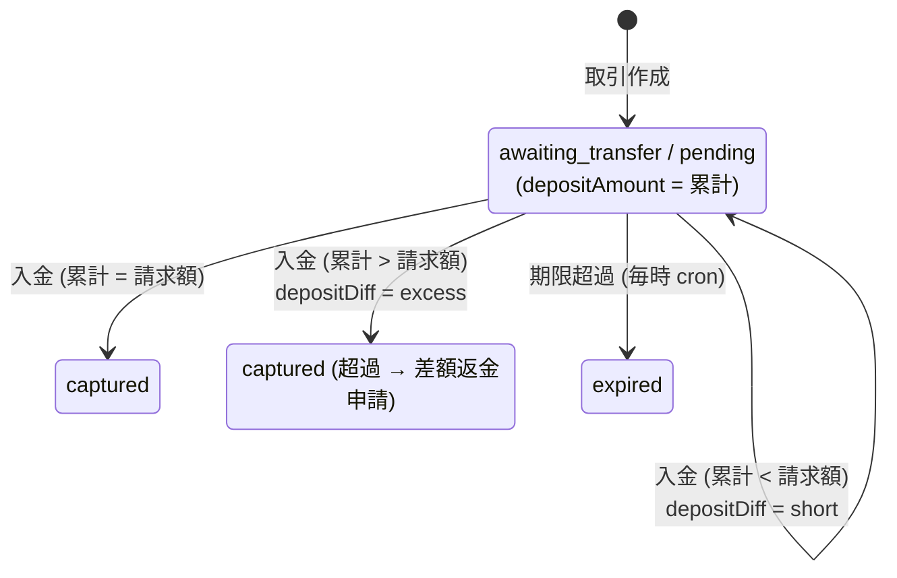

### 5.2 過不足入金の対応状況（`depositDiffStatus`）

| 値 | 表示 | 遷移 |
|---|---|---|
| `open` | 未対応 | 消込直後に自動設定 |
| `refund_arranged` | 差額返金手配中 | 超過 × 未対応 → PSP「差額を返金申請」（`createRefundRequest` 理由 `duplicate`、`reason = "excess deposit (<振込ID>)"`） |
| `notified` | 追加入金案内済 | 不足 × 未対応 → PSP「追加入金を案内済にする」（メール `deposit_short`: 振込ID・不足額・請求金額・期限） |
| `resolved` | 完了 | 任意の状態 → PSP「完了にする」 |

API: `GET /api/deposit-diffs`、`POST /api/deposit-diffs/{paymentId}/refund|notify|resolve`（権限 `deposit_diff.update` = admin / accounting / cs、監査 `payment.deposit_diff_update`）。

### 5.3 未消込入金（振込ID不明の入金）

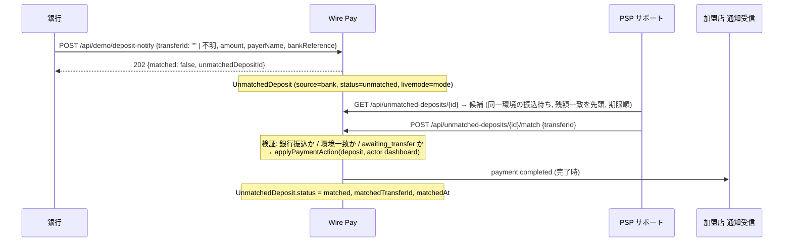

| 操作 | API | 権限 | エラー |
|---|---|---|---|
| 登録（手入力） | `POST /api/unmatched-deposits` `{ amount, payerName, receivedAt?, bankReference?, givenTransferId?, note? }` | `unmatched_deposit.register`（admin / accounting / cs） | `receivedAt` 不正 400 |
| 候補取得 | `GET /api/unmatched-deposits/{id}` → `{ deposit, candidates[] }`（最大 20 件、`exact`（残額一致）と `overdue` フラグ付き） | 閲覧 | |
| 消込 | `POST /api/unmatched-deposits/{id}/match` `{ transferId }` → `{ deposit, payment, renotified }` | `unmatched_deposit.match`（admin / accounting） | 振込ID不明 / 銀行振込でない 404 `transfer_not_found`、環境不一致 409 `mode_mismatch`、振込待ち以外 409 `invalid_transition`、処理済み 409 `deposit_not_open` |
| 却下 | `POST /api/unmatched-deposits/{id}/dismiss` `{ reason }` | `unmatched_deposit.dismiss` | 処理済み 409 `deposit_not_open` |
| API 再通知 | `POST /api/payments/{id}/renotify`（銀行振込の完了系のみ） | `payment.renotify`（admin / cs / developer） | 銀行振込でない 409 `not_bank_transfer`、未完了 409 `invalid_transition`、加盟店なし 409 `no_merchant` |

### 5.4 期限超過の扱い

| 項目 | 仕様 |
|---|---|
| 期限 | 銀行振込: 作成 + `Merchant.transferDueDays`（既定 7、1〜60）。コンビニ: 作成 + `Merchant.cvsDueDays`（既定 3、1〜30）。いずれも `Payment.transferDueAt` |
| 自動期限切れ | 毎時 0 分の cron `GET/POST /api/cron/expire-transfers`（`CRON_SECRET`）が `transferDueAt < now` かつ `awaiting_transfer`（または `pending` + 受付番号あり）の取引を最大 200 件 / 回、`expire`（actor `system`、監査 `cron`）で `expired` に。加盟店へ `payment.expired` |
| 手動期限切れ | PSP 管理画面「期限切れにする」。期限前は 409 `not_overdue` |
| 期限後の入金 | 取引が既に `expired` なら入金通知は 409 `invalid_transition`。振込IDが一致しても消込されません（**入金は未消込入金にも登録されません**）。運用上は PSP が組戻し（返金）を別途行う必要があります（**※要確認**: 期限切れ後入金の運用手順はシステム外） |
| 期限直前の入金 | cron は実時間で `transferDueAt` を再確認するため、期限を過ぎても cron が走るまでの最大 1 時間は消込可能。競合時は状態条件付き更新で片方が失敗 |
| 日次通知 | 毎時 50 分の通知 cron が「振込期限超過 N 件」「コンビニ支払期限超過 N 件」を日次 1 通、PSP の通知センターへ（`transfer.overdue` / `cvs.overdue`） |

### 5.5 本番接続に向けた要件

| 要件 | 内容 |
|---|---|
| R5-1 | 入金通知は 1 入金 1 通。同じ入金を再送しない（累計判定のため二重計上になる） |
| R5-2 | 入金通知には入金日時（`receivedAt`）と銀行側参照番号（`bankReference`）を含め、Wire Pay 側で未消込入金の突合と監査に使えるようにする |
| R5-3 | 期限切れ後の入金・不明入金の返金（組戻し）手段をプロバイダ側またはアダプタで用意する（Wire Pay には資金移動の機能が無い） |
| R5-4 | 部分入金（複数回の振込）を許容するかは加盟店との契約で決める。Wire Pay は累計判定で自動的に許容する |

### 5.6 未実装・今後の予定（第 5 章）

- 期限切れ後・キャンセル後の入金を保留する仕組みはありません（409 で拒否）。
- 入金通知の重複排除はありません（3.4 節）。

---

## 6. 与信・売上・取消・返金・チャージバック

本章は、各操作について **Wire Pay 側のステータス反映（実装）** と **プロバイダとの間で必要になる操作（本番接続に向けた要件）** を対で示します。状態遷移表は仕様書A 2.3 節と同一（`lib/payments/transitions.ts`）で、ここでは再掲しません。

### 6.1 操作と Wire Pay の反映

| 操作 | Wire Pay の契機（実装） | 反映（`applyPaymentAction`） | 加盟店 Webhook | プロバイダとの操作（要件） |
|---|---|---|---|---|
| 与信（authorize） | 取引作成 `autoCapture: false`（credit / qr）、決済リンクの作成、テストカード `4000000000003220` | `authorized`（履歴 `created` → authorized） | なし | R6-1: 与信 API を呼び、プロバイダ側取引IDを `externalId` に保存 |
| 売上確定（capture） | 取引作成 `autoCapture: true`、PSP「完了にする」、決済ページ「お支払いを確定する」、結果通知 `payment.captured` | `captured`、`capturedAt` | `payment.completed` | R6-2: 売上確定 API（与信済に対して）。即時売上の場合は与信 + 売上を 1 回で |
| 取消（void / cancel） | PSP「キャンセル」、結果通知 `payment.cancelled` | `cancelled`、`cancelledAt` | `payment.cancelled` | R6-3: 与信取消 API。銀行振込・コンビニは番号の無効化 |
| 失敗（fail） | PSP「失敗にする」、結果通知 `payment.failed`、作成時の拒否（限度額・ブラックリスト・テストカード） | `failed`、`failureReason` | `payment.failed`（作成時の拒否は `limit.exceeded` のみ） | R6-4: 与信否認・エラー応答の取り込み（`failureReason` に理由コード） |
| 期限切れ（expire） | 毎時 cron、PSP「期限切れにする」 | `expired` | `payment.expired` | R6-5: 番号の無効化通知（任意） |
| 入金消込（deposit） | 入金通知（銀行 / コンビニ）、PSP「入金消込」、未消込入金の消込 | 第 5 章 | `payment.completed`（完了時） | 第 3・5 章 |
| 返金（refund） | 返金申請の承認（PSP）、結果通知 `payment.refunded` | `partially_refunded` / `refunded`、`amountRefunded += 額`、`refundedAt`（全額時）、`Refund.status = completed` | `refund.completed` | R6-6: 返金 API（一部・全額）。**現状は承認と同時に即完了**（`approved` / `processing` を経由しない） |
| チャージバック | PSP がチャージバック登録 → 異議 → 敗訴 / 確定 | 敗訴・確定で `chargeback`（`captured` / `partially_refunded` / `refunded` から） | 登録時のみ `chargeback.opened` | R6-7: 支払異議の通知取り込み、証憑の提出 API（任意） |

### 6.2 返金の内部フロー

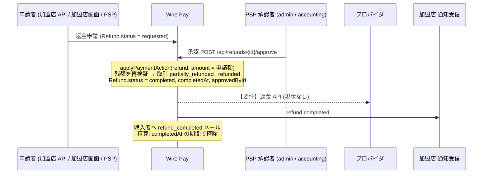

- 結果通知 `payment.refunded`（3.1 節）は申請を経由せず、`Refund` 行を `completed` で直接作成します（`reasonCode = other`、`requestedById` なし）。プロバイダ側で返金が実行された事後通知の取り込み口として使えます。
- 返金可能残額は「取引額 − 返金済額 − 審査待ちの申請額」。承認時にも残額を再検証します。

### 6.3 チャージバックの内部フロー

| ステップ | Wire Pay の操作（PSP、権限 `chargeback.create` / `chargeback.update` = admin / accounting） | 反映 |
|---|---|---|
| 登録 | `POST /api/chargebacks` `{ paymentId, amount?（既定 = 取引額）, reasonCode, disputeDeadline?（既定 14 日後）, evidenceNote? }` | `Chargeback(received)`、加盟店へ `chargeback.opened` |
| 異議申立て | `POST /api/chargebacks/{id}/dispute` `{ evidenceNote }`（必須） | `disputed` |
| 結果登録 | `POST /api/chargebacks/{id}/resolve` `{ outcome: won \| lost, note? }` | `won`（取引は変わらない）/ `lost`（取引 → `chargeback`、`resolvedAt`） |
| 確定 | `POST /api/chargebacks/{id}/confirm`（`received` / `disputed` / `lost` から） | `confirmed`、取引 → `chargeback`、`resolvedAt`（未設定なら現在時刻） |
| 精算控除 | `lost` / `confirmed` の `resolvedAt` が期間内のものを `chargeback` 行として控除 | 第 7 章 |
| 期限管理 | 毎時 50 分の通知 cron が期限 3 日前から日次で PSP に通知（`chargeback.deadline`） | |

プロバイダ（カード会社 / アクワイアラ）からの支払異議は **現状 PSP オペレータが手入力** で登録します。取引の `chargeback` ステータスは管理画面の直接操作では付けられず、チャージバックの敗訴・確定からのみ遷移します。

### 6.4 ステータスの整合性を保つ仕組み

| 仕組み | 内容 |
|---|---|
| 状態条件付き更新 | `updateMany({ where: { id, status: { in: from } } })` で、遷移元に含まれない場合は 0 件更新 → 409。並行する通知・操作が二重に適用されることはありません |
| 履歴 | すべての遷移を `PaymentEvent(type, fromStatus, toStatus, amount, actor)` に追記 |
| 監査 | `AuditLog` に `payment.<action>` を前後スナップショット付きで記録（actorType: `admin` / `webhook` / `bank` / `cvs` / `system` / `merchant`） |
| プロバイダ無効時 | 接続が `disabled` の取引に対する操作は 400 `provider_disabled`（帳簿は残るが遷移できない）。接続を `active` に戻せば再開 |
| 副作用の分離 | Webhook・メールは **コミット後** に送信し、失敗しても状態遷移は成功のまま |

### 6.5 本番接続に向けた要件（まとめ）

| 要件 | 内容 |
|---|---|
| R6-1〜R6-7 | 6.1 節の各行 |
| R6-8 | プロバイダ API の呼び出しは状態遷移の **前** に行い、成功したら `applyPaymentAction` を適用する（現状の `applyPaymentAction` は外部呼び出しを想定していないため、呼び出し層をアクションの手前に追加する設計となる。第 10 章） |
| R6-9 | プロバイダ側で非同期に確定する操作（3D セキュア後の売上、返金の後日確定）は結果通知（3.1 節）で取り込む |
| R6-10 | 返金の `approved` → `processing` → `completed` / `failed` を実際に使う場合、承認時に `applyPaymentAction(refund)` を即時に呼ばず、プロバイダ応答後に呼ぶよう `approveRefund` を分割する |

### 6.6 未実装・今後の予定（第 6 章）

- プロバイダへの与信・売上・取消・返金 API 呼び出し、応答の取り込み。
- チャージバックの自動登録（プロバイダ通知からの取り込み）と証憑提出 API。
- 返金ステータス `approved` / `processing` / `failed` の実運用。

---

## 7. 精算と資金の流れ

### 7.1 資金フローの位置づけ

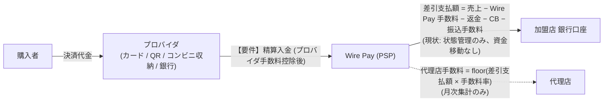

| 区間 | 対象コミットの実装 | 要件 |
|---|---|---|
| 購入者 → プロバイダ | 外部。Wire Pay は結果 / 入金通知で認識（第 3 章） | — |
| プロバイダ → Wire Pay | **なし**。プロバイダからの精算入金・プロバイダ手数料の取り込み（照合）はありません | R7-1: プロバイダの精算明細（対象取引・金額・手数料・入金日）を取り込み、Wire Pay の取引と照合する |
| Wire Pay → 加盟店 | 精算バッチの生成・確定・振込予定・振込済の **状態管理**。振込の実行はありません | R7-2: 振込 API（全銀 / 銀行 API）で `scheduled` のバッチを `paid` にする |
| Wire Pay → 代理店 | 月次集計と CSV のみ | — |

### 7.2 精算バッチの計算

計算式・締めサイクル・支払サイト・明細の集計ルール・ステータス遷移は **仕様書A 第 9 章** と同一です（同じ `lib/settlements/service.ts`）。プロバイダ接続の観点で重要な点のみ補足します。

| 観点 | 内容 |
|---|---|
| 手数料の位置づけ | 精算で控除する手数料は **Wire Pay（PSP）→ 加盟店** の契約料率（`MerchantFeeSchedule`、決済手段別 `ratePercent` + `fixedFee`）です。プロバイダが Wire Pay に課す手数料（インターチェンジ、加盟店手数料）は **モデル化されていません** |
| 完了日基準 | 売上行は `capturedAt`、返金行は `completedAt`、チャージバック行は `resolvedAt` が期間内のものを集計。プロバイダ側の入金日・締め日とは独立 |
| 環境 | `livemode` ごとに別バッチ。テスト環境のバッチは支払対象外（デモ用） |
| 適格請求書 | Wire Pay → 加盟店の **決済手数料** に対する請求書（内税、税率別、端数処理）。プロバイダとの間の請求書は対象外 |
| 明細の source | `SettlementLine.paymentId / refundId / chargebackId` は文字列参照（FK なし）。元データが削除されても帳簿は残る |

### 7.3 プロバイダ精算との照合（要件）

対象コミットにはプロバイダの精算明細を扱うテーブル・画面がありません。本番接続では次の要件を満たすアダプタ・テーブルの追加が必要です。

| 要件 | 内容 |
|---|---|
| R7-3 | プロバイダ精算明細の取り込み（取引ID / `externalId` 単位の金額・手数料・入金予定日） |
| R7-4 | Wire Pay の完了取引（`captured` 以降）との照合と差異レポート |
| R7-5 | プロバイダからの入金確認をトリガーに加盟店バッチを `scheduled` → `paid` にするか、独立に運用するかの方針決定（**※要確認**: 業務要件） |

### 7.4 未実装・今後の予定（第 7 章）

- プロバイダ手数料・プロバイダ精算明細のモデル、資金移動（振込）の API 接続、締めサイクルごとの自動生成（仕様書A 9.10 節）。

---

## 8. 障害時の運用

### 8.1 決済手段の一時停止

プロバイダ側の障害（カードネットワーク障害、収納代行の停止など）に対して、PSP は **決済手段の新規受付だけ** を止められます。進行中の取引の完了・返金・入金消込は影響を受けません。

| 項目 | 仕様（`lib/payments/method-controls.ts`、`PaymentMethodControl`） |
|---|---|
| 範囲 | 全体停止（`scope = global`、admin）/ 加盟店別停止（`scope = merchant`、admin / cs） |
| 対象 | `credit` / `qr` / `convenience` / `bank`（「その他」は対象外） |
| 必須 | 停止理由（`reason`） |
| 自動再開 | `resumeAt`（未来日時）を指定すると毎時 45 分の cron `GET/POST /api/cron/payment-method-controls` が再開（監査 `payment_method.resume`、通知 `payment_method.resumed`） |
| 効果 | 取引作成の共通処理で 409 `method_suspended`（API・PSP 管理画面・決済リンク・定期課金すべて）。決済ページと作成フォームの選択肢から消える |
| 可視化 | PSP 管理画面: 全体停止中は全画面に赤バナー。加盟店管理画面: 「決済手段の状態」に理由・再開予定 |
| 通知 | 停止時に通知センターへ（全体 = critical、加盟店別 = warning）。全体停止時に障害お知らせ（`incident`）の下書き作成を提案 |
| API | `GET /api/payment-method-controls[?merchantId=]`、`PUT /api/payment-method-controls` `{ scope, merchantId?, method, suspended, reason, resumeAt? }` |
| 監査 | `payment_method.suspend` / `payment_method.resume` |

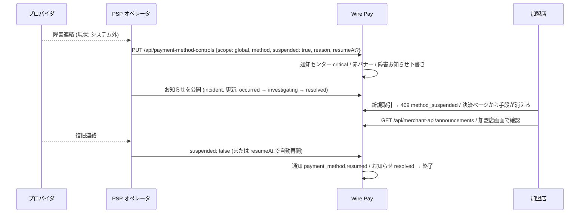

### 8.2 通知の再送

| 対象 | 仕組み |
|---|---|
| Wire Pay → 加盟店 Webhook | 1 分 → 5 分 → 30 分 → 2 時間 → 24 時間の自動再送（毎時 30 分の cron `/api/cron/webhook-retry`）、5 回で断念 → 通知センター critical（`webhook.abandoned`）。手動再送は PSP（権限 `webhook.resend` = admin / developer）と加盟店自身。詳細は仕様書A 6.6 節 |
| プロバイダ → Wire Pay 結果通知 | Wire Pay 側に再送要求の機能はありません。プロバイダの再送に依存（3.1 節。重複はイベントIDで排除） |
| プロバイダ → Wire Pay 入金通知 | 同上。取りこぼした入金は PSP が「未消込入金 → 登録」で手入力し消込できます（5.3 節） |
| 銀行振込の加盟店再通知 | `POST /api/payments/{id}/renotify`（`payment.completed` の再送、銀行振込の完了系のみ） |

### 8.3 通知センターへの連携

PSP 向け通知（`lib/notifications/*`）のうち、プロバイダ接続の運用に関わる種別です。重要度は既定値で、メール / Slack への配信は管理者ごとの設定に従います。

| 種別 | 重要度 | 契機 | 対象ロール |
|---|---|---|---|
| `payment_method.suspended` | critical（全体）/ warning（加盟店別） | 決済手段の停止 | 全員 / admin, cs |
| `payment_method.resumed` | info | 自動再開 | 全員 |
| `webhook.abandoned` | critical | 加盟店 Webhook が 5 回失敗 | admin, developer |
| `batch.failed` | critical | cron ジョブの例外（`runCron` が包む: 期限切れ・Webhook 再送・定期課金・決済手段再開・通知・匿名化） | admin, developer |
| `transfer.overdue` / `cvs.overdue` | warning | 期限超過の振込 / コンビニ支払（日次 1 通） | admin, accounting, cs |
| `limit.exceeded` | warning | 加盟店の限度額超過 | admin, accounting, cs |
| `blacklist.candidate` | warning | 連続失敗検知 | admin, cs |
| `chargeback.deadline` | critical | 異議申立期限 3 日前 | admin, accounting |
| `subscription.payment_failed` | warning / critical | 定期課金の失敗 / 停止 | admin, accounting, cs |
| `settlement.generated` / `settlement.held` | info / warning | 精算バッチの生成 / 保留 | admin, accounting |
| `refund.requested` | info | 返金申請 | admin, accounting |

同一種別・同一対象は 24 時間に 1 通に抑制されます。配信は `GlobalSetting.slackWebhookUrl`（Slack Incoming Webhook、8 秒タイムアウト・1 回リトライ・`SlackLog`）と、テンプレート `notification` によるメールです。

### 8.4 cron ジョブと障害

| cron（`vercel.json`、UTC） | 処理 | 停止時の影響 |
|---|---|---|
| `/api/cron/expire-transfers` 毎時 0 分 | 期限超過の振込 / コンビニを期限切れに | 期限切れが遅れる（消込は可能なまま） |
| `/api/cron/webhook-retry` 毎時 30 分 | 再送時刻が来た加盟店 Webhook を送信 | 再送が遅れる |
| `/api/cron/subscriptions` 毎時 15 分 | 定期課金の課金 | 課金が遅れる |
| `/api/cron/payment-method-controls` 毎時 45 分 | 再開予定日時を過ぎた停止を解除 | 自動再開が遅れる |
| `/api/cron/notifications` 毎時 50 分 | 日次まとめ通知と未配信通知のメール / Slack 配信 | 通知が遅れる |
| `/api/cron/anonymize` 19:00 | 個人情報の保持期間処理 | 匿名化が遅れる |
| `/api/demo/reset` 18:00 | デモデータのリセット（公開デモ専用。実データ環境では登録しない） | — |

すべて `Authorization: Bearer <CRON_SECRET>` が必要で、未設定時は 404 です。例外は `batch.failed` 通知になり、ルートは 500 を返します（Vercel 側に失敗として記録）。

### 8.5 復旧手順（PSP 運用）

1. プロバイダ障害の認知 → 該当決済手段を **全体停止**（理由・再開予定を入力）→ 障害お知らせを公開（`occurred`）。
2. 障害中に届いた結果 / 入金通知の失敗（400 / 409 / 5xx）は `WebhookEvent.error` と操作ログで確認。プロバイダに再送を依頼。
3. 復旧 → 停止を解除（または自動再開）→ お知らせに `investigating` / `resolved` を追記 → 終了。
4. 断念した加盟店 Webhook を Webhook 送信ログから再送。振込の取りこぼしは未消込入金から消込。
5. 期限切れ cron が停止していた場合は復旧後の最初の実行で最大 200 件 / 回ずつ処理（超過分は次回以降）。

### 8.6 本番接続に向けた要件

| 要件 | 内容 |
|---|---|
| R8-1 | プロバイダの障害・復旧をシステム的に受け取る手段（ステータス API / 通知）。現状は PSP の手動停止 |
| R8-2 | プロバイダ側の再送ポリシーと Wire Pay の重複排除（イベントID）の整合（3.5 節） |
| R8-3 | 障害中に Wire Pay 側で `authorized` のまま残った取引の扱い（自動取消 / 期限）の方針（**※要確認**: `authorized` に期限はありません） |

### 8.7 未実装・今後の予定（第 8 章）

- プロバイダ障害の自動検知・自動停止、`authorized` 取引の自動取消、cron 失敗時の自動リトライ。

---

## 9. セキュリティ要件

### 9.1 署名

| 方向 | 方式 | 実装 |
|---|---|---|
| プロバイダ → Wire Pay（結果通知） | `Wirepay-Signature: t=<UNIX 秒>,v1=<hex HMAC-SHA256(secret, "<t>.<生ボディ>")>`。許容ずれ ±300 秒。定数時間比較。秘密は接続設定の `webhook_secret`（AES-GCM で暗号化保存、使用時に復号） | `lib/webhooks/verify.ts`、`app/api/webhooks/[providerId]/route.ts` |
| プロバイダ → Wire Pay（入金通知） | Bearer トークン `DEPOSIT_NOTIFY_SECRET`（環境変数、定数時間比較）。署名なし | `app/api/demo/deposit-notify/route.ts`、`cvs-notify/route.ts` |
| Wire Pay → 加盟店（Webhook） | `X-Signature: v1=<hex HMAC-SHA256(secret, "<X-Timestamp>.<payload>")>` + `X-Timestamp`、互換 `Wirepay-Signature: t=..,v1=..`。秘密は加盟店の署名シークレット（環境別、無ければ加盟店パスワード） | 仕様書A 6.4 節 |
| cron / デモリセット | Bearer `CRON_SECRET`（定数時間比較） | `app/api/cron/*` |

本番接続に向けた要件: R9-1 入金通知にも **署名またはプロバイダ別トークン** を導入する（現状は 1 つの共有 Bearer）。R9-2 秘密のローテーション手順（`webhook_secret` の更新は PSP 管理画面の接続編集で可能。旧秘密との併用期間はありません）。

### 9.2 IP 制限

| 対象 | 実装 |
|---|---|
| プロバイダ → Wire Pay の通知 | **IP 制限なし**（`/api/webhooks/*`、`/api/demo/*` は `ipRestricted: false`、middleware も通過）。署名 / トークンのみで認証 |
| PSP 管理画面 | `IpRestriction(target = admin, mode = deny)` に一致する接続元は画面・API とも遮断（403 `ip_blocked`）。自己ロックアウト防止（400 `ip_self_block`）。IPv4 のみ |
| 加盟店 API | `IpRestriction(target = merchant_api, merchantId)` の deny ルール（仕様書A 10.1 節） |

本番接続に向けた要件: R9-3 プロバイダの送信元 IP レンジが固定の場合、受信ルート単位の許可リストをアダプタ層または WAF で実装する（Wire Pay 本体には受信側の IP 許可リストが無い）。

### 9.3 鍵の管理

| 鍵 | 用途 | 仕様（`lib/crypto.ts` ほか） |
|---|---|---|
| `ENCRYPTION_KEY` | プロバイダ認証情報の秘匿フィールド、加盟店パスワード、署名シークレットの暗号文、管理者 TOTP シークレットの **AES-256-GCM** 暗号化 | base64 32 バイト（43 文字 + `=`）。12 バイト IV（毎回乱数）、16 バイト認証タグ。暗号文は `iv:tag:data`（各 base64）。**fail-closed**: 本番で未設定・不正なら起動 / 利用時に例外（API は 500 `encryption_key`）。開発時のみ固定の開発鍵で警告付き動作 |
| `SESSION_SECRET` | 管理者セッション Cookie、加盟店セッション Cookie（鍵派生を分離: `wirepay-merchant-session:` 接頭辞）、領収書ダウンロード URL（`wirepay-receipt:` 接頭辞）の HMAC | 未設定時は `ENCRYPTION_KEY` を流用 |
| `CRON_SECRET` | cron / デモリセットの Bearer | 未設定時は cron 系が 404（期限切れ・再送・課金・通知・匿名化が止まる） |
| `DEPOSIT_NOTIFY_SECRET` | 入金通知の Bearer | 未設定時は本番 404、開発は認証なし |
| プロバイダの `webhook_secret` ほか秘匿フィールド | 結果通知の署名検証など | 接続ごとに `PaymentProvider.credentials`（JSON）に暗号文で保存。画面は `••••••••` + 末尾 4 文字のマスク。編集時に空欄 = 変更なし |
| 加盟店の API キー | 加盟店 API 認証 | SHA-256 ハッシュのみ保存。平文は発行 / ローテーション時に 1 回表示 |
| 加盟店の署名シークレット | 加盟店 Webhook 署名 | ハッシュに加えて AES-GCM 暗号文（`ApiKey.secretEnc`）を保持（送信時に復号） |

鍵の変更: `ENCRYPTION_KEY` を変えると既存の暗号文は復号できず、API は 422 `undecryptable`、画面は「復号不能」表示になります（デモ DB は seed で作り直す運用）。鍵ローテーション（暗号文への鍵バージョン付与）は未実装です。

### 9.4 個人情報の非保持

| 項目 | 仕様 |
|---|---|
| カード番号（PAN）・セキュリティコード | **保存しません**。公開 API の `card.number` は Luhn 検証・ブランド判定・下 4 桁・識別ハッシュ（`sha256(brand\|last4\|expiry)`）の算出にのみ使い、`cvc` は検証にも使いません。PSP 管理画面の取引作成フォームもブランド・下 4 桁・有効期限のみ |
| 保存カード（`PaymentToken`） | ブランド・下 4 桁・有効期限・識別ハッシュ。プロバイダのトークンを保持する列はありません |
| 購入者の個人情報 | 氏名・メール・電話・接続元 IP を平文列で保存し、PSP 画面でマスク表示、操作ログは保存時にマスク、保持期間（既定 24 か月）で匿名化（仕様書A 10.5 節） |
| プロバイダへ渡す情報（要件） | R9-4: PAN を扱う本番接続では、プロバイダのトークン化 / ホスト型フィールド / 3D セキュアのリダイレクトを前提とし、Wire Pay のサーバーが PAN を受け取らない設計にする（PCI DSS 範囲を Wire Pay に広げない） |

### 9.5 通信・認可・監査

| 項目 | 仕様 |
|---|---|
| 受信エンドポイントの認可 | 結果通知は接続ごとの `providerId` + 署名。入金通知は共有トークン。管理画面向けの CSRF・セッション検査は対象外 |
| 管理操作の認可 | `lib/role.ts` の権限マトリクス。プロバイダ接続の作成 / 更新 / 削除 / 接続テストは `admin` / `developer`、決済手段の全体停止は `admin`、入金消込は `admin` / `accounting`、未消込入金の消込は `admin` / `accounting` |
| 監査ログ | すべての変更を `AuditLog` に記録（actorType `admin` / `merchant` / `system` / `webhook` / `bank` / `cvs` / `cron` / `seed`、前後スナップショットは秘匿キーを `[redacted]`、個人情報キーをマスク） |
| レート制限 | プロバイダからの受信にはありません。PSP 管理画面の更新系 API は IP ごとに 60 回 / 分 |
| セキュリティヘッダー | Next.js の `next.config.js` で設定（**※要確認**: 具体的なヘッダー値は本書の対象外） |

### 9.6 未実装・今後の予定（第 9 章）

- 入金通知の署名・プロバイダ別トークン、受信側 IP 許可リスト、鍵ローテーション（KMS）、プロバイダトークンの保持列。

---

## 10. 新規プロバイダを追加する手順

本章は Wire Pay 側でプロバイダ接続を追加・実装する開発者向けです。対象コミットの構造に沿って、(A) **接続設定の追加だけで済む範囲**（現状の仕組み）と、(B) **実通信を伴う本番接続の実装手順**（要件を満たすための設計）を分けて示します。リポジトリの作業ルール（`CLAUDE.md`）を前提とします。

### 10.1 (A) 接続設定の追加（現状の仕組みで可能な範囲）

1. **プロバイダ定義を追加** — `lib/providers/registry.ts` の `PROVIDERS` に `ProviderDefinition` を追加する。
   - `key`（一意、英小文字 + `_`）、`name` / `description`（`{ ja, en }` 両言語必須）、`category`（`credit` / `qr` / `convenience` / `bank` / `other`）、`logoColor`、`docsUrl`（任意）、`supportsTestMode`。
   - `fields`: 入力項目。`type`（`text` / `password` / `secret` / `url` / `email` / `select` / `textarea`）、`required`、`secret: true`（暗号化保存・マスク表示）、`placeholder`（技術文字列のみ）、`helpText`（`{ ja, en }`）、`select` の `options`。
   - 結果通知の署名に使う秘密は **`webhook_secret` というキー名** にする（`app/api/webhooks/[providerId]/route.ts` はこのキーを参照）。
2. **辞書** — 画面文言はすべて `LocalizedText` で定義に含める。追加の UI 文字列があれば `lib/i18n/messages/ja.ts` / `en.ts` の両方へ（片方だけだと型エラー）。
3. **接続テスト** — `runConnectionTest` は必須項目と URL 形式のみ検証する。プロバイダ固有の検証が必要なら `lib/providers/connection.ts` に分岐を追加（外部通信を入れる場合は 10.2 節）。
4. **seed（任意）** — デモに接続サンプルを載せる場合は `prisma/seed-data.ts` に固定 ID で `upsert({ update: {} })` を追加。
5. **検証** — `npm run verify`（lint → typecheck → check:i18n → check:permissions → test → build）。`lib/providers/*.test.ts` に定義の整合テストがあれば追加。
6. **運用** — PSP 管理画面「決済プロバイダ → 追加」でカテゴリから選べるようになる。テスト用と本番用は別の接続として登録する。

この範囲では、追加したプロバイダは **取引作成時のプロバイダ選択・環境の分離・結果通知の受信（`webhook_secret` があれば）** に組み込まれますが、外部通信は行われません。

### 10.2 (B) 実通信を伴う本番接続の実装手順（設計指針）

対象コミットにはアダプタ層が無いため、以下は **追加設計の指針** です（実装済みではありません）。

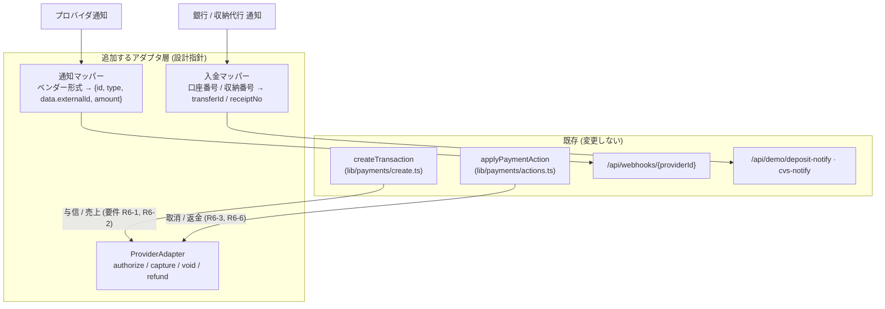

| 手順 | 内容 | 関係する既存モジュール |
|---|---|---|
| B-1 アダプタのインターフェース定義 | `authorize(input) → { externalId }`、`capture(externalId, amount)`、`void(externalId)`、`refund(externalId, amount) → { refundId }` を持つ `ProviderAdapter` を `lib/providers/adapters/<key>.ts` に実装。認証情報は `readCredentialsForUse(providerKey, credentials)` で復号して渡す（`lib/crypto` を直接 import しない） | `lib/providers/credentials.ts` |
| B-2 取引作成への組み込み | `createTransaction` の取引行作成の **前** に与信 / 売上を呼び、成功時の `externalId` を保存、失敗時は `failed` + `failureReason`（テストカードの `forcedFailure` と同じ経路）。`Payment.externalId` は `(providerId, externalId)` 一意 | `lib/payments/create.ts`（`generateDemoExternalId` の置き換え） |
| B-3 アクションへの組み込み | `applyPaymentAction` を呼ぶ手前（PSP の capture / cancel、返金承認 `approveRefund`）でアダプタを呼ぶ。返金は `approved` → プロバイダ応答 → `completed` / `failed` に分割（R6-10） | `lib/payments/actions.ts`、`lib/refunds/service.ts`、`app/api/payments/[id]/[action]/route.ts` |
| B-4 結果通知マッパー | ベンダー固有の Webhook を受けるルート（例 `/api/webhooks/stripe/{providerId}`）で署名検証（ベンダー方式）→ `{ id, type, data: { externalId, amount } }` に変換 → 既存の処理（重複排除・`EVENT_TO_ACTION`）を再利用。`WEBHOOK_EVENT_TYPES` に足りない種別（与信のみ、部分売上、チャージバック）は `lib/webhooks/events.ts` と `EVENT_TO_ACTION` を拡張 | `lib/webhooks/verify.ts`、`lib/webhooks/events.ts` |
| B-5 入金通知マッパー | 銀行 / 収納代行の通知を `{ transferId, amount, payerName, bankReference, receivedAt, mode }` / `{ receiptNo, amount }` に変換し、`applyPaymentAction(deposit)` または `registerUnmatchedDeposit` を呼ぶ。イベントIDによる重複排除を **追加**（現状なし） | `lib/payments/actions.ts`、`lib/deposits/service.ts` |
| B-6 認証情報の項目 | 必要なフィールドを `registry.ts` に追加（秘匿は `secret: true`）。既存の接続は `PATCH /api/providers/{id}` で追記可能 | `lib/providers/registry.ts` |
| B-7 テスト | Route Handler 統合テスト（`tests/integration/*.test.ts`、SQLite `prisma/test.db`）で `fetch` をスタブし、アダプタ → 状態遷移 → 加盟店 Webhook（`WEBHOOK_DELIVERY=queue` でキュー確認）を検証。Playwright スモーク（`tests/smoke-ops.mjs`）に画面確認を追加 | `tests/` |
| B-8 監査・通知 | アダプタ呼び出しの失敗は `recordAudit` と通知センター（`emitNotification`、種別追加時は `NOTIFICATION_KINDS` と辞書 `notificationEnums.*`）に記録 | `lib/audit.ts`、`lib/notifications/*` |
| B-9 ドキュメント | 管理画面マニュアル `content/manual/{ja,en}/*.md`、`CLAUDE.md`、本仕様書の該当章を更新 | — |

### 10.3 追加時のチェックリスト

- [ ] `PROVIDERS` に定義を追加し、`{ ja, en }` の文言が揃っている（`npm run check:i18n` 通過）
- [ ] 秘匿フィールドに `secret: true` を付け、画面でマスク表示される
- [ ] 結果通知の秘密キー名が `webhook_secret`（既存ルートを使う場合）
- [ ] テスト用・本番用の接続を別々に登録し、`testMode` が正しい
- [ ] 取引作成で `category` に対応するプロバイダが選ばれる（公開 API は作成日時の古い順に 1 件）
- [ ] 結果通知の署名検証・重複排除・状態遷移がテストで確認できる（`simulate-webhook` で手動確認可）
- [ ] 入金通知（銀行 / コンビニ）が振込ID / 受付番号に変換され、消込・過不足・未消込の各ケースが確認できる
- [ ] 決済手段の停止（全体 / 加盟店別）で新規受付が 409 になる
- [ ] 取引を持つ接続を削除しようとすると 409 `provider_has_payments` になり、無効化で運用できる
- [ ] `npm run verify` と Playwright スモークが通過し、マニュアル・CLAUDE.md を更新した

### 10.4 未実装・今後の予定（第 10 章）

- 10.2 節のアダプタ層・マッパー・返金の分割はすべて未実装です。

---

## 11. 未実装・今後の予定

対象コミットの Wire Pay は **デモモード** で、決済処理の「実送信」はありません。プロバイダ接続に関して実装されていないもの・モックのままのものを正直に列挙します。

### 11.1 実送信が未実装のもの

| 項目 | 現状 |
|---|---|
| 与信・売上・取消・返金のプロバイダ API 呼び出し | なし。すべて DB 上の状態遷移として即時に処理 |
| プロバイダ側取引IDの取り込み | なし。`Payment.externalId` は Wire Pay が疑似生成 |
| バーチャル口座 / 収納番号の払い出し、コンビニ受付番号の収納代行への登録 | なし。振込ID・受付番号は Wire Pay の乱数 |
| 期限切れ・取消時のプロバイダへの無効化連絡 | なし |
| プロバイダ精算明細の取り込み・照合、資金移動（加盟店への振込、代理店への支払） | なし。精算は状態管理のみ |
| チャージバック通知の自動取り込み・証憑提出 | なし。PSP が手入力 |
| 実メール配信 | `EMAIL_PROVIDER=log`（記録のみ）/ `console` |
| 接続テストの外部通信 | なし。必須項目と URL 形式の検証のみ |

### 11.2 モックのままのもの

| 項目 | 現状 |
|---|---|
| 結果通知の形式 | Wire Pay 独自形式（`{ id, type, data: { externalId, amount } }`、Stripe 互換署名）。ベンダー形式のマッパーなし |
| 入金通知 | `/api/demo/deposit-notify`、`/api/demo/cvs-notify`（共有 Bearer、重複排除なし、環境は照合に不使用） |
| 加盟店 Webhook のデモ受信 | `/api/demo/webhook-receiver?result=ok\|error\|timeout` |
| PSP 管理画面の「完了にする / 失敗にする」 | 本番ではプロバイダ通知が行う遷移を手動で行うデモ用操作 |
| 決済ページの「お支払いを確定する（デモ）」「店頭で支払い済みにする（デモ）」 | 実カード入力・実店頭支払いの代替 |
| 定期課金の課金結果 | `RiskSetting.demoChargeFailPercent`（既定 20%）で失敗を混ぜる乱数 |
| テストカード番号 | テスト環境でのシナリオ選択。本番環境ではネットワーク不在のため通常フロー（即時完了） |
| 接続設定の多くのフィールド | 保存・表示のみ（`expiry_days`、`stores`、`webhook_url`、`callback_url`、`notify_url`、`statement_descriptor`、`api_endpoint`、`api_key` など） |

### 11.3 データモデル上の不足

| 項目 | 現状 |
|---|---|
| プロバイダ手数料、プロバイダ精算明細、プロバイダのトークン（保存カード）、チャージバックの外部ケース ID、バーチャル口座番号 | 列・テーブルなし |
| 入金通知のイベントID | 列なし（`WebhookEvent` は結果通知専用） |
| `authorized` の有効期限 | なし（与信済は期限切れにならない） |
| Postgres の migration 履歴 | Vercel は `prisma db push`（SQLite 用 schema を provider 書き換え）。Docker 経路は `migrate deploy` |

### 11.4 運用上の制約

| 項目 | 現状 |
|---|---|
| レート制限 | プロバイダ受信にはなし。管理画面の IP 単位はインスタンス内メモリ（複数インスタンスでは best-effort） |
| 鍵ローテーション | `ENCRYPTION_KEY` の変更で既存暗号文が復号不能（KMS・鍵バージョン未対応） |
| IPv6 | IP 制限の判定対象外 |
| デモ上限 | プロバイダ 50 件、取引 1,000 件 など `DEMO_LIMITS` |

---

## 付録 A: データモデル（ER 図）

決済・プロバイダ接続・精算に関わる主要モデル（`prisma/schema.prisma`）。列挙値は文字列列で、アプリケーション側で検証します。

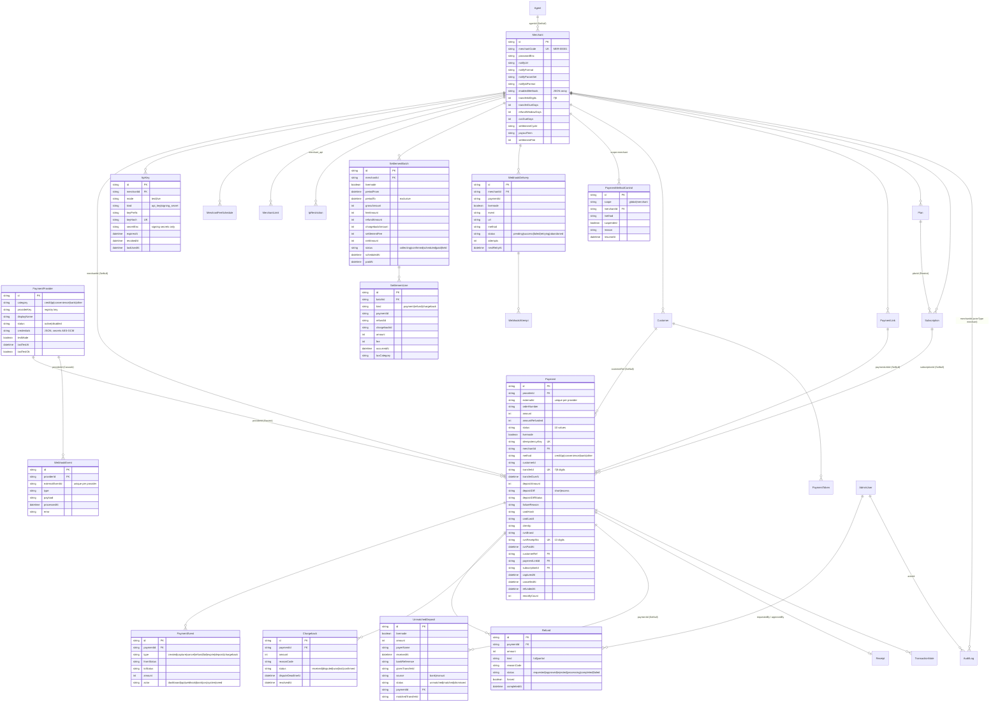

その他のモデル（`AdminUser`、`AuditLog`、`IpRestriction`、`Blacklist`、`RiskSetting`、`Notification*`、`SlackLog`、`EmailTemplate`、`EmailLog`、`Announcement*`、`GlobalSetting`、`ApiRateLimit`、`Receipt`、`Customer`、`PaymentToken`、`AnonymizeBatch`、`Plan`、`Subscription`、`PaymentLink`、`TransactionNote`、`Agent`）は `prisma/schema.prisma` を参照してください。

## 付録 B: 設定項目一覧

### B.1 環境変数（`DEPLOY.md`）

| 変数 | 必須 | 用途（プロバイダ接続に関わるもの） |
|---|---|---|
| `DATABASE_URL` | ✅ | SQLite（`file:`）または Postgres |
| `ENCRYPTION_KEY` | ✅ | AES-256-GCM 鍵（base64 32 バイト）。プロバイダ認証情報・加盟店パスワード・署名シークレット・TOTP の暗号化。本番は fail-closed |
| `SESSION_SECRET` | 任意 | セッション・領収書 URL の HMAC 鍵（未設定は `ENCRYPTION_KEY`） |
| `CRON_SECRET` | 本番 ✅ | `/api/cron/*`・`/api/demo/reset` の Bearer。未設定で cron 系は 404 |
| `DEPOSIT_NOTIFY_SECRET` | 任意 | `/api/demo/deposit-notify`・`/api/demo/cvs-notify` の Bearer。未設定は本番 404 / 開発は認証なし |
| `APP_URL` | 本番推奨 | 相対 `notifyUrl` の解決、決済リンク URL、OpenAPI の `servers`（未設定は `VERCEL_PROJECT_PRODUCTION_URL` → `VERCEL_URL` → `http://localhost:3000`） |
| `WEBHOOK_DELIVERY` | 任意 | `queue` で加盟店 Webhook を即時送信せずキューに積む（cron が送信） |
| `EMAIL_PROVIDER` / `EMAIL_DEFAULT_LANG` | 任意 | メールの送信先プロバイダ（`log` / `console`）と購入者メールの言語 |
| `DEMO_READONLY` | 任意 | `1` で DELETE とプロバイダ PATCH を 403 |
| `DEMO_LOGIN_HINT` / `DEMO_GENERAL_PASSWORD` | 任意 | デモアカウント表示 |

### B.2 プロバイダ接続（`PaymentProvider`）

| 項目 | 値 |
|---|---|
| `providerKey` | 2.1 節の 15 種 |
| `category` | 定義から自動設定 |
| `displayName` | 1〜80 文字 |
| `status` | `active` / `disabled` |
| `testMode` | true / false |
| `credentials` | 定義のフィールドごと（秘匿は暗号文） |

### B.3 全体設定（`GlobalSetting`、PSP 管理画面「全体設定」、admin）

| 項目 | 既定 | 用途 |
|---|---|---|
| `viewerCsvExport` | false | viewer ロールの CSV 可否 |
| `slackWebhookUrl` | — | 通知センターの Slack 配信先 |
| `issuerName` / `issuerRegistrationNo`（`T` + 13 桁）/ `issuerAddress` / `issuerTel` | — | 適格請求書の発行者 |
| `taxRounding` | `floor` | 消費税の端数処理（`floor` / `round` / `ceil`） |
| `piiRetentionMonths` | 24 | 個人情報の保持期間 |
| `auditRetentionYears` | 7 | 操作ログの保持期間 |
| `csvPii` | `masked` | CSV の個人情報（`masked` / `full`） |

### B.4 リスク設定（`RiskSetting`、id `global`）

| 項目 | 既定 | 用途 |
|---|---|---|
| `windowMinutes` | 10 | 連続失敗検知の時間窓（1〜1440） |
| `maxFailures` | 3 | 候補登録の失敗回数（2〜100） |
| `demoChargeFailPercent` | 20 | 定期課金のデモ失敗率（0〜100） |

### B.5 加盟店ごとの設定（`Merchant`、プロバイダ接続に関わるもの）

| 項目 | 既定 / 制約 | 用途 |
|---|---|---|
| `enabledMethods` | `[]` | 利用可能な決済手段 |
| `transferIdDigits` | 7（7 / 8） | 振込IDの桁数 |
| `transferDueDays` | 7（1〜60） | 振込期限 |
| `cvsDueDays` | 3（1〜30） | コンビニ支払期限 |
| `refundWindowDays` | 180（0〜365） | 返金可能期限 |
| `notifyUrl` / `notifyFormat` / `notifyParamSet` / `notifyIdFormat` | https / `json_post` / `standard` / `payment_id` | 加盟店 Webhook |
| `settlementCycle` / `payoutTerm` / 口座 / `settlementFee` / `invoiceNumber` / `address` | `monthly` / `next_month_end` / — / 0 / — / — | 精算 |
| `MerchantFeeSchedule`（`plan`, `rates`, `effectiveFrom`） | — | 手数料（履歴） |
| `MerchantLimit`（`perTransaction`, `daily`, `monthly`） | null = 無制限 | 限度額 |
| `IpRestriction(target = merchant_api)` | — | 加盟店 API の IP 制限 |
| `PaymentMethodControl(scope = merchant)` | — | 加盟店別の決済手段停止 |

### B.6 cron（`vercel.json`）

第 8.4 節の表を参照。
